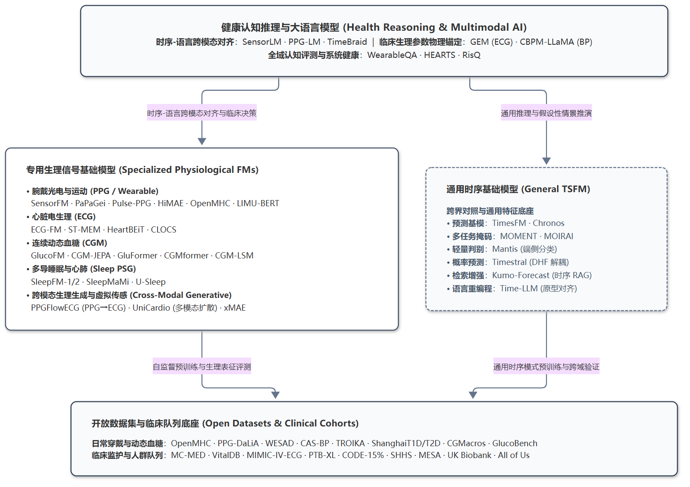

# Wearable & Physiological Foundation Models | 可穿戴与生理信号基础模型研读与选型指南

> 面向 **智能手表、连续血糖监测（CGM）、心电（ECG）及多导睡眠（PSG）** 等可穿戴与临床生理信号基础模型的论文精读、方法对比、开源权重与数据集索引；同时收录通用时间序列基础模型（General TSFM）与系统级多模态健康模型作为对照与延伸。

---

## 目录

- [如何使用本仓库](#如何使用本仓库)
- [为什么需要生理信号专用基础模型](#为什么需要生理信号专用基础模型)
- [领域专题文档与技术长文](#领域专题文档与技术长文)
- [最近更新](#最近更新)
- [基础模型与评测基准索引表](#基础模型与评测基准索引表)
- [开放数据集与临床队列索引](#开放数据集与临床队列索引)
- [领域综述参考](#领域综述参考)
- [关联实验工程与参与贡献](#关联实验工程与参与贡献)

---

## 如何使用本仓库

按使用目的可从以下四条路径切入：

1. **快速建立领域脉络**：先阅读下方“为什么需要生理信号专用基础模型”，再按传感器模态选读代表性工作：
   - 腕戴 PPG 与多传感器表征：[PaPaGei](docs/models/smartwatch_models.md#papagei)、[Pulse-PPG](docs/models/smartwatch_models.md#pulse-ppg)、[AnyPPG](docs/models/smartwatch_models.md#anyppg)、[HiMAE](docs/models/smartwatch_models.md#himae)、[OpenMHC](docs/models/smartwatch_models.md#openmhc)
   - 传感器-语言对齐与跨模态生成：[SensorLM](docs/models/smartwatch_models.md#sensorlm)、[PPG-LM](docs/models/smartwatch_models.md#ppg-lm)、[PPGFlowECG](docs/models/smartwatch_models.md#ppgflowecg)、[UniCardio](docs/models/smartwatch_models.md#unicardio)
   - 12 导联心电与物理锚定推理：[ECG-FM](docs/models/ecg_models.md#ecg-fm)、[ST-MEM](docs/models/ecg_models.md#st-mem)、[GEM](docs/models/health_reasoning_llms.md#gem)
   - CGM 连续血糖与多导睡眠：[GlucoFM](docs/models/cgm_models.md#glucofm)、[GluFormer](docs/models/cgm_models.md#gluformer)、[CGMformer](docs/models/cgm_models.md#cgmformer)、[SleepFM](docs/models/sleep_models.md#sleepfm)
2. **开源模型与预训练权重选型**：直接查阅 [基础模型与评测基准索引表](#基础模型与评测基准索引表)，按模态、参数量与开源资源筛选可直接加载的权重，点击模型名称跳转至对应精读小节与架构图。
3. **按模块深入研读**：在 [领域专题文档与技术长文](#领域专题文档与技术长文) 中按研究方向查阅横向对比，或阅读串联多篇工作的专题长文。
4. **查找训练数据与评测基准**：查阅 [开放数据集与临床队列索引](#开放数据集与临床队列索引) 以及 [数据集文档](docs/datasets/wearable_datasets.md)，获取采样率、样本规模、预处理工具与下载申请入口。

---

## 为什么需要生理信号专用基础模型

通用时间序列模型（如 TimesFM、Chronos）通常将时序视为无量纲的抽象数值序列，而可穿戴与临床生理信号具有明确的生物物理约束：

1. **异构采样率与多时间尺度耦合**：原始 PPG（25～100 Hz）、三轴加速度计 ACC（25～50 Hz）、ECG（250～1000 Hz）、CGM（5～15 min/点）以及每日聚合指标跨越多个数量级，模型需兼顾毫秒级波形微形态（如 QRS 波宽、重搏波切迹）与数周至数月的长程昼夜节律。
2. **运动伪影与频域重叠**：日常手腕活动或跑步产生的步频谐波（1～3.5 Hz）与心率脉搏波基频高度重叠，单纯依赖像素级掩码重构（MSE）容易拟合噪声与基线漂移。
3. **生理机制与临床可解释性要求**：血糖的餐后波动、血压的心输出量与外周阻力关系、心电导联的空间几何投影均遵循生理学先验；临床场景要求模型输出可核验的波形测量依据，而非黑盒分类标签。

生理信号基础模型通过自监督预训练（对比学习、掩码自编码、潜空间预测、流匹配或临床语言对齐），从大规模无标注或多模态配对生理记录中提取通用表征，支持下游少样本微调、零样本检索与跨模态生成。

---

## 领域专题文档与技术长文

### 领域专题文档 (`docs/`)

按传感器模态与认知层级组织的文献拆解与横向对比：

| 专⁠题⁠文⁠档 | 定⁠位 | 涵盖模型 / 内容 |
| :--- | :---: | :--- |
| [智能手表与腕戴生理模型](docs/models/smartwatch_models.md) | 核⁠心⁠主⁠线 | SensorFM、PaPaGei、Pulse-PPG、xMAE、HiMAE、UniCardio、PPGFlowECG、AnyPPG、SigmaPPG、PPG-Distill、PpgAge、PPG-Bench、OpenMHC、PPG-LM、SensorLM、LIMU-BERT |
| [心电与心血管电生理基础模型](docs/models/ecg_models.md) | 核⁠心⁠主⁠线 | ECG-FM、ST-MEM、HeartBEiT、CLOCS 及 PPG-ECG 跨模态生成对比 |
| [连续血糖监测（CGM）基础模型](docs/models/cgm_models.md) | 核⁠心⁠主⁠线 | GlucoFM、CGM-JEPA、GluFormer、CGMformer、CGM-LSM、GlucoBench |
| [睡眠与心肺多模态模型](docs/models/sleep_models.md) | 核⁠心⁠主⁠线 | SleepFM / SleepFM-2、SleepMaMi、U-Sleep 及穿戴睡眠迁移分析 |
| [可穿戴健康推理与生理大语言模型](docs/models/health_reasoning_llms.md) | 核⁠心⁠主⁠线 | WearableQA、HEARTS、CBPM-LLaMA、GEM 及神经符号 Agent 协同 |
| [开源数据集与评测基准](docs/datasets/wearable_datasets.md) | 数⁠据⁠底⁠座 | 腕戴多模态、CGM、临床重症与心电、睡眠 PSG、大型人群队列及清洗工具 |
| [系统级多模态健康模型](docs/models/universal_health_models.md) | 扩⁠展⁠专⁠题 | RisQ 及静态组学与动态穿戴时序的联合建模 |
| [通用时间序列基础模型](docs/models/general_tsfm.md) | 扩⁠展⁠专⁠题 | TimesFM、Chronos、MOMENT、Mantis、MOIRAI、Timestral、Kumo-Forecast、TimeBraid、Time-LLM |

### 专题技术长文 (`blogs/`)

围绕特定研究脉络与跨模态范式撰写的图文解析长文：

- [从波形生成到全身画像：北京大学洪申达团队在生理时序基模与医疗大模型的前沿探索](blogs/从波形重构到全身画像_北京大学洪申达团队生理基模与医疗大模型探索.md)  
  梳理 MC-MED 急诊配对管线、PPGFlowECG 潜空间整流流生成、AnyPPG 心电引导多器官预训练、GEM 与 ECG-R1 物理锚定推理及软硬件转化闭环。
- [让大语言模型理解和赋能生理时序波形](blogs/让大语言模型理解和赋能生理时序波形.md)  
  围绕 CBPM-LLaMA、Time-LLM、GEM、PPG-LM、SensorLM 与 TimeBraid，讨论领域先验注入时序预测与自然语言对齐消除黑盒幻觉的双向机制。

---

## 最近更新

以下列表由 `data/models.yaml` 自动生成，展示最近收录或更新的 10 个条目：

<!-- BEGIN:RECENT_UPDATES -->

| 收⁠录⁠日⁠期 | 模⁠型 / 基⁠准 | 机⁠构⁠与⁠发⁠表 | 传⁠感⁠模⁠态 | 核⁠心⁠机⁠制⁠与⁠开⁠源⁠资⁠源 |
| :---: | :--- | :--- | :--- | :--- |
| 2026‑10‑30 | [**SigmaPPG**](docs/models/smartwatch_models.md#sigmappg) | 米⁠兰⁠理⁠工大⁠学 / 浙⁠江⁠大⁠学 / Emory Univ. arXiv 2026 | 单⁠通⁠道 PPG | 强化学习先验引导对抗掩码 + 向量量化语义一致性（120,000+ 小时公开 PPG 预训练语料） [论⁠文](https://arxiv.org/abs/2601.21031) · [代⁠码](https://github.com/ZonghengGuo/SigmaPPG) · [权⁠重](https://github.com/ZonghengGuo/SigmaPPG) |
| 2026‑10‑26 | [**Timestral**](docs/models/general_tsfm.md#timestral) | Mistral AI 2026 | 通⁠用⁠单/多⁠变⁠量⁠时⁠序 | 解耦预测跨度 (DHF) + 21 分位数概率预测（大规模多领域时序语料） [报⁠告](https://mistral.ai/news/timestral/) · [代⁠码](https://github.com/mistralai/timestral) · [权⁠重](https://huggingface.co/mistralai/Timestral-209M) |
| 2026‑10‑26 | [**Kumo-Forecast**](docs/models/general_tsfm.md#kumo-forecast) | NVIDIA 2026 | 通⁠用⁠多⁠变⁠量时⁠序 / 结⁠构⁠化⁠数⁠据 | 冻结 MOMENT + DARR 时序检索增强与原生可解释层（企业级多变量时序与结构化数据集） [报⁠告](https://developer.nvidia.com/blog/advancing-tabular-and-time-series-ai-with-nvidia-kumo/) · [代⁠码](https://github.com/NVIDIA/Kumo-TS) · [权⁠重](https://huggingface.co/nvidia/Kumo-Forecast) |
| 2026‑10‑22 | [**AnyPPG**](docs/models/smartwatch_models.md#anyppg) | 北⁠京⁠大⁠学健⁠康⁠医⁠疗大⁠数⁠据⁠国家⁠研⁠究⁠院 ACM SIGKDD 2026 | 单⁠通⁠道 PPG (心⁠电⁠引⁠导) | 心电引导跨模态对比预训练 (ECG-Guided InfoNCE)（100,000+ 小时同步配对数据 (MC-MED, MIMIC 等)） [论⁠文](https://arxiv.org/abs/2511.01747) · [代⁠码](https://github.com/Ngk03/AnyPPG) |
| 2026‑10‑22 | [**GEM**](docs/models/health_reasoning_llms.md#gem) | 北⁠京⁠大⁠学 / 新⁠加⁠坡⁠国立⁠大⁠学 NeurIPS 2025 | 12 导⁠联 ECG (1D 波⁠形 + 2D 心⁠电⁠报⁠告⁠图) | 双编码器 + 波形参数物理锚定 (ECG-Grounding)（PTB-XL, Chapman, Ningbo 等多源临床心电） [论⁠文](https://arxiv.org/abs/2503.06073) · [代⁠码](https://github.com/lanxiang1017/GEM) |
| 2026‑10‑22 | [**PPGFlowECG**](docs/models/smartwatch_models.md#ppgflowecg) | 北⁠京⁠大⁠学健⁠康⁠医⁠疗大⁠数⁠据⁠国家⁠研⁠究⁠院 arXiv 2025‑2026 | PPG → 诊⁠断⁠级 ECG | CardioAlign 潜空间对齐 + 潜空间整流流 (Rectified Flow)（MC-MED (11.8 万人 / 1000 万对急诊样本)） [论⁠文](https://arxiv.org/abs/2502.14856) · [代⁠码](https://github.com/PKUDigitalHealth/PPGFlowECG) |
| 2026‑10‑19 | `基准` [**PPG-Bench**](docs/models/smartwatch_models.md#ppg-bench) | Mannas AI arXiv 2026 | 腕⁠部⁠与⁠指⁠尖 PPG | 4 级探针微调协议 (跨 5 大脉搏基模评测)（9 个公开数据集 · 26 项下游任务） [论⁠文](https://arxiv.org/abs/2610.13435) · [代⁠码](https://github.com/mannas-ai/ppg-bench) |
| 2026‑10‑19 | `基准` [**PPG Age Benchmark**](docs/models/smartwatch_models.md#开源脉搏基础模型生物年龄横评) | Nabil Brag arXiv 2026 | 腕⁠戴 PPG | 脉搏基础模型血管生物年龄跨域横评（PulseDB (906 人, 41,104 段) vs UKB） [论⁠文](https://arxiv.org/abs/2603.14030) · [代⁠码](https://github.com/Misterbra/ppg-age-benchmark) |
| 2026‑10‑15 | [**CBPM-LLaMA**](docs/models/health_reasoning_llms.md#cbpm-llama) | 中⁠科⁠院⁠深圳⁠先⁠进⁠院 / 香⁠港⁠理⁠工大⁠学 ACM‑BCB '24 | ECG + PPG (31 维⁠血⁠流⁠动⁠力学⁠先⁠验⁠特⁠征) | 血流动力学解耦 Prompt + LLaMA 指令微调（CAS-BP (1,272 受试者无袖带血压队列)） [论⁠文](https://arxiv.org/abs/2406.18069) · [代⁠码](https://github.com/zdzdliu/CAS-BP) |
| 2026‑10‑14 | `综述` [**Review of Open FM for ECG & PPG**](docs/models/ecg_models.md#1-领域综述导读心电与脉搏波开源基础模型及数据集全景) | MIT / SNU / Yonsei npj Digital Medicine 2026 | ECG + PPG | 综述与开源生态绘制（覆盖数十个公开基准） [论⁠文](https://doi.org/10.1038/s41746-026-03101-7) · 闭⁠源 |

<!-- END:RECENT_UPDATES -->

---

## 基础模型与评测基准索引表

以下表格由 `data/models.yaml` 自动生成，点击模型名称可跳转至对应专题文档中的详细拆解与论文架构图：

<!-- BEGIN:MODELS_TABLE -->

| 模⁠型 / 基⁠准 | 机⁠构⁠与⁠发⁠表 | 传⁠感⁠模⁠态 | 核⁠心⁠机⁠制⁠与⁠数⁠据⁠规⁠模 | 开⁠源⁠资⁠源 |
| :--- | :--- | :--- | :--- | :---: |
| [**SensorFM**](docs/models/smartwatch_models.md#sensorfm) | Google Research / Fitbit Health AI arXiv 2026 | 腕⁠部⁠多⁠模⁠态 (PPG, ACC, EDA, 皮⁠温, 气⁠压⁠计) | 统一物理时间分块 + 掩码多模态建模与跨模态填补（大模型级） 规模：1 万亿分钟 (500 万真实用户) | [论⁠文](https://arxiv.org/abs/2605.22759) · 闭⁠源 |
| [**PaPaGei**](docs/models/smartwatch_models.md#papagei) | Nokia Bell Labs / 剑⁠桥⁠大⁠学 / 达⁠特⁠茅⁠斯学⁠院 ICLR 2025 | 单⁠通⁠道 PPG (光⁠电⁠脉⁠搏⁠波) | 形态感知对比学习 + ResNet1D-MoE（约 1.5M） 规模：5.7 万小时 (10 个公开数据集) | [论⁠文](https://arxiv.org/abs/2410.20542) · [代⁠码](https://github.com/Nokia-Bell-Labs/papagei-foundation-model) [权⁠重](https://zenodo.org/records/13983110) |
| [**Pulse-PPG**](docs/models/smartwatch_models.md#pulse-ppg) | 孟⁠菲⁠斯⁠大学 / UIUC UbiComp 2025 | 腕⁠部⁠高⁠噪 PPG | 相对对比学习 (RelCon) + 大核 1D-ResNet（约 2M） 规模：5.5 万小时 (120 人连续 100 天野外生活数据) | [论⁠文](https://arxiv.org/abs/2410.08375) · [代⁠码](https://github.com/maxxu05/pulseppg) [权⁠重](https://zenodo.org/records/10892019) |
| [**xMAE**](docs/models/smartwatch_models.md#xmae) | Samsung Research America / UCLA ICML 2024 | PPG + ECG (跨⁠模⁠态⁠虚⁠拟传⁠感) | 跨模态掩码自编码 (Cross-Modal MAE)（紧凑级） 规模：9,400 小时同步配对 ECG-PPG 数据 | [论⁠文](https://openreview.net/forum?id=VjI72R3gJq) · 闭⁠源 |
| [**HiMAE**](docs/models/smartwatch_models.md#himae) | Samsung Research America / UCLA ICLR 2026 | 单⁠通⁠道⁠手⁠腕绿⁠光 PPG | 5 级 1D 卷积 U-Net + 混合分块掩码自编码 (80% MAE)（0.31M (编码器)） 规模：8 万小时 (47,644 名用户真实手表数据) | [论⁠文](https://arxiv.org/abs/2510.25785) · [代⁠码](https://github.com/Simonlee711/HiMAE) [权⁠重](https://github.com/Simonlee711/HiMAE) |
| [**UniCardio**](docs/models/smartwatch_models.md#unicardio) | 清⁠华⁠大⁠学 / 安⁠贞⁠医⁠院 / 帝⁠国⁠理⁠工学⁠院 Nature Machine Intelligence 2025/2026 | PPG + ECG + 动⁠脉⁠血⁠压 (BP) | 多模态扩散 DiT + 任务特异性掩码与持续学习（骨干共享 + 0.3M/模态增量） 规模：339 小时高精度三模态全时程波形 | [论⁠文](https://doi.org/10.1038/s42256-025-01147-y) · [代⁠码](https://github.com/chen-zehua/UniCardio) |
| [**PPGFlowECG**](docs/models/smartwatch_models.md#ppgflowecg) | 北⁠京⁠大⁠学健⁠康⁠医⁠疗大⁠数⁠据⁠国家⁠研⁠究⁠院 arXiv 2025‑2026 | PPG → 诊⁠断⁠级 ECG | CardioAlign 潜空间对齐 + 潜空间整流流 (Rectified Flow)（紧凑级 (1-4 步 ODE 快速采样)） 规模：MC-MED (11.8 万人 / 1000 万对急诊样本) | [论⁠文](https://arxiv.org/abs/2502.14856) · [代⁠码](https://github.com/PKUDigitalHealth/PPGFlowECG) |
| [**AnyPPG**](docs/models/smartwatch_models.md#anyppg) | 北⁠京⁠大⁠学健⁠康⁠医⁠疗大⁠数⁠据⁠国家⁠研⁠究⁠院 ACM SIGKDD 2026 | 单⁠通⁠道 PPG (心⁠电⁠引⁠导) | 心电引导跨模态对比预训练 (ECG-Guided InfoNCE)（5.85M (单分支)） 规模：100,000+ 小时同步配对数据 (MC-MED, MIMIC 等) | [论⁠文](https://arxiv.org/abs/2511.01747) · [代⁠码](https://github.com/Ngk03/AnyPPG) |
| [**SigmaPPG**](docs/models/smartwatch_models.md#sigmappg) | 米⁠兰⁠理⁠工大⁠学 / 浙⁠江⁠大⁠学 / Emory Univ. arXiv 2026 | 单⁠通⁠道 PPG | 强化学习先验引导对抗掩码 + 向量量化语义一致性（紧凑级） 规模：120,000+ 小时公开 PPG 预训练语料 | [论⁠文](https://arxiv.org/abs/2601.21031) · [代⁠码](https://github.com/ZonghengGuo/SigmaPPG) [权⁠重](https://github.com/ZonghengGuo/SigmaPPG) |
| [**PPG-Distill**](docs/models/smartwatch_models.md#ppg-distill) | Emory University 2025 | 腕⁠部 PPG | 预测级 + 特征级 + 形态节律三级多尺度蒸馏（紧凑 1D 学生网络 (内存降低 19x)） 规模：多中心公开穿戴语料 | [论⁠文](https://arxiv.org/abs/2509.19215) · [代⁠码](https://github.com/LingFengGold/PPG-Distill) |
| [**Apple PpgAge**](docs/models/smartwatch_models.md#ppgage) | Apple Health Nature Communications 2025 | 腕⁠戴⁠日⁠常 PPG | 深度时序表征与血管生理年龄预测 (PPG Age Gap)（工业级） 规模：Apple Health Study (213,593 名真实佩戴者) | [论⁠文](https://doi.org/10.1038/s41467-025-64275-4) · 闭⁠源 |
| `基准` [**PPG-Bench**](docs/models/smartwatch_models.md#ppg-bench) | Mannas AI arXiv 2026 | 腕⁠部⁠与⁠指⁠尖 PPG | 4 级探针微调协议 (跨 5 大脉搏基模评测) 规模：9 个公开数据集 · 26 项下游任务 | [论⁠文](https://arxiv.org/abs/2610.13435) · [代⁠码](https://github.com/mannas-ai/ppg-bench) |
| `基准` [**PPG Age Benchmark**](docs/models/smartwatch_models.md#开源脉搏基础模型生物年龄横评) | Nabil Brag arXiv 2026 | 腕⁠戴 PPG | 脉搏基础模型血管生物年龄跨域横评 规模：PulseDB (906 人, 41,104 段) vs UKB | [论⁠文](https://arxiv.org/abs/2603.14030) · [代⁠码](https://github.com/Misterbra/ppg-age-benchmark) |
| `基准` [**OpenMHC**](docs/models/smartwatch_models.md#openmhc) | 斯⁠坦⁠福⁠大学⁠医⁠学⁠院 (Euan Ashley Lab) / 帝⁠国⁠理⁠工 arXiv 2026 | 19 通⁠道⁠穿⁠戴⁠时序 + 169 维⁠自⁠述⁠健⁠康变⁠量 | 统一基准赛道 (预测/插补/外推) + WBM/LSM 开源复现 规模：6,700+ 万小时 (11,894 名受试者 13 年纵向记录) | [论⁠文](https://arxiv.org/abs/2607.16235) · [代⁠码](https://github.com/AshleyLab/OpenMHC) [权⁠重](https://huggingface.co/MyHeartCounts) |
| [**PPG-LM**](docs/models/smartwatch_models.md#ppg-lm) | Emory / UCLA / Google / Stanford arXiv 2026 | PPG 波⁠形 + 多⁠层⁠级⁠临⁠床自⁠然⁠语⁠言 | 两阶段对齐 (CoCa 对比/生成 + 连续物理时间 RoPE)（12.7M (波形塔) + 8 层因果语言塔） 规模：73,700 小时 (MC-MED 队列 36,430 名急诊患者) | [论⁠文](https://arxiv.org/abs/2609.33516) · 闭⁠源 |
| [**SensorLM**](docs/models/smartwatch_models.md#sensorlm) | Google Research / Google DeepMind NeurIPS 2025 | 5 维⁠传⁠感⁠器 (PPG, ACC, EDA, 皮⁠温, 气⁠压⁠计) + 文⁠本 | ViT-2D Patch + CoCa 对比与多模态自回归解码（工业级） 规模：5,970 万小时 (103,000+ 名真实用户) | [论⁠文](https://arxiv.org/abs/2506.09108) · [代⁠码](https://github.com/Google-Health/consumer-health-research/tree/main/sensorlm) |
| [**LIMU-BERT**](docs/models/smartwatch_models.md#limu-bert) | 南⁠洋⁠理⁠工大⁠学 (NTU) ACM SenSys 2021 | 手⁠腕⁠三⁠轴 ACC + 陀⁠螺⁠仪 | 掩码传感器建模 (Masked Sensor Modeling)（紧凑级） 规模：公开 IMU 运动数据集 | [论⁠文](https://dl.acm.org/doi/10.1145/3485730.3485938) · [代⁠码](https://github.com/dapowan/LIMU-BERT-Public) [权⁠重](https://github.com/dapowan/LIMU-BERT-Public) |
| [**GlucoFM**](docs/models/cgm_models.md#glucofm) | Google Research / UNSW arXiv 2026 | CGM 血⁠糖 | 双流 JEPA 潜空间预测（0.72M） 规模：477 人 (10.9 万小时) | [论⁠文](https://arxiv.org/abs/2605.30865) · 权⁠重⁠需⁠申⁠请 |
| [**CGM-JEPA**](docs/models/cgm_models.md#cgm-jepa) | CRUISE Lab 2025 | CGM 血⁠糖 | 潜空间 JEPA 预测（约 0.5M） 规模：228 人 (开源重训基座) | [论⁠文](https://arxiv.org/abs/2605.00933) · [代⁠码](https://github.com/cruiseresearchgroup/CGM-JEPA) [权⁠重](https://huggingface.co/CRUISEResearchGroup/CGM-JEPA) |
| [**GluFormer**](docs/models/cgm_models.md#gluformer) | Pheno.AI / 魏⁠茨⁠曼 / NVIDIA Nature 2026 | CGM 血⁠糖 | GPT 式因果自回归（135M） 规模：10,812 人 (>1000 万读数) | [论⁠文](https://www.nature.com/articles/s41586-025-08639-6) · [代⁠码](https://github.com/Guylu/GluFormer) 权⁠重⁠需⁠申⁠请 |
| [**CGMformer**](docs/models/cgm_models.md#cgmformer) | 中⁠科⁠院 / 上⁠海⁠六⁠院 NSR 2025 | CGM 血⁠糖 | BERT 式 MLM 掩码重构（0.85M～10M） 规模：5.9 万人 (131 万天) | [论⁠文](https://doi.org/10.1093/nsr/nwaf082) · [代⁠码](https://github.com/YurunLu/CGMformer) [权⁠重](https://github.com/YurunLu/CGMformer) |
| [**CGM-LSM**](docs/models/cgm_models.md#cgm-lsm) | JHU CDHAI arXiv 2024 | CGM 血⁠糖 | GPT-2 自回归（约 124M） 规模：592 人 (1600 万读数) | [论⁠文](https://arxiv.org/abs/2412.09727) · [代⁠码](https://github.com/JHU-CDHAI/cgmlsm) |
| `基准` [**GlucoBench**](docs/models/cgm_models.md#glucobench) | Texas A&M University ICLR 2024 | CGM 血⁠糖 | 标准化评测基准套件 规模：多队列基准集成 | [论⁠文](https://openreview.net/forum?id=u4UaZq1Goi) · [代⁠码](https://github.com/IrinaStatsLab/GlucoBench) |
| [**ECG-FM**](docs/models/ecg_models.md#ecg-fm) | 多⁠伦⁠多⁠大学 / UHN / Vector arXiv 2024 | 12 导⁠联 ECG | 掩码重构 + 对比学习（约 100M） 规模：约 150 万条心电 (MIMIC-IV + UHN) | [论⁠文](https://arxiv.org/abs/2407.13576) · [代⁠码](https://github.com/kadenmckeen/ecg-fm) [权⁠重](https://huggingface.co/kadenmckeen/ecg-fm) |
| [**ST-MEM**](docs/models/ecg_models.md#st-mem) | VUNO Inc. ICLR 2024 | 12 导⁠联 ECG | 时空解耦 Patch-MAE（紧凑级） 规模：约 80 万例 12 导联心电 | [论⁠文](https://arxiv.org/abs/2402.04631) · [代⁠码](https://github.com/vuno-inc/ST-MEM) [权⁠重](https://github.com/vuno-inc/ST-MEM) |
| [**HeartBEiT**](docs/models/ecg_models.md#heartbeit) | Mila / 蒙⁠特⁠利⁠尔大⁠学 arXiv 2023 | 12 导⁠联 ECG | 离散代码本掩码建模（紧凑级） 规模：MIMIC-IV-ECG | [论⁠文](https://arxiv.org/abs/2306.07920) · [代⁠码](https://github.com/hsd1503/HeartBEiT) |
| [**CLOCS**](docs/models/ecg_models.md#clocs) | 牛⁠津⁠大⁠学 NeurIPS 2020 | 多⁠导⁠联 ECG | 时空多导联对比学习（轻量级） 规模：PhysioNet 2017 + Chapman | [论⁠文](https://proceedings.neurips.cc/paper/2020/hash/da65ae7d09f25745b85e0546cb7ee3b4-Abstract.html) · [代⁠码](https://github.com/danikiyasseh/CLOCS) |
| [**SleepFM / SleepFM-2**](docs/models/sleep_models.md#sleepfm) | 斯⁠坦⁠福⁠大学 / DTU / BrainCapture Nat Med 2024 / arXiv 2026 | 多⁠导⁠睡⁠眠⁠监测 (EEG, ECG, PPG, Resp, EMG) | 留一对比学习 (LOO-CL) + 局部 MAE 重构（2.57M (v2)） 规模：200+ 万小时 / 23.5 万受试者 | [论⁠文](https://arxiv.org/abs/2609.06849) · [代⁠码](https://github.com/zou-group/sleepfm-v2-public) [权⁠重](https://github.com/zou-group/sleepfm-v2-public) |
| [**SleepMaMi**](docs/models/sleep_models.md#sleepmami) | 首⁠尔⁠大⁠学 ICML 2026 | 多⁠导⁠睡⁠眠⁠监测 (EEG, ECG, Resp) | 宏微观分层双编码器 + 人口统计学引导对比（约 15M） 规模：15.8 万小时 / 2.0 万受试者 | [论⁠文](https://arxiv.org/abs/2605.15852) · [代⁠码](https://github.com/SNU-SPL/SleepMaMi) |
| [**U-Sleep**](docs/models/sleep_models.md#u-sleep) | 哥⁠本⁠哈⁠根大⁠学 npj Digit Med 2021 | 睡⁠眠⁠脑⁠电⁠与眼⁠电 (EEG, EOG) | 1D 全卷积深层 U-Net（约 3.1M） 规模：约 1.5 万小时多中心临床 PSG | [论⁠文](https://doi.org/10.1038/s41746-021-00440-5) · [代⁠码](https://github.com/perslev/U-Sleep) [权⁠重](https://github.com/perslev/U-Sleep) |
| `基准` [**WearableQA**](docs/models/health_reasoning_llms.md#wearableqa) | Meta AI / Reality Labs arXiv 2026 | 长⁠程⁠多⁠模⁠态聚⁠合⁠指⁠标 (16 维⁠时⁠序 + 17 维⁠化⁠验) | 解耦评测基准 (数据计算推理 + 健康机制推理) 规模：200 人 × 500 天长程穿戴数据 (4,084 道推理题) | [论⁠文](https://arxiv.org/abs/2609.05405) · [代⁠码](https://github.com/facebookresearch/WearableQA) [权⁠重](https://huggingface.co/datasets/facebook/WearableQA) |
| `基准` [**HEARTS**](docs/models/health_reasoning_llms.md#hearts) | Yang AI Lab ICML 2026 | 全⁠谱⁠系 20 种⁠生⁠理⁠模⁠态 (ECG, EEG, PPG, CGM 等) | 四层认知能力阶梯评测 + CodeAct 工具调用 规模：16 个开源数据集 / 110 项任务 / 20,226 评测样本 | [论⁠文](https://arxiv.org/abs/2603.06638) · [代⁠码](https://github.com/yang-ai-lab/HEARTS) |
| [**CBPM-LLaMA**](docs/models/health_reasoning_llms.md#cbpm-llama) | 中⁠科⁠院⁠深圳⁠先⁠进⁠院 / 香⁠港⁠理⁠工大⁠学 ACM‑BCB '24 | ECG + PPG (31 维⁠血⁠流⁠动⁠力学⁠先⁠验⁠特⁠征) | 血流动力学解耦 Prompt + LLaMA 指令微调（8B） 规模：CAS-BP (1,272 受试者无袖带血压队列) | [论⁠文](https://arxiv.org/abs/2406.18069) · [代⁠码](https://github.com/zdzdliu/CAS-BP) |
| [**GEM**](docs/models/health_reasoning_llms.md#gem) | 北⁠京⁠大⁠学 / 新⁠加⁠坡⁠国立⁠大⁠学 NeurIPS 2025 | 12 导⁠联 ECG (1D 波⁠形 + 2D 心⁠电⁠报⁠告⁠图) | 双编码器 + 波形参数物理锚定 (ECG-Grounding)（7B 级） 规模：PTB-XL, Chapman, Ningbo 等多源临床心电 | [论⁠文](https://arxiv.org/abs/2503.06073) · [代⁠码](https://github.com/lanxiang1017/GEM) |
| [**RisQ**](docs/models/universal_health_models.md#risq) | TUM / Helmholtz / Harvard 2026 | 全⁠基⁠因⁠组 + 生⁠化 + EHR + 穿⁠戴 | 统一跨模态共享潜在表征 规模：74.5 万人 (UKB + All of Us) | [论⁠文](https://doi.org/10.64898/2026.07.07.26357373) · 闭⁠源 |
| [**TimesFM**](docs/models/general_tsfm.md#timesfm) | Google Research ICML 2024 | 通⁠用⁠一⁠维⁠时序 | 纯解码器自回归 (Decoder-Only) + 连续 Patch（200M / 500M） 规模：1000 亿+ 时间点 (Google Trends, Wikipedia 等) | [论⁠文](https://arxiv.org/abs/2310.10688) · [代⁠码](https://github.com/google-research/timesfm) [权⁠重](https://huggingface.co/google/timesfm-1.0-200m) |
| [**Chronos / Chronos-Bolt**](docs/models/general_tsfm.md#chronos) | Amazon Web Services (AWS) ICML 2024 | 通⁠用⁠一⁠维⁠时序 | 离散分箱量化 (4096 Bins) + T5 语言模型迁移（20M - 710M） 规模：多领域公开时序 + 合成高斯过程数据 | [论⁠文](https://arxiv.org/abs/2403.07815) · [代⁠码](https://github.com/amazon-science/chronos-forecasting) [权⁠重](https://huggingface.co/amazon/chronos-t5-base) |
| [**MOMENT**](docs/models/general_tsfm.md#moment) | Carnegie Mellon University (Auton Lab) ICML 2024 | 通⁠用⁠多⁠变⁠量时⁠序 (含⁠生⁠理⁠信⁠号) | 连续值分块掩码自编码 (Patch-MAE) + 通道独立（385M (Large)） 规模：Time-series Pile (13 领域公开时序, 含 ECG/PPG/EEG) | [论⁠文](https://arxiv.org/abs/2402.04385) · [代⁠码](https://github.com/moment-timeseries-foundation-model/moment) [权⁠重](https://huggingface.co/AutonLab/MOMENT-1-large) |
| [**Mantis**](docs/models/general_tsfm.md#mantis) | 华⁠为⁠诺⁠亚方⁠舟⁠实⁠验室 / Inria ICML 2026 | 通⁠用⁠多⁠变⁠量时⁠序 | 自适应卷积分块 (TGU) + 轻量 ViT-1D 对比学习（约 8M） 规模：多样化公开时序基准 (UCR/UEA) | [论⁠文](https://arxiv.org/abs/2502.15637) · [代⁠码](https://github.com/vfeofanov/mantis) [权⁠重](https://huggingface.co/paris-noah/Mantis-8M) |
| [**MOIRAI**](docs/models/general_tsfm.md#moirai) | Salesforce AI Research ICML 2024 | 通⁠用⁠多⁠变⁠量时⁠序 | 多尺寸分块 + 任意变量掩码注意力 (Any-Variate)（14M - 311M） 规模：LOTSA 数据集 (270 亿观测值) | [论⁠文](https://arxiv.org/abs/2402.02592) · [代⁠码](https://github.com/SalesforceAIResearch/uni2ts) [权⁠重](https://huggingface.co/Salesforce/moirai-1.0-R-base) |
| [**Timestral**](docs/models/general_tsfm.md#timestral) | Mistral AI 2026 | 通⁠用⁠单/多⁠变⁠量⁠时⁠序 | 解耦预测跨度 (DHF) + 21 分位数概率预测（5M - 209M） 规模：大规模多领域时序语料 | [报⁠告](https://mistral.ai/news/timestral/) · [代⁠码](https://github.com/mistralai/timestral) [权⁠重](https://huggingface.co/mistralai/Timestral-209M) |
| [**Kumo-Forecast**](docs/models/general_tsfm.md#kumo-forecast) | NVIDIA 2026 | 通⁠用⁠多⁠变⁠量时⁠序 / 结⁠构⁠化⁠数⁠据 | 冻结 MOMENT + DARR 时序检索增强与原生可解释层（约 340M） 规模：企业级多变量时序与结构化数据集 | [报⁠告](https://developer.nvidia.com/blog/advancing-tabular-and-time-series-ai-with-nvidia-kumo/) · [代⁠码](https://github.com/NVIDIA/Kumo-TS) [权⁠重](https://huggingface.co/nvidia/Kumo-Forecast) |
| [**TimeBraid**](docs/models/general_tsfm.md#timebraid) | UC San Diego / USC / Aether AI arXiv 2026 | 时⁠序⁠数⁠值 + 自⁠然⁠语⁠言⁠文本 | 双塔深度交错残差注意力 (MoT) + 统一 Prompt（1.2B - 6.7B） 规模：跨模态时序-语言对齐数据集 | [论⁠文](https://arxiv.org/abs/2609.29792) · [代⁠码](https://github.com/Aether-AI/TimeBraid) |
| [**Time-LLM**](docs/models/general_tsfm.md#time-llm) | Monash / 蚂⁠蚁⁠集⁠团 / HKUST ICLR 2024 | 通⁠用⁠一⁠维⁠时序 | 文本原型跨注意力重编程 + 提示词前缀增强（冻结 7B LLM (微调 <1%)） 规模：多领域通用时序基准 (M4, ETT 等) | [论⁠文](https://arxiv.org/abs/2310.01728) · [代⁠码](https://github.com/KimMeen/Time-LLM) |

<!-- END:MODELS_TABLE -->

---

## 开放数据集与临床队列索引

以下表格由 `data/datasets.yaml` 自动生成，详细说明与预处理工具请查阅 [docs/datasets/wearable_datasets.md](docs/datasets/wearable_datasets.md)：

<!-- BEGIN:DATASETS_TABLE -->

| 数⁠据⁠集⁠与⁠领⁠域 | 机⁠构 / 来⁠源 | 传⁠感⁠器⁠与⁠采⁠样⁠率 | 样⁠本⁠规⁠模⁠与⁠适⁠用⁠任⁠务 | 获⁠取⁠方⁠式 |
| :--- | :--- | :--- | :--- | :---: |
| [**OpenMHC**](docs/datasets/wearable_datasets.md#openmhc) 手⁠腕⁠多⁠模⁠态 | Stanford / Imperial / Charité | 19 维⁠分⁠钟⁠级⁠时序 + 169 维⁠自⁠述⁠健⁠康变⁠量 | 11,894 人 (>6,700 万小时) 任务：基础模型预训练、多变量缺失插补、未来预测 | [开⁠放⁠获⁠取](https://github.com/AshleyLab/OpenMHC) |
| [**PhysioNet Wrist PPG**](docs/datasets/wearable_datasets.md#physionet-wrist-ppg) 手⁠腕⁠多⁠模⁠态 | Univ. of Manchester | 腕⁠部 PPG/ACC/Gyro 256 Hz + 胸 ECG 256 Hz | 8 人 (走、跑、骑行 4 类运动) 任务：运动伪影消除、运动心率回归 | [开⁠放⁠获⁠取](https://physionet.org/content/wrist/1.0.0/) |
| [**PPG-DaLiA**](docs/datasets/wearable_datasets.md#ppg-dalia) 手⁠腕⁠多⁠模⁠态 | Univ. of Siegen / Bosch | 腕⁠部 PPG 64 Hz、ACC 32 Hz、EDA 4 Hz + 胸 ECG 700 Hz | 15 人 (每人 2.5 小时，共 36 小时) 任务：日常活动心率监测与去噪 | [开⁠放⁠获⁠取](https://archive.ics.uci.edu/dataset/495/ppg+dalia) |
| [**WESAD**](docs/datasets/wearable_datasets.md#wesad) 手⁠腕⁠多⁠模⁠态 | Univ. of Siegen / Bosch | 腕⁠部 E4 (PPG/ACC/EDA/Temp) + 胸 RespiBAN 700 Hz | 15 人 (实验室压力与情绪诱发) 任务：心理压力检测、情绪状态分类 | [开⁠放⁠获⁠取](https://archive.ics.uci.edu/dataset/465/wesad+wearable+stress+and+affect+detection) |
| [**TROIKA**](docs/datasets/wearable_datasets.md#troika) 手⁠腕⁠多⁠模⁠态 | Samsung Research / 国⁠防⁠科⁠大 | 腕⁠部⁠双⁠通⁠道 PPG 125 Hz、ACC 125 Hz + 胸 ECG 125 Hz | 12 人 (跑步机最高 15 km/h) 任务：剧烈跑步心率跟踪基准 | [开⁠放⁠获⁠取](https://zenodo.org/records/3902660) |
| [**CAS-BP**](docs/datasets/wearable_datasets.md#cas-bp) 手⁠腕⁠多⁠模⁠态 | 中⁠科⁠院⁠深圳⁠先⁠进⁠院 / 华⁠为 | 手⁠表⁠多⁠波⁠长 PPG 1000 Hz + ECG 1000 Hz + 听⁠诊⁠血⁠压 | 1,272 人 (4 周随访，12,624 次测量) 任务：无袖带连续血压回归与校准 | [学⁠术⁠申⁠请](https://github.com/zdzdliu/CAS-BP) |
| [**WildPPG**](docs/datasets/wearable_datasets.md#wildppg) 手⁠腕⁠多⁠模⁠态 | ETH Zürich (SIPLab) | 4 部⁠位⁠多⁠波⁠长 PPG/ACC 128 Hz + 皮⁠温 + 气⁠压 + 胸 ECG | 16 人 (高山徒步与日常交通，共 216 小时) 任务：野外高噪/温差/海拔变化下 PPG 心率估计与去噪 | [开⁠放⁠获⁠取](https://github.com/eth-siplab/WildPPG) |
| [**BUT-PPG**](docs/datasets/wearable_datasets.md#but-ppg) 手⁠腕⁠多⁠模⁠态 | 布⁠尔⁠诺⁠理工⁠大⁠学 (BUT) | 手⁠机⁠镜⁠头⁠指端/耳⁠部 PPG 30 Hz + 胸 ECG 1000 Hz + ACC | 48 人 (3,888 段 10 s 记录，含血压/血氧/血糖) 任务：PPG 信号质量评估 (SQI)、伪影判别与心率估计 | [开⁠放⁠获⁠取](https://physionet.org/content/butppg/2.0.0/) |
| [**RealWorldPPG**](docs/datasets/wearable_datasets.md#realworldppg) 手⁠腕⁠多⁠模⁠态 | 曼⁠努⁠菲⁠亚大⁠学 (Menoufia Univ.) | 指⁠端⁠光⁠电 PPG 50 Hz (单⁠段 6 s，300 采⁠样⁠点) | 35 人 (共 2,074 段记录，年龄 10-75 岁) 任务：脉搏波形特征提取、心率估计与生物身份识别 | [开⁠放⁠获⁠取](https://data.mendeley.com/datasets/yynb8t9x3d/3) |
| [**ECSMP**](docs/datasets/wearable_datasets.md#ecsmp) 手⁠腕⁠多⁠模⁠态 | 重⁠庆⁠邮⁠电大⁠学 / 西⁠南⁠大⁠学 | 腕⁠部 E4 (PPG 64 Hz/ACC/EDA/Temp) + 脑⁠电 EEG + 胸 ECG | 89 人 (静息、情绪诱发、睡眠与抑郁量表评估) 任务：多模态情绪识别、抑郁筛查与自主神经状态评估 | [开⁠放⁠获⁠取](https://data.mendeley.com/datasets/f9bf7b6264/2) |
| [**ShanghaiT1DM / T2DM**](docs/datasets/wearable_datasets.md#shanghait1dm--shanghait2dm) CGM 连⁠续⁠血⁠糖 | 上⁠海⁠市⁠第六⁠人⁠民⁠医院 | Abbott Libre (15 min 间⁠质⁠液⁠血⁠糖) + 入⁠院⁠血⁠检⁠生化 | 112 人 (12 例 T1D + 100 例 T2D，3-14 天) 任务：连续血糖预测、缺失插补、生化指标探针 | [开⁠放⁠获⁠取](https://figshare.com/articles/dataset/ShanghaiT1DM_T2DM_data/20444397) |
| [**Hall Glucotypes**](docs/datasets/wearable_datasets.md#hall-glucotypes) CGM 连⁠续⁠血⁠糖 | 斯⁠坦⁠福⁠大学 (Michael Snyder 实⁠验⁠室) | Dexcom G4 (5 min 血⁠糖) + 标⁠准⁠化⁠早⁠餐记⁠录 | 57 人 (105,426 个采样点) 任务：血糖动态波动分型、前驱糖尿病表征 | [开⁠放⁠获⁠取](https://doi.org/10.1371/journal.pbio.2005143.s010) |
| [**BIG IDEAs**](docs/datasets/wearable_datasets.md#big-ideas) CGM 连⁠续⁠血⁠糖 | 杜⁠克⁠大⁠学 (Jessilyn Dunn 实⁠验⁠室) | Dexcom G6 (5 min) + Empatica E4 手⁠环 | 16 人 (连续配对 8-10 天) 任务：腕戴光电与皮下间质血糖跨模态建模 | [开⁠放⁠获⁠取](https://physionet.org/content/big-ideas-glycemic-wearable/1.1.2/) |
| [**CGMacros**](docs/datasets/wearable_datasets.md#cgmacros) CGM 连⁠续⁠血⁠糖 | 德⁠州⁠农⁠工大⁠学 / Sansum | 双 CGM (5/15 min) + Fitbit + 餐⁠食⁠照⁠片⁠与宏⁠量⁠营⁠养⁠素 | 45 人 (每人约 10 天，含生化与菌群) 任务：个性化营养餐后血糖响应建模 | [开⁠放⁠获⁠取](https://physionet.org/content/cgmacros/1.0.0/) |
| [**Colas DFA**](docs/datasets/wearable_datasets.md#colas-dfa) CGM 连⁠续⁠血⁠糖 | Hospital Universitario de Móstoles | Medtronic iPro (5 min 血⁠糖) | 208 人 (累计约 9,500 小时) 任务：2 型糖尿病发病风险预测、时序预训练 | [开⁠放⁠获⁠取](https://doi.org/10.1371/journal.pone.0225817.s001) |
| [**OhioT1DM**](docs/datasets/wearable_datasets.md#ohiot1dm) CGM 连⁠续⁠血⁠糖 | 俄⁠亥⁠俄⁠大学 | Medtronic Enlite (5 min) + 胰⁠岛⁠素⁠泵 + 碳⁠水 + 手⁠环 | 12 人 (每人 8 周连续自由生活) 任务：30-60 min 短程血糖自回归预测基准 | [学⁠术⁠申⁠请](http://smarthealth.cs.ohio.edu/OhioT1DM-dataset.html) |
| [**Weinstock 2016**](docs/datasets/wearable_datasets.md#weinstock-2016) CGM 连⁠续⁠血⁠糖 | T1D Exchange / Jaeb Center | 盲⁠态 Dexcom G4 (5 min) + 严⁠重⁠低⁠血⁠糖发⁠作⁠史 | 201 人 (高龄 T1D，每人约 14 天) 任务：老年高危人群严重低血糖风险分析 | [开⁠放⁠获⁠取](https://public.jaeb.org/) |
| [**GlucoBench**](docs/datasets/wearable_datasets.md#glucobench) CGM 连⁠续⁠血⁠糖 | 德⁠州⁠农⁠工大⁠学 (Irina Gaynanova 实⁠验⁠室) | 整⁠合 5 个⁠公⁠开 CGM 队⁠列 (统⁠一 5 min 网⁠格) | >500 人 任务：跨队列标准化血糖预测与零样本评测 | [开⁠放⁠获⁠取](https://github.com/IrinaStatsLab/GlucoBench) |
| [**Glucose-ML**](docs/datasets/wearable_datasets.md#glucose-ml) CGM 连⁠续⁠血⁠糖 | Emory / Dartmouth (Prioleau 团⁠队) | 自⁠动⁠化⁠整⁠合 20 余⁠个⁠公⁠开 CGM 数⁠据⁠集 | 4,300+ 人 (约 4,490 万采样点) 任务：大规模 CGM 基础模型预训练与标准化转换 | [开⁠放⁠获⁠取](https://github.com/Augmented-Health-Lab/Glucose-ML-Project) |
| [**MC-MED**](docs/datasets/wearable_datasets.md#mc-med) 临⁠床⁠多⁠模⁠态 | 斯⁠坦⁠福⁠大学⁠医⁠学⁠院 | 床⁠旁 ECG 500 Hz、PPG 125 Hz、Resp 125 Hz + 急⁠诊 EHR | 118,385 次就诊 (70,545 人) 任务：脉搏与心电基础模型预训练、急诊表型预测 | [凭⁠证⁠申⁠请](https://physionet.org/content/mc-med/) |
| [**VitalDB**](docs/datasets/wearable_datasets.md#vitaldb) 临⁠床⁠多⁠模⁠态 | 首⁠尔⁠大⁠学医⁠院 | 桡⁠动⁠脉⁠波 ABP 500 Hz、PPG 500 Hz、ECG 500 Hz | 6,388 例非心脏手术全程监护 任务：PPG 转血压波形重建、围术期多参数建模 | [开⁠放⁠获⁠取](https://vitaldb.net/) |
| [**BIDMC PPG**](docs/datasets/wearable_datasets.md#bidmc-ppg) 临⁠床⁠多⁠模⁠态 | 牛⁠津⁠大⁠学 / BIDMC | 指⁠尖 PPG 125 Hz、ECG 125 Hz、阻⁠抗⁠呼⁠吸⁠波 125 Hz | 53 人 (每人 8 min 重症监护记录) 任务：呼吸率估计、脉搏波微观形态分析基准 | [开⁠放⁠获⁠取](https://physionet.org/content/bidmc/1.0.0/) |
| [**PulseDB**](docs/datasets/wearable_datasets.md#pulsedb) 临⁠床⁠多⁠模⁠态 | 德⁠州⁠农⁠工大⁠学 (PulseLab) | 同⁠步 ECG + 指⁠尖 PPG + 有⁠创⁠动⁠脉⁠波 ABP 125 Hz (10 s) | 5,361 人 (524.5 万段清洗切片，源自 MIMIC-III 与 VitalDB) 任务：无袖带连续血压回归基准、血管生物年龄跨域评测 | [开⁠放⁠获⁠取](https://github.com/pulselabteam/PulseDB) |
| [**PPG-BP**](docs/datasets/wearable_datasets.md#ppg-bp) 临⁠床⁠多⁠模⁠态 | 桂⁠林⁠电⁠子科⁠技⁠大⁠学 / 英⁠属⁠哥⁠伦比⁠亚⁠大⁠学 | 短⁠时⁠指⁠尖 PPG 1000 Hz (单⁠段 2.1 s) + 袖⁠带⁠血⁠压⁠与临⁠床⁠诊⁠断 | 219 人 (657 段波形，年龄 20-89 岁，含高血压与糖尿病标签) 任务：短时 PPG 无袖带血压估计、高血压与慢病筛查 | [开⁠放⁠获⁠取](https://figshare.com/articles/dataset/PPG-BP_Database_zip/5459299) |
| [**MIMIC-IV-ECG**](docs/datasets/wearable_datasets.md#mimic-iv-ecg) 临⁠床⁠心⁠电 | MIT / BIDMC | 12 导⁠联⁠诊⁠断⁠级 ECG 500 Hz (10 s) + 住⁠院 EHR | 800,035 条记录 (161,352 人) 任务：大规模心电自监督预训练与多病种筛查 | [开⁠放⁠获⁠取](https://physionet.org/content/mimic-iv-ecg/1.0/) |
| [**PTB-XL**](docs/datasets/wearable_datasets.md#ptb-xl) 临⁠床⁠心⁠电 | 德⁠国 PTB / Fraunhofer HHI | 12 导⁠联 ECG 500/100 Hz (10 s，71 类 SCP 标⁠签) | 21,837 条记录 (18,885 人) 任务：多标签心电分类与基础模型微调基准 | [开⁠放⁠获⁠取](https://physionet.org/content/ptb-xl/1.0.3/) |
| [**CODE-15%**](docs/datasets/wearable_datasets.md#code-15) 临⁠床⁠心⁠电 | 巴⁠西 TNMG / Uppsala Univ. | 12 导⁠联 ECG 400 Hz (7-10 s) + 死⁠亡⁠率⁠随⁠访 | 345,779 条记录 (233,770 人) 任务：心电预训练缩放定律与长程生存分析 | [开⁠放⁠获⁠取](https://zenodo.org/records/4916206) |
| [**Chapman-Shaoxing / Ningbo**](docs/datasets/wearable_datasets.md#chapman-shaoxing--ningbo) 临⁠床⁠心⁠电 | Chapman Univ. / 绍⁠兴⁠与⁠宁波⁠医⁠院 | 12 导⁠联 ECG 500 Hz (10 s，SNOMED-CT 标⁠签) | 45,152 条临床记录 任务：东亚人群心律失常分类与跨中心泛化验证 | [开⁠放⁠获⁠取](https://physionet.org/content/ecg-arrhythmia/1.0.0/) |
| [**SHHS**](docs/datasets/wearable_datasets.md#shhs) 睡⁠眠 PSG | 美⁠国 NIH / NHLBI (NSRR) | 整⁠夜⁠家⁠庭 PSG (EEG/EOG/EMG/ECG/Resp/SpO2) | 5,804 人 (>15 年心血管随访) 任务：睡眠分期、心肺耦合与慢病发病预测 | [学⁠术⁠申⁠请](https://sleepdata.org/datasets/shhs) |
| [**MESA**](docs/datasets/wearable_datasets.md#mesa) 睡⁠眠 PSG | 美⁠国 NIH / NHLBI (NSRR) | 整⁠夜 PSG (256 Hz) + 7 天⁠腕⁠部⁠体⁠动仪 Actigraphy | 2,237 人 (四族裔中老年队列) 任务：临床 PSG 与腕戴睡眠/脉搏跨模态对齐 | [学⁠术⁠申⁠请](https://sleepdata.org/datasets/mesa) |
| [**Sleep-EDF**](docs/datasets/wearable_datasets.md#sleep-edf) 睡⁠眠 PSG | St. Antonius Hospital / LUMC | 双⁠通⁠道 EEG 100 Hz、EOG 100 Hz、EMG、呼⁠吸 | 197 份整夜 PSG 记录 任务：睡眠分期算法快速原型验证基准 | [开⁠放⁠获⁠取](https://physionet.org/content/sleep-edfx/1.0.0/) |
| [**DREAMT**](docs/datasets/wearable_datasets.md#dreamt) 睡⁠眠 PSG | 杜⁠克⁠大⁠学 (BIG IDEAs Lab) | 左⁠腕 Empatica E4 (PPG 64 Hz/ACC 32 Hz/EDA/Temp) + 整⁠夜⁠临⁠床 PSG | 100 名睡眠障碍门诊患者 (整夜同步记录，30 s 睡眠分期标注) 任务：腕戴 PPG/ACC 实时睡眠分期、睡眠呼吸暂停与肥胖筛查 | [注⁠册⁠获⁠取](https://physionet.org/content/dreamt/2.1.0/) |
| [**UK Biobank**](docs/datasets/wearable_datasets.md#uk-biobank) 人⁠群⁠队⁠列 | UK Biobank / 牛⁠津⁠大⁠学 | 腕⁠部⁠三⁠轴 ACC 100 Hz (7 天) + 全⁠基⁠因⁠组 + MRI + EHR | 103,712 人体动 (总队列 50 万人) 任务：运动数字生物标志物、全谱系慢病风险建模 | [受⁠限⁠申⁠请](https://www.ukbiobank.ac.uk/enable-your-research/apply-for-access) |
| [**All of Us**](docs/datasets/wearable_datasets.md#all-of-us) 人⁠群⁠队⁠列 | 美⁠国 NIH All of Us Research Program | Fitbit 多⁠年⁠连⁠续⁠序列 + 全⁠基⁠因⁠组 + OMOP EHR | 40 万+ 人 EHR (数万人含 Fitbit) 任务：跨族裔精准医学与长程可穿戴健康模型验证 | [受⁠限⁠申⁠请](https://www.researchallofus.org/) |

<!-- END:DATASETS_TABLE -->

---

## 领域综述参考

- **Review of open foundation models and datasets for ECG and PPG waveforms**
  - **来源**：*npj Digital Medicine* (2026) · [DOI: 10.1038/s41746-026-03101-7](https://doi.org/10.1038/s41746-026-03101-7)
  - **作者**：Ahram Han, Takeshi Tohyama, Dukyong Yoon, Kenneth Paik, Brian Gow, Leo Anthony Celi, Hyeonhoon Lee, Hyung-Chul Lee（首尔大学医学院、MIT 计算生理学实验室等）
  - **主要内容**：系统梳理了公开的心电（ECG）与光电脉搏波（PPG）基础模型（ECG-FM、ST-MEM、HeartBEiT 等）及其训练数据集（MIMIC-IV-ECG、PTB-XL、CODE-15%、VitalDB 等），归纳了当前领域的五项主要挑战：预训练人群分布偏倚、缺乏统一划分协议导致的评估泄漏、真实穿戴环境下的运动伪影、黑盒表征缺乏电生理可解释性、以及端侧微控制器部署的资源限制。详见 [心电专题导读](docs/models/ecg_models.md)。

---

## 关联实验工程与参与贡献

### 关联代码仓库

- **智能手表表征与抗伪影实验库**：[Watch_LSM](https://github.com/tujy859/Watch_LSM) —— 包含手腕 PPG 与加速度计运动伪影频域分析及双流跨模态自监督训练代码。
- **CGM 基础模型复现与对比库**：[CGM_FM](https://github.com/tujy859/CGM_FM) —— 包含 GlucoFM、GluFormer 与 CGM-JEPA 的表征迁移评测。

### 参与贡献与维护规范

欢迎提交 Issue 或 Pull Request 补充新发表的论文、开源权重或数据集。提交前请参阅 [参与贡献说明](CONTRIBUTING.md) 与 [写作与格式规范](docs/STYLE.md)。
