# 从波形生成到全身画像：北京大学洪申达团队在生理时序基模与医疗大模型的前沿探索

> **导读**：随着智能手表、手环等消费级可穿戴设备以及临床床旁监护仪器的普及，高频生理时序数据（如光电容积脉搏波 PPG、体表心电图 ECG、脑电图 EEG）正成为现代预防医学与数字健康最核心的感知源。然而，穿戴生理计算长期受制于三大深层壁垒：一是低成本穿戴光电波形与临床确诊电生理金标准之间的“**模态鸿沟**”；二是传统脉搏算法长期局限于心率与血压等单一维度，无法挖掘波形背后潜在的“**全身系统性表型**”；三是近年来医疗多模态大语言模型（MLLM）在解读生理波形时普遍存在的“**黑盒幻觉与不可信诊断**”。  
> 北京大学健康医疗大数据国家研究院 / 人工智能研究院数字健康实验室（PKUDigitalHealth）洪申达教授团队，在过去数年中构建了一套完整的技术闭环：从基于急诊临床数据库 **MC-MED** 的千万级配对语料管线、潜空间整流流跨模态生成框架 **PPGFlowECG**，到心电引导的多器官通用脉搏基座 **AnyPPG**、波形物理锚定多模态大模型 **GEM** 与协议驱动推理基座 **ECG-R1**。本文将从**数据基座、跨模态生成、表型升维、因果认知推理到团队演进图谱**，系统解构该团队在生理时序基础模型与数字健康前沿的核心方法论与学术脉络。

---

## 目录

- [引言：生理时序计算的三个范式跃迁节点](#引言生理时序计算的三个范式跃迁节点)
- [一、 数据基石：MC-MED 与千万级真实急诊多模态时序生态](#一-数据基石mc-med-与千万级真实急诊多模态时序生态)
  - [1.1 为什么生理基模研发必须依托真实急诊重症库？](#11-为什么生理基模研发必须依托真实急诊重症库)
  - [1.2 MC-MED 数据资产画像与临床金标准评测协议](#12-mc-med-数据资产画像与临床金标准评测协议)
- [二、 跨模态生成篇：PPGFlowECG 破解穿戴与临床的“模态鸿沟”](#二-跨模态生成篇ppgflowecg-破解穿戴与临床的模态鸿沟)
  - [2.1 物理与语义的双重壁垒：从末梢光阻抗到心肌电偶极子](#21-物理与语义的双重壁垒从末梢光阻抗到心肌电偶极子)
  - [2.2 CardioAlign 编码器：变分高斯潜空间的全局与局部生理对齐](#22-cardioalign-编码器变分高斯潜空间的全局与局部生理对齐)
  - [2.3 Latent Rectified Flow：1～4 步 ODE 直线传输的极速逆向生成](#23-latent-rectified-flow14-步-ode-直线传输的极速逆向生成)
  - [2.4 医生双盲图灵测试与心血管重症筛查实证](#24-医生双盲图灵测试与心血管重症筛查实证)
- [三、 表型升维篇：AnyPPG 从“单一心率”跃迁至“全身多器官画像”](#三-表型升维篇anyppg-从单一心率跃迁至全身多器官画像)
  - [3.1 突破传统局限：脉搏波不只是心血管的专属回声](#31-突破传统局限脉搏波不只是心血管的专属回声)
  - [3.2 为什么必须以 ECG 引导预训练？过滤噪声与表征解耦](#32-为什么必须以-ecg-引导预训练过滤噪声与表征解耦)
  - [3.3 Net1D 双分支架构与多器官表型评测（CKD、帕金森病早筛）](#33-net1d-双分支架构与多器官表型评测ckd帕金森病早筛)
- [四、 认知推理篇：GEM 与 ECG-R1 构筑临床可信的因果锚定大模型](#四-认知推理篇gem-与-ecg-r1-构筑临床可信的因果锚定大模型)
  - [4.1 医疗多模态大模型的“印象派”通病与黑盒信任危机](#41-医疗多模态大模型的印象派通病与黑盒信任危机)
  - [4.2 GEM：时序-视觉统一双编码与微观波形参数物理锚定（ECG-Grounding）](#42-gem时序-视觉统一双编码与微观波形参数物理锚定ecg-grounding)
  - [4.3 ECG-R1：临床指南协议驱动与强化学习证据奖励](#43-ecg-r1临床指南协议驱动与强化学习证据奖励)
- [五、 技术谱系与演进全景：从判别小模型到软硬件一体数字健康闭环](#五-技术谱系与演进全景从判别小模型到软硬件一体数字健康闭环)
  - [5.1 PKUDigitalHealth 团队的十年演进图谱](#51-pkudigitalhealth-团队的十年演进图谱)
  - [5.2 软硬一体与产学研实战：从 PhysioNet 夺冠到安徽心之声与“问心无恙”医疗器械闭环](#52-软硬一体与产学研实战从-physionet-夺冠到安徽心之声与问心无恙医疗器械闭环)
  - [5.3 启示：给生理时序基础模型（TSFM）研发者的四条核心方法论](#53-启示给生理时序基础模型tsfm研发者的四条核心方法论)
- [参考文献与精选开源项目](#参考文献与精选开源项目)

---

## 引言：生理时序计算的三个范式跃迁节点

回顾生物医学信号处理与人工智能结合的发展史，生理时序数据（Biosignals）经历了三次重要的范式转移：

1. **浅层特征工程与特定任务判别（2015～2020）**：早期研究依赖专家手动提取时域、频域或非线性动力学特征（如 HRV 指标 SDNN、RMSSD、功率谱），随后使用 SVM、ResNet-1D 等分类器。这一时期的模型极度依赖特定任务的有监督精细标注，泛化能力脆弱，且无法处理复合噪声与硬件传感器域漂移。
2. **多模态跨域生成与基础模型预训练（2021～2025）**：随着对比学习、流匹配（Rectified Flow）与掩码自动编码（MAE）的兴起，学术界意识到：低成本穿戴传感器（PPG、加速度）可以通过深层表征与临床高精度模态（ECG、PSG）进行跨域对齐与逆向合成，基座模型（Foundation Models）开始在千万级无标注数据中涌现强大的零样本泛化能力。
3. **物理锚定与协议驱动的多模态认知推理（2025～未来）**：进入生成式大模型时代，单纯输出数值预测或定性分类标签已无法满足严肃医疗场景的需求。模型必须能够像人类临床专家一样，完成“**波形定位 → 物理参数测算 → 临床指南循证判定 → 结构化报告生成**”的完整因果推理闭环。

北京大学洪申达教授及其带领的数字健康实验室（PKUDigitalHealth），正是在这三次浪潮的激荡中，走出了一条独具特色的系统性演进路线。

---

## 一、 数据基石：MC-MED 与千万级真实急诊多模态时序生态

### 1.1 为什么生理基模研发必须依托真实急诊重症库？

在生理基础模型与生成式 AI 领域，许多算法在学术公开数据集（如 MIMIC-III、CapnoBase、BIDMC）上能够跑出接近完美的指标，但一旦部署到真实世界或进入医院临床盲测，性能便断崖式下跌。

其核心症结在于**数据生态的失真**：
- **健康人实验室数据的局限性**：大多数受控采集数据集（如 WESAD、TROIKA）受试者多为年轻健康的在校学生，缺乏真实的心律失常、心肌缺血或血流动力学紊乱样本；
- **重症监护室（ICU）的静态滞后性**：MIMIC 等传统 ICU 数据集中的患者多已接受深度镇静、气管插管或体外循环支持，药物干预强烈，无法反映疾病从“突发急性期”到“代偿期”的急剧动态生理演化；
- **配对样本极度匮乏**：可穿戴 PPG 传感器与临床级多导联 ECG 之间的跨模态转换，极度依赖严格时间同步的高精配对样本。

洪申达团队意识到：**没有真实、高通量、高疾病多样性的临床数据基础设施，任何生理大模型的架构创新都是无源之水。**

### 1.2 MC-MED 数据资产画像与临床金标准评测协议

为此，洪申达团队依托斯坦福医学院发布的急诊重症数据库 **MC-MED**（Multimodal Clinical Monitoring in the Emergency Department），构建了千万级配对生理时序数据管线，其数据流入、质控与下游模型生态如下所示：

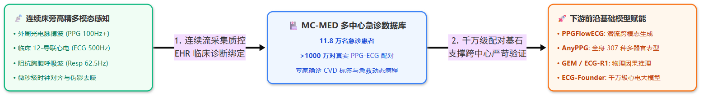

*图 1：MC-MED 数据基础设施与下游基础模型生态运转流水。左侧连续床旁监护仪多模态流输入，微秒级时钟对齐并与电子病历深度质控绑定；中间沉淀为 11.8 万名急诊患者、千万对配对基准库；右侧驱动 PPGFlowECG、AnyPPG、GEM 等前沿模型的预训练与临床实证。*

#### MC-MED 四阶严苛构建流水线：
1. **多中心连续床旁采集**：直连三甲医院急诊科重症监护仪（Patient Monitors），捕获突发急危重症患者从就诊、恶化到用药复苏的全动态病程；
2. **微秒级硬件时钟校准**：对外周光电波形（PPG 100Hz+）、体表心电（ECG 500Hz）及阻抗胸腹呼吸波进行严格的硬件级时钟同步与伪影清洗；
3. **真实电子病历（EHR）深度质控绑定**：将高频波形切片与急诊电子病历中的抢救用药（如血管活性药、利尿剂）、实验室生化指标（如血钾、肌钙蛋白）及心内科专家确诊结论建立确切的因果索引；
4. **多尺度分层资产沉淀**：涵盖秒级局部形态、事件级用药反应与患者级长程追踪，最终沉淀出 **11.8 万名急诊患者、超 1000 万对**高质量同步配对时序切片，为下游 PPGFlowECG 跨模态生成、AnyPPG 多器官预训练提供了不可替代的基石。

---

## 二、 跨模态生成篇：PPGFlowECG 破解穿戴与临床的“模态鸿沟”

### 2.1 物理与语义的双重壁垒：从末梢光阻抗到心肌电偶极子

在可穿戴设备中，手表和手环搭载的光电容积脉搏波（PPG）传感器体积小、功耗低，支持 24 小时全天候无感监测。然而在现代心血管临床中，诊断冠心病、心律失常、束支传导阻滞的金标准依然是 12-导联心电图（ECG）。

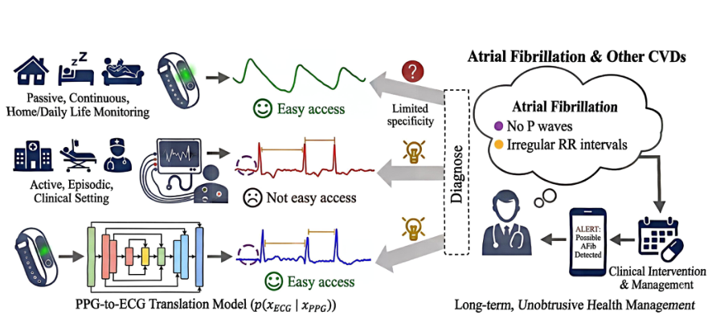

*图 2：可穿戴脉搏波（PPG）到临床确诊级心电（ECG）跨模态生成的临床动机与闭环应用。日常佩戴设备便捷但缺乏诊断特异性，临床 12-导联心电具备确诊金标准但难以长程覆盖；PPGFlowECG 依托急诊大规模配对数据构建跨模态生成桥梁，赋能长程无创心血管疾病（如房颤、心梗）的主动管理。*

将 PPG 转换为 ECG（PPG → ECG）是一个典型的病态反问题（Ill-posed Inverse Problem），面临两大核心物理与数学壁垒：

1. **跨模态物理起源的本征异质性**：PPG 检测的是微血管床容积变化引起的光吸收阻抗波动（反映外周血管舒缩与机械泵血流体动力学）；而 ECG 记录的是窦房结传导引起心肌细胞膜电位除极/复极的电场空间偶极子投影。两者在相位、频带、微观形态上存在巨大的物理延迟与非线性映射。
2. **生成模型的保真度与延迟冲突**：
   - 传统的条件生成对抗网络（Conditional GAN，如早期经典的 CardioGAN）容易出现**模式崩溃（Mode Collapse）**，生成的 QRS 波群微形态模糊，难以保留高保真 ST-T 段；
   - 传统扩散模型（DDPM）虽然质量提升，但需要迭代执行数十至上百步高斯逆向去噪采样，**推断延迟高达数秒至数十秒**，完全无法在手环端侧或急诊近线监测中实时落地。

针对上述难题，洪申达团队提出了 **PPGFlowECG**（*Latent Rectified Flow with Cross-Modal Encoding for PPG-Guided ECG Generation and Cardiovascular Disease Detection*, arXiv:2509.19774）。

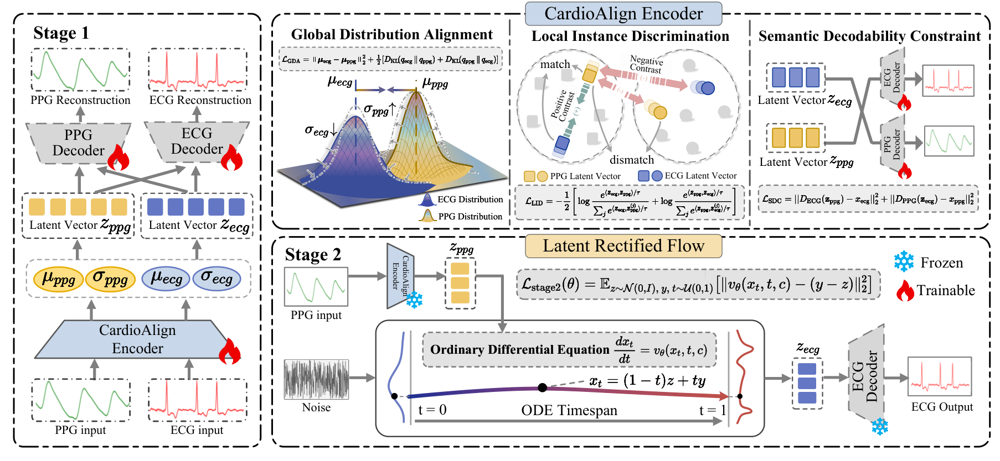

*图 3：PPGFlowECG 两阶段生成框架图。Stage 1 通过 CardioAlign 编码器在潜空间中完成全局分布对齐、局部实例区分与语义可解码约束；Stage 2 依托潜空间整流流（Latent Rectified Flow），以直线 ODE 矢量场在 1～4 步内极速完成由高斯噪声向高保真 ECG 潜向量的确定性传输。*

### 2.2 CardioAlign 编码器：变分高斯潜空间的全局与局部生理对齐

PPGFlowECG 确立了“**先潜表征对齐，后流匹配生成**”的核心范式。其第一阶段设计了参数绑定的 **CardioAlign** 变分编码器，将 PPG 与 ECG 统一映射至低维生理潜空间 $\mathcal{Z}$，并通过三项复合损失函数锁定生理本质：

1. **全局分布对齐损失 ($\mathcal{L}_{\text{GDA}}$)**：  
   编码器输出变分高斯参数 $(\mu_{\text{ppg}}, \sigma_{\text{ppg}})$ 与 $(\mu_{\text{ecg}}, \sigma_{\text{ecg}})$，通过联合最小化均值欧氏距离与潜分布对称 KL 散度，消除模态宏观分布漂移：

   $$
   \mathcal{L}_{\text{GDA}} = \|\mu_{\text{ecg}} - \mu_{\text{ppg}}\|_2^2 + \frac{1}{2} \left[ \mathcal{D}_{\text{KL}}(q_{\text{ecg}} \parallel q_{\text{ppg}}) + \mathcal{D}_{\text{KL}}(q_{\text{ppg}} \parallel q_{\text{ecg}}) \right]
   $$

2. **局部实例判别损失 ($\mathcal{L}_{\text{LID}}$)**：  
   基于 InfoNCE 结构，将同一时间窗口配对采样的 $z_{\text{ppg}}$ 与 $z_{\text{ecg}}$ 作为正样本对，同批次其他窗口作为负样本，约束潜向量在细粒度时间窗口内精准对齐：

   $$
   \mathcal{L}_{\text{LID}} = -\frac{1}{2} \left[ \log \frac{e^{\langle z_{\text{ecg}}, z_{\text{ppg}} \rangle / \tau}}{\sum_j e^{\langle z_{\text{ecg}}, z_{\text{ppg}}^{(j)} \rangle / \tau}} + \log \frac{e^{\langle z_{\text{ecg}}, z_{\text{ppg}} \rangle / \tau}}{\sum_j e^{\langle z_{\text{ppg}}, z_{\text{ecg}}^{(j)} \rangle / \tau}} \right]
   $$

3. **语义可解码性约束 ($\mathcal{L}_{\text{SDC}}$)**：  
   强制要求使用交叉解码器，即用 $z_{\text{ppg}}$ 经过 ECG 解码器还原真实 ECG 波形，确保潜空间未丢失心肌微观形态的生成重构能力。

### 2.3 Latent Rectified Flow：1～4 步 ODE 直线传输的极速逆向生成

在第二阶段，PPGFlowECG 摒弃了传统扩散模型在反向扩散过程中曲折随机的随机微分方程（SDE）路径，创新性地引入了**潜空间整流流（Latent Rectified Flow）**。

整流流的核心在于学习从标准正态分布 $X_0 \sim \mathcal{N}(0, I)$ 到目标 ECG 潜分布 $X_1 \sim q(z_{\text{ecg}})$ 的**最短直线传输轨迹（Straight-line Trajectory）**：

$$
X_t = (1 - t)X_0 + tX_1, \quad t \in [0, 1]
$$

网络 $v_\theta(X_t, t, z_{\text{ppg}})$ 学习拟合该直线速度场，其训练目标为简单的最小二乘回归：

$$
\mathcal{L}_{\text{stage2}}(\theta) = \mathbb{E}_{X_0 \sim \mathcal{N}(0, I), X_1, t \sim \mathcal{U}(0, 1)} \left[ \|v_\theta(X_t, t, z_{\text{ppg}}) - (X_1 - X_0)\|_2^2 \right]
$$

* **常微分方程（ODE）极速采样**：因为传输轨迹近似为直线，推断时不再需要步步微调去噪，直接使用 Euler 求解器或 RK45 求解器进行 **1～4 步数值积分**，即可精确求解最终的 ECG 潜向量 $z_{\text{ecg}}^*$；
* **极低推断延迟**：与需要 50～100 步采样的常规扩散模型（DDPM/DDIM）相比，推断时间缩短 **90% 以上**，完全达到了智能手表与急诊床旁实时监测的算力上限。

### 2.4 医生双盲图灵测试与心血管重症筛查实证

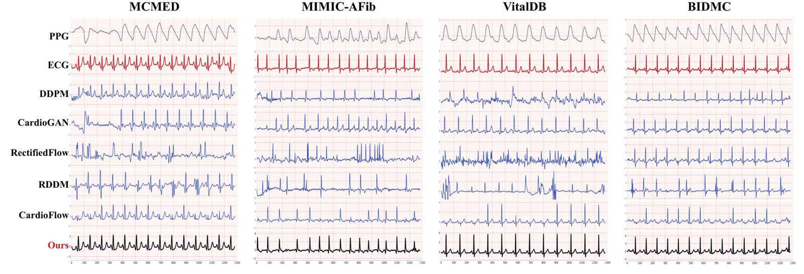

*图 4：跨四个数据集（MC-MED, MIMIC-AFib, VitalDB, BIDMC）的 PPG → ECG 生成波形定性对比。PPGFlowECG（Ours）在基线漂移消除、QRS 尖锐度、P 波与 T 波保真度上显著超越传统 DDPM、CardioGAN 与 CardioFlow。*

如图 4 所示，在面对形态各异的原始 PPG 输入时，传统模型要么产生严重的高频震颤与伪影（DDPM），要么丢失心律节律甚至平摊波形（CardioGAN）。而 PPGFlowECG 能够稳定重构出干净、形态锐利、符合电生理传导规律的高保真 ECG。

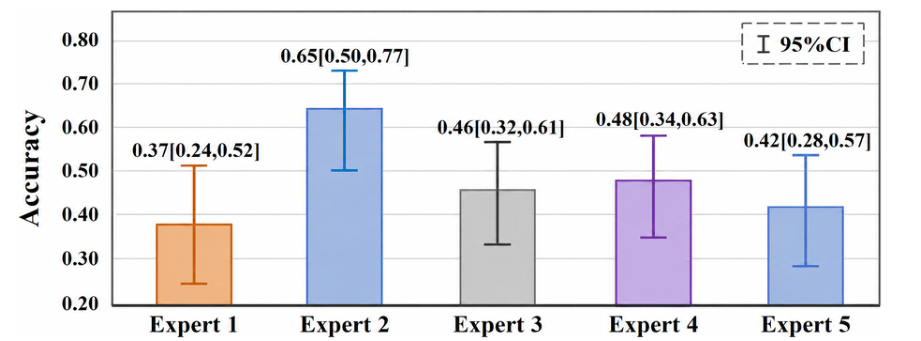

*图 5：5 位资深心内科临床医生对生成的 ECG 进行双盲图灵测试（Turing Test）。*

* **临床图灵盲测**：团队邀请了 5 位来自三甲医院的心内科临床医生对混合在一起的真实 ECG 与生成 ECG 进行双盲盲测（图 5）。测试显示，医生们的平均识别准确率仅为 **42% 左右**（低于随机猜测的 50% 基线），绝大多数医生将合成的心电波形判定为真实人类心电图；
* **下游疾病筛查指标**：在 MC-MED 极具挑战性的急诊房颤（AFib）、室性期前收缩（PVC）和室上性心动过速（SVT）检测中，基于合成 ECG 训练的下游分类器 AUC 性能全面超越以往 SOTA 基线，与真实临床 12-导联 ECG 的分类准确率差距压缩到了 1.5% 以内。

---

## 三、 表型升维篇：AnyPPG 从“单一心率”跃迁至“全身多器官画像”

### 3.1 突破传统局限：脉搏波不只是心血管的专属回声

在智能手表出货量达数亿台的今天，用户手腕上的光电脉搏波（PPG）几乎仅被用于监测心率、静息心率变异性（HRV）、血氧饱和度（SpO2）以及评估心血管血管弹性。

然而，人体的生理系统是一个高度耦合的有机整体。**手腕微血管床的脉搏搏动，真的只能反映心脏与大动脉的健康吗？**

洪申达团队在发表于 **ACM SIGKDD 2026** 的代表作 **AnyPPG**（*AnyPPG: An ECG-Guided PPG Foundation Model Trained on Over 100,000 Hours of Recordings for Holistic Health Profiling*, arXiv:2511.01747）中给出了颠覆性的回答：**PPG 具备成为全身多器官综合健康画像（Holistic Health Profiling）通用数字生物标志物的巨大潜能。**

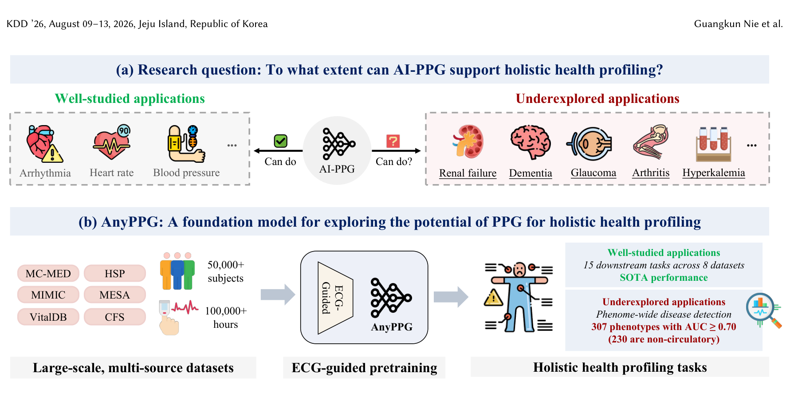

*图 6：AnyPPG 的核心动机与研究全景。(a) 从传统狭窄的心血管应用拓展至未充分探索的多器官全身复杂表型；(b) 依托超 10 万小时数据与 ECG 引导预训练，在多达 307 种全身疾病表型上展现出强劲筛查能力。*

微血管系统遍布全身，其形态动力学受到多个重要器官系统的深度调控：
- **肾脏系统（Renal Function）**：肾功能衰竭与慢性肾脏病（CKD）会导致体液潴留、电解质紊乱（如高钾血症）以及微血管内皮重塑硬化，直接改变外周脉搏波的上升斜率与降中峡切迹；
- **神经中枢与脑功能（Neurological Function）**：脑血管退行与帕金森病（Parkinson's Disease）伴随严重的**自主神经功能障碍（Autonomic Dysregulation）**，这会在外周微循环的交感/副交感节律调制上产生特异性的微小涨落；
- **全身代谢与内分泌**：高血糖、慢性低度炎症会长期侵蚀毛细血管床，导致脉搏反射波时延的微细畸变。

### 3.2 为什么必须以 ECG 引导预训练？过滤噪声与表征解耦

在构建通用 PPG 基础模型时，学术界通常借鉴计算机视觉的方法，采用单模态自监督学习（如掩码重建 MAE 或简单的时间对比学习）。

然而，洪申达团队揭示了**纯单模态自监督预训练在 PPG 上的致命缺陷**：
- **虚假局部特征劫持**：手腕 PPG 极易受到佩戴松紧度、皮肤色素沉着、探头毛细血管压差以及轻微手部动作的影响；
- 纯波形自监督模型往往会“投机取巧”，花费绝大部分模型容量去拟合这些与疾病无关的外周高频运动伪影与静态皮肤光阻抗基线，导致学到的表征下游泛化能力极差。

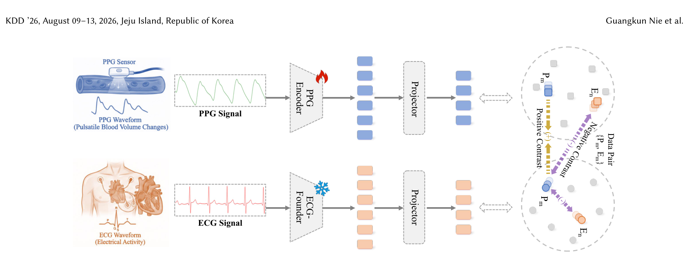

*图 7：AnyPPG 心电引导跨模态对比预训练机制。利用冻结的大规模心电基模 ECGFounder 作为高阶电生理教师，通过深层正负样本对比学习，约束可训练的轻量级 PPG 编码器提取深层生理本质。*

为了彻底解决这一问题，AnyPPG 提出了 **ECG-Guided Cross-Modal Pretraining（心电引导跨模态预训练）**：
1. **中枢金标准锚定**：心电图（ECG）记录的是心肌纯粹的膜电位除极，不存在外周光吸收和皮肤色素干扰；
2. **冻结高阶生理教师**：预训练时，团队引入了在千万级真实心电数据上预训练的心电基模 **ECG-Founder**（NEJM AI 2025），将其参数完全冻结（Frozen）；
3. **跨模态对比表征牵引**：让轻量级 PPG 编码器提取的潜表征，在潜空间中去强力对齐冻结的 ECG 高阶语义表征。这种不对称的对比学习机制，迫使 PPG 编码器自动剥离所有表层光吸收与动作噪点，仅保留反映心脏射血、血管顺应性与自主神经调控的深层生理动力学内核。

### 3.3 Net1D 双分支架构与多器官表型评测（CKD、帕金森病早筛）

* **超轻量端侧部署**：AnyPPG 采用了团队自主研发的 **Net1D**（7 阶段 1D-ResNet）作为主干。预训练完成后，端侧推理只需保留单个仅 **5.85M 参数**的轻量级 PPG 编码器，毫秒级算力开销即可无缝嵌入可穿戴芯片。
* **大规模全表型实验验证**：基于超 10 万小时的高精度同步时序数据，AnyPPG 采用冻结主干特征 + 线性探测（Linear Probing）的严苛协议，在 **15 项心血管基准任务**与 **307 种全身复杂疾病表型**上展开了前所未有的广谱评测：
  - **心血管核心基准**：在心律失常、心肌梗死、血压异常等传统任务中全面打破现有 SOTA；
  - **非循环系统全身器官表型大放异彩**：在多达 **230 种非心血管系统疾病**中取得了 $\text{AUC} \ge 0.70$ 的出色表现。特别是在**慢性肾脏病**（CKD）、**高钾血症**（Hyperkalemia）与**帕金森综合征**的无创早筛中，AUC 显著超越所有对比的自监督和监督基线，有力佐证了手腕脉搏波作为全身多系统生理镜像的潜力。

---

## 四、 认知推理篇：GEM 与 ECG-R1 构筑临床可信的因果锚定大模型

### 4.1 医疗多模态大模型的“印象派”通病与黑盒信任危机

随着 GPT-4o、Med-Gemini 等多模态通用大模型的快速迭代，研究者们开始尝试将心电图、脉搏图直接喂入大模型，让其直接生成诊断报告。

然而，这类“端到端印象派”模型在临床落地时面临着严重的**信任危机与高虚假幻觉率**：
- **临床因果链条断裂**：真实世界的心内科医生阅读一份 12-导联心电图时，具有极其严密且刻板的**临床四步判定流**：
  1. *查心率节律*（P 波是否存在？心率是否整齐？是否窦性？）；
  2. *量各波时限*（PR 间期是否 $> 200\text{ ms}$？QRS 波群时限是否 $> 120\text{ ms}$？QTc 间期是否延长？）；
  3. *审形态抬高*（胸前 V1～V4 导联 ST 段是否有特征性弓背抬高 $> 0.1\text{ mV}$？T 波是否对称倒置？）；
  4. *合指南定论*（根据严格的指南量纲阈值下达最终诊断结论）。
- **黑盒幻觉灾难**：现存医疗大模型往往缺乏对微观波形参数的量纲度量能力，容易根据全局粗糙的轮廓纹理“凭印象猜测”，给出“急性前壁心肌梗死”等惊悚结论，却无法指认异常波形发生的具体导联、毫秒数或毫伏变化。

为了终结这一黑盒乱象，洪申达团队在近年连续推出了 **GEM**（NeurIPS 2025）与 **ECG-R1**（ICML 2026）。

### 4.2 GEM：时序-视觉统一双编码与微观波形参数物理锚定（ECG-Grounding）

北京大学洪申达团队联合新加坡国立大学（NUS）冯梦凌团队在 **NeurIPS 2025** 上发表了 **GEM**（*Empowering MLLM for Grounded ECG Understanding with Time Series and Images*, arXiv:2503.06073）。

*图 8：GEM 的波形物理锚定范式（ECG-Grounding）与现有大模型直接输出抽象诊断的对比。GEM 强制在诊断前完成微观波形参数度量与异常时间轴定位，提供完整的循证因果链条。*

#### 1. 破局机制：强制波形物理锚定（ECG-Grounding）
GEM 首次确立了医疗大语言模型的物理约束准则：**在输出任何疾病结论之前，必须强制输出可验证的客观生物物理量纲**：
- 显式给出 PR 间期（ms）、QRS 宽度（ms）、QT/QTc 间期（ms）的具体测量数值；
- 准确定位 ST 段抬高或压低的确切毫伏数（mV）及其受影响的特定导联（如 II, III, aVF 导联对应下壁梗死）；
- 将诊断结论与临床指南判定规则建立确定性的因果链接（例如：$\text{PR 间期} = 224\text{ ms} > 200\text{ ms} \implies \text{一度房室传导阻滞}$）。

*图 9：GEM 双编码器架构图。结合 1D ECG 原始高频波形编码器与 2D 12-导联打印图纸视觉编码器，经过多模态投影层对齐大语言模型，输出带有物理锚定的结构化临床解释。*

#### 2. 时序-视觉统一双编码器架构（Dual-Encoder Framework）
如图 9 所示，GEM 结合了两种截然不同的感知维度：
- **1D 原始高频波形编码器**：捕捉采样率 500 Hz 的毫秒级微观波形细节与高阶高频扰动；
- **2D 图像视觉编码器**：对齐临床心电图纸（网格背景、12 导联分块排布）的宏观空间上下文与医生视觉阅片习惯；
- **临床实测性能飞跃**：在严格的基准评测中，相比于无物理锚定的常规医疗大模型，GEM 在心血管疾病诊断准确率上提升 **7.4%**，临床可解释性提升 **22.7%**，病理依据锚定准确率提升 **25.3%**，有效遏制了虚假幻觉。

### 4.3 ECG-R1：临床指南协议驱动与强化学习证据奖励

在 GEM 奠定的 Grounding 范式之上，洪申达团队在 **ICML 2026** 上进一步推进了最新工作 **ECG-R1**（*ECG-R1: Protocol-Guided and Modality-Agnostic MLLM for Reliable ECG Interpretation*）：

1. **临床协议驱动的指令微调（Protocol-Guided Instruction Tuning）**：将现代心脏病学教科书与 AHA/ESC 临床诊疗指南的决策树逻辑深度编译为思维链（Chain-of-Thought, CoT），让模型严格按步推理；
2. **模态解耦与交错丢弃（Interleaved Modality Dropout）**：确保大模型在“纯 1D 时序波形”、“纯 2D 纸质照片”或“双模态皆备”的各种残缺临床现场均能稳定输出一致的诊断结论；
3. **强化学习诊断证据奖励（RL with Diagnostic Evidence Rewards）**：利用强化学习机制，对模型给出的物理测量证据与指南阈值的吻合度施加重度奖励，从模型对齐机制层面消除自由发挥的倾向。

---

## 五、 技术谱系与演进全景：从判别小模型到软硬件一体数字健康闭环

### 5.1 PKUDigitalHealth 团队的十年演进图谱

梳理洪申达团队多年来的代表性工作，可以清晰地勾勒出其从**传统判别模型 → 跨模态生成 → 通用基础模型 → 物理锚定推理大模型**的完整演化图景：

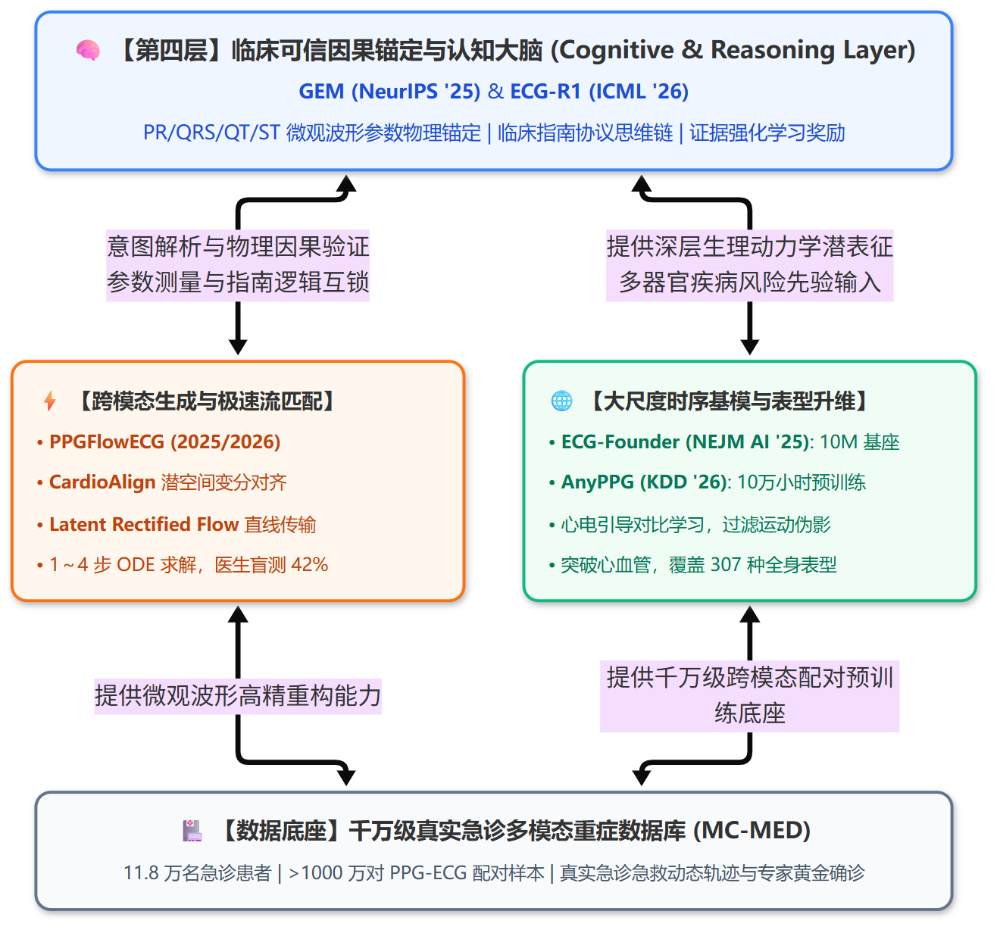

*图 10：北京大学数字健康实验室（PKUDigitalHealth）四层技术栈闭环。从底层的千万级急诊临床数据库（MC-MED），到跨模态生成（PPGFlowECG）与大尺度多器官时序基模（AnyPPG / ECG-Founder），最终收敛至顶层具备微观波形物理锚定与临床指南推理能力的认知大脑（GEM / ECG-R1）。*

| 发展阶段与时期 | 代表作与发表平台 | 核心科学假说与技术突破 | 标志性开源项目 / 数据基准 |
| :--- | :--- | :--- | :--- |
| **第一阶段 (2017～2021) 经典知识引导与判别小模型** | • **PhysioNet '17 冠军模型** • **MINA** (ACM SIGKDD '19) • **CardioGAN** (AAAI '21) | • 探索多层注意力机制，将心搏、节律与频域等医学知识融入网络结构； • 首次提出双判别器对抗生成网络（CardioGAN），开创端到端 PPG → ECG 信号级跨模态合成先河。 | PhysioNet Challenge 2017 国际冠军算法 |
| **第二阶段 (2022～2025) 数据基础设施与极速流匹配生成** | • **MC-MED 配对管线** • **PPGFlowECG** (2025/2026) • **DiffuSETS** (Cell Patterns '25) | • 依托急诊高精生理数据库 MC-MED 构建千万对配对语料（11.8 万次急诊就诊）； • 提出 CardioAlign 潜空间生理对齐 + 潜空间整流流（Latent Rectified Flow），仅需 1～4 步 ODE 直线传输即可生成高保真心电，通过心内科医生双盲图灵测试。 | [PPGFlowECG 开源代码与生成器](https://github.com/PKUDigitalHealth/PPGFlowECG) |
| **第三阶段 (2025～2026) 大尺度生物时序基模与表型升维** | • **ECG-Founder** (NEJM AI '25) • **HeartLang** (ICLR '25) • **AnyPPG** (ACM SIGKDD '26) | • 基于超 1000 万条记录构建千万级心电通用基座 ECG-Founder； • 提出“心跳即词汇、心律即句子”，构建心电语言模型 HeartLang； • 提出心电引导跨模态对比预训练 AnyPPG，打破传统心血管狭隘任务，实现单模态手腕 PPG 对全身 307 种复杂疾病表型（如 CKD、帕金森）的无创筛查。 | [AnyPPG 官方代码与预训练权重](https://github.com/Ngk03/AnyPPG) |
| **第四阶段 (2025～未来) 临床可信因果锚定与认知大模型** | • **GEM** (NeurIPS '25) • **ECG-R1** (ICML 2026) | • 改变医疗 MLLM 缺乏证据链的“黑盒印象派猜测”； • 提出波形物理锚定（ECG-Grounding），强制在输出诊断前测算 PR/QRS/QT/ST 等客观生物物理量纲并绑定临床指南阈值； • 引入临床协议驱动思维链与诊断证据强化学习奖励机制。 | [GEM 开源代码与物理锚定基准](https://github.com/lanxiang1017/GEM) |

从早期的 MINA 和 CardioGAN，到近年的 PPGFlowECG、AnyPPG、GEM 与 ECG-R1，团队始终聚焦在“**如何让算法忠实反映生物物理本质、如何在真实临床中获得医生与患者的确定性采信**”这一核心主轴上。

### 5.2 软硬一体与产学研实战：从 PhysioNet 夺冠到安徽心之声与“问心无恙”医疗器械闭环

纵观学术界，许多医学 AI 算法往往止步于公开跑分榜单，难以跨越临床注册与低成本穿戴芯片工程化落地的“死亡之谷”。而洪申达老师团队之所以能够在生理时序基础模型领域形成深厚的技术壁垒，与其深度的**产学研联动与软硬协同实战经验**密不可分。

#### 1. 算法源头：2017 年 PhysioNet 国际挑战赛世界冠军与 ENCASE 框架
2017 年，生物医学信号处理领域的国际“世界杯”——**PhysioNet / Computing in Cardiology (CinC) Challenge 2017** 以“简短单导联心电波形的房颤与心律失常自动分类”为题，吸引了全球 70 余支顶级学术界与工业界团队参赛。当时尚在北京大学攻读博士的洪申达作为核心算法第一作者，带领团队斩获**全球第一名（国际冠军）**。

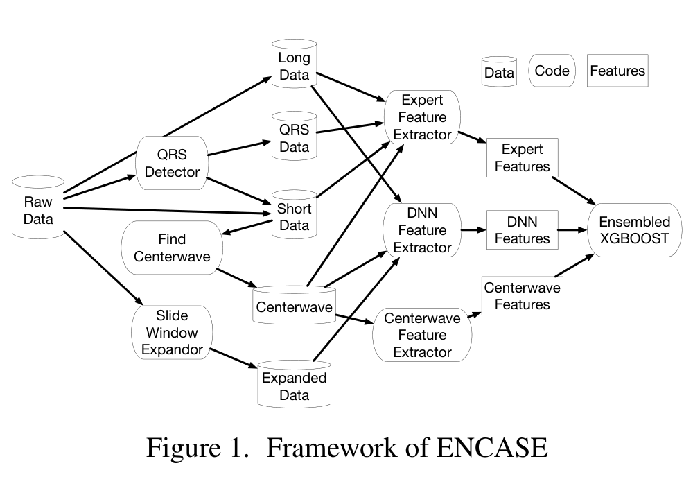

*图 11：PhysioNet Challenge 2017 国际冠军算法 ENCASE 系统架构图。首创将心脏病学专家工程特征（Expert Features，包含时域、频域与 QRS 检测）与长短时记忆神经网络（LSTM / Centerwave CNN）深度特征动态融合，并通过梯度提升树（XGBoost）集成，奠定了工业级单导联心电高保真自动分析的技术范式。*

#### 2. 产业化载体：安徽心之声医疗科技（HeartVoice Medical）
2017 年 7 月，伴随着国际赛事的夺冠突破，洪申达作为**联合创始人兼首席科学家 / 董事**，与中国科学技术大学校友傅兆吉博士等人联合创立了**安徽心之声医疗科技有限公司**。心之声专注于将深度学习应用于心脏健康与生理时序自动分析，成为高校前沿理论通往工业级医疗设备的核心工程转化桥梁：
* **芯片级轻量化算法研发（Cardio-learn®）**：团队攻克了微弱生物电采集前端的高频工频干扰与基线漂移，将深度学习与时序基座模型压缩编译至超低功耗微控制器（MCU）与边缘嵌入式芯片中；
* **发明专利与自主知识产权布局**：洪申达作为第一发明人与核心骨干，为心之声主导申报了数十项国家发明专利，涵盖**心肌梗死精准定位、纸质心电智能数字化重建、多导联波形实时重构与心律失常秒级报警**等关键核心技术。

#### 3. 落地器械载体：“问心无恙”家庭便携式 AI 心电仪与慢病监护
通过产学研深度协同，团队的相关核心技术成功转化为具有**国家二类医疗器械注册证**（皖械注准）的实体硬件产品——“**问心无恙**”便携式家庭 AI 心电仪（包括手持即测型 E-HA03C、P1 单导联便携心电监护仪及 24 小时动态心电贴片等）：

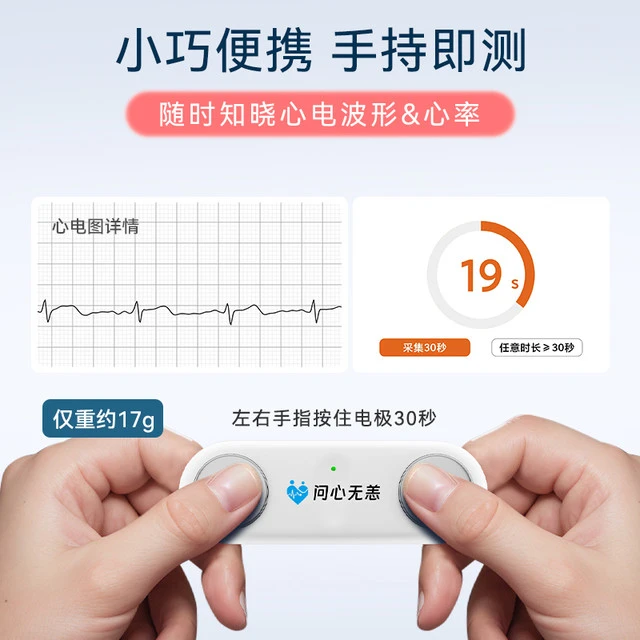

*图 12：“问心无恙”（WenXinWuYang / HeartVoice）便携式家庭 AI 心电仪官方真机图。机身仅重约 17g，左右手拇指按住双电极 30 秒即可完成微弱心电采集与去噪，配合手机端/云端大模型引擎即时呈现心电波形、心率与心律失常筛查报告。*

* **院外随身即测与主动预警**：用户仅需双手拇指轻触电极片 30 秒，即可捕获一过性心慌、胸闷时的心电异变，秒级输出房颤、室性早搏等高危预警，已真实服务超 **10 万+** 家庭；
* **无感长程动态贴片**：摆脱传统医院 Holter 笨重导联线束缚，支持 24 小时连续心电监测，显著提升隐匿性心脏事件与夜间睡眠呼吸暂停的检出率。

#### 4. “端-边-云”软硬协同转化全景图
心之声的产业化落地与北京大学 PKUDigitalHealth 实验室的基础科研形成了极佳的正向飞轮：实验室提供源源不断的大模型先验与跨模态生成算法，心之声提供真实的硬件载体、临床试验验证与海量脱敏真实世界反馈。

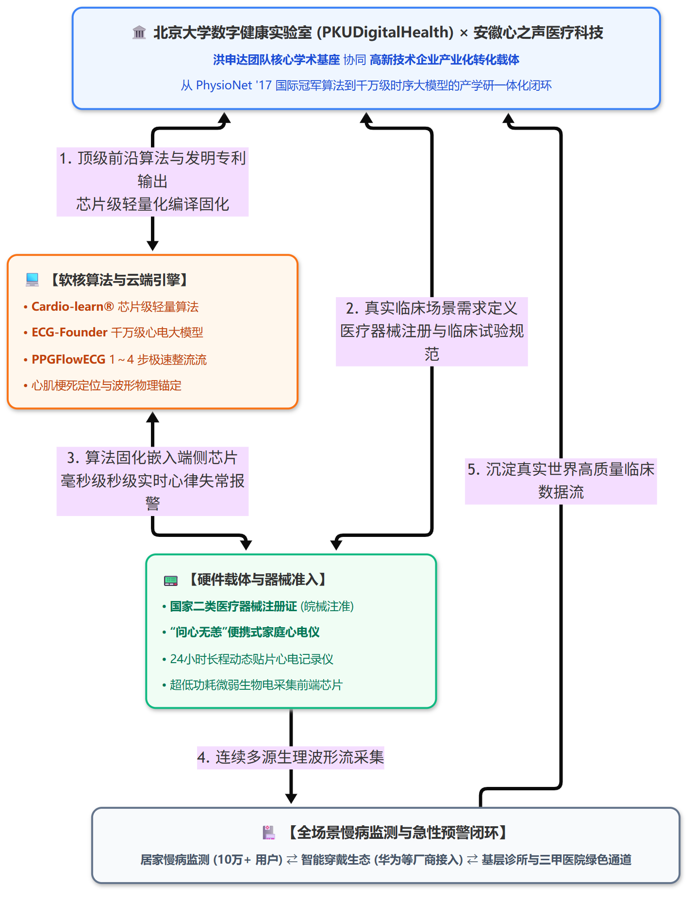

*图 13：北京大学数字健康实验室 × 安徽心之声医疗科技产学研转化全景。构建了从“顶层算法与专利研发”到“嵌入式芯片轻量化”、“二类医疗器械注册申报”，再到“家庭居家监测与三甲医院绿色通道”的软硬一体全流程产业闭环。*

### 5.3 启示：给生理时序基础模型（TSFM）研发者的四条核心方法论

综合分析洪申达团队的一系列开创性工作，对于致力于穿戴计算、时序基模与医疗 AI 的从业者而言，有四条极具启发意义的方法论原则：

1. **跨模态物理锚定：用高质量金标准模态拉升低成本穿戴模态**  
   智能手表采集的 PPG 或穿戴加速度不可避免地伴随海量运动伪影。AnyPPG 与 PPGFlowECG 证明：**千万不要试图仅在单一噪声模态内自娱自乐**。利用临床严谨对齐的黄金模态（ECG、动脉血压）作为引导或目标，在潜空间中进行变分绑定与不对称对比拉近，是提升穿戴信号生理可信度的王道路径。
2. **生成机制革新：用流匹配（Rectified Flow）直线传输替代曲折迭代**  
   在生理信号生成领域，盲目搬用图像领域的几十步反向扩散去噪往往由于延迟过高而失去落地价值。PPGFlowECG 展现了流匹配直线速度场在生理领域的绝佳适配性：仅需 **1～4 步** ODE 直线求解，既杜绝了 GAN 的模式崩溃，又打破了扩散模型的延迟枷锁。
3. **破除任务狭隘性：从局部心血管走向全身多系统数字标志物**  
   不要把手腕传感器仅仅局限于测心率和算卡路里。人体是一个不可分割的生理闭环，外周微循环系统实时映射着中枢神经（帕金森）、肾脏代偿（CKD）与代谢健康。跳出传统心血管分类思维，尝试在全表型组（Phenome-wide）空间中探索基础模型的表征能力，将发掘出意想不到的巨大临床转化价值。
4. **消除黑盒幻觉：大语言模型必须强制绑定客观量纲与物理事实**  
   医疗大模型不能做凭感觉空谈的“印象派”。GEM 和 ECG-R1 树立了行业标杆：**凡是定性诊断，必先给出定量测量参数；凡是下达结论，必先绑定指南循证依据**。唯有通过波形物理锚定（Grounding）与指南协议约束，才能让大语言模型真正赢得临床专家的信赖，走向千家万户的主动健康监护。

---

## 参考文献与精选开源项目

### 团队代表性论文
* **[AnyPPG (KDD 2026)]** Guangkun Nie, Xiaocheng Fang, Shenda Hong*, et al. *AnyPPG: An ECG-Guided PPG Foundation Model Trained on Over 100,000 Hours of Recordings for Holistic Health Profiling*. ACM SIGKDD 2026. [arXiv:2511.01747](https://arxiv.org/abs/2511.01747)
* **[PPGFlowECG (2025/2026)]** Xiaocheng Fang, Jiarui Jin, Haoyu Wang, Shenda Hong*, et al. *PPGFlowECG: Latent Rectified Flow with Cross-Modal Encoding for PPG-Guided ECG Generation and Cardiovascular Disease Detection*. [arXiv:2509.19774](https://arxiv.org/abs/2509.19774)
* **[GEM (NeurIPS 2025)]** Xiang Lan, Feng Wu, Kai He, Qinghao Zhao, Shenda Hong, Mengling Feng. *GEM: Empowering MLLM for Grounded ECG Understanding with Time Series and Images*. NeurIPS 2025. [arXiv:2503.06073](https://arxiv.org/abs/2503.06073)
* **[ECG-R1 (ICML 2026)]** Jiarui Jin, Haoyu Wang, Xingliang Wu, Xiaocheng Fang, Xiang Lan, Shenda Hong*, et al. *ECG-R1: Protocol-Guided and Modality-Agnostic MLLM for Reliable ECG Interpretation*. ICML 2026.
* **[HeartLang / UniECG (ICLR 2025)]** Jiarui Jin, Haoyu Wang, Shenda Hong*, et al. *Reading Your Heart: Learning ECG Words and Sentences via Pre-training ECG Language Model*. ICLR 2025.
* **[ECG 10M Foundation Model (NEJM AI 2025)]** Jun Li, Shenda Hong*, M. Brandon Westover*, et al. *An Electrocardiogram Foundation Model Built on over 10 Million Recordings*. NEJM AI, 2025.
* **[CardioGAN (AAAI 2021)]** Pranav Chebbi, Shenda Hong, et al. *CardioGAN: Attentive Generative Adversarial Network with Dual Discriminators for Synthesis of ECG from PPG*. AAAI 2021.
* **[MINA (KDD 2019)]** Shenda Hong, et al. *MINA: Multilevel Knowledge-Guided Attention for Modeling Electrocardiography Signals*. ACM SIGKDD 2019.
* **[ENCASE (PhysioNet/CinC 2017 国际冠军)]** Shenda Hong, Yuxi Zhou, Qingyun Wang, Meng Wu, Junyuan Shang. *ENCASE: an ENsemble ClASsifiEr for ECG Classification Using Expert Features and Deep Neural Networks*. Computing in Cardiology (CinC), 2017. [CinC PDF](https://www.cinc.org/archives/2017/pdf/178-245.pdf)

### 开源仓库与转化平台
* **AnyPPG 官方开源代码与预训练权重**: [GitHub: Ngk03/AnyPPG](https://github.com/Ngk03/AnyPPG)
* **PPGFlowECG 官方开源代码与流匹配生成器**: [GitHub: PKUDigitalHealth/PPGFlowECG](https://github.com/PKUDigitalHealth/PPGFlowECG)
* **GEM 官方开源代码与物理锚定评测基准**: [GitHub: lanxiang1017/GEM](https://github.com/lanxiang1017/GEM)
* **ENCASE 国际冠军开源算法仓库**: [GitHub: hsd1503/ENCASE](https://github.com/hsd1503/ENCASE)
* **北京大学数字健康实验室主页 (PKUDigitalHealth)**: [https://hsd1503.github.io/](https://hsd1503.github.io/)
* **安徽心之声医疗科技官方主页 (HeartVoice)**: [https://www.heartvoice.com.cn/](https://www.heartvoice.com.cn/)

---

> **欢迎交流与共建**  
> 本文由开源知识库项目 [Wearable-Physiological-Foundation-Models](https://github.com/tujy859/Wearable-Physiological-Foundation-Models) 整理策划。该项目持续追踪全球在智能手表、连续血糖监测（CGM）以及多模态生理健康基础模型领域的最新突破。如果您对可穿戴生理计算、时序健康基模与数字生物标志物有任何想法，欢迎在仓库提 Issue 交流！
