# 让大语言模型理解和赋能生理时序波形

> **摘要**：在可穿戴设备和智慧医疗场景中，生理时序信号（如脉搏 PPG、心电 ECG、连续血压）处理长期面临两大深层瓶颈：一是干净标注数据极少、噪声极大，而人类百年积累的医学规律却沉睡在论文与临床指南中难以被传统算法利用；二是无论是早期的特征工程、深度卷积网络，还是近年涌现的时序基础模型，其本质都是黑盒数值映射，缺乏临床可解释性与因果链条。本文围绕近期顶会与预印本中的几项代表性工作（CBPM-LLaMA、Time-LLM、GEM、PPG-LM、SensorLM 与 TimeBraid），系统剖析大语言模型（LLM）与生理时序模型的双向联动机制：**如何用 LLM 蕴含的高质量领域先验赋能时序预测，以及如何借助自然语言理解波形并消除黑盒幻觉**。在此基础上，进一步探讨时序基模、大模型中枢与自主健康 Agent 协同的未来终局。

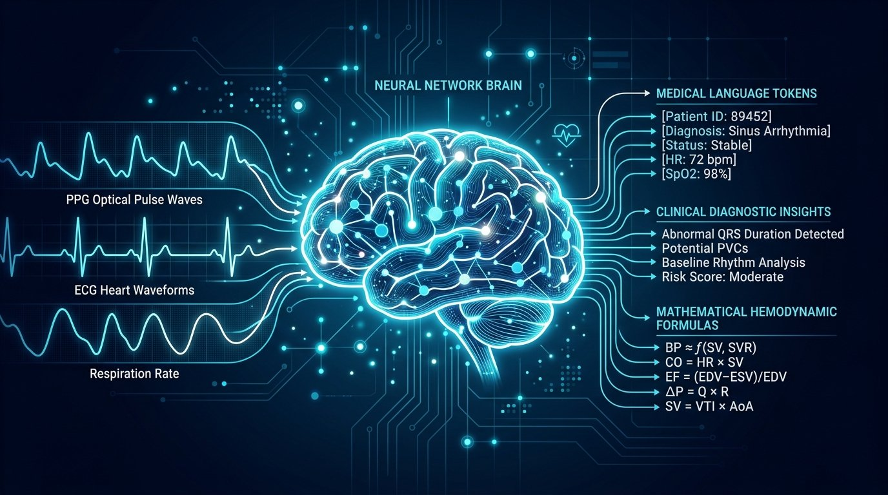

---

## 目录

- [引言：生理时序算法的两大固有困境](#引言生理时序算法的两大固有困境)
- [一、 赋能篇：用大语言模型的领域先验破解数据匮乏](#一-赋能篇用大语言模型的领域先验破解数据匮乏)
  - [1.1 为什么直接端到端拟合生理指标容易失效？](#11-为什么直接端到端拟合生理指标容易失效)
  - [1.2 CBPM-LLaMA：血流动力学先验机制解耦与公式反解](#12-cbpm-llama血流动力学先验机制解耦与公式反解)
  - [1.3 Time-LLM：跨模态文本原型重编程](#13-time-llm跨模态文本原型重编程)
- [二、 理解篇：用自然语言打破时序黑盒，重构因果链条](#二-理解篇用自然语言打破时序黑盒重构因果链条)
  - [2.1 传统时序模型的“黑盒病”与临床信任危机](#21-传统时序模型的黑盒病与临床信任危机)
  - [2.2 GEM：微观波形参数物理锚定（Grounded ECG）](#22-gem微观波形参数物理锚定grounded-ecg)
  - [2.3 PPG-LM：多尺度临床语言对齐与连续时间 RoPE](#23-ppg-lm多尺度临床语言对齐与连续时间-rope)
  - [2.4 SensorLM：多传感器时序的常识消歧](#24-sensorlm多传感器时序的常识消歧)
- [三、 展望篇：时序 + LLM + Agent 的终局形态](#三-展望篇时序--llm--agent-的终局形态)
  - [3.1 从单向解读到双向交织：TimeBraid 与反事实推演（What-If）](#31-从单向解读到双向交织timebraid-与反事实推演what-if)
  - [3.2 神经符号协同：CodeAct Agent 解决浮点计算幻觉](#32-神经符号协同codeact-agent-解决浮点计算幻觉)
  - [3.3 端云分层的闭环主动健康管家](#33-端云分层的闭环主动健康管家)
- [四、 对研发单纯时序基模（Pure TSFM）的反哺思考](#四-对研发单纯时序基模pure-tsfm的反哺思考)
- [参考文献与精选开源项目](#参考文献与精选开源项目)

---

## 引言：生理时序算法的两大固有困境

如果梳理过去十年可穿戴设备与生物医学信号处理的算法演进，会发现一个耐人寻味的现象：模型的骨干网络从支持向量机、XGBoost，一路升级到 ResNet、Transformer，再到如今动辄上亿参数的时序基础模型（TSFM，如 PatchTST、MOMENT）。模型参数量膨胀了成百上千倍，但在真实佩戴与复杂临床场景中，算法的落地表现依然常常不尽如人意。

究其根源，生理时序处理面临着两个难以通过简单堆叠网络层数解决的固有困境：

### 困境一：“数据贫瘠”与“知识丰沛”的强烈割裂

生理信号的采集成本极其高昂。要获取一段带有金标准连续动脉血压、多导联心电或血气分析的波形，通常需要在手术室、重症监护室（ICU）或标准化睡眠实验室进行侵入式或严苛的设备连接。在消费级手环或智能手表端，虽然采集变得容易，但信号信噪比极低，充斥着运动伪影、接触不良以及频繁的脱表断流。

与此同时，人类在现代医学发展的数百年历程中，已经摸索出了极其丰富且严密的生物物理规律：

- 心脏电信号的传导为何会形成 P-QRS-T 波群？
- 动脉血压如何受心输出量、外周阻力与大动脉顺应性的共同约束？
- 脉搏波的主波、重搏波切迹与血管弹性之间存在何种流体力学关系？

这些高质量的领域先验知识，全部沉淀在医学教材、学术论文、临床诊疗指南以及物理方程中，以**非结构化自然语言或数理符号**的形式存在。以往的纯数值时序模型对这些知识是“盲目”的，它们只能在有限且充满噪点的浮点数序列里，试图仅凭端到端梯度下降重新“重新发现”这些物理规律。这种做法在样本量受限时极易导致严重的过拟合。

### 困境二：解释真空与“不可信任的黑盒输出”

无论是分类心律失常还是回归收缩压数值，传统时序算法的输出本质上都是一段冰冷的浮点数。模型可以给出一个预测值“收缩压 145 mmHg”，或者一个分类标签“房室传导阻滞”。

但在严肃的医疗与健康监测中，医生和用户无法采信没有推导过程的结论：

- 模型依据了波形的哪一段异常做出的判断？
- 测得的 PR 间期到底是几毫秒？ST 段压低了多少毫米？
- 这个异常是真实的病理反映，还是仅仅因为手腕活动造成的伪影漂移？

由于数值模型本身缺乏因果链条的组织能力，一旦遇到分布外（OOD）样本，模型往往会在完全错误的波形上给出高度自信的错误预测。

**正是这两大困境，将目光引向了大语言模型（LLM）。**  
大模型并不是只能用于文字聊天。在生理时序领域，它正在成为两种关键角色：

1. **赋能（LLM → 时序）**：大模型拥有极强的文本常识与医学指南知识，通过合理的机制引导，可以用领域先验直接补足数值信号少、质量差的短板；
2. **理解（时序 → LLM）**：自然语言具备天然的因果叙述与逻辑推导结构，将连续波形映射至语言空间，能够彻底打破时序黑盒，建立清晰可靠的临床证据链。

---

## 一、 赋能篇：用大语言模型的领域先验破解数据匮乏

### 1.1 为什么直接端到端拟合生理指标容易失效？

以可穿戴无袖带连续血压（Cuffless Blood Pressure, BP）测量为例。以往的研究范式通常是：采集手腕的同步心电（ECG）与光电容积脉搏波（PPG），切成定长窗口，设计一个深度网络直接拟合袖带气囊测出的收缩压（SBP）和舒张压（DBP）。

这种纯数据驱动的端到端拟合存在严重的统计缺陷：

- 血压是一个受自主神经、血管舒缩状态、心肌收缩力多重调节的动态生理指标；
- 在同一个受试者身上，早晨静息状态下的脉搏波形态与剧烈运动后的形态差异极大；
- 深度网络在有限数据集（通常几百至上千人）上训练时，极容易走捷径——模型学到的可能只是特定人群在特定心率范围内的统计均值，一旦受试者换了姿势、血管外周阻力发生改变，预测误差就会急剧放大。

### 1.2 CBPM-LLaMA：血流动力学先验机制解耦与公式反解

中国科学院深圳先进技术研究院（SIAT）联合香港理工大学（PolyU）发表在 ACM-BCB '24 的研究 **CBPM-LLaMA**（*Large Language Models for Cuffless Blood Pressure Measurement From Wearable Biosignals*），提供了一种将医学教科书逻辑转化为大模型提示词的范式。

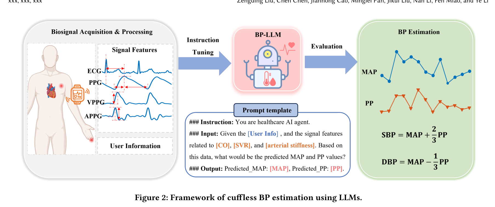

*图 1：CBPM-LLaMA 框架示意图。通过从 ECG 与 PPG 中提取严密对应心输出量（CO）、外周阻力（PR）和大动脉硬度（PTT）的特征，引导大语言模型先预测平均动脉压（MAP）和脉压差（PP），再代数反解 SBP 与 DBP。*

#### 核心机制：血流动力学先验解耦

该团队没有强迫 LLaMA3-8B 或 Qwen2-7B 去直接拟合 SBP 和 DBP，而是利用经典的**心血管动力学原理**，对预测目标做了一次严格的降解与重构：

1. **三维生理特征显式提取**：  
   从 1000 Hz 同步的心电与脉搏波中，提取 31 维具有明确生物物理意义的特征，严格归类为三大机制模块：
   - **大动脉硬度与顺应性相关（Arterial Stiffness）**：脉搏到达时间（PTT，即心电 R 波顶点到 PPG 波谷的时差）；
   - **心输出量相关（Cardiac Output, CO）**：脉搏波上升支时间、上升斜率；
   - **外周血管阻力相关（Peripheral Resistance, PR）**：脉搏波下降支时间、下降面积、降中峡切迹比值。
2. **机制变量降解与代数反解**：  
   依据生理学基本公式：
   - **平均动脉压（MAP）**：整个心动周期中动脉血压的平均值，主要由心输出量和外周阻力决定；
   - **脉压差（PP）**：$\text{PP} = \text{SBP} - \text{DBP}$，直接反映大动脉弹性贮器功能的强弱（与大动脉硬度和 PTT 紧密挂钩）。  
     因此，提示词中显式约束模型：**利用 CO 和 PR 特征去推导 MAP，利用 PTT 和大动脉硬度特征去推导 PP**。在得到大模型预测出的 $\widehat{\text{MAP}}$ 与 $\widehat{\text{PP}}$ 之后，利用确定性的物理代数方程反解收缩压与舒张压：  
     $\text{SBP} = \widehat{\text{MAP}} + \frac{2}{3}\widehat{\text{PP}}$  
     $\text{DBP} = \widehat{\text{MAP}} - \frac{1}{3}\widehat{\text{PP}}$

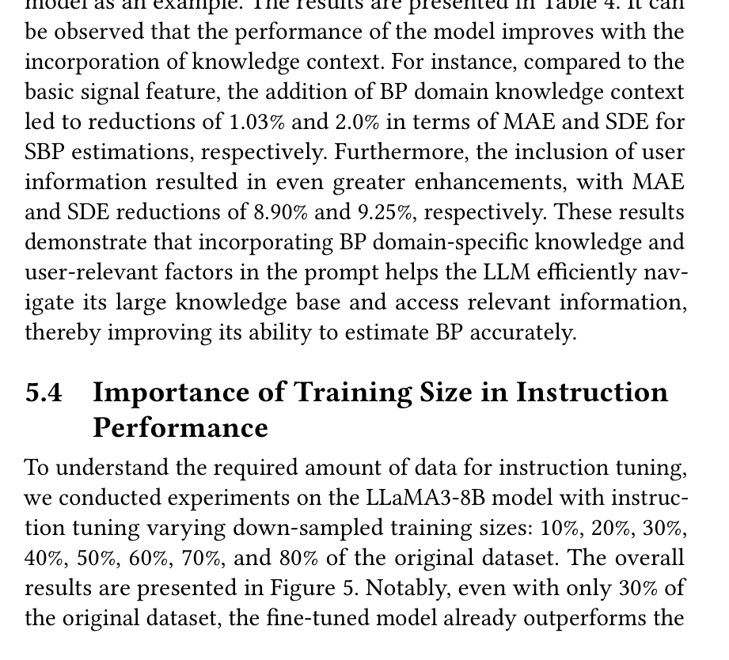

*图 2：数据利用效率对比。在 CAS-BP 数据集上，基于生理机制解耦的 LLaMA-3-8B 仅使用 30% 的训练样本，预测精度便超越了使用 80% 全量数据充分训练的传统基线模型。*

#### 关键实验结果与启示

- **误差显著收敛**：通过引入血流动力学解耦 Prompt，收缩压（SBP）的平均绝对误差（MAE）相对未经机制引导的基线 Prompt 直接下降了 **8.90%**；
- **惊人的样本效率**：在涵盖 1,272 名受试者的 CAS-BP 队列中，微调后的 LLaMA-3-8B **仅使用 30% 的训练数据，就击败了使用 80% 全量数据训练的 AdaBoost 等传统回归基线**。

这一结果有力证明：**当领域知识足够确定时，将其作为结构化归纳偏置注入大模型，能够产生极强的杠杆效应，极大程度弥补生理时序数据样本少、分布窄的劣势。**

---

### 1.3 Time-LLM：跨模态文本原型重编程

如果手头完全没有标注数据，或者只有少量的几个样本，无法做深度的生理机制建模，大模型还能赋能时序吗？

Monash 大学与蚂蚁集团发表在 ICLR 2024 的 **Time-LLM**（*Time Series Forecasting by Reprogramming Large Language Models*）探索了另一种视角：**跨模态重编程（Cross-Modality Reprogramming）**。

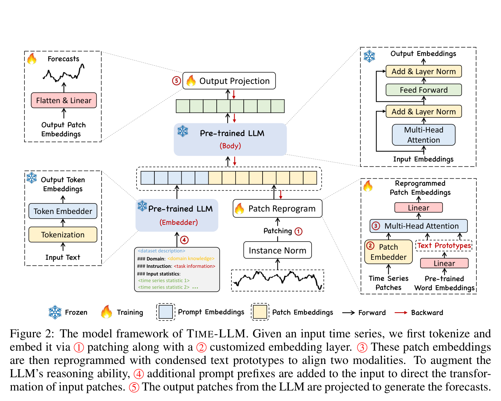

*图 3：Time-LLM 模型框架。冻结 LLM 主干参数，通过轻量级交叉注意力层将时序补丁（Patch）对齐到预训练词表的文本原型（Text Prototypes）凸组合中。*

#### 核心设计要点

1. **拒绝破坏语义流形**：直接微调一个 7B 大模型去预测时序，不仅显存开销极大，还很容易破坏模型在海量语料上建立的通用常识推理能力。Time-LLM 选择**完全冻结大语言模型的所有参数**；
2. **文本原型（Text Prototypes）软组合**：从语言模型的词表中挑选出一批代表性词向量作为锚点。将连续时序通过 RevIN 标准化并切分成 Patch 向量后，利用 Multi-Head Cross-Attention，将每个时序 Patch 映射为文本原型的加权组合：  
   $\widetilde{P} = \text{Softmax}\left(\frac{Q E'^T}{\sqrt{d}}\right) E'$  
   这在数学上保证了时序特征被投影在 LLM 预训练的合法语义流形内；
3. **少样本泛化优势**：在少样本（Few-shot 5%～10% 训练集）测试中，Time-LLM 依靠大模型原生的通用关联推理能力，全面压制了从头开始训练的纯时序网络。

---

## 二、 理解篇：用自然语言打破时序黑盒，重构因果链条

### 2.1 传统时序模型的“黑盒病”与临床信任危机

在心电图（ECG）自动分析领域，这种困境尤为尖锐。一个训练良好的分类网络输入一段心电波形，输出“广泛前壁心肌梗死”。

但临床医生的诊断逻辑绝不是这样的。医生看心电图时，有着严格的四步临床推理路径：

1. **看节律与心率**：P 波是否存在？P-P 间期是否匀齐？心率是多少？
2. **量时间与间期**：PR 间期有没有超过 200 ms？QRS 波群时限是否宽于 120 ms？QTc 间期是否延长？
3. **查形态与抬高**：V1 到 V4 导联的 ST 段是否有特征性的弓背向抬高（超过 0.1 mV）？T 波是否对称倒置？
4. **综合作出判定**：根据指南阈值，确定是急性心梗、束支阻滞还是电解质紊乱。

以往的多模态医疗大模型往往模仿了“全局印象”，模型根据波形整体粗暴地吐出诊断名词，幻觉频发且完全丢失了中间这套因果链条。

---

### 2.2 GEM：微观波形参数物理锚定（Grounded ECG）

北京大学洪申达团队联合新加坡国立大学冯梦凌团队在 NeurIPS 2025 发表的成果 **GEM**（*Empowering MLLM for Grounded ECG Understanding with Time Series and Images*），首次系统性解决了这一黑盒难题。

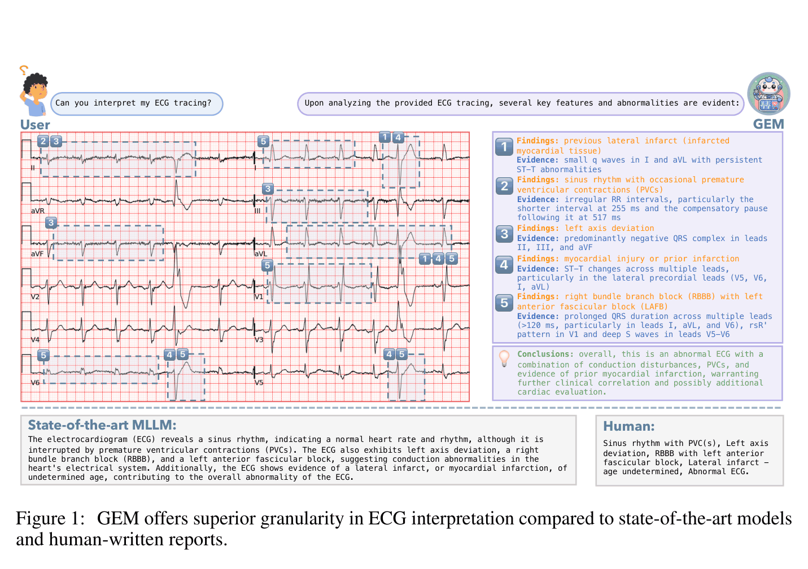

*图 4：GEM 与现有大模型及医生报告的粒度对比。现有基线直接给出抽象诊断结论，而 GEM 强制测量出微观波形参数与异常位置，提供具备可验证证据链的解读。*

#### 破局理念：可锚定心电理解（ECG-Grounding）

GEM 提出，大语言模型在输出任何定性诊断前，**必须先完成量化参数的物理锚定**：

- 严格测量出 PR 间期（ms）、QRS 间期（ms）、QT/QTc 间期（ms）；
- 标定 ST 段抬高或压低的确切毫伏数（或毫米数），指出具体出现在哪些导联；
- 将输出的诊断结论严格绑定在这些测量参数上（例如：$\text{PR 间期} = 224\text{ ms} > 200\text{ ms} \implies \text{一度房室传导阻滞}$）。

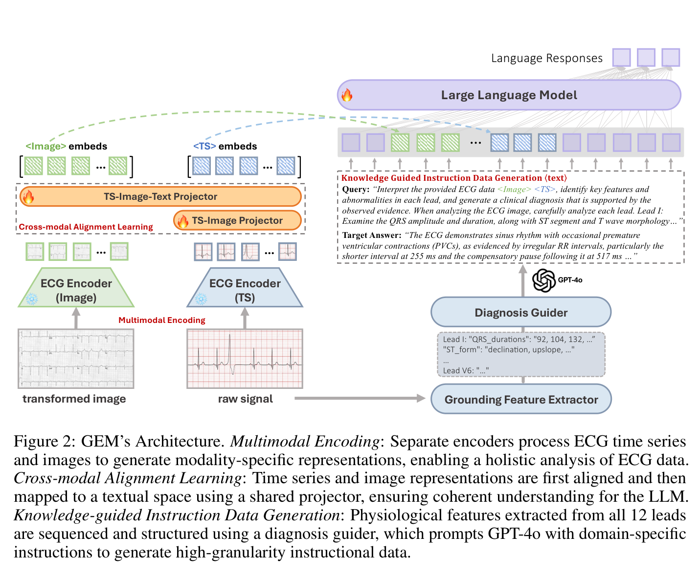

*图 5：GEM 双编码器架构图。结合 1D ECG 原始高频波形编码器与 2D 12-导联打印图纸视觉编码器，经过投影层输入 LLM，生成具备物理锚定的临床因果解释。*

#### 双编码器架构与临床表现

- **时序-视觉统一双编码器**：结合了 1D 原始高频时序编码器（感知毫秒级高频微观形态）和 2D 视觉编码器（对齐心电图纸的宏观几何排布习惯）；
- **实测性能飞跃**：相比于无物理锚定的常规医疗多模态大模型，GEM 在心血管疾病诊断准确率上提升了 **7.4%**，临床可解释性提升了 **22.7%**，病理依据锚定准确率提升了 **25.3%**。

**当模型必须给出精确的物理参数证据时，医疗大模型常见的虚假幻觉便被客观的生物物理边界牢牢锁死。**

---

### 2.3 PPG-LM：多尺度临床语言对齐与连续时间 RoPE

智能手表最常用的传感器是光电容积脉搏波（PPG）。以往学术界习惯用自监督对比学习（如 SimCLR、BYOL）或者掩码重建（MAE）来预训练脉搏模型。但纯波形自监督学到的特征高度偏向局部的几何统计，下游迁移到具体疾病或药物反应时，表现往往后劲不足。

Emory 大学、UCLA 与 Google 联合推出的 **PPG-LM**（*PPG-LM: Multi-Scale Pulse-Language Foundation Model for Emergency and Clinical Medicine*，arXiv:2609.33516），将脉搏波与语言的对齐推向了全新高度。

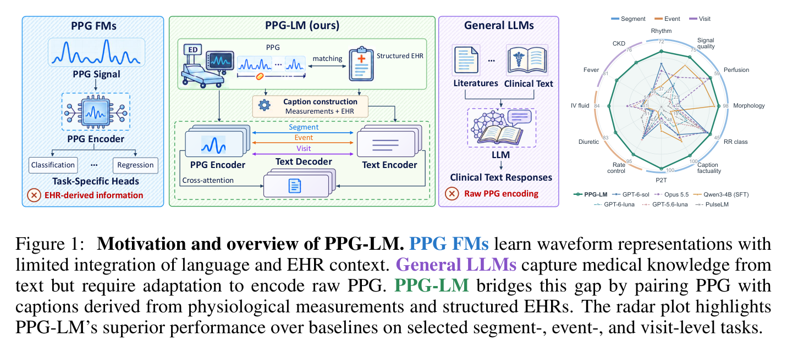

*图 6：PPG-LM 的动机与整体概览。传统纯波形基模（左）只能服务于孤立的单一任务 Head；而 PPG-LM（中）通过将脉搏波形与多尺度临床语言对齐，具备了生成、分类、检索等多任务全能接口。*

#### 核心机制一：真实急诊病历的多尺度语言对齐

研究团队基于大规模急诊重症数据集 MC-MED（涵盖 36,000+ 名患者、73,700 小时连续脉搏波），将 PPG 信号与电子病历（EHR）构建了三个尺度的语言对齐：

- **秒级片段（Segment-level）**：基于数字信号处理算法（pyPPG）提取心率、重搏波切迹、信噪比，生成局部形态描述；
- **事件级（Event-level）**：对应患者在急诊期间的急救用药（如升压药、降率药、利尿剂）注射与生命体征急剧波动；
- **就诊级（Visit-level）**：对应整场就诊的最终诊断、合并慢性病史与转归结果。

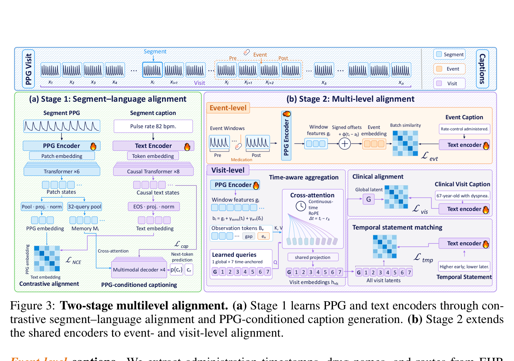

*图 7：PPG-LM 两阶段多层次对齐流水线。第一阶段利用 CoCa 对称对比学习建立波形与文本编码器，第二阶段利用连续时间 RoPE 与多尺度聚合器进行长程就诊级理解。*

#### 核心机制二：连续物理时间 RoPE（Continuous-Time RoPE）

在现实佩戴中，用户洗澡、充电或剧烈运动会导致信号断流数十分钟甚至数小时。传统的时序模型采用离散的位置编码（Step 1, Step 2, Step 3），一旦中间缺失，必须人为插值补齐，这在长时间尺度下会造成严重的数据失真。

PPG-LM 在此展现了一个极具启发性的设计：**将旋转位置编码（RoPE）直接绑定在真实的物理时间差上**。

- 每一个脉搏 Token 的旋转矩阵角度不是它的序列序号，而是它相对于基准时刻的**真实物理分钟数 $\Delta t$**；
- 配合 Perceiver 结构的固定潜变量探针（Latent Probes），即便中间断流 3 个小时，模型也能在不进行任何人工插值的前提下，准确感知生理特征在时间轴上的长程演变与昼夜节律衰减。

#### 评测结果：语言带来的表征越迁

在 32 项横跨急诊、ICU 和围手术期的临床分类与回归测试中，**PPG-LM 冻结的特征全面击败了 PaPaGei-S、Pulse-PPG 等现有脉搏基座模型，以及 MOMENT、Chronos-2 等通用时序大模型**。这充分证明：**经过临床语言语义锚定学到的时序表征，其泛化能力远高于在纯波形上闭门造车学到的自监督表征。**

---

### 2.4 SensorLM：多传感器时序的常识消歧

Google Research 在 NeurIPS 2025 发布的 **SensorLM**（*Learning the Language of Wearable Sensors*，arXiv:2506.09108），利用 10.3 万名 Fitbit 用户近 6,000 万小时的真实多传感器数据，展示了大语言模型在**多传感器消歧**上的常识价值。

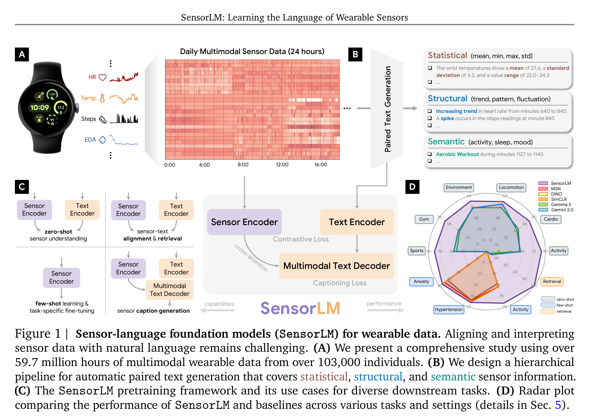

*图 8：Google SensorLM 概览。将智能手表的 5 种异构传感器（PPG、三轴加速度、皮电 EDA、体温、气压计）统一映射至文本空间，实现零样本人体活动识别（HAR）、双向图文检索与状态生成。*

在日常佩戴中，单一传感器往往充满二义性：

- 用户的瞬时心率从 70 骤升至 125 bpm。纯看心率波形，模型无法推测原因。
- 此时结合手腕的三轴加速度计（ACC）与外周皮电反应（EDA）：
  - **情境 A**：心率飙升 + ACC 高振幅规律振动 $\implies$ 大模型常识判定为“户外跑步或椭圆机运动”；
  - **情境 B**：心率飙升 + ACC 几乎静止 + EDA 皮电急剧攀升 $\implies$ 大模型常识判定为“处于答辩、演讲或心理焦虑应激状态”。

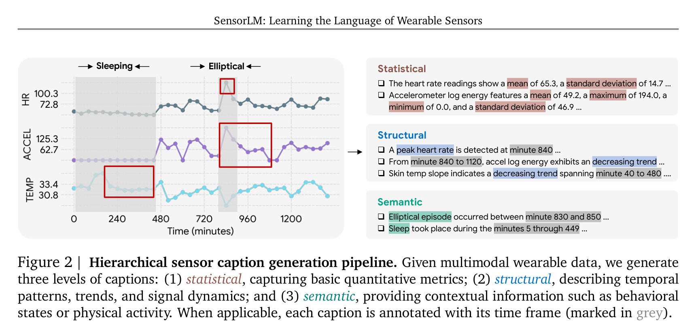

*图 9：SensorLM 的分层打标生成流程。自底向上构建统计级（极值/均值）、结构级（趋势变化）与语义级（行为与生理状态）三层描述，低成本孵化海量多模态对齐语料。*

SensorLM 表明，当多个生理时序信号汇入大模型时，大语言模型不仅是一个解码器，更是一个**拥有物理与生理常识的仲裁者**。

---

## 三、 展望篇：时序 + LLM + Agent 的终局形态

从 CBPM-LLaMA 的“先验赋能”，到 GEM 和 PPG-LM 的“语言理解”，时序与语言的结合已经展现出巨大潜力。但目前大部分系统仍停留在**静态的单向管道**中：要么是波形输入吐出文本报告，要么是文本 Prompt 辅助数值预测。

一旦大模型真正理解了时序波形，下一步的自然演进，就是**接入智能体（Agent）生态**。

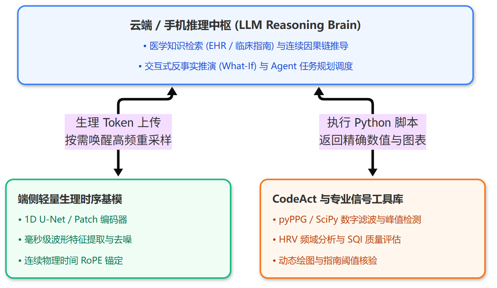

*图 10：端云分层协同的时序-语言健康 Agent 架构。底层负责毫秒级高频波形感知与连续时间锚定，顶层负责因果推理与工具调用闭环。*


---

### 3.1 从单向解读到双向交织：TimeBraid 与反事实推演（What-If）
如果时序和语言不再分先后，而是深度交织在同一个自回归序列里呢？

UCSD 与 USC 团队在 2026 年提出的 **TimeBraid**（*A Foundation Model for Deeply Interleaved Time Series and Language*，arXiv:2609.29792），给出了一个具有前瞻性的答案。

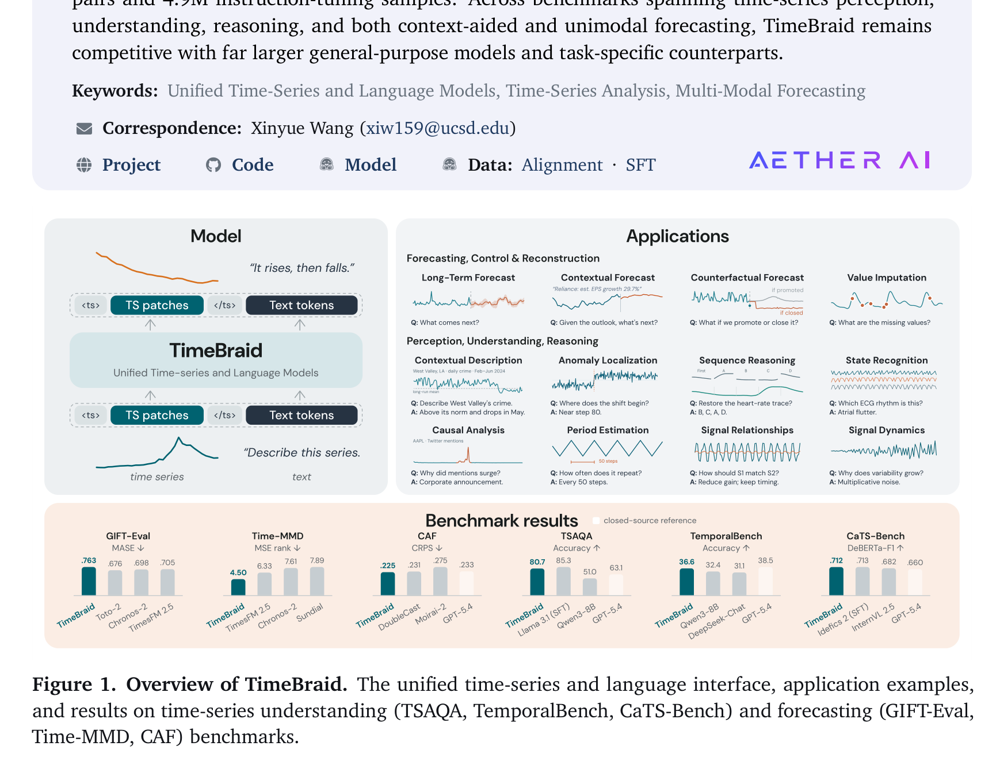
*图 11：TimeBraid 深度交错架构。连续时序 Patch 与离散文本 Token 在统一自回归 Transformer 中并存，原生支持时序问答、反事实推演（What-If）与数值生成。*

TimeBraid 采用 **Mixture-of-Tokens (MoT)** 架构：文本用常规 Token 表示，连续时序切片为连续向量，二者在自回归注意力机制中完全平等。

这种架构解锁了一种极其强大的能力 —— **反事实推演（Counterfactual Reasoning / What-If）**：
- **场景**：一位糖尿病或高血压患者正在监测连续生理指标；
- **提示**：输入 `[过去 3 小时连续波形] + [文本：“患者在第 120 分钟服用了 5mg 降压药，同时喝了一杯高糖饮料”] + [请预测未来 2 小时的生理指标变化]`；
- **输出**：大模型结合预训练中的药代动力学（PK/PD）知识与当前波形状态，不仅能用文字解释生理机制，还能**自回归生成一条符合物理事实的未来波形曲线**。

这种“波形-文本-波形”的双向推演，彻底改变了传统时序模型只能基于历史趋势外推的局限，让模型具备了在虚拟空间中推演生理干预后果的能力。

---

### 3.2 神经符号协同：CodeAct Agent 解决浮点计算幻觉
在大模型理解时序的过程中，一个无法回避的物理事实是：**大语言模型不擅长做高精度的浮点连续积分、快速傅里叶变换（FFT）或复杂的数字滤波**。强行让 LLM 数波峰往往会产生荒谬的幻觉。

解决这一矛盾的最优解是 **神经符号协同（CodeAct Agent）**：
- **LLM 做规划中枢，专业工具做精确计算**：当大模型怀疑用户存在夜间睡眠呼吸暂停或房颤时，它不再自己去猜心率变异性（HRV），而是自主生成并执行一段 Python 代码：
  ```python
  import scipy.signal as signal
  from pyPPG import ppg_sig_processing

  # 自主调用专业 DSP 库计算频域 HRV 与重搏波切迹落差
  clean_ppg, sqi = filter_and_evaluate(raw_waveform)
  lf_hf_ratio = compute_hrv_frequency_domain(clean_ppg)
  ```
- **闭环反思**：代码执行环境返回精确的浮点数与图形结果，大模型读取结果后，对照临床指南作出最终诊断。UIUC 的 CodeAct 实证表明，引入自主代码执行后，大模型在复杂时序感知与数据推理任务上的达标率平均提升了 **38.6%**。

---

### 3.3 端云分层的闭环主动健康管家
结合目前消费电子的算力现实，我们能够清晰预见未来可穿戴健康系统的最终落地形态：
1. **手表端（毫秒级端侧感知层）**：部署极轻量的 1D 卷积网络（如 Samsung HiMAE 的 1D U-Net，参数量 <1M，CPU 延迟 <1ms），以极低功耗负责高频去噪、信号质量评估（SQI）并提取紧凑的生理 Token；
2. **手机/云端（认知与 Agent 层）**：维护包含连续时间 RoPE 的状态空间与大语言模型。大模型结合用户的病史档案、用药记录、日程安排，全天候静默推演健康状态；
3. **主动交互与闭环干预**：当检测到隐匿性风险时，不再是弹出一个吓人的冰冷数字，而是给出一条带有清晰波形测量证据、因果解释且具备行动建议的自然语言对话。

---

## 四、 对研发单纯时序基模（Pure TSFM）的反哺思考

回过头来看，跳出单纯的 NLP 视角，大模型与生理时序的这些碰撞，对我们正在研发的纯数值时序基础模型（Pure TSFM）有哪些直接的技术反哺？

1. **分块 Tokenizer 不能做纯黑盒切片，必须保留局部形态特征**  
   很多通用时序基模把波形粗暴地切成 16 或 32 点的 Patch，直接丢给线性层。CBPM-LLaMA 和 GEM 启示我们：时序的底层表征应当在编码阶段显式提取或保全生物物理参数（极值点、间期、斜率、切迹比值）。哪怕只作为辅助损失函数，也能极大地帮助模型建立物理守恒约束。
2. **位置编码必须拥抱连续物理时间流形**  
   现实中的物联网与可穿戴数据天然是不规则、间断采样的。继续使用基于序列离散索引的位置编码（`pos = 0, 1, 2...`）注定无法适应野外环境。PPG-LM 的**连续物理时间 RoPE**（将旋转角度绑定在真实时间差 $\Delta t$ 上）提供了一个优雅的工业级示范。
3. **优化目标应引入机制守恒与中间物理量约束**  
   单纯优化 MSE 重构误差容易导致模型输出平滑而无特征的假波形。在自监督训练中，结合频域能量保真损失、或引入类似平均压/脉压差的中间状态生理不变量，是防止时序基模在分布外泛化时产生物理幻觉的有效手段。
4. **语言是时序走向真实世界的终极统一接口**  
   不要试图为每一个下游业务开发一个专用的回归/分类 Head。将时序表征投影到语言对齐空间，利用自然语言 Prompt 作为统一的控制界面，才是让基础模型跨越任务鸿沟、赋能广阔现实世界的最优路径。

---

## 参考文献与精选开源项目

1. **CBPM-LLaMA (ACM-BCB '24)**: *Large Language Models for Cuffless Blood Pressure Measurement From Wearable Biosignals*. arXiv:2406.18069.  
   开源仓库: [GitHub: zdzdliu/CAS-BP](https://github.com/zdzdliu/CAS-BP)
2. **GEM (NeurIPS 2025)**: *GEM: Empowering MLLM for Grounded ECG Understanding with Time Series and Images*. arXiv:2503.06073.  
   开源仓库: [GitHub: lanxiang1017/GEM](https://github.com/lanxiang1017/GEM)
3. **PPG-LM (arXiv 2026.09)**: *PPG-LM: Multi-Scale Pulse-Language Foundation Model for Emergency and Clinical Medicine*. arXiv:2609.33516.  
   论文预印本: [arXiv:2609.33516](https://arxiv.org/abs/2609.33516)
4. **SensorLM (NeurIPS 2025)**: *SensorLM: Learning Multimodal Sensor-Language Representations*. arXiv:2506.09108.  
   官方开源代码: [GitHub: Google-Health/consumer-health-research/sensorlm](https://github.com/Google-Health/consumer-health-research/tree/main/sensorlm)
5. **TimeBraid (arXiv 2026.09)**: *TimeBraid: A Foundation Model for Deeply Interleaved Time Series and Language*. arXiv:2609.29792.  
   论文预印本: [arXiv:2609.29792](https://arxiv.org/abs/2609.29792)
6. **Time-LLM (ICLR 2024)**: *Time-LLM: Time Series Forecasting by Reprogramming Large Language Models*. arXiv:2310.01728.  
   开源仓库: [GitHub: KimMeen/Time-LLM](https://github.com/KimMeen/Time-LLM)
7. **HiMAE (ICLR 2026)**: *HiMAE: Hierarchical Masked Autoencoders Discover Resolution-Specific Structure in Wearable Time Series*. arXiv:2510.25785.  
   开源仓库: [GitHub: Simonlee711/HiMAE](https://github.com/Simonlee711/HiMAE)

---

> **欢迎交流与共建**  
> 本文由开源知识库项目 [Wearable-Physiological-Foundation-Models](https://github.com/tujy859/Wearable-Physiological-Foundation-Models) 整理策划。该项目持续追踪全球在智能手表、连续血糖监测（CGM）以及多模态生理健康基础模型领域的最新突破。如果您对可穿戴生理计算、时序健康基模与数字生物标志物有任何想法，欢迎在仓库提 Issue 交流！
