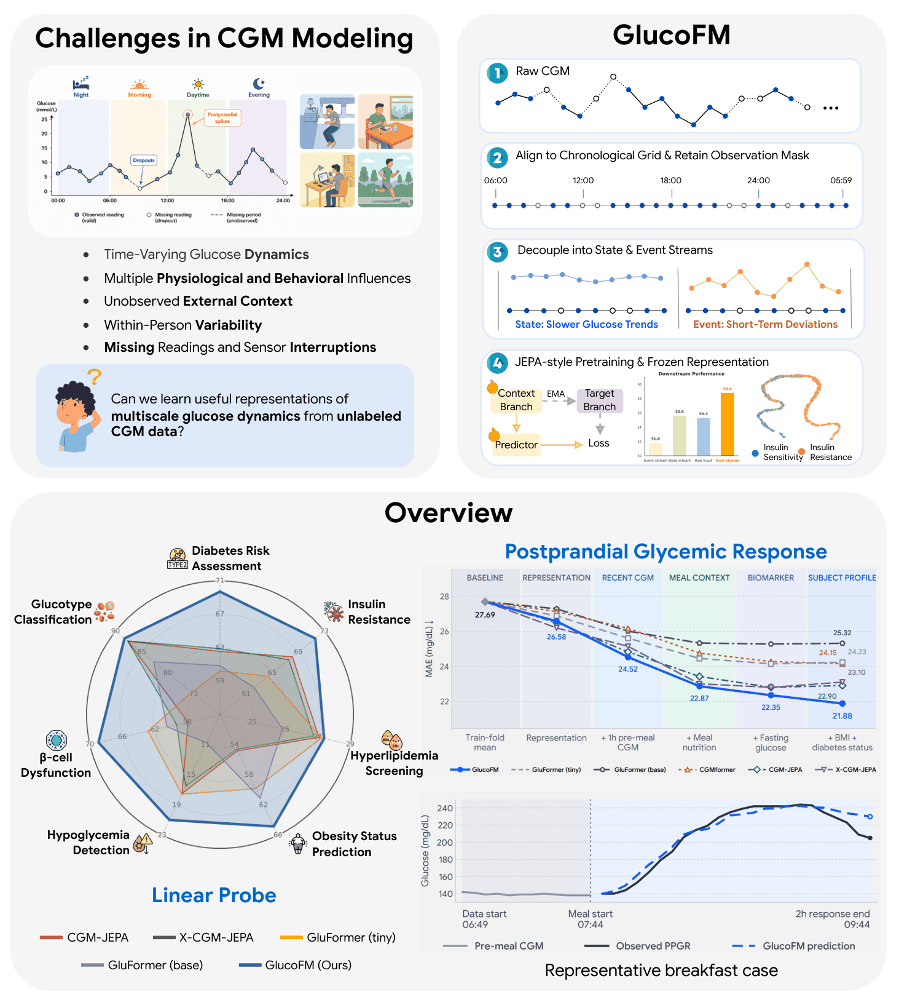
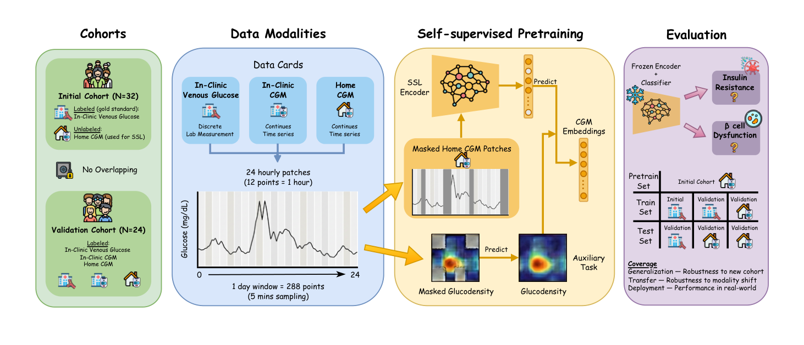
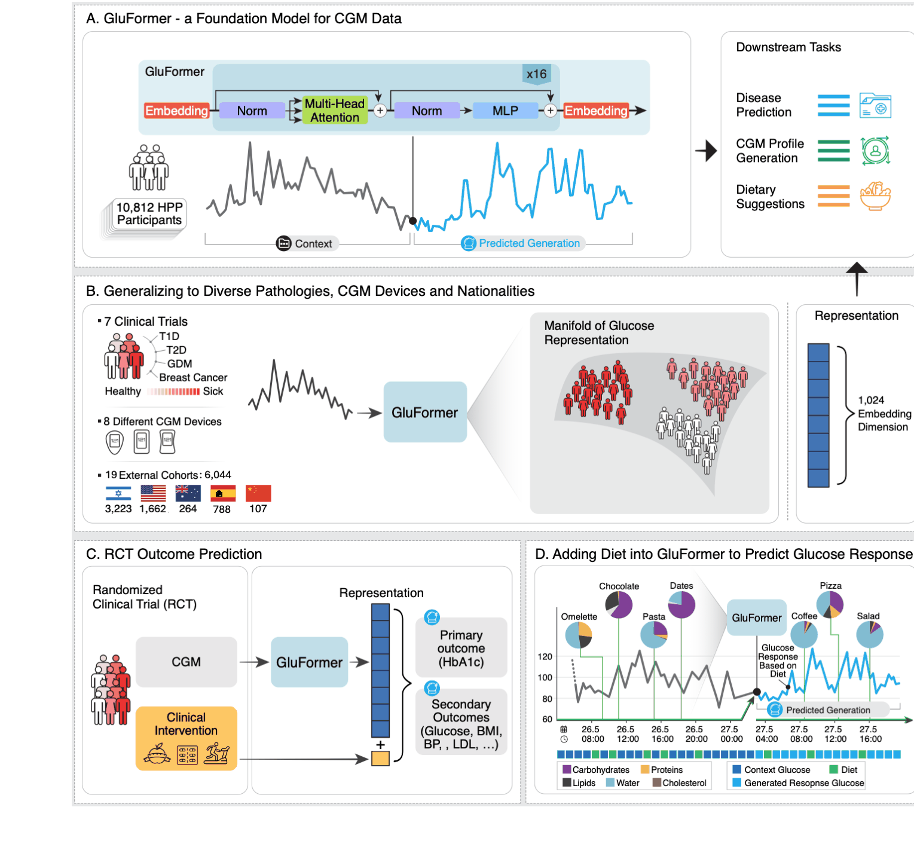
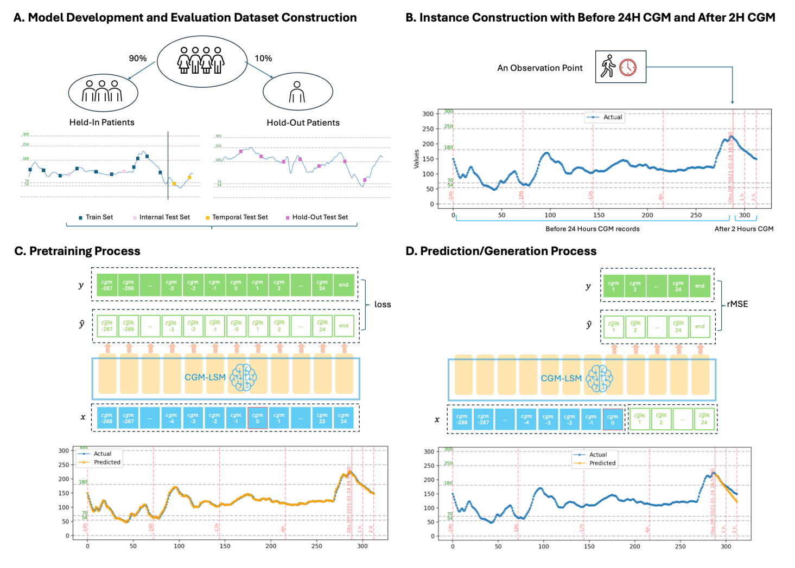
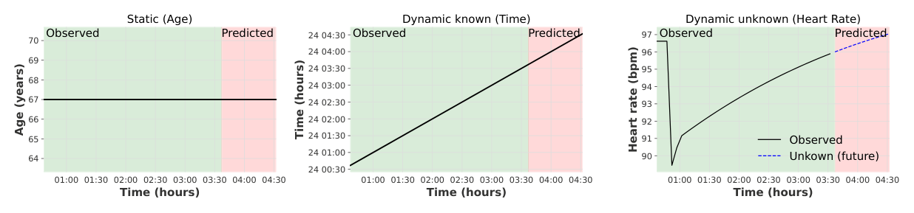

# 连续血糖监测（CGM）基础模型

连续血糖监测（Continuous Glucose Monitoring, CGM）通过皮下微创传感器每 5～15 分钟测定组织间液葡萄糖浓度，是代谢与内分泌疾病数字化管理的重要手段。本专题对比以血糖时序为核心表征对象的代表性基础模型与标准化评测基准，梳理其架构选型与表征学习设计空间。

## 目录

- [1. CGM 信号生理特性与时序表征要点](#1-cgm-信号生理特性与时序表征要点)
- [2. 经典连续血糖基础模型与基准](#2-经典连续血糖基础模型与基准)
  - [GlucoFM](#glucofm)
  - [CGM-JEPA](#cgm-jepa)
  - [GluFormer](#gluformer)
  - [CGMformer](#cgmformer)
  - [CGM-LSM](#cgm-lsm)
  - [GlucoBench](#glucobench)
- [3. 核心 CGM 基础模型与基准横向对比](#3-核心-cgm-基础模型与基准横向对比)
- [4. CGM 基础模型设计空间实验观察](#4-cgm-基础模型设计空间实验观察)

---

## 1. CGM 信号生理特性与时序表征要点

相比高频波形信号（如 25～100 Hz PPG），CGM 呈现出低采样率、强生物节律及独特的生化动力学特性：

1. **昼夜节律与 288 点固定时间网格**：
   - 商用 CGM（如 Dexcom、Abbott Libre、Medtronic）采样间隔通常为 5 分钟（部分早期型号为 15 分钟）。
   - 单日完整时程包含 $24 \times 60 / 5 = 288$ 个读数点。血糖水平受人体皮质醇分泌、胰岛素敏感性周期及睡眠节律支配，具有鲜明的 24 小时昼夜波动。
2. **皮下间质液生化延迟与非线性突变**：
   - 传感器测定的是组织间液葡萄糖，相比静脉与毛细血管全血存在 5～15 分钟的生理滞后。
   - 信号由慢速生理基线漂移（空腹稳态、基础胰岛素吸收）与快速突变（餐后冲击、外源胰岛素注射、夜间体位压迫导致的传感器骤降）叠加而成。
3. **观测缺失（Observational Missingness）**：
   - 探针脱落、蓝牙断连与传感器校准会导致记录碎片化。盲目使用密集线性插值会引入虚假的平滑先验，显式保留观测掩码更符合物理测量特性。

---

## 2. 经典连续血糖基础模型与基准

### GlucoFM

Google Research / UNSW · 2026 · [论文](https://arxiv.org/abs/2605.30865) · [基准论文](https://arxiv.org/abs/2606.06881)

图源：GlucoFM 论文 Fig. 1（arXiv:2605.30865）

GlucoFM 针对血糖动力学的时间尺度差异，提出了双流解耦联合嵌入预测架构（Dual-Stream JEPA）。

**方法**

- **双流分解**：利用可学习因果高斯滤波器提取低频基线的状态流（State Stream，捕捉慢生理稳态），并将残差作为事件流（Event Stream，捕捉餐后尖峰与突发偏移）。
- **时间网格与掩码保留**：将不规则记录映射至统一的 288 点单日网格，短时缺失（≤ 1 小时）在网格内标注掩码并传入损失函数，避免插值伪影。
- **预训练目标**：结合掩码上下文潜空间预测（MCR）与时序动力学残差转移预测（TD），通过 EMA 目标编码器在潜表征空间中学习自监督表征。
- **轻量参数**：可训练参数量为 **0.72M**（3 层 Transformer、特征维度 128）。

**结果**

- 在包含 477 名受试者（10.9 万小时）的数据上预训练，在 7 项临床代谢下游任务（糖尿病风险、胰岛素抵抗、Glucotype 分型等）中评估，平均 PR-AUC 相较对比基线有所提升。

---

### CGM-JEPA

CRUISE Research Group · 2025 · [权重与数据集](https://huggingface.co/CRUISEResearchGroup/CGM-JEPA)

图源：CGM-JEPA 论文 Fig. 1

CGM-JEPA 是基于公开可用数据构建的单流联合嵌入预测基础模型，提供了公开可复现的预训练权重与评测基准。

**方法**

- 采用 24 patch × 12 步的一维卷积分块与 Transformer 骨干。
- 使用 EMA 动量目标编码器（动量系数 0.997）与轻量预测器，在隐空间进行非生成式自监督预测。
- 提供了开源预训练语料 `CGM-JEPA-Pretraining`（涵盖 228 人）与下游测试集 `CGM-JEPA-Downstream`。

---

### GluFormer

Pheno.AI / Weizmann Institute / NVIDIA · Nature 2026 · [论文](https://www.nature.com/articles/s41586-025-08639-6) · [代码](https://github.com/Guylu/GluFormer)

图源：GluFormer 论文 Fig. 1（Nature 2026）

GluFormer 是基于大规模前瞻性人群队列训练的长程因果自回归血糖基础模型。

**方法**

- **分箱离散化**：将连续血糖值划分为 460 个离散分箱，将连续时序建模转化为自回归自预测任务（Next-Token Prediction）。
- **长上下文窗口**：支持最长 1200 个词元（约 12.5 天连续监测）的上下文序列。
- 架构基于 GPT 式单向因果 Transformer，参数量约为 135M（16 层、特征维度 1024）。
- 预训练语料基于人类表型组计划（HPP）10,812 名受试者的超 1000 万条连续血糖记录。

**结果**

- 支持多模态饮食营养输入以模拟进食后的血糖反应。
- 在跨越 2～12 年时间跨度的长程随访中，可基于入组基线 CGM 表征评估受试者未来发生 2 型糖尿病及相关代谢异常的风险。

---

### CGMformer

中国科学院 / 上海交通大学医学院附属第六人民医院 · NSR 2025 · [论文](https://doi.org/10.1093/nsr/nwaf082) · [代码](https://github.com/YurunLu/CGMformer)

CGMformer 是基于大规模中国人群真实临床 CGM 记录训练的掩码自编码基础模型。

**方法**

- 采用双向 Transformer 编码器架构（参数量 0.85M～10M 多种规格）。
- 将单日 288 点血糖记录量化映射为 260 个离散词元，并引入 PAD 与 MASK 标记。
- 在预训练阶段采用类似 BERT 的掩码语言模型（MLM）目标，由未掩码上下文重构被遮蔽的血糖状态。
- 预训练汇集了中国人群 58,847 名受试者共 131 万天的真实世界 CGM 监测数据。

**结果**

- 在院内血糖波动评估、糖尿病视网膜病变（DR）筛查以及口服降糖药效果评估等临床任务中验证了表征迁移性能。

---

### CGM-LSM

约翰霍普金斯大学 (JHU CDHAI) · 2024 · [论文](https://arxiv.org/abs/2412.09727) · [代码](https://github.com/JHU-CDHAI/cgmlsm)

图源：CGM-LSM 论文 Fig. 1（arXiv:2412.09727）

CGM-LSM 探索将预训练语言模型（GPT-2 Small 架构，约 124M 参数）直接迁移到血糖自回归预测任务。

**方法**

- 将连续血糖数值量化为 400 个离散词元。
- 输入窗口为 26 小时（24 小时历史上下文 + 2 小时自回归预测目标）。
- 基于 592 名受试者的约 1600 万条读数进行训练，针对未来 30、60 与 120 分钟的短程血糖波动进行外推预测。

---

### GlucoBench

Texas A&M University · ICLR 2024 · [论文](https://openreview.net/forum?id=u4UaZq1Goi) · [代码](https://github.com/IrinaStatsLab/GlucoBench)

图源：GlucoBench 论文 Fig. 2（ICLR 2024）

GlucoBench 针对以往连续血糖预测研究中评估指标和数据集切分不统一的问题，构建了标准化的基准评测套件。

**要点**

- 整合了包含健康人群、1 型与 2 型糖尿病人群的公开 CGM 数据集。
- 确立了包含 RMSE、MAE、MARD 以及克拉克误差网格（Clarke Error Grid）临床区域比例在内的多维评估体系。
- 提供了基线模型实现与统一的数据加载接口。

---

## 3. 核心 CGM 基础模型与基准横向对比

| 维度 | GlucoFM | CGM-JEPA | GluFormer | CGMformer | CGM-LSM |
| :--- | :--- | :--- | :--- | :--- | :--- |
| **发表来源** | Google Research (arXiv 2026) | CRUISE Group (2025) | Pheno.AI (Nature 2026) | 中科院 / 上海六院 (NSR 2025) | JHU CDHAI (arXiv 2024) |
| **学习范式** | 双流 JEPA 潜空间预测 | 单流 JEPA 潜空间预测 | 因果自回归生成 | 掩码语言建模（MLM） | 因果自回归生成 |
| **输入表达** | 连续 Conv1d + 双流分解 | 连续 Conv1d 分块 | 460 Bins 离散化 | 260 Bins 离散化 | 400 Bins 离散化 |
| **参数量** | 0.72M | 约 0.5M | 约 135M | 0.85M～10M | 约 124M |
| **预训练规模** | 477 人（10.9 万小时） | 228 人（公开语料重组） | 10,812 人（>1000 万读数） | 58,847 人（131 万天） | 592 人（1600 万读数） |
| **时间上下文** | 单日 24 小时（288 点） | 单日 24 小时（288 点） | 1200 点（约 12.5 天） | 单日 24 小时（288 点） | 26 小时（24h 历史 + 2h 预测） |
| **缺失值处理** | 保留二值观测掩码 | 掩码保留 | 线性插值 | 特殊标记填充 | 连续完整性过滤 |
| **代码与权重** | 代码开源在论文中承诺 | 代码开源，权重公开（HF） | 官方代码开源，权重受限 | 官方代码与权重公开 | 官方代码开源 |

---

## 4. CGM 基础模型设计空间实验观察

在基于多种预训练目标（JEPA vs. 重建 vs. 因果）与网络架构（标准 Transformer vs. 双流分解 vs. 卷积基线）的对照测试中，展现出以下设计倾向：

1. **预训练目标函数的选取**：
   - 连续值逐点回归重建（MSE Recon）倾向于学习局部平滑先验，容易钝化高频生理突变。
   - 潜空间联合预测（JEPA）与自回归生成（Causal）迫使模型在隐空间建模整体趋势，在代谢表型分型等判别任务中表现相对稳健。
2. **双流分解的作用**：
   - 将低频基线（慢生理状态流）与高频事件（餐后冲击与干扰）显式解耦，能够为插补和趋势外推提供物理归纳偏置。
3. **缺失值显式掩码与插值的差异**：
   - 显式保留二值观测掩码并参与注意力计算，避免了盲目密集插值向模型注入虚假平滑信息，有助于提升跨传感器与真实佩戴场景下的适应能力。
