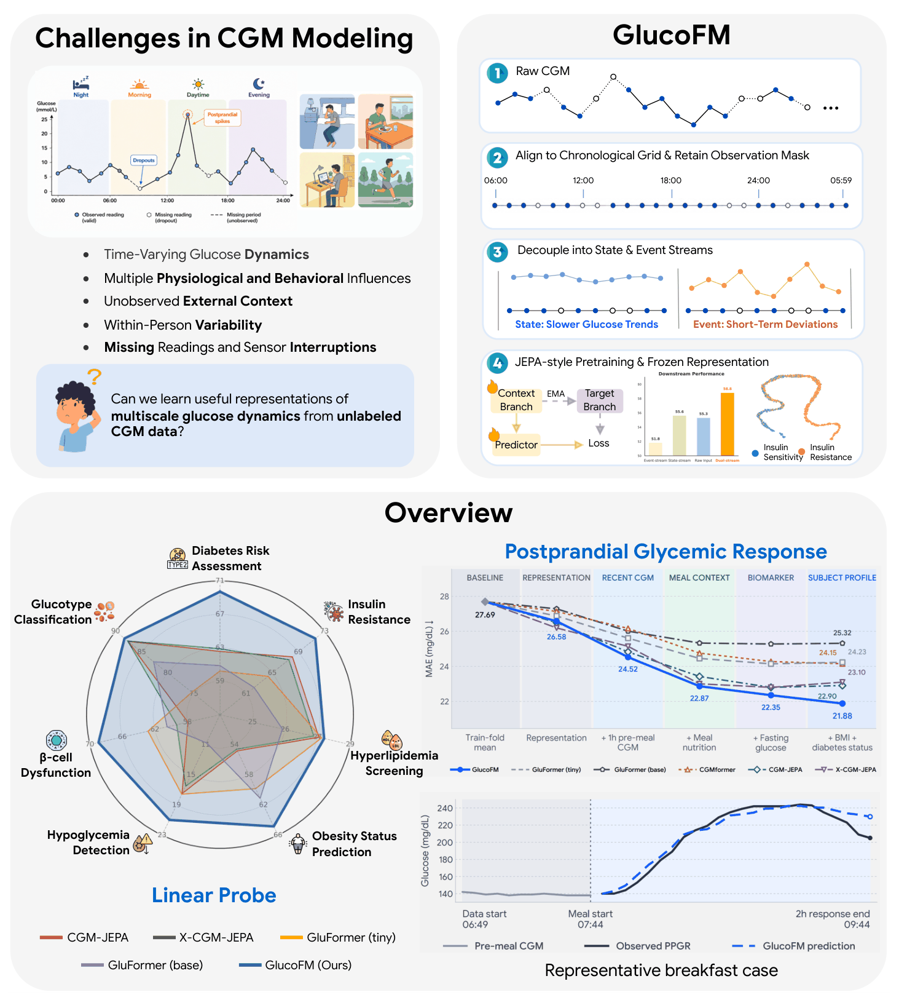
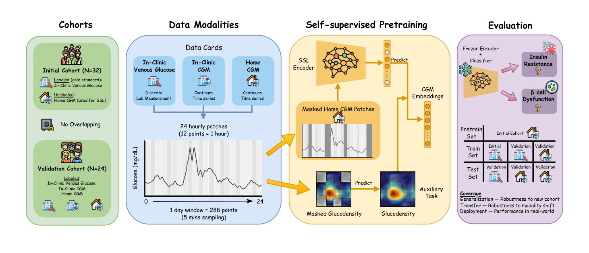
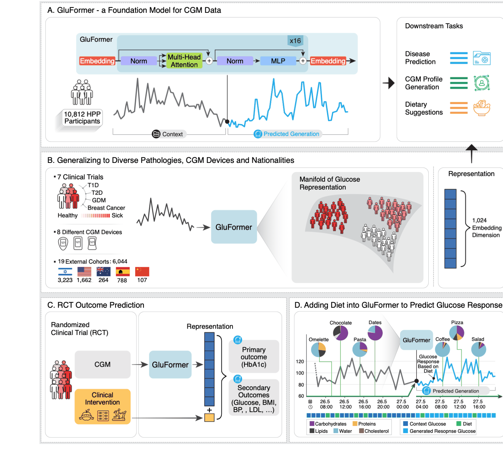
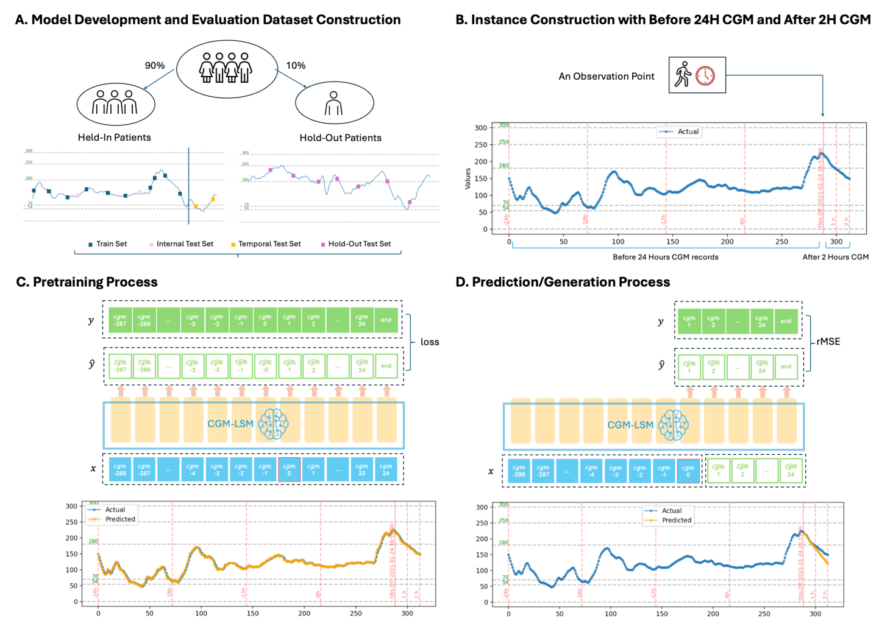
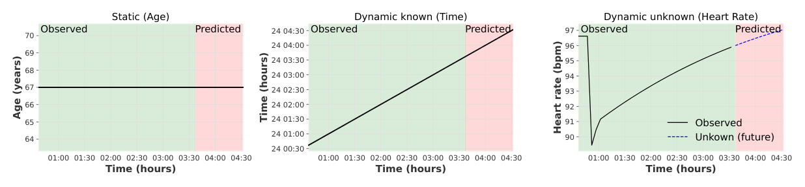
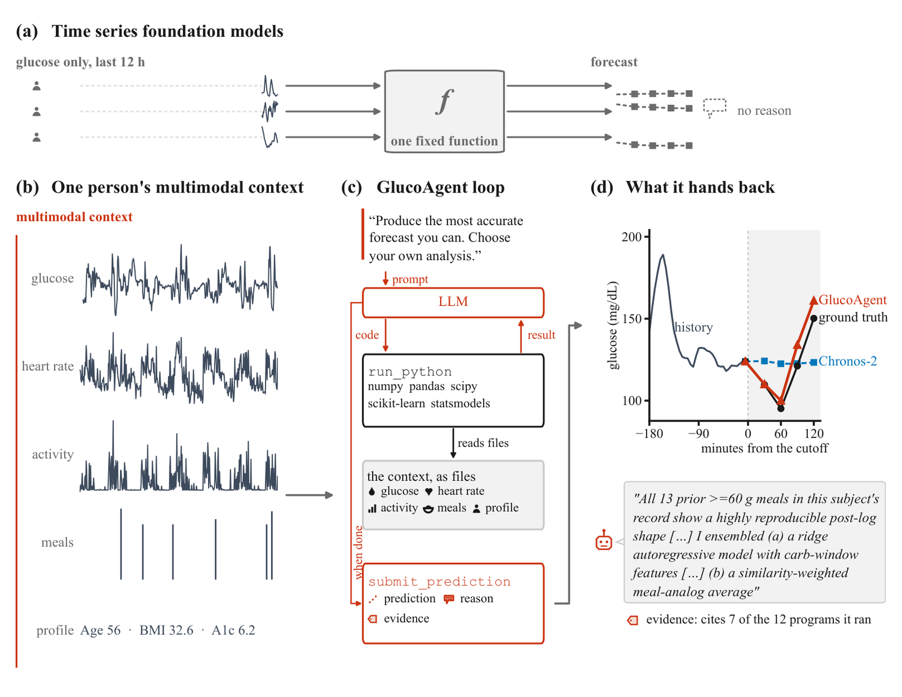

# 连续血糖监测（CGM）基础模型 (Continuous Glucose Monitoring Foundation Models)

连续血糖监测（Continuous Glucose Monitoring, CGM）通过皮下微创电化学传感器每 5～15 分钟连续测定组织间液葡萄糖浓度，是糖尿病及代谢综合征数字化管理的核心监测手段。本专题系统拆解以血糖时序为核心表征对象的代表性基础模型与标准化评测基准，并结合多目标、多架构全因子受控实验观察，总结 CGM 表征学习的设计空间与范式演进。[Agent 预测方法](#5-agent-预测方法)作为相关方法单独讨论，用于比较个人上下文的利用方式。

---

## 目录

- [1. CGM 信号生理特性与时序表征痛点](#1-cgm-信号生理特性与时序表征痛点)
- [2. 代表性连续血糖基础模型与评测基准](#2-代表性连续血糖基础模型与评测基准)
  - [GlucoFM](#glucofm)
  - [CGM-JEPA](#cgm-jepa)
  - [GluFormer](#gluformer)
  - [CGMformer](#cgmformer)
  - [CGM-LSM](#cgm-lsm)
  - [GlucoBench](#glucobench)
- [3. 核心 CGM 基础模型与基准横向对比](#3-核心-cgm-基础模型与基准横向对比)
- [4. CGM 基础模型设计空间实证洞察](#4-cgm-基础模型设计空间实证洞察)
- [5. Agent 预测方法](#5-agent-预测方法)
  - [GlucoAgent](#glucoagent)

---

## 1. CGM 信号生理特性与时序表征痛点

相比高频心血管波形信号（如 25～100 Hz PPG 或 250～500 Hz ECG），CGM 时序呈现出低采样率、强昼夜节律及独特的皮下生化动力学特性：

1. **昼夜节律与 288 点固定时间网格**：
   - 主流商用 CGM（如 Dexcom G6/G7、Medtronic Guardian）采样间隔为 5 分钟（部分型号如早期 Abbott FreeStyle Libre 为 15 分钟）。
   - 单日 24 小时完整时程恰好包含 $24 \times 60 / 5 = 288$ 个采样点。血糖波动受下丘脑-垂体-肾上腺轴皮质醇分泌（黎明现象）、胰岛素敏感性昼夜周期及睡眠节律调控，具有显著的 24 小时周期性。
2. **皮下组织间液生化延迟与双尺度动力学叠加**：
   - 传感器测定的是皮下组织间液葡萄糖，相比静脉或毛细血管全血存在 5～15 分钟的生理扩散滞后。
   - 信号在物理上由两个时间尺度叠加而成：**慢速生理基线漂移**（空腹血糖稳态、基础胰岛素释放与胰岛素抵抗底色）与**高频瞬态事件冲击**（进食碳水化合物引发的餐后血糖尖峰、外源短效胰岛素推注、剧烈运动消耗，以及夜间睡眠受压导致的传感器局部缺血假性骤降 Compression Artifact）。
3. **非随机观测缺失（Observational Missingness）**：
   - 传感器探针脱落、蓝牙传输断连与更换传感器时的初始化校准期会导致时序碎片化。在 CGM 建模中，传统的稠密线性插值或样条填补会向缺失区段注入虚假的平滑先验，破坏真实的餐后突变陡峭度与夜间稳态方差特征。

---

## 2. 代表性连续血糖基础模型与评测基准

### GlucoFM

> **发表信息**：arXiv 2026（2026 年 5 月） · [论文](https://arxiv.org/abs/2605.30865) · [配套基准 GlucoFM-Bench](https://arxiv.org/abs/2606.06881)  
> **机构**：Google Research / 新南威尔士大学 (UNSW)  
> **预训练数据**：477 名受试者（累计约 10.9 万小时连续血糖记录）  
> **开源状态**：论文公开（官方代码在论文中承诺开源）

图源：GlucoFM 论文 Fig. 1（arXiv:2605.30865）

GlucoFM（*GlucoFM: A Dual-Stream Foundation Model for Continuous Glucose Monitoring*）针对血糖时序中“慢稳态基线”与“快瞬态冲击”混杂的痛点，提出了轻量级双流解耦联合嵌入预测架构（Dual-Stream JEPA）。

#### 2.1 双流生理分解 (Dual-Stream Decomposition)

GlucoFM 在输入层将原始血糖序列解耦为两个并行的物理分支：
1. **状态流（State Stream，慢生理稳态）**：
   - 引入**可学习因果高斯滤波器（Learnable Causal Gaussian Filter）** 提取低频生理基线；
   - 滤波核带宽约束在 $\sigma \in [2, 12]$ 个网格步（对应物理时间约 10～60 分钟），通过 Sigmoid 重参数化与端到端反向传播自适应学习最优平滑尺度。
2. **事件流（Event Stream，瞬态偏移）**：
   - 残差项定义为 $\text{Event}(t) = \text{Signal}(t) - \text{State}(t)$；
   - 专门捕捉餐后血糖急剧拉升、运动后快速下降以及夜间局部受压伪影等高频突变成分。

#### 2.2 24h 时间网格对齐与观测掩码显式保留

- 将不规则采样时间戳对齐至统一的 288 点单日昼夜网格，**严格分离时间网格对齐与数值插值**；
- 显式保留二值观测掩码 $M \in \{0, 1\}$：对于 $\le 1\text{ h}$ 的短时缺失，在网格内标注 $M=0$ 并将掩码一路传递至注意力层与损失函数；对于 $> 1\text{ h}$ 的长时间断连，直接执行物理切段以防跨段污染。

#### 2.3 双预训练目标 (JEPA 潜空间预测 + 时序动力学残差)

GlucoFM 摒弃了在原始数值空间逐点重建的 MAE 范式，转向隐空间非生成式预测：
1. **掩码上下文潜空间预测（MCR, Masked Contextual Latent Prediction）**：
   - 随机掩蔽 50%～60% 的时序分块（Patch），由双向编码器根据可见分块预测被掩蔽分块在指数移动平均（EMA，动量系数 $0.997$）目标编码器中的潜表征向量；
   - 采用 Smooth L1 损失，并按分块内部真实有效观测点的比例对损失进行加权。
2. **时序动力学残差转移预测（TD, Temporal Dynamics Residual Prediction）**：
   - 引入隐空间状态递推头：$S_{\tau+1} = S_\tau + g(S_\tau, E_\tau, \tau)$；
   - 迫使模型显式建模当前慢状态 $S_\tau$ 在快事件 $E_\tau$ 与时间相位 $\tau$ 驱动下向下一时刻状态 $S_{\tau+1}$ 演变的物理过程。

#### 2.4 模型规模与下游临床评测

- **轻量级参数设计**：可训练参数量仅 **0.72M**（3 层 Transformer、4 注意力头、特征维度 $D=128$、前馈维度 $\text{FFN}=256$），单张 H100 GPU 即可完成全量预训练。
- **下游表征评估**：在配套的 **GlucoFM-Bench**（涵盖 CGMacros、Hall、Stanford、Shanghai 4 个独立队列）7 项临床代谢下游任务（糖尿病诊断分级、胰岛素抵抗 HOMA-IR、胰岛 $\beta$ 细胞功能障碍、Glucotype 血糖变异分型、高脂血症、低血糖风险、肥胖）中，冻结表征线性探针的平均 PR-AUC 相比对比基线提升 **+4.1 个百分点**，参数量约为百兆级对比模型的 $1/200$。

---

### CGM-JEPA

UNSW / Google Research · arXiv 2026 · [论文](https://arxiv.org/abs/2605.00933) · [代码](https://github.com/cruiseresearchgroup/CGM-JEPA) · [权重与数据入口](https://huggingface.co/CRUISEResearchGroup/CGM-JEPA)

图源为 CGM-JEPA 论文架构图，arXiv 2605.00933。

CGM-JEPA 预测被遮蔽片段的潜在表示，X-CGM-JEPA 进一步加入 Glucodensity 分布视图。两者用于研究同一代谢状态在居家 CGM、静脉 OGTT 和分布摘要之间的迁移。预训练包含 228 人约 38.9 万条读数，下游公开子集的两个临床队列分别为 27 人和 17 人。[论文](https://arxiv.org/abs/2605.00933)

官方实现将一天的 288 个五分钟采样点分成 24 个块，公开 CGM-JEPA 与 X-CGM-JEPA 检查点、预训练数据和下游划分。作者在 20 次重复的二折交叉验证下报告，X-CGM-JEPA 相对最强基线在跨队列及静脉至 CGM 迁移中的 AUROC 最大分别提高 6.5 和 3.6 个百分点。[官方实现](https://github.com/cruiseresearchgroup/CGM-JEPA) · [论文](https://arxiv.org/abs/2605.00933)

评注。此工作提供了可复现的潜空间与分布视图消融。临床验证样本较小，复现中应保留受试者级去重、划分及置信区间，并将跨视图设计的贡献与队列差异分别分析。

---

### GluFormer

> **发表信息**：Nature 2026（预印本 arXiv 2024） · [论文](https://www.nature.com/articles/s41586-025-09925-9) · [代码](https://github.com/Guylu/GluFormer) 
> **机构**：Pheno.AI / 魏茨曼科学研究所 (Weizmann Institute) / NVIDIA  
> **预训练数据**：10,812 名非糖尿病及前驱糖尿病受试者（超 1,000 万条连续血糖读数，人类表型组计划 HPP）  
> **开源状态**：官方仓库提供训练、评估与特征提取代码；预训练权重的获取方式尚不明确

图源：GluFormer 论文 Fig. 1（Nature 2026 / arXiv:2408.11876）

GluFormer（*A foundation model for continuous glucose monitoring data*）是基于万人级前瞻性纵向队列训练的自回归生成式血糖基础模型。

#### 核心架构与自回归建模

- **分箱离散化词元（Quantization Tokenization）**：将连续血糖测量区间均匀量化映射为 460 个离散词元（Bins），从而将连续生理时序建模转化为标准的因果语言模型下一词元预测任务（Next-Token Prediction）。
- **上下文窗口**：训练使用 1,200 个词元的片段，在 15 分钟采样下对应约 12.5 天。官方实现采用 16 层、16 个注意力头、隐藏维度 1,024、前馈维度 2,048 的因果 Transformer，参数量约 135M。[作者训练代码](https://github.com/Guylu/GluFormer/blob/main/train_model/train_GluFormer.py)
- **临床长程预后与多模态扩展**：
  - **跨年远期结局预测**：在长达 2～12 年的前瞻性随访中，仅凭入组基线期的 14 天 CGM 表征，即可显著超越传统临床指标（HbA1c、空腹血糖）预测受试者未来发生 2 型糖尿病、心血管疾病及视网膜病变的风险；
  - **饮食响应生成**：多模态扩展将宏量营养素记录转为饮食词元，与血糖共同输入，评估餐后血糖轨迹生成。[官方实现说明](https://github.com/Guylu/GluFormer)

---

### CGMformer

中国科学院 / 上海交通大学医学院附属第六人民医院等 · National Science Review 2025 · [论文](https://doi.org/10.1093/nsr/nwaf039) · [代码与权重入口](https://github.com/YurunLu/CGMformer)

CGMformer 将单日 288 点 CGM 离散化为血糖词元，使用四层、每层八头的 Transformer 编码器进行掩码预测，并对高低血糖词元调整遮蔽权重。论文分别报告全国多中心数据（964 人、1,917 人天）和真实世界扩展数据（58,847 人、1,310,548 人天）的预训练实验，模型规模实验覆盖约 0.8M-10M 参数。[论文 Fig. 1 与方法](https://doi.org/10.1093/nsr/nwaf039)

作者报告糖尿病筛查 AUROC 0.914、并发症筛查 AUROC 0.741，并研究血糖分型和膳食反应预测。两组语料、各下游任务与模型规格应按原实验对应，不能把所有结果都归因于 5.9 万人版本。官方仓库提供训练代码与 Google Drive 检查点入口。[论文](https://doi.org/10.1093/nsr/nwaf039) · [官方实现](https://github.com/YurunLu/CGMformer)

评注。此项补充掩码离散词元路线，可与 GluFormer 的自回归目标和 CGM-JEPA 的潜空间目标对照。现有实验提供筛查与膳食研究证据，不能据此直接推导自动用药或胰岛素剂量建议。

---

### CGM-LSM

JHU / Welldoc · npj Health Systems 2025 · [期刊论文](https://doi.org/10.1038/s44401-025-00039-y) · [2024 预印本](https://arxiv.org/abs/2412.09727) · [代码](https://github.com/JHU-CDHAI/cgmlsm)

图源：CGM-LSM 论文 Fig. 1（arXiv:2412.09727）

CGM-LSM 的正式论文为 *A large sensor foundation model pretrained on continuous glucose monitor data for diabetes management*。模型使用 12 层、12 头、隐藏维度 768 的 GPT-2 式解码器，将 400 个整数血糖值和 17 个特殊标记组成词表，以 24 小时历史预测未来 2 小时。论文未明确给出总参数量，不沿用原始 GPT-2 语言模型的参数数目。[论文 Methods](https://doi.org/10.1038/s44401-025-00039-y)

正文列出 592 名参与者和 15,961,183 个有效样本，以参与者与观察时间构成一个实例，每例对应 26 小时窗口。摘要却写 160 万条记录，Methods 又将同一计数称为 glucose records，统计名称与数量存在不一致。下表的 592 人、约 1,596 万个有效实例对应正文口径；重叠窗口数不能直接换算成独立观测时长。[论文 Results 与 Methods](https://pmc.ncbi.nlm.nih.gov/articles/PMC13354170/)

期刊版在 OhioT1DM 外部评估中报告，1 小时预测 RMSE 为 15.90 mg/dL，相对论文选取的基线降低 48.51%；该百分比对应这一预测时距，不能扩写为所有预测窗口均降低相同比例。官方仓库提供训练和评测流程，预训练权重的获取方式尚不明确。[期刊论文](https://doi.org/10.1038/s44401-025-00039-y) · [官方仓库](https://github.com/JHU-CDHAI/cgmlsm)

---

### GlucoBench

> **发表信息**：ICLR 2024 · [论文](https://openreview.net/forum?id=u4UaZq1Goi) · [代码](https://github.com/IrinaStatsLab/GlucoBench)  
> **机构**：德州农工大学 (Texas A&M University, Irina Gaynanova Lab)  
> **数据规模**：整合 5 个公开 CGM 队列（覆盖健康、前驱糖尿病、T1D 与 T2D 超 500 名受试者）  
> **开源状态**：开源完整评测管线与基线库

图源：GlucoBench 论文 Fig. 2（ICLR 2024）

GlucoBench 针对早期血糖预测研究数据集切分不一、评价指标单薄的问题，建立了首个跨队列标准化评测基准：
- **统一数据协议**：将 Hall、Colas、OhioT1DM、Dubosson、Weinstock 等涵盖不同人群与采样设备的公开队列统一对齐至 5 分钟时间网格，严格区分受试者内（In-distribution）与跨受试者零样本（Out-of-distribution）测试集。
- **临床安全评价体系**：除了常规数值误差（RMSE、MAE、MARD），强制引入**克拉克误差网格（Clarke Error Grid, Zone A+B 临床安全区占比）**，防止模型在低血糖或高血糖极值区发生具有临床风险的预测偏差。

---

## 3. 核心 CGM 基础模型与基准横向对比

| 对⁠比⁠维⁠度 | Google GlucoFM | CRUISE CGM-JEPA | Pheno.AI GluFormer | 中⁠科⁠院 CGMformer | JHU CGM-LSM |
| :--- | :--- | :--- | :--- | :--- | :--- |
| **发⁠表⁠来⁠源** | arXiv 2026 | arXiv 2026 | Nature 2026 | NSR 2025 | npj Health Systems 2025 |
| **学⁠习⁠范⁠式** | 双流 JEPA 潜空间预测 | JEPA 潜空间预测与 Glucodensity 跨视图扩展 | GPT 式因果自回归生成 | BERT 式 MLM 掩码重构 | GPT-2 式因果自回归 |
| **词⁠元⁠化⁠方⁠式** | 连续 Conv1d + 双流滤波 | 连续 Conv1d 分块 | 460 Bins 离散化 | 260 Bins 离散化 | 400 Bins 离散化 |
| **参⁠数⁠量** | **0.72M** | 未统一报告 | 约 135M | 0.85M～10M | 总参数量未报告 |
| **预⁠训⁠练⁠规⁠模** | 477 人（10.9 万小时） | 228 人（约 38.9 万读数） | 10,812 人（>1,000 万读数） | 58,847 人（131 万天） | 592 人（约 1,596 万有效实例，见统计口径说明） |
| **时⁠间⁠上⁠下⁠文** | 单日 24 小时（288 点） | 单日 24 小时（288 点） | **1,200 点（约 12.5 天）** | 单日 24 小时（288 点） | 26 小时（24h 历史 + 2h 预测） |
| **缺⁠失⁠值⁠处⁠理** | 二值观测掩码显式保留 | 发布数据使用平滑样条插补 | 线性插值 | `PAD` 特殊标记填充 | 连续完整性切片过滤 |
| **核⁠心⁠优⁠势⁠任⁠务** | 临床代谢表型线性探针判别 | 开源重训与迁移评测基线 | 2～12 年远期结局与饮食模拟 | 血糖分型、并发症筛查与膳食反应 | 30～120 分钟短程血糖外推 |
| **开⁠源⁠状⁠态** | 论文公开（代码承诺开源） | 代码、数据与权重完全开源 | 代码可得，未列预训练权重 | 代码与官方权重完全开源 | 代码开源 |

---

## 4. CGM 基础模型设计空间实证洞察

在基于 3 类自监督目标（JEPA 潜空间预测 vs. 原始值掩码重建 Recon vs. 因果自回归 Causal）× 3 类骨干架构（标准 Transformer vs. 双流 GlucoFM vs. 1D 卷积网络）的全因子矩阵（30 组受控预训练模型、三轨综合评测）实证研究中，CGM 表征学习展现出以下三条核心规律：

### 洞察 1：预训练目标函数决定下游表征上限

- **连续值掩码重建（MSE Recon）在高阶临床判别任务中表现最弱**：单纯迫使解码器在数值空间逐点拟合血糖读数，会使模型过度关注局部平滑插值先验，反而钝化了反映胰岛 $\beta$ 细胞功能衰退的宏观动态特征。
- **JEPA 潜空间预测与因果预测更具判别力**：JEPA（MCR + TD）迫使编码器在高维隐空间捕捉生理状态转移趋势，在 Hall Glucotype 血糖重度变异分型任务中，线性探针 AUROC 达到 **0.984**（相比随机初始化基线 0.841 提升显著）。

### 洞察 2：双流分解的物理归纳偏置增益

- 无论在 Transformer 还是 1D-CNN 骨干中，引入因果高斯滤波将慢速生理状态流（$\sigma \in [2, 12]$）与快速事件流显式剥离，均能为时序插补与趋势外推提供有效的物理归纳偏置。
- 在未观测区段时序插补探针评测中，双流分解架构将平均绝对误差（MAE）从单流基线的 23.8 mg/dL 降低至 **16.6 mg/dL（误差相对下降 30.3%）**。

### 洞察 3：显式观测掩码优于稠密线性插值

- 真实世界 CGM 记录的稀疏缺失反映了传感器脱落、受压与低功耗采样特性。将二值观测掩码 $M \in \{0, 1\}$ 显式传入注意力机制与损失函数，能让模型聚焦于高置信度真实观测区间建立动力学表征，相比预先进行线性插值的方案具有更强的跨设备泛化鲁棒性。

---

## 5. Agent 预测方法

本节收录直接面向 CGM 预测的相关方法，重点比较它们怎样利用个人历史、饮食与活动背景。此类方法与前述预训练表征模型分别讨论；跨模态语言适配及健康分析系统见 [健康推理专题](health_reasoning_llms.md)。

### GlucoAgent

Meta Reality Labs Research / Yale University · GenAI for Health Workshop @ NeurIPS 2026 · [论文](https://arxiv.org/abs/2611.04126) · 版本：arXiv v1。

图源：GlucoAgent 论文 Fig. 1（arXiv:2611.04126v1，CC BY 4.0），由原论文裁取。

GlucoAgent 是基于大语言模型（LLM）的预测方法。在每个预测时点，Agent 根据该人的 CGM、心率、活动、饮食记录与健康档案编写并运行 Python，按执行结果继续分析，最后提交血糖预测、理由和计算证据。它可以检索相似历史餐次、拟合统计或生理模型并回测；环境只提供通用数值工具，不预置血糖预测器。主实验采用 Claude Opus 5 的高推理预算配置，每次最多 16 轮，未另行预训练生理基础模型。论文实验输入不含原始餐食照片。[论文 §3 与附录 A](https://arxiv.org/html/2611.04126v1#S3)

**实验与结果**

CGMacros 多模态实验从 45 人中留出 9 人测试，覆盖 1,903 个预测时点；每个时点预测未来 30、60、90、120 分钟。可用个人历史中位数为 5.5 天、22 次饮食记录，全部输入截止于预测时点。下表摘录同一批测试时点的结果，单位为 mg/dL，先计算各人的 RMSE，再对受试者等权平均；这里只列均值，原表同时给出受试者间标准差。[论文 §4.1 与 Table 1](https://arxiv.org/html/2611.04126v1#S4)

| 方法 | 输入设置 | 30 min | 60 min | 90 min | 120 min |
| :--- | :--- | ---: | ---: | ---: | ---: |
| Chronos-2 | 完整血糖历史 | 17.329 | 23.853 | 26.464 | 27.553 |
| GlucoAgent | 完整血糖历史 | 17.416 | 24.187 | 26.584 | 27.661 |
| Chronos-2 | 多模态个人上下文 | 17.246 | 23.711 | 26.052 | 26.866 |
| GlucoAgent | 多模态个人上下文 | 16.357 | 22.132 | 25.163 | 26.450 |

四个跨度的平均 RMSE 为 22.5 mg/dL，Chronos-2 为 23.5 mg/dL；只用完整血糖历史时两者接近。餐后子集的 60 分钟预测中，加入多模态上下文使 GlucoAgent 的 RMSE 从约 31.0 降至 26.5 mg/dL。Chronos-2 接收对齐的数值协变量，Agent 接收含静态健康档案的 JSON，二者的输入组织方式不同。[论文 §4.2–4.3 与附录 D](https://arxiv.org/html/2611.04126v1#S4.SS2)

**评注**

这项工作可用于比较“预训练预测器”和“预测时组织个人分析”两种路线。复现需要保留以下条件：

- 餐后标签由预测时点之前的进食与活动定义；预测时可能已观察到部分餐后血糖变化，与进餐前预测整段餐后反应的任务不同。
- 多模态主结果来自 9 人测试集。其他血糖基准使用固定抽样时点，应与相同受试者和时点上的基线比较，不能混用不同划分的论文分数。
- 主配置每个时点执行 Python 的中位数为 7 次，性能随语言模型与推理预算变化；精度比较需同时记录调用量、延迟和失败处理。[论文 §4.4–4.5 与附录 C](https://arxiv.org/html/2611.04126v1#S4.SS4)

论文附录提供提示词、工具接口与评测协议，GlucoAgent 实现的公开获取方式尚不明确。论文中的 CGM-LSM 仓库链接对应对照方法。[论文附录 A](https://arxiv.org/html/2611.04126v1#A1)
