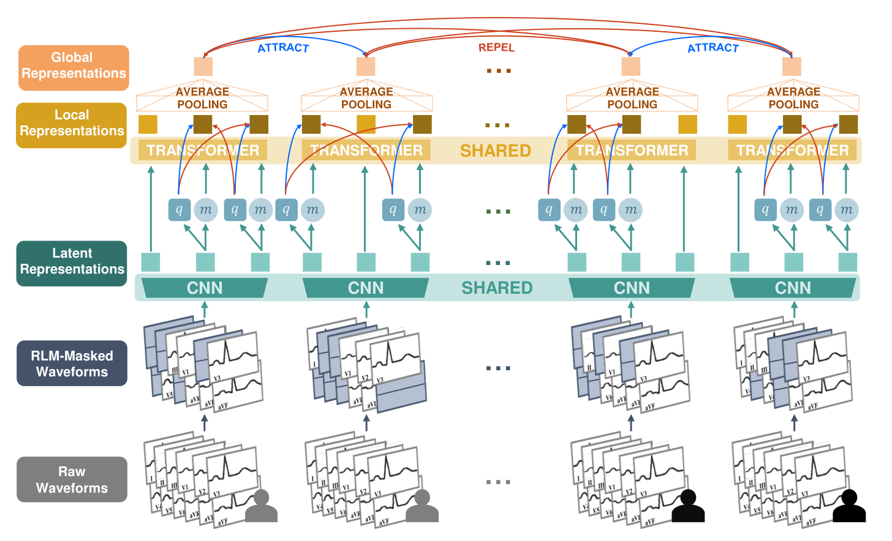
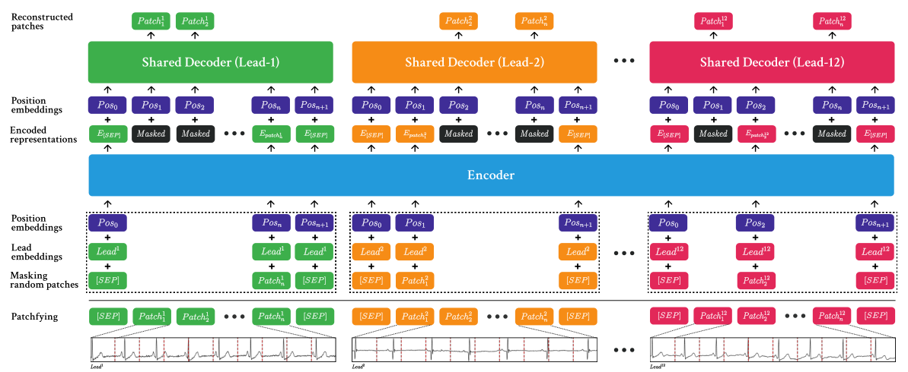
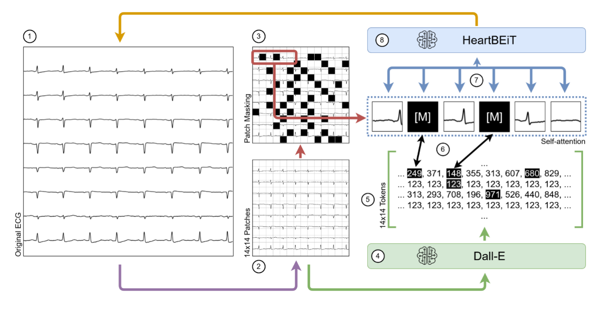
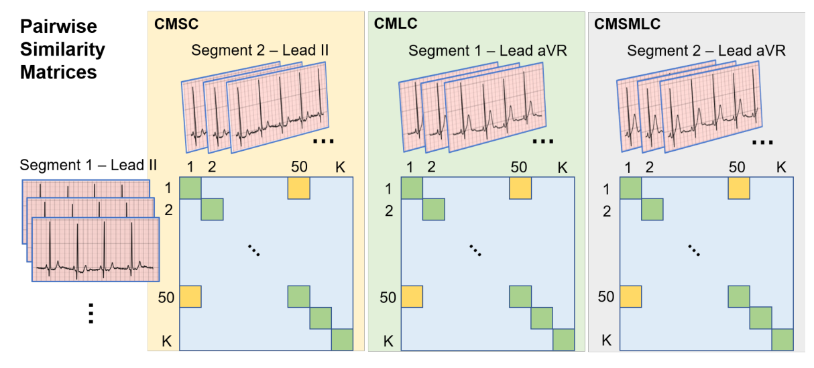

# 心电图（ECG）与心血管电生理基础模型 (Electrocardiogram & Electrophysiology Foundation Models)

本专题基于 2026 年发表于 *npj Digital Medicine* 的综述论文《*Review of open foundation models and datasets for ECG and PPG waveforms*》（MIT 计算生理学实验室 Leo Anthony Celi 等著），系统梳理多导联心电自监督预训练、跨模态波形重构（PPG 与 ECG）及心血管临床下游任务迁移的底层技术演进。

---

## 目录

- [1. 领域综述导读：心电与脉搏波开源基础模型及数据集全景](#1-领域综述导读心电与脉搏波开源基础模型及数据集全景)
- [2. 心电时序的生理学特异性与空间几何先验](#2-心电时序的生理学特异性与空间几何先验)
- [3. 经典心电开源基础模型与核心预训练范式](#3-经典心电开源基础模型与核心预训练范式)
  - [ECG-FM](#ecg-fm)
  - [ST-MEM](#st-mem)
  - [HeartBEiT](#heartbeit)
  - [CLOCS](#clocs)
- [4. 消费级脉搏（PPG）与临床心电（ECG）的跨模态桥梁](#4-消费级脉搏ppg与临床心电ecg的跨模态桥梁)
- [5. 下游心血管临床任务迁移全景](#5-下游心血管临床任务迁移全景)
- [6. 行业结构性瓶颈与未来演进路线](#6-行业结构性瓶颈与未来演进路线)

---

## 1. 领域综述导读：心电与脉搏波开源基础模型及数据集全景

- **论文题目**：*Review of open foundation models and datasets for ECG and PPG waveforms*
- **发表期刊**：*npj Digital Medicine*（2026 年 8 月）
- **DOI 链接**：[10.1038/s41746-026-03101-7](https://doi.org/10.1038/s41746-026-03101-7)
- **作者团队**：Ahram Han（MIT / 首尔大学）、Takeshi Tohyama（MIT / 国际医疗福祉大学）、Dukyong Yoon（延世大学 / MIT）、Kenneth Paik（MIT）、Brian Gow（MIT / MIMIC 核心团队）、Leo Anthony Celi（通讯作者，MIT 计算生理学实验室主任 / 哈佛公卫学院 / MIMIC 数据集创始人）、Hyeonhoon Lee 与 Hyung-Chul Lee（首尔大学医学院医疗 AI 研究所）。

### 综述核心贡献与洞见

1. **学习范式转变（Paradigm Shift）**：传统心电深度学习依赖稀缺的临床专家逐波标注，且局限于单一特定任务（Narrow Task）；生理基础模型（Foundation Models）通过自监督学习（SSL）在百万级无标注波形上预训练通用表征，展现出高数据利用效率（Data-Efficiency）与少样本（Few-shot）/ 零样本迁移能力。
2. **开源生态全景梳理**：系统性收录并横向对比了全球主流开源心电与脉搏波基础模型（如 ECG-FM、ST-MEM、HeartBEiT、PaPaGei 等）及其依赖的公开数据集（MIMIC-IV-ECG、PTB-XL、CODE-15%、VitalDB 等）。
3. **直击五大行业结构性瓶颈**：深入剖析了“预训练数据人群同质性与肤色/族裔偏倚”、“缺乏统一受试者级评测基准（波形切片泄漏）”、“真实穿戴高噪运动伪影”、“黑盒表征与临床电生理可解释性脱节”以及“移动端与微控制器轻量化部署壁垒”。

---

## 2. 心电时序的生理学特异性与空间几何先验

心电信号并非抽象的无序浮点序列，其背后承载着心脏起搏与传导系统去极化、复极化的生物电向量投射规律：

1. **时域波形形态与传导间期先验**：
   - **P 波**：窦房结发放冲动引发的左右心房去极化过程；
   - **PR 间期**：心房开始去极化至心室开始去极化的房室传导时间（正常成人范围 120～200 ms，延长提示房室传导阻滞）；
   - **QRS 波群**：左右心室快速去极化过程（正常宽度 60～100 ms，异常增宽提示束支传导阻滞或室性异位起搏）；
   - **ST 段与 T 波**：心室缓慢与快速复极化过程（ST 段抬高或压低、T 波倒置或高耸是急性心肌缺血、心肌梗死及电解质紊乱的核心诊断依据）。
2. **12 导联空间立体投影与代数先验（Spatial Projection & Einthoven's Law）**：
   - **肢体导联（I, II, III, aVR, aVL, aVF）**：捕获人体额面（Frontal Plane）六个方向的心电综合向量投影；
   - **胸前导联（V1～V6）**：环绕胸壁贴附，捕获水平面（Horizontal Plane）从右心室前壁、室间隔到左心室前侧壁的局部电位演变；
   - **强通道互信息与代数物理约束**：根据爱因托芬三角形定律（Einthoven's Triangle），双极肢体导联满足 $\text{Lead II} = \text{Lead I} + \text{Lead III}$，加压单极肢体导联满足 $\text{aVR} + \text{aVL} + \text{aVF} = 0$。有效的心电基础模型需要显式建模导联间的空间几何相关性，而非将其视为孤立的 12 条独立单变量序列。

---

## 3. 经典心电开源基础模型与核心预训练范式

### ECG-FM

> **发表信息**：arXiv 2024 · [论文](https://arxiv.org/abs/2407.13576) · [代码](https://github.com/kadenmckeen/ecg-fm) · [权重](https://huggingface.co/kadenmckeen/ecg-fm)  
> **机构**：多伦多大学 / 大学健康网络 (UHN) / Vector Institute  
> **预训练数据**：约 150 万条 12 导联心电记录（MIMIC-IV-ECG + UHN 临床队列）  
> **开源状态**：开源完整训练/微调代码与 Hugging Face 预训练权重

图源：ECG-FM 论文 Fig. 1（arXiv:2407.13576）

ECG-FM（*ECG-FM: An Open Electrocardiogram Foundation Model*）是面向 12 导联临床心电图的代表性开源基础模型，旨在填补心电领域缺乏公开权重高容量基座与统一评测基准的空白。

#### 核心机制与评估表现

- **wav2vec 2.0 式骨干与多导联分块嵌入**：由多层一维卷积局部特征提取器与 Transformer 上下文编码器串联构成。将 500 Hz 采样的 10 秒 12 导联 ECG（$12 \times 5,000$ 采样点）转化为紧凑潜空间时间步词元，并注入导联空间与时间位置编码。
- **混合自监督预训练策略（Hybrid SSL）**：联合优化**掩码潜表征重构（Masked Latent Reconstruction）** 与**跨时间步对比学习（Contrastive Learning）**。掩码重构迫使模型捕捉局部波形微观几何细节（如 ST 段偏移、QRS 切迹）；对比学习迫使全局上下文捕获节律与传导一致性表征。
- **下游少样本迁移**：在左室射血分数降低（$\text{LVEF} \le 40\%$）、肥厚型心肌病及 20 余种心律失常多标签诊断任务中，仅使用 1%～10% 标注样本微调即可显著优于从头训练的 ResNet1D 基线。

---

### ST-MEM

> **发表信息**：ICLR 2024 · [论文](https://arxiv.org/abs/2402.04631) · [代码](https://github.com/vuno-inc/ST-MEM) · [权重](https://github.com/vuno-inc/ST-MEM)  
> **机构**：VUNO Inc. / 首尔大学  
> **预训练数据**：约 80 万例 12 导联临床心电图  
> **开源状态**：开源官方代码与预训练模型权重

图源：ST-MEM 论文 Fig. 1（ICLR 2024）

ST-MEM（*Spatio-Temporal Masked Electrocardiogram Modeling*）指出传统时序 MAE 仅在时间轴做随机掩码，忽视了 12 导联在解剖空间上的高度冗余性（模型极易通过相邻导联同一时刻的电位直接“抄袭”重构，而未学到时间节律演变），为此提出了时空解耦掩码自编码框架。

#### 核心架构设计

1. **时空补丁切分（Spatio-Temporal Patching）**：将 12 导联波形沿导联空间维与时间维切分为独立补丁，分别加上导联嵌入（Lead Embedding）与时间位置编码。
2. **空间导联掩码与导联隔离解码（Spatial & Lead-Isolated Decoding）**：
   - 随机掩蔽 12 个导联中的 4～8 个导联，并在解码器中约束跨导联信息泄漏，训练模型利用局部导联推断完整心脏电轴表征，显著提升了向少导联（如智能手表 I 导联或三肢体导联）迁移的鲁棒性。
3. **高比例时间片段掩码（Temporal Masking）**：在残存导联上随机掩蔽 50%～75% 的时间补丁，采用深编码器、浅解码器的非对称架构重建原始电压波形。
4. **评测表现**：在 PTB-XL、Chapman-Shaoxing 与 CPSC2018 三大公开基准的多标签心律失常与传导阻滞分类任务中，线性探测与全微调均取得领先性能。

---

### HeartBEiT

> **发表信息**：arXiv 2023 · [论文](https://arxiv.org/abs/2306.07920) · [代码](https://github.com/akhilvaid/HeartBEiT)  
> **机构**：西奈山伊坎医学院 (Icahn School of Medicine at Mount Sinai)  
> **预训练数据**：超过 850 万条临床心电记录  
> **开源状态**：开源架构与微调代码

图源：HeartBEiT 论文架构图（arXiv:2306.07920）

HeartBEiT（*HeartBEiT: Vision Transformer for Electrocardiogram Analysis*）借鉴计算机视觉中的 BEiT 掩码图像建模思想，探索将心电信号转化为二维视觉-时序表征并采用离散词元掩码预测。

- **离散代码本词元化（Discrete Codebook Tokenization）**：利用向量量化自编码器（VQ-VAE）将连续电压波形片段映射为离散代码本索引（Discrete Tokens）。
- **抗噪分类损失**：将连续电压的均方误差（MSE）回归任务转化为离散词元的交叉熵分类预测，有效降低了预训练过程对基线漂移与高频肌电噪声的敏感度，在肥厚型心肌病与低射血分数筛查中展现出良好的少样本迁移性能。

---

### CLOCS

> **发表信息**：NeurIPS 2020 · [论文](https://proceedings.neurips.cc/paper/2020/hash/da65ae7d09f25745b85e0546cb7ee3b4-Abstract.html) · [代码](https://github.com/danikiyasseh/CLOCS)  
> **机构**：牛津大学 (University of Oxford)  
> **预训练数据**：PhysioNet 2017、PhysioNet 2020 与 Chapman 多中心心电队列  
> **开源状态**：开源完整训练与评估代码

图源：CLOCS 论文 Fig. 1（NeurIPS 2020）

CLOCS（*Contrastive Learning of Cardiac Signals Across Space, Time, and Patients*）是将患者特异与时空不变性对比学习引入多导联心电领域的奠基性工作。

#### 三大生理对比不变性设计

1. **CMSC（Contrastive Multi-Segment Coding，跨时间段对比）**：将同一患者在相邻非重叠时间窗口（如前 5 秒与后 5 秒）的心电片段视为正样本对，不同患者的片段视为负样本，迫使编码器学习患者个体稳定的基础节律表征。
2. **CMLC（Contrastive Multi-Lead Coding，跨空间导联对比）**：将同一心脏搏动时刻在不同空间导联（如导联 I 与导联 V2）上的同步投影视为正样本对，学习多导联间的立体空间几何一致性。
3. **CMSMLC（时空联合对比）**：同时在时间切片与空间导联两个正交维度构造正样本对，在仅用 5%～25% 下游标注数据时即可超越全监督训练基线。

---

## 4. 消费级脉搏（PPG）与临床心电（ECG）的跨模态桥梁

### 4.1 为什么要打通 PPG 与 ECG？

| 对⁠比⁠维⁠度 | 光⁠电⁠容⁠积⁠脉⁠搏⁠波 (PPG) | 心⁠电⁠图 (ECG) |
| :--- | :--- | :--- |
| **物⁠理⁠测⁠量⁠本⁠质** | 外周微血管搏动性充血引起的**组织光吸收反射变化** | 心脏起搏传导系统去极化/复极化产生的**微伏级体表生物电** |
| **穿⁠戴⁠设⁠备⁠形⁠态** | 智能手表、手环、智能戒指（支持 24/7 全天候无感佩戴） | 临床 12 导联湿电极、胸贴或手表双指主动触摸（偶发、受限） |
| **临⁠床⁠信⁠息⁠密⁠度** | 反映机械搏动、心率节律与外周血管顺应性，缺乏心室除极细节 | 心血管诊断金标准：可精确定位心肌缺血部位、传导阻滞与心律失常 |
| **跨⁠模⁠态⁠协⁠同⁠愿⁠景** | **借助跨模态基础模型，利用 24 小时低成本腕戴 PPG，逆向合成或蒸馏临床级 ECG 诊断表征。** |

### 4.2 跨模态生成与蒸馏代表性工作

1. **[PPGFlowECG](smartwatch_models.md#ppgflowecg)** （北京大学，2025/2026）：采用 CardioAlign 双层生理对齐编码器结合**潜空间整流流（Latent Rectified Flow）**，以直线常微分方程（ODE）轨迹在 1～4 步内由单通道 PPG 合成 12 导联心电波形，并在斯坦福 MC-MED 11.8 万急诊就诊队列上通过了心血管内科医生的双盲诊断评测。
2. **[UniCardio](smartwatch_models.md#unicardio)** （清华大学 / 北京安贞医院，Nature Machine Intelligence 2025）：构建统一多模态扩散 Transformer（DiT）框架，将 PPG、ECG 与连续动脉血压（ABP）的去噪、缺失插补与跨模态双向翻译统一建模，仅需 0.3M/模态增量参数即可支持多传感器热插拔与持续学习。
3. **[AnyPPG](smartwatch_models.md#anyppg)** （北京大学，KDD 2026）：提出“心电引导式脉搏波预训练（ECG-Guided Pretraining）”，在 10.7 万小时配对 PPG-ECG 数据上利用冻结的高容量心电编码器作为语义教师，指导纯 PPG 编码器提取深层心血管与全身微循环特征，成功将腕戴脉搏波筛查拓展至慢性肾脏病（CKD）与帕金森病等跨系统疾病。

---

## 5. 下游心血管临床任务迁移全景

根据 *npj Digital Medicine* 综述总结，心电与脉搏基础模型的下游临床迁移任务可分为三个难度层级：

| 任⁠务⁠层⁠级 | 临⁠床⁠任⁠务⁠范⁠畴 | 代⁠表⁠性⁠适⁠应⁠症⁠与⁠数⁠字⁠生⁠物⁠标⁠志⁠物 |
| :--- | :--- | :--- |
| **Level 3：隐⁠匿⁠性⁠与⁠结⁠构⁠性⁠心⁠脏⁠病⁠早⁠期⁠筛⁠查** | 常规肉眼阅图难以直接识别的微弱电机械重塑表型 | 无症状左室射血分数降低（$\text{LVEF} \le 40\%$）、重度主动脉瓣狭窄、肥厚型心肌病（HCM）、心脏淀粉样变性、高钾血症 |
| **Level 2：常⁠见⁠临⁠床⁠节⁠律⁠与⁠形⁠态⁠学⁠诊⁠断** | 标准心电图科室常规结构化报告自动判读 | 心房颤动 / 心房扑动（AF/AFL）、室性早搏（PVC）、房性早搏（PAC）、房室传导阻滞（AVB）、左右束支传导阻滞、ST 段抬高型心梗（STEMI） |
| **Level 1：连⁠续⁠血⁠流⁠动⁠力⁠学⁠与⁠生⁠理⁠参⁠数⁠估⁠计** | 日常健康管理与重症监护连续生命体征追踪 | 连续无袖带血压（CBP）、心率变异性（HRV）、血管生物学年龄（Vascular Age Gap）、ICU 临床恶化与院内死亡率预警 |

---

## 6. 行业结构性瓶颈与未来演进路线

依据 *npj Digital Medicine* 综述剖析，当前心电与脉搏基础模型走向临床级应用仍需突破以下四大瓶颈：

1. **破解预训练人群同质性与光学肤色偏倚（Data Diversity & Algorithmic Fairness）**：
   - 现有开源心电基模高度依赖欧美重症与急诊群体（如 MIMIC-IV-ECG），东亚、非洲及低收入地区人群代表性不足；
   - 腕戴光学 PPG 在深肤色人群（Fitzpatrick 肤色分级 V–VI 型）中面临黑色素对绿光波段的强吸收衰减，预训练阶段亟需引入跨肤色光学增益不变性约束。
2. **建立严格的“受试者级”无泄漏评测规范（Subject-Level Evaluation Split）**：
   - **严禁记录级或切片级随机混洗**：同一患者的心电形态具有高度个体特异性，训练、验证与测试集的划分必须严格以**独立患者 ID（Patient-level Split）** 为隔离边界；
   - **全面报告 AUPRC 与校准度**：在危重心律失常等正负样本极度失衡（正例 $<1\%$）的任务中，必须同时报告精确率-召回率曲线下面积（AUPRC）、宏平均 F1 分数与概率校准曲线（ECE），避免仅凭虚高的 AUROC 产生误判。
3. **端侧微控制器轻量化部署（Edge AI on Wearables）**：
   - 消费级智能手表电池容量受限（通常仅 200～400 mAh），百兆参数的 Transformer 难以长时常驻端侧内存；
   - 需结合结构化通道剪枝、INT8/INT4 定点量化与跨层知识蒸馏（如 [PPG-Distill](smartwatch_models.md#ppg-distill)），将模型推理功耗压降至微控制器（MCU / NPU）毫瓦级水平。
4. **电生理波形级归因与临床可解释性（Waveform Grounding & Trust）**：
   - 临床医生的诊断决策建立在 P 波极性、PR 间期、QRS 时限、QTc 间期等明确物理量纲之上。将纯黑盒隐向量与波形物理测量值显式对齐（如 [GEM](health_reasoning_llms.md#gem) 的心电物理特征锚定范式），是通过医疗器械监管审批（FDA / NMPA）并建立临床信任的必由之路。
