# 心电信号（ECG）与心血管电生理基础模型

本专题基于发表于 *npj Digital Medicine*（2026）的系统综述《*Review of open foundation models and datasets for ECG and PPG waveforms*》（MIT 计算生理学实验室 Leo Anthony Celi 等著），梳理多导联与单导联心电自监督预训练、心电-临床文本多模态对齐、跨模态波形转换（PPG 与 ECG）以及心血管临床下游任务迁移的技术脉络。

## 目录

- [1. 领域综述导读：心电与脉搏波开源基础模型及数据集全景](#1-领域综述导读心电与脉搏波开源基础模型及数据集全景)
- [2. 心电时序的生理学特异性与空间几何先验](#2-心电时序的生理学特异性与空间几何先验)
- [3. 12 导联心电开源基础模型与核心预训练范式](#3-12-导联心电开源基础模型与核心预训练范式)
  - [ECGFounder](#ecgfounder)
  - [ECG-CPC](#ecg-cpc)
  - [DeepECG-SSL](#deepecg-ssl)
  - [HuBERT-ECG](#hubert-ecg)
  - [ECG-FM](#ecg-fm)
  - [ECG-JEPA](#ecg-jepa)
  - [ST-MEM](#st-mem)
  - [HeartLang](#heartlang)
  - [MERL](#merl)
  - [ESI](#esi)
  - [MELP](#melp)
  - [KED](#ked)
  - [HeartBEiT](#heartbeit)
  - [CLOCS](#clocs)
- [4. 单导联心电与脉搏波词元化基础模型](#4-单导联心电与脉搏波词元化基础模型)
  - [HeartGPT](#heartgpt)
  - [HeartBERT](#heartbert)
- [5. 消费级脉搏（PPG）与临床心电（ECG）的跨模态桥梁](#5-消费级脉搏ppg与临床心电ecg的跨模态桥梁)
- [6. 下游心血管临床任务迁移全景](#6-下游心血管临床任务迁移全景)
- [7. 行业结构性瓶颈与未来演进路线](#7-行业结构性瓶颈与未来演进路线)

---

## 1. 领域综述导读：心电与脉搏波开源基础模型及数据集全景

MIT 计算生理学实验室 / 首尔大学医学院 / 延世大学 · *npj Digital Medicine* 2026 · [论文](https://doi.org/10.1038/s41746-026-03101-7)

- **论文题目**：*Review of open foundation models and datasets for ECG and PPG waveforms*
- **发表期刊**：*npj Digital Medicine*（2026 年，Volume 9, Article 371）
- **作者团队**：Ahram Han（MIT / 首尔大学）、Takeshi Tohyama（MIT / 国际医疗福祉大学）、Dukyong Yoon（延世大学 / MIT）、Kenneth Paik（MIT）、Brian Gow（MIT / MIMIC 团队）、Leo Anthony Celi（通讯作者，MIT 计算生理学实验室主任 / 哈佛公共卫生学院）、Hyeonhoon Lee 与 Hyung-Chul Lee（首尔大学医学院医疗 AI 研究所）。

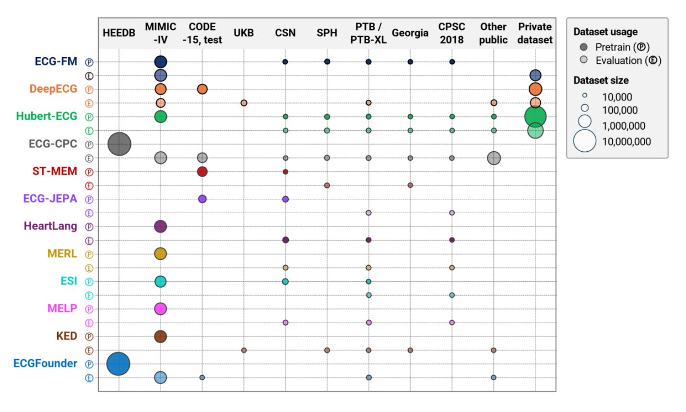

图源：Han et al., *npj Digital Medicine* 2026, Fig. 3（16 个心电与脉搏开源基础模型的预训练及外部验证数据集复用关系网络）

### 1.1 综述核心贡献与四大训练范式

该综述对截至 2025 年底全球公开的 53 个心电（ECG）与光电容积脉搏波（PPG）基础模型进行了文献筛选，重点评述了其中**开放模型权重与推理代码的 16 个核心开源基础模型**（12 个 12 导联临床 ECG 模型与 4 个单导联 ECG/PPG 模型）以及 **34 个公开波形数据集**（累计涵盖超过 2,100 万条 ECG 与 170 万条 PPG 记录）：

1. **掩码重建与潜空间预测（Masked Reconstruction & Latent Prediction）**：代表工作包括 [ECG-FM](#ecg-fm)、[ST-MEM](#st-mem)、[HuBERT-ECG](#hubert-ecg)、[ECG-JEPA](#ecg-jepa)、[HeartLang](#heartlang) 与 [HeartBEiT](#heartbeit)。通过遮蔽局部时间片段或完整导联，在时域电压、离散代码本或潜空间特征维度执行重建，迫使编码器捕获局部波形形态与多导联空间几何耦合。
2. **对比学习与千万级弱监督预训练（Contrastive & Weakly-Supervised Pretraining）**：代表工作包括 [ECGFounder](#ecgfounder)、[ECG-CPC](#ecg-cpc)、[DeepECG-SSL](#deepecg-ssl) 与 [CLOCS](#clocs)。利用跨时间窗/跨导联不变性对比、自回归对比预测编码（CPC）或医院电子病历提取的千万级置信度感知正未标记（Positive-Unlabeled）多标签监督，构建具备高判别力的心电表征空间。
3. **心电-临床文本跨模态对齐（Multimodal ECG-Text Alignment）**：代表工作包括 [MERL](#merl)、[ESI](#esi)、[MELP](#melp) 与 [KED](#ked)。借助机器自动生成的临床心电图报告或大语言模型扩充的心脏病学领域知识，构建双塔对比与分层局部-全局对齐，赋予心电编码器零样本（Zero-shot）病种判别与跨模态检索能力。
4. **波形量化与因果/掩码语言建模（Tokenized Language Modeling）**：代表工作包括 [HeartGPT](#heartgpt)（含 ECG-PT 与 PPG-PT）及 [HeartBERT](#heartbert)。将连续单通道生理波形通过幅值分箱或字节对编码（BPE）映射为离散字符序列，直接复用 GPT 自回归下一词元预测或 RoBERTa 掩码语言建模架构。

### 1.2 开源心电与脉搏基础模型全景对照表

下表汇总了综述核心评测的 16 个开源权重基础模型（包含 12 个 12 导联临床心电基模与 4 个单通道心电/脉搏基模）：

| 模⁠型⁠名⁠称 | 研⁠发⁠机⁠构 | 发⁠表⁠出⁠处 | 模⁠态⁠与⁠采⁠样⁠率 | 骨⁠干⁠架⁠构⁠与⁠参⁠数⁠量 | 预⁠训⁠练⁠范⁠式 | 预⁠训⁠练⁠规⁠模 | 开⁠源⁠资⁠源 |
| :--- | :--- | :--- | :--- | :--- | :--- | :--- | :---: |
| [**ECGFounder**](#ecgfounder) | 北京大学 / 哈佛 / Emory | NEJM AI 2025 | 12 导联 / 单导联 ECG (500 Hz) | RegNet1D CNN (31M) | 置信度感知 PU 多标签监督 | 1,070 万条 (HEEDB, 180 万人) | [代码](https://github.com/PKUDigitalHealth/ECGFounder) · [权重](https://huggingface.co/PKUDigitalHealth/ECGFounder) |
| [**ECG-CPC**](#ecg-cpc) | 奥尔登堡大学 | arXiv 2025 | 12 导联 ECG (240 Hz) | 4 层 CNN + 4 层 S4 (3.3M) | 自回归对比预测编码 (CPC) | 1,070 万条 (HEEDB, 180 万人) | [代码/权重](https://github.com/AI4HealthUOL/ecg-fm-benchmarking) |
| [**DeepECG-SSL**](#deepecg-ssl) | 蒙特利尔心脏研究所 | Eur Heart J 2026 | 12 导联 ECG (250 Hz) | CNN + Transformer (91M) | SimCLR/CMSC 对比 + 导联掩码 | 190 万条 (MHI + MIMIC-IV + CODE-15%) | [代码/权重](https://github.com/HeartWise-AI/DeepECG_Docker) |
| [**HuBERT-ECG**](#hubert-ecg) | 罗马生物医学自由大学 | medRxiv 2024 | 12 导联 ECG (100 Hz) | CNN + Transformer (93M) | 迭代聚类伪标签掩码预测 | 910 万条 (整合 10 个公开/受限队列) | [代码](https://github.com/Edoar-do/HuBERT-ECG) · [权重](https://huggingface.co/Edoardo-BS/hubert-ecg-base) |
| [**ECG-FM**](#ecg-fm) | 多伦多大学 / UHN | arXiv 2024 | 12 导联 ECG (500 Hz) | CNN + Transformer (91M) | 掩码潜表征重构 + 对比学习 | 156 万条 (MIMIC-IV-ECG + UHN) | [代码](https://github.com/kadenmckeen/ecg-fm) · [权重](https://huggingface.co/kadenmckeen/ecg-fm) |
| [**ECG-JEPA**](#ecg-jepa) | 首尔大学 / 庆北大学 | arXiv 2024 | 8 独立导联 ECG (250 Hz) | 双塔 Transformer + CroPA (85M) | 潜空间掩码表征预测 (JEPA) | 18 万条 (CSN + CODE-15%) | [代码/权重](https://github.com/sehunfromdaegu/ecg_jepa) |
| [**ST-MEM**](#st-mem) | VUNO Inc. / 首尔大学 | ICLR 2024 | 12 导联 ECG (250 Hz) | ViT-1D + 导联隔离解码 (85M) | 时空解耦分块掩码自编码 | 19 万条 (CSN + CODE-15% + CinC2021) | [代码/权重](https://github.com/vuno-inc/ST-MEM) |
| [**HeartLang**](#heartlang) | 北京大学 / 中山大学 | ICLR 2025 | 12 导联 ECG (100 Hz) | ST-ECGFormer + VQ-HBR (45M) | QRS 心拍词表量化与掩码预测 | 80 万条 (MIMIC-IV-ECG) | [代码/权重](https://github.com/PKUDigitalHealth/HeartLang) |
| [**MERL**](#merl) | 帝国理工 / 剑桥 / 哈佛 | ICML 2024 | 12 导联 ECG (500 Hz) + 文本 | ResNet1D (5.5M) + Med-CPT | 跨模态/单模态双重对比对齐 | 77.1 万对 (MIMIC-IV-ECG) | [代码/权重](https://github.com/cheliu-computation/MERL-ICML2024) |
| [**ESI**](#esi) | 莱斯大学 / UTHealth | TMLR 2024 | 12 导联 ECG (500 Hz) + 文本 | ConvNeXtV2 (88M) + BioLinkBERT | LLM 形态描述增强对比与生成 | 66 万条 (MIMIC-IV-ECG 等 3 队列) | [代码/权重](https://github.com/comp-well-org/ESI) |
| [**MELP**](#melp) | 香港大学 / 帝国理工 | ICML 2025 | 12 导联 ECG (500 Hz) + 文本 | CNN + Transformer (66M) + 文本塔 | 词元/心拍/节律三层跨模态对齐 | 76 万对 (MIMIC-IV-ECG) | [代码/权重](https://github.com/HKU-MedAI/MELP) |
| [**KED**](#ked) | 上海交通大学 / 浦东医院 | Cell Rep Med 2024 | 12 导联 ECG (500 Hz) + 文本 | 1D CNN (7.9M) + 知识文本塔 | 心脏病学知识图谱增强对比学习 | 80 万条 (MIMIC-IV-ECG) | [代码/权重](https://github.com/control-spiderman/ECGFM-KED) |
| [**HeartGPT**](#heartgpt) | 帝国理工学院 | arXiv 2024 | 单导联 ECG (100 Hz) / PPG (50 Hz) | GPT 解码器 (0.44M) | 量化幅值因果下一词元预测 | 4,200 万 ECG 词元 + 1.28 亿 PPG 词元 | [代码/权重](https://github.com/harryjdavies/HeartGPT) |
| [**HeartBERT**](#heartbert) | 多伦多大学 | arXiv 2024 | 单/多导联 ECG (100-500 Hz) | RoBERTa (83.5M) | 量化 + BPE 分词掩码语言建模 | 7,400 万词元 (MIMIC-III, PTB-XL, Icentia11k) | [代码/权重](https://github.com/ecgResearch/HeartBert) |
| [**PaPaGei**](smartwatch_models.md#papagei) | Nokia Bell Labs / 剑桥 | ICLR 2025 | 单通道 PPG (125 Hz) | ResNet1D-MoE (5M) | 形态指标 (sVRI/IPA) 引导对比学习 | 5.7 万小时 / 2,000 万段 (10 个队列) | [代码](https://github.com/Nokia-Bell-Labs/papagei-foundation-model) · [权重](https://zenodo.org/records/13983110) |
| [**Pulse-PPG**](smartwatch_models.md#pulse-ppg) | 孟菲斯大学 / UIUC | UbiComp 2025 | 腕部高噪 PPG (50 Hz) | 1D-ResNet (28.5M) | 相对对比学习 (RelCon) | 5.5 万小时 (120 人连续 100 天野外数据) | [代码](https://github.com/maxxu05/pulseppg) · [权重](https://zenodo.org/records/10892019) |

### 1.3 八大开源心电基础模型统一基准横评洞察

由于各模型原始论文采用的下游数据集划分与微调超参不一致，奥尔登堡大学 Nils Strodthoff 团队在 [ECG-CPC](#ecg-cpc) 论文中构建了涵盖 **8 个开源心电基础模型、12 个公开临床数据集、26 项下游任务组**的统一第三方评测基准（`ecg-fm-benchmarking`），揭示了四项关键结论：

1. **全量微调（Full Fine-Tuning）第一梯队**：在端到端全参数微调设定下，**[ECG-CPC](#ecg-cpc)**、**[ECG-FM](#ecg-fm)** 与 **[ECGFounder](#ecgfounder)** 综合平均排名位居前三。其中仅 **3.3M 参数**的 `ECG-CPC`（CNN + S4 状态空间架构，在 1,070 万条 HEEDB 心电上预训练）在逾半数任务上取得最优或次优表现，证明长程状态空间模型配合千万级多样化预训练数据可显著压缩模型体积。
2. **线性探测（Linear Probing）与冻结特征表征**：当冻结预训练骨干仅训练线性分类头时，**[ECG-JEPA](#ecg-jepa)**、**[ECGFounder](#ecgfounder)** 与 **[MELP](#melp)** 表现突出。`ECG-JEPA` 是唯一在全量微调、线性探测和冻结注意力池化三种评估协议下均稳居前三的模型，尽管其预训练数据量最小（仅 18 万条公开记录），表明潜空间预测（JEPA）与跨导联模式注意力（CroPA）提取的特征具备较高的线性可分性。
3. **跨年龄分布外泛化（成人 → 儿科队列 ZZU pECG）**：在全部成人心电数据上预训练的模型直接迁移至 0-14 岁中国儿童心电数据集（[ZZU pECG](../datasets/wearable_datasets.md#zzu-pecg)）时，无显式心拍假设的纯波形自监督模型（`ECG-JEPA` 排名第 1，`ST-MEM` 排名第 2，`ECG-CPC` 排名第 3）显著优于依赖成人心电报告文本对齐的模型（`MELP`、`MERL`）以及依赖固定窗口 QRS 模板切分的模型（`HeartLang`），因为婴幼儿的高心率（120-160 bpm）与右心室占优电轴偏离了成人诊断文本与固定心拍窗口的先验分布。
4. **预训练与评测数据泄漏警示**：综述图 3（上方网络图）直观展示了 `MIMIC-IV-ECG`、`CODE-15%` 与 `Chapman-Shaoxing/Ningbo` 同时被多个模型用作预训练语料和下游测试集。在跨模型对比时，必须严格区分院内同分布验证与真正的跨中心零交集外部验证（如 `PTB-XL`、`CPSC 2018`、`SPH`、`EchoNext`）。

---

## 2. 心电时序的生理学特异性与空间几何先验

心电信号并非抽象的无序浮点序列，其背后承载着心脏起搏与传导系统去极化、复极化的生物电向量投射规律：

1. **时域波形形态与传导间期先验**：
   - **P 波**：窦房结发放冲动引发的左右心房去极化过程；
   - **PR 间期**：心房开始去极化至心室开始去极化的房室传导时间（正常成人范围 120～200 ms，延长提示房室传导阻滞）；
   - **QRS 波群**：左右心室快速去极化过程（正常宽度 60～100 ms，异常增宽提示束支传导阻滞或室性异位起搏）；
   - **ST 段与 T 波**：心室缓慢与快速复极化过程（ST 段抬高或压低、T 波倒置或高耸是急性心肌缺血、心肌梗死及电解质紊乱的核心诊断依据）。
2. **12 导联空间立体投影与代数先验（Spatial Projection & Einthoven's Law）**：
   - **肢体导联（I, II, III, aVR, aVL, aVF）**：捕获人体额面（Frontal Plane）六个方向的心电综合向量投影；
   - **胸前导联（V1～V6）**：环绕胸壁贴附，捕获水平面（Horizontal Plane）从右心室前壁、室间隔到左心室前侧壁的局部电位演变；
   - **强通道互信息与代数物理约束**：根据爱因托芬三角形定律（Einthoven's Triangle）与基尔霍夫电压定律，双极肢体导联满足 $\text{Lead II} = \text{Lead I} + \text{Lead III}$，加压单极肢体导联满足 $\text{aVR} + \text{aVL} + \text{aVF} = 0$。因此，12 导联心电信号中仅有 **8 个线性独立的物理导联（I, II, V1～V6）**，其余 4 个肢体导联（III, aVR, aVL, aVF）均可由导联 I 与 II 线性表出。这一电生理先验直接启发了 [ECG-JEPA](#ecg-jepa) 等模型直接以 8 独立导联作为输入并设计跨导联掩码预测。

---

## 3. 12 导联心电开源基础模型与核心预训练范式

### ECGFounder

北京大学健康医疗大数据国家研究院 (洪申达团队) / 哈佛大学 / Emory University · *NEJM AI* 2025 · [论文](https://arxiv.org/abs/2410.04133) · [代码](https://github.com/PKUDigitalHealth/ECGFounder) · [权重](https://huggingface.co/PKUDigitalHealth/ECGFounder)

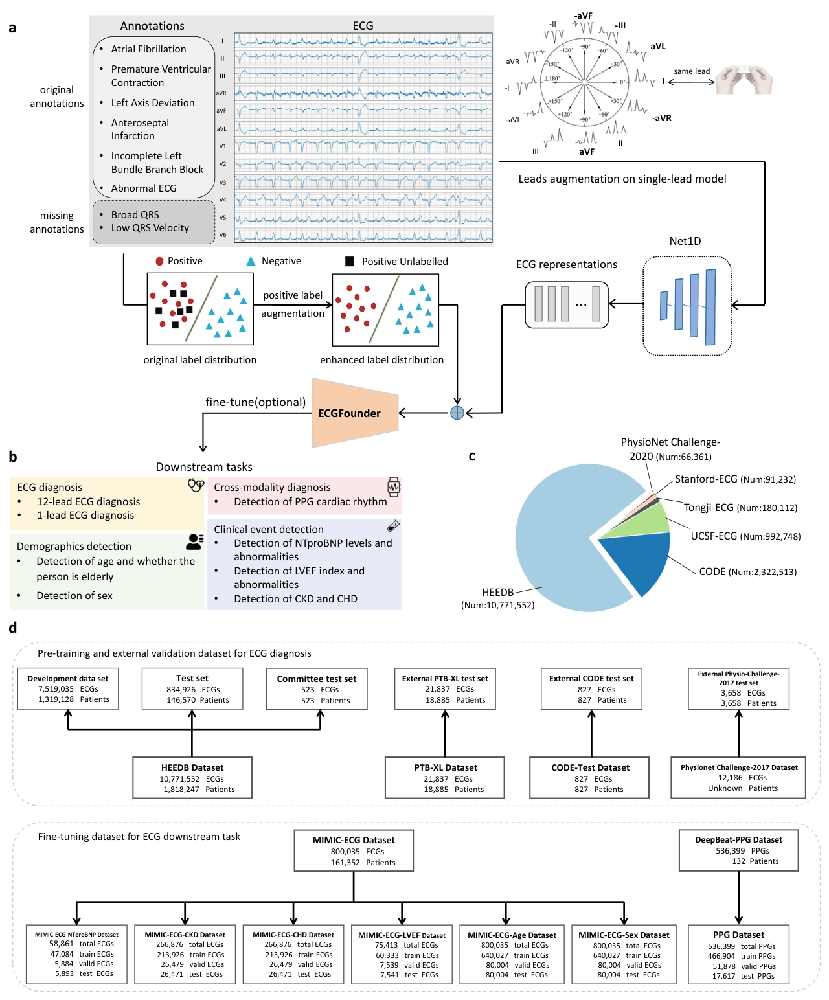

图源：ECGFounder 论文 Fig. 1（*NEJM AI* 2025 / arXiv:2410.04133）

**方法**：面向 500 Hz、10 秒的 12 导联临床心电信号与单导联（Lead I）可穿戴心电信号，采用基于阶段式瓶颈块（Stagewise Bottleneck Blocks）与通道空间注意力的 **RegNet1D 卷积网络（参数量约 31M）** 作为骨干，在哈佛-埃默里心电数据库（[HEEDB](../datasets/wearable_datasets.md#heedb)）的 **180 万名患者、1,070 万条临床心电记录**上开展大规模预训练。针对临床心电图报告中普遍存在的“未提及即默认为阴性”导致的假阴性标签噪声（医生在报告中往往只记录主要危重异常而忽略次要波形改变），作者设计了：
1. **层级化 150 类临床心电标签分类树**：联合心脏电生理专家对 Marquette 12SL 原始诊断语句进行清洗与语义消歧，覆盖节律、传导阻滞、房室肥厚、心肌缺血/梗死与形态改变等 150 种临床表型；
2. **置信度感知正未标记学习（Confidence-Aware Positive-Unlabeled Learning）**：在二元交叉熵损失中引入基于模型预测概率的软标签重加权机制，对高预测置信度的未标记样本赋予正样本补偿权重，抑制大队列弱监督训练中的假阴性梯度干扰；
3. **单导联抗噪增强分支**：通过对 Lead I 施加随机时间基线截取与高斯/基线漂移增强，同步训练可独立部署于智能手表与便携心电贴的单导联版本。

**结果**：在内部与多中心外部验证中，ECGFounder 在 **82 类临床心电诊断上的 AUROC ≥ 0.95，112 类诊断的 AUROC ≥ 0.90**；在左室射血分数降低（LVEF ≤ 40%，AUROC 0.88～0.91）、高钾血症、慢性肾病等隐匿性系统疾病筛查以及年龄/性别回归任务上，线性探测与微调性能均优于已有自监督基线。单导联模型在 Apple Watch 与便携单导联队列上针对心房颤动等节律异常保持了 0.95 以上的判别精度。

**评注**：依托千万级真实临床心电队列与 PU 抗噪监督，ECGFounder 同时开源了 12 导联与单导联两套预训练权重，开箱即具备 150 类心脏病学标签的直接推理能力；其局限在于纯卷积骨干未包含生成式解码器，不直接支持缺失波形重构或自由文本生成。

---

### ECG-CPC

奥尔登堡大学 (Nils Strodthoff 团队) · arXiv 2025 · [论文](https://arxiv.org/abs/2509.25095) · [代码](https://github.com/AI4HealthUOL/ecg-fm-benchmarking) · [权重](https://github.com/AI4HealthUOL/ecg-fm-benchmarking)

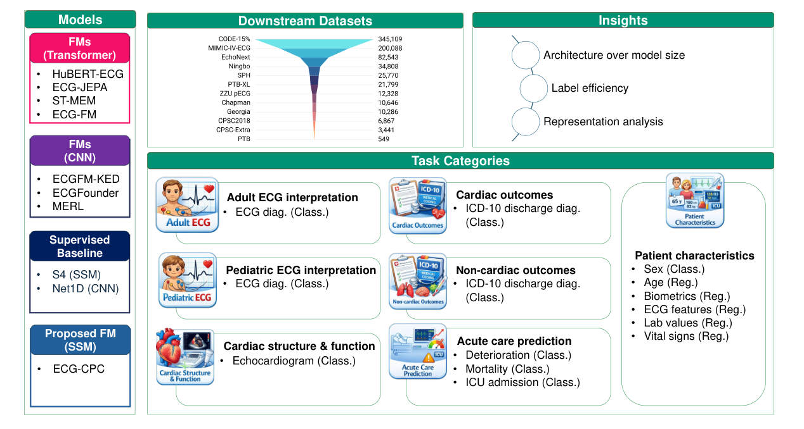

图源：ECG-CPC 论文 Fig. 1（arXiv:2509.25095）

**方法**：输入为重采样至 240 Hz 的 12 导联心电信号，采用极紧凑的混合状态空间架构（总参数量仅 **3.3M**，不足主流 Transformer 基模的 1/25）：底层由 **4 层一维卷积编码器（CNN）** 将局部波形片段下采样编码为潜表征词元，顶层串联 **4 层结构化状态空间序列模型（S4, Structured State Space Sequence Model）** 作为因果自回归上下文聚合器。模型在 [HEEDB](../datasets/wearable_datasets.md#heedb) 的 **1,070 万条 12 导联心电记录**上采用**对比预测编码（Contrastive Predictive Coding, CPC）** 目标进行自监督预训练，利用历史时间步上下文预测未来多个时间步的潜空间表征并与同批次负样本对比。除模型本身外，该工作还开源了统一的第三方心电基础模型评测套件（`ecg-fm-benchmarking`）。

**结果**：在横跨 **12 个公开临床数据集（PTB-XL、Chapman、Ningbo、SPH、CPSC 2018、CODE-15%、MIMIC-IV-ECG、EchoNext、ZZU pECG 等）、26 项临床任务组**的 8 大开源基模横评中，ECG-CPC 在**端到端全量微调（Full Fine-Tuning）模式下综合排名第 1**（平均排名 2.38，领先于 91M 参数的 `ECG-FM` 与 31M 参数的 `ECGFounder`），在 `EchoNext` 结构性心脏病筛查（AUROC 0.850）与 `MIMIC-IV-ECG` 全谱系 ICD 疾病预测（AUROC 0.892）上均位列榜首。

**评注**：证明了结合局部卷积与长程状态空间模型（SSM/S4）的紧凑架构在千万级无标注数据预训练下，能够以约 3.3M 参数追平乃至超越百兆参数级 Transformer，非常适合算力受限的医院本地工作站与边缘医疗设备微调；但在不更新骨干权重的线性探测（Linear Probing）设定下，其低维表征容量略逊于高维 Transformer 模型（如 `ECG-JEPA`）。

---

### DeepECG-SSL

蒙特利尔心脏研究所 (HeartWise-AI) · *European Heart Journal* 2026 · [论文](https://doi.org/10.1093/eurheartj/ehaf1119) · [代码](https://github.com/HeartWise-AI/DeepECG_Docker) · [权重](https://github.com/HeartWise-AI/DeepECG_Docker)

**方法**：面向 250 Hz、10 秒的 12 导联心电信号，采用 **Wav2Vec 2.0 式一维卷积特征提取器与 Transformer 编码器（WCR，参数量约 91M）**，在汇总自蒙特利尔心脏研究所（MHI）、[MIMIC-IV-ECG](../datasets/wearable_datasets.md#mimic-iv-ecg) 与 [CODE-15%](../datasets/wearable_datasets.md#code-15) 的 **190 万条 12 导联心电信号**上进行自监督预训练。训练目标结合了局部潜表征对比学习（SimCLR）、患者级跨片段全局对比（CMSC）与随机导联掩码（Random Lead Masking, RLM）。该工作在临床验证中系统纳入了**算法公平性（跨年龄/性别假阳性率差异）**、**对抗扰动鲁棒性**与**成员推理隐私攻击（Membership Inference Attack）** 三项安全评估。

**结果**：在 7 个医疗中心逾 100 万份外部测试心电信号上，DeepECG-SSL 在 **77 类心电诊断上取得 0.98 的宏平均 AUROC**，识别左室射血分数降低（LVEF ≤ 40%）的 AUROC 达 **0.92**，预测未来 5 年新发心房颤动的 AUROC 达 **0.74**。在仅使用 1%～10% 标注样本的少样本微调场景下，其结构性心脏病筛查性能持续优于监督训练基线；同时成员推理测试证实自监督预训练权重未发生患者个体波形记忆泄漏。

**评注**：作为发表于心血管临床期刊 *European Heart Journal* 的代表作，DeepECG-SSL 建立了涵盖临床性能、人口学公平性与隐私安全性的完整医疗器械级验证范式，并提供容器化 Docker 部署管线。

---

### HuBERT-ECG

罗马生物医学自由大学 (Campus Bio-Medico University of Rome) · medRxiv 2024 · [论文](https://doi.org/10.1101/2024.11.14.24317328) · [代码](https://github.com/Edoar-do/HuBERT-ECG) · [权重](https://huggingface.co/Edoardo-BS/hubert-ecg-base)

**方法**：将语音领域的 HuBERT（Hidden-Unit BERT）自监督框架迁移至 100 Hz 重采样的 12 导联心电信号，提供 Small（30M）、Base（**93M**）与 Large（188M）三个参数规模。模型首先对多导联心电信号执行带通滤波与幅值归一化，将其展平或分通道送入一维卷积编码器与多层 Transformer；预训练阶段通过 **k-means 迭代聚类**为局部波形特征生成多组离散伪标签词本（Cluster Ensembles），并对随机遮蔽的潜表征时间步执行跨词本分类预测，从而避免直接回归含噪电压值。预训练语料整合了 **10 个多国临床心电数据集（含 CODE、MIMIC-IV-ECG、PTB-XL、Chapman、CPSC 等），总规模达 910 万条 12 导联记录**。

**结果**：在横跨 **164 种心血管疾病与心电表型**的下游评估中，HuBERT-ECG 在其中 **140 余种病种上的 AUROC 超过 0.90**；在查加斯病（Chagas Disease）患者 2 年死亡率预测任务上取得 **0.87 的 AUROC**。

**评注**：HuBERT-ECG 是目前公开 Hugging Face 权重的模型中整合多源跨国预训练队列数量最多（10 个队列、910 万条记录）的工作，且提供了小、中、大三种尺寸方便按算力选型；需要注意的是，其预训练语料已包含了 PTB-XL 与 CPSC 等常用公开集，在复用这些公开集做下游评测时应注意排查受试者重叠。

---

### ECG-FM

多伦多大学 / 大学健康网络 (UHN) / Vector Institute · arXiv 2024 · [论文](https://arxiv.org/abs/2407.13576) · [代码](https://github.com/kadenmckeen/ecg-fm) · [权重](https://huggingface.co/kadenmckeen/ecg-fm)

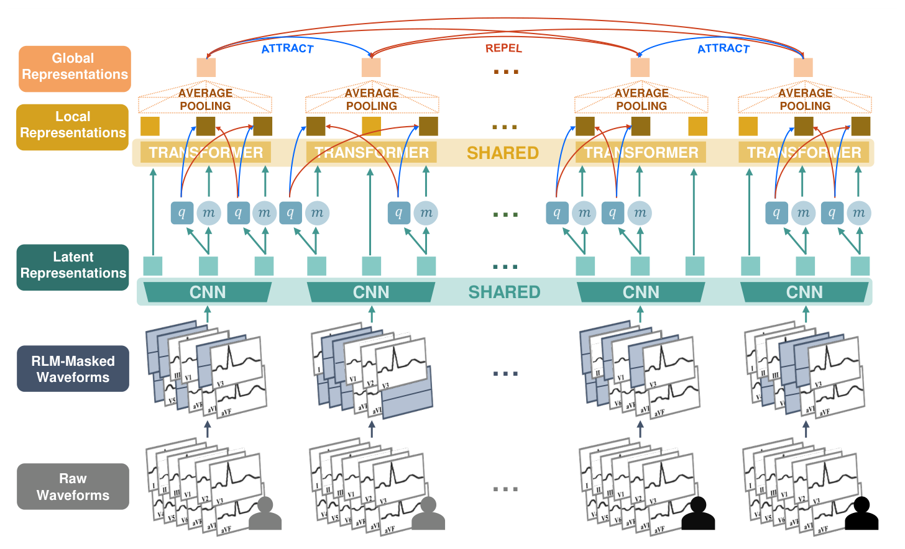

图源：ECG-FM 论文 Fig. 1（arXiv:2407.13576）

**方法**：面向 500 Hz 采样的 5 秒/10 秒 12 导联临床心电信号，采用基于 `fairseq_signals` 的 **Wav2Vec 2.0 式一维卷积局部特征提取器 + 12 层 Transformer 上下文编码器（参数量约 91M）**，在整合自 [MIMIC-IV-ECG](../datasets/wearable_datasets.md#mimic-iv-ecg)、UHN 医院私有队列、PhysioNet 2021 与 CODE-15% 的 **约 156 万条 12 导联心电信号**上进行混合自监督预训练。训练目标结合了：
1. **掩码潜表征对比预测（Wav2Vec 2.0 Contrastive Masked Prediction）**：遮蔽约 50%～65% 的潜空间时间步，通过 Gumbel-Softmax 量化代码本进行对比辨别；
2. **跨片段患者级对比学习（CMSC）与随机导联掩码（Random Lead Masking, RLM）**：随机丢弃部分心电导联并拉近同一记录相邻 5 秒片段的全局表示距离。

**结果**：在 `PhysioNet 2021` 的 26 类心律失常诊断上取得 **AUROC 0.98（宏平均 F1 = 0.77）**，在 UHN 队列左室射血分数降低（LVEF ≤ 40%）筛查上取得 **AUROC 0.93**；在 [ECG-CPC](#ecg-cpc) 的 12 数据集 26 任务独立横评中，ECG-FM 在端到端微调模式下综合排名位居全场第 2。

**评注**：ECG-FM 开源了基于 `fairseq_signals` 的完整预训练管线与多阶段检查点（预训练骨干权重 + 下游微调权重），是学术界复现率最高的 12 导联心电基础模型之一；其对输入采样率（500 Hz）与 5 秒分段预处理有较明确的格式约定。

---

### ECG-JEPA

首尔大学 / 庆北大学 · arXiv 2024 · [论文](https://arxiv.org/abs/2410.08559) · [代码](https://github.com/sehunfromdaegu/ecg_jepa) · [权重](https://github.com/sehunfromdaegu/ecg_jepa)

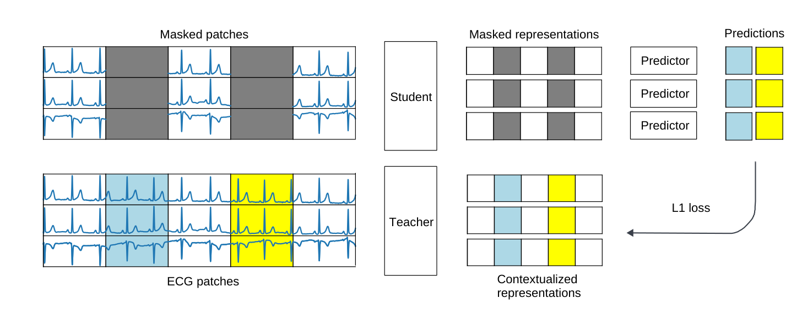

图源：ECG-JEPA 论文 Fig. 3（arXiv:2410.08559）

**方法**：借鉴 Yann LeCun 提出的联合嵌入预测架构（JEPA），摒弃时域电压重建（MAE）容易过拟合高频肌电噪声与基线漂移的缺陷，直接在高层抽象表征空间执行掩码预测。模型根据心电信号物理代数冗余性（4 个肢体导联可由导联 I、II 线性表出），仅输入 **8 个物理独立导联（I, II, V1～V6，250 Hz，10 秒）**，切分为 8×50 = 400 个时空分块（Patch），采用 **师生非对称 Transformer 架构（参数量约 85M）**，在仅 **18 万条公开无标注心电信号**（[Chapman-Shaoxing/Ningbo](../datasets/wearable_datasets.md#chapman-shaoxing--ningbo) 与 [CODE-15%](../datasets/wearable_datasets.md#code-15)）上预训练。针对多导联心电空间结构，作者提出了**跨模式注意力掩码（Cross-Pattern Attention, CroPA）**：限制自注意力仅在同一导联内部（Intra-lead）或同一时间步跨导联（Inter-lead）之间传播，避免跨导联跨时间的无关噪声干扰。

**结果**：在 [PTB-XL](../datasets/wearable_datasets.md#ptb-xl) 多标签分类与 [CPSC 2018](../datasets/wearable_datasets.md#cpsc-2018--cinc-2020) 心律失常基准上，ECG-JEPA 线性探测 AUROC 分别达 **0.909** 与 **0.943**；在传导间期与形态测量任务中，心率估计 MAE 仅 **1.45 bpm**，QRS 时限回归 MAE 仅 **4.40 ms**。在 8 大基模统一横评（`ecg-fm-benchmarking`）中，ECG-JEPA 是**唯一在全量微调、线性探测和冻结注意力池化三类评估协议下均稳居前 3 的模型**，且在跨年龄迁移至儿科数据集（[ZZU pECG](../datasets/wearable_datasets.md#zzu-pecg)）时位列**全场第 1**。

**评注**：证明了结合生理物理先验（8 独立导联 + CroPA 时空正交注意力）与潜空间预测目标（JEPA），仅需不到 20 万条公开数据即可训练出泛化力媲美千万级数据模型的表征空间，是数据受限场景下构建生理基础模型的高效范本。

---

### ST-MEM

VUNO Inc. / 首尔大学 · ICLR 2024 · [论文](https://arxiv.org/abs/2402.04631) · [代码](https://github.com/vuno-inc/ST-MEM) · [权重](https://github.com/vuno-inc/ST-MEM)

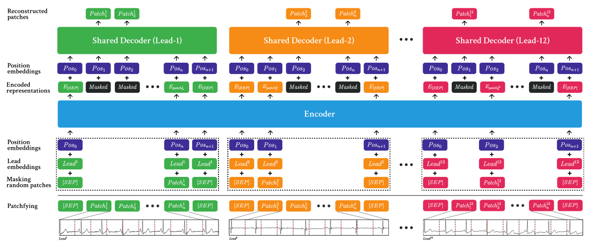

图源：ST-MEM 论文 Fig. 1（ICLR 2024）

**方法**：指出传统时序掩码自编码器（MAE）若仅在时间轴做随机掩码，模型极易利用 12 导联在空间解剖上的高度同步性，直接从相邻导联同一时刻的未遮蔽电压“抄近道”插值，而无法学到真正的心动周期时间演变。为此，ST-MEM 对 250 Hz 的 12 导联心电信号（参数量约 **85M**，在 [Chapman-Shaoxing/Ningbo](../datasets/wearable_datasets.md#chapman-shaoxing--ningbo)、[CODE-15%](../datasets/wearable_datasets.md#code-15) 与 PhysioNet 2021 共 **约 19 万条心电信号**上预训练）设计了：
1. **时空分块嵌入（Spatio-Temporal Patching）**：为每个导联-时间块分别注入可学习的导联解剖嵌入（Lead Embedding）与时间位置编码；
2. **高比例时间掩码 + 导联隔离解码器（Lead-wise Shared Decoder）**：编码器通过全局自注意力联合建模跨导联与跨时间上下文，但轻量解码器在重建被遮蔽块时**严格按单导联隔离运行**（禁止解码器在重建阶段直接跨导联读取同时间步信息），迫使编码器将跨导联空间几何关系提前内化至潜空间表征中。

**结果**：在 PTB-XL、CPSC 2018 与 PhysioNet 2021 等基准的多标签心律失常与心肌梗死分类中，全量微调宏平均 AUROC 达 **0.93～0.98**；在削减为单导联（Lead I）或四肢体导联的少导联迁移实验中，性能衰减幅度显著小于普通 ViT-MAE。

**评注**：导联隔离解码（Lead-Isolated Decoding）机制优雅地解决了多通道同步生理信号在掩码重建时的跨通道信息泄漏捷径问题，被后续多个多模态生理模型广泛借鉴。

---

### HeartLang

北京大学健康医疗大数据国家研究院 (洪申达团队) / 中山大学 · ICLR 2025 · [论文](https://arxiv.org/abs/2502.10707) · [代码](https://github.com/PKUDigitalHealth/HeartLang) · [权重](https://github.com/PKUDigitalHealth/HeartLang)

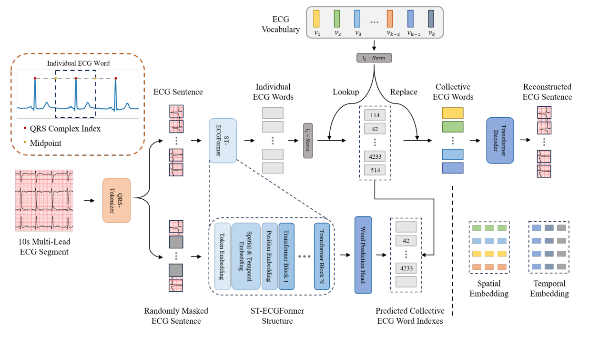

图源：HeartLang 论文 Fig. 2（ICLR 2025 / arXiv:2502.10707）

**方法**：提出将连续心电信号视作一门自然语言，把每个导联上的**单次心拍（Heartbeat）作为基本语义单词（Word）**，构建面向 100 Hz、10 秒 12 导联心电信号的自监督语言模型（参数量约 **45M**，在 [MIMIC-IV-ECG](../datasets/wearable_datasets.md#mimic-iv-ecg) 的 **80 万条记录**上预训练）：
1. **基于 QRS 波群的心拍分词器（QRS-based Heartbeat Tokenizer）**：先检测全导联参考 R 波峰值位置，以每个 R 波为中心截取固定窗口的局部单心拍子序列，将整段 12 导联记录转化为带有导联索引与时间节律间隔属性的心拍序列；
2. **向量量化心电词表构建（VQ-HBR）**：训练时空 Transformer 自编码器（ST-ECGFormer）配合向量量化码本，将连续心拍形态映射为离散的生理语义词表索引（ECG Vocabulary）；
3. **掩码心拍词元预测**：在第二阶段遮蔽约 50% 的心拍块，训练主干网络预测对应的离散词表索引。

**结果**：在 PTB-XL（诊断、形态、节律、超类）、CPSC 2018 与 Chapman 数据集的节律分类任务上，线性探测 AUROC 达 **0.90**，并在少样本微调与导联缺失场景下展现出良好的跨数据集泛化能力。

**评注**：以生理学意义明确的“单心拍（P-QRS-T 复合波）”替代机械固定时间切片作为基础 Token，使离散码本具备直观的波形形态语义；局限在于重度室颤或高噪伪影下若前置 QRS 波峰检测失准，可能影响后续分词质量。

---

### MERL

帝国理工学院 / 剑桥大学 / 哈佛大学 · ICML 2024 · [论文](https://arxiv.org/abs/2403.06659) · [代码](https://github.com/cheliu-computation/MERL-ICML2024) · [权重](https://github.com/cheliu-computation/MERL-ICML2024)

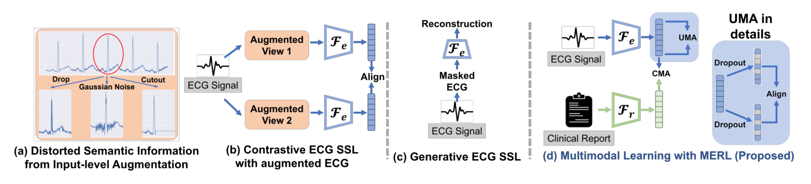

图源：MERL 论文 Fig. 2（ICML 2024 / arXiv:2403.06659）

**方法**：开创性地验证了直接利用心电图机原始机器诊断文本报告（未经人工精标的自由文本）开展大规模**多模态心电表征学习（Multimodal ECG Representation Learning, MERL）** 的可行性。模型在 [MIMIC-IV-ECG](../datasets/wearable_datasets.md#mimic-iv-ecg) 的 **77.1 万对“12 导联心电波形（500 Hz，10 秒）— 机器文本报告”** 上预训练，提供轻量 **ResNet1D（仅 5.5M 参数）** 与 ViT-1D 两款心电编码器，配对预训练生物医学文本编码器 **Med-CPT**：
1. **跨模态与单模态双重对比对齐（CMA + UMA）**：同时优化心电表征与文本报告表征间的对称对比损失（Cross-Modal Alignment），以及心电波形经生理数据增强后的单模态自监督对比损失（Uni-Modal Alignment）；
2. **临床知识增强提示工程（CKEPE）**：在测试阶段执行零样本（Zero-shot）推理时，不直接使用简短的疾病名称（如“左束支传导阻滞”）计算文本向量，而是调用大语言模型检索权威心脏病学教材，将类别名称扩展为详细的电生理波形形态特征描述（如“V1 导联呈宽大 QS 或 rS 波，I、V5、V6 导联呈宽钝 R 波且无 q 波，QRS 时限 ≥ 120 ms”），大幅缩小训练期机器报告与测试期疾病标签之间的语义鸿沟。

**结果**：在 PTB-XL、CPSC 2018、Chapman-Shaoxing 与 Ningbo 四大外部基准的 **90 余种心血管疾病零样本分类中，平均 AUROC 达 0.82～0.88**（超越在 1%～5% 标注样本上全监督训练的专用模型）；经全量微调后平均 AUROC 提升至 **0.91**。

**评注**：MERL 证明了免费的临床心电图机自动报告是高价值的预训练弱监督信号，且心电编码器仅 5.5M 参数，推理开销低，是心电零样本分类领域的经典基线。

---

### ESI

莱斯大学 (Akane Sano 实验室) / 德州大学休斯顿健康科学中心 (UTHealth) · TMLR 2024 · [论文](https://arxiv.org/abs/2405.19366) · [代码](https://github.com/comp-well-org/ESI) · [权重](https://github.com/comp-well-org/ESI)

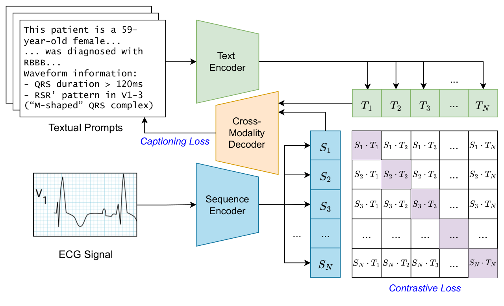

图源：ESI 论文 Fig. 3（TMLR 2024 / arXiv:2405.19366）

**方法**：针对临床机器心电报告往往只有简短诊断结论（如“窦性心律，前壁心梗”）而缺乏具体波形形态描述的问题，ESI（*ECG Signal Investigation*）设计了**心脏查询助手（Cardio Query Assistant, CQA）检索增强管线**：在预训练前结合心脏病学教科书知识库与大语言模型，将简短的诊断标签自动改写为包含具体导联、波段极性与时限特征的细粒度波形描述文本。模型采用 **1D ConvNeXtV2（参数量约 88M）** 作为 12 导联心电编码器，配对 **BioLinkBERT** 文本编码器，在整合自 MIMIC-IV-ECG、PTB-XL 与 Chapman 的 **66 万条心电记录**上联合优化**跨模态对比对齐损失**与**条件文本生成（Captioning）损失**。

**结果**：在下游心律失常诊断任务上，全量微调 AUROC 达 **0.94**，零样本分类 AUROC 达 **0.81**；在基于心电波形估计生物年龄与识别患者性别的回归/分类任务上，性能同样优于纯波形自监督模型。

**评注**：将一维 ConvNeXtV2 骨干与检索增强的电生理形态文本对齐相结合，缓解了临床报告简写缩略语带来的语义稀疏问题。

---

### MELP

香港大学 (HKU-MedAI) / 帝国理工学院 · ICML 2025 · [论文](https://arxiv.org/abs/2506.21803) · [代码](https://github.com/HKU-MedAI/MELP) · [权重](https://github.com/HKU-MedAI/MELP)

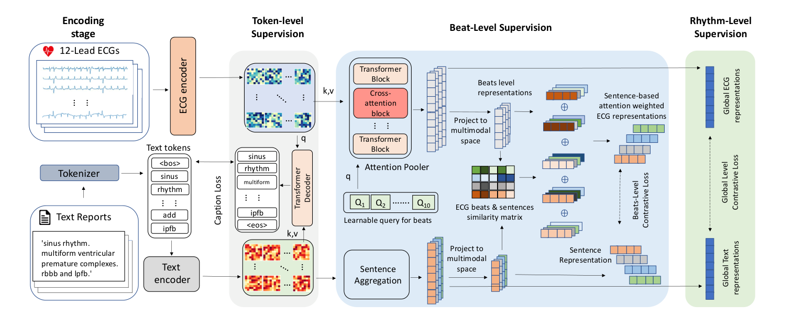

图源：MELP 论文 Fig. 1（ICML 2025 / arXiv:2506.21803）

**方法**：指出既有心电-文本对齐模型（如 MERL、ESI）仅在整段 10 秒心电与整篇报告之间做粗粒度全局对比，忽略了心电信号内部从局部波段、单次心拍到全局节律的多尺度层级对应关系。MELP（*Multiscale ECG-Language Pretraining*）采用 **CNN + 浅层 Transformer（心电编码器参数量约 66M）**，在 [MIMIC-IV-ECG](../datasets/wearable_datasets.md#mimic-iv-ecg) 的 **76 万对心电-报告数据**上构建了**三层级跨模态对齐（Hierarchical Supervision）**：
1. **词元级监督（Token-level Supervision）**：通过交叉注意力解码器由局部波形 Patch 重建报告中的医学词汇（Captioning Loss）；
2. **心拍级监督（Beat-level Supervision）**：引入一组可学习的心拍查询向量（Learnable Beat Queries）聚合单心拍局部特征，并与报告拆解出的单句形态描述构建细粒度相似度矩阵与局部对比损失；
3. **节律级监督（Rhythm-level Supervision）**：在整段 10 秒全局心电表示与整篇报告语义表示之间施加全局对比损失。

**结果**：在零样本心律与形态分类中取得 **0.85 的宏平均 AUROC**，微调后达 **0.97**；在 [ECG-CPC](#ecg-cpc) 的 8 大基模统一横评中，MELP 在全部心电-语言多模态模型里取得最高的线性探测平均排名（全场第 3，在 `PTB-XL` 五项子任务与 `Georgia`、`SPH` 数据集上稳居前列）。

**评注**：通过显式建模“词元—心拍—全局节律”三级跨模态对齐，MELP 克服了全局 CLIP 对齐容易丢失局部早搏或短暂 ST-T 改变细节的局限。

---

### KED

上海交通大学 / 上海市浦东医院 · *Cell Reports Medicine* 2024 · [论文](https://doi.org/10.1016/j.xcrm.2024.101775) · [代码](https://github.com/control-spiderman/ECGFM-KED) · [权重](https://github.com/control-spiderman/ECGFM-KED)

**方法**：KED（*Knowledge-Enhanced Electrocardiogram Diagnosis*）面向 500 Hz、10 秒的 12 导联心电信号，采用轻量级 **一维卷积网络（1D CNN，参数量约 7.9M）** 作为心电编码器，并在文本侧引入结构化心脏病学领域知识库，将 [MIMIC-IV-ECG](../datasets/wearable_datasets.md#mimic-iv-ecg) 的 **80 万条心电记录**中的诊断术语拆解为涵盖心率、电轴、传导阻滞、心房/心室肥大及缺血部位的标准化解剖与电生理属性描述，通过知识增强跨模态对比学习对齐波形与医学概念空间。

**结果**：在多个跨中心独立测试队列的 **20 余种常见心电异常零样本筛查中取得超过 0.90 的平均 AUROC**，并在 7 大类临床心律失常与心肌缺血判读对比实验中展现出与心血管专科医生相近的诊断一致性。

**评注**：证明了结合结构化医学先验知识图谱与轻量级 1D CNN（7.9M），即可在不依赖下游中心标注数据的条件下实现高精度的跨医院零样本心电异常分诊。

---

### HeartBEiT

西奈山伊坎医学院 (Icahn School of Medicine at Mount Sinai) · *npj Digital Medicine* 2023 · [论文](https://doi.org/10.1038/s41746-023-00840-9) · [代码](https://github.com/akhilvaid/HeartBEiT) · [权重](https://huggingface.co/akhilvaid/HeartBEiT)

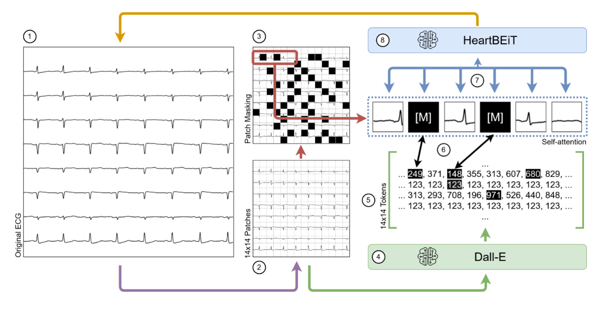

图源：HeartBEiT 论文架构图（*npj Digital Medicine* 2023 / arXiv:2306.07920）

**方法**：借鉴计算机视觉中的 BEiT 掩码图像建模思想，将 12 导联心电波形绘制转化为二维视觉图像表征（参数量约 **86M**），在西奈山医疗系统的 **850 万条临床心电记录**上预训练。通过向量量化自编码器（VQ-VAE）将局部图像块映射为离散视觉词元索引（Discrete Visual Tokens），并将预训练目标设定为预测被随机遮蔽区域的离散词元类别（交叉熵损失）。

**结果**：在肥厚型心肌病（HCM）筛查（AUROC 0.90）、左室射血分数降低（LVEF ≤ 40%，AUROC 0.94）以及急性 ST 段抬高型心肌梗死识别中，尤其在标注样本极度受限（5%～10% 训练集）的条件下，性能显著优于基于 ImageNet 预训练的 ViT 与标准卷积基线。

**评注**：作为早期探索千万级心电基础模型的先驱工作，HeartBEiT 验证了离散词元掩码建模在心脏结构性病变筛查中的少样本优势；但将一维多通道电压首先渲染为二维光栅图像的做法增加了计算冗余，后续工作大多转向原生一维时空分块架构。

---

### CLOCS

牛津大学 (University of Oxford) · NeurIPS 2020 · [论文](https://proceedings.neurips.cc/paper/2020/hash/da65ae7d09f25745b85e0546cb7ee3b4-Abstract.html) · [代码](https://github.com/danikiyasseh/CLOCS)

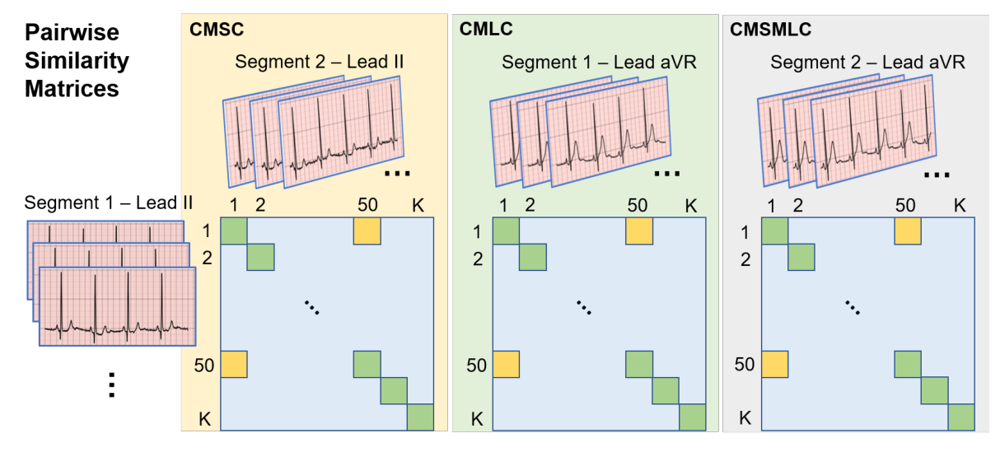

图源：CLOCS 论文 Fig. 1（NeurIPS 2020）

**方法**：CLOCS（*Contrastive Learning of Cardiac Signals Across Space, Time, and Patients*）是将患者特异与时空不变性对比学习引入多导联心电领域的奠基性工作，提出了三项生理对比不变性先验：
1. **CMSC（跨时间段对比，Contrastive Multi-Segment Coding）**：将同一患者在相邻非重叠时间窗口（如前 5 秒与后 5 秒）的心电片段视为正样本对，不同患者的片段视为负样本，迫使编码器学习个体稳定的基础心电底色；
2. **CMLC（跨空间导联对比，Contrastive Multi-Lead Coding）**：将同一心脏搏动时刻在不同空间导联（如导联 I 与导联 V2）上的同步投影视为正样本对，学习多导联间的立体空间几何一致性；
3. **CMSMLC（时空联合对比）**：同时在时间切片与空间导联两个正交维度构造正样本对。

**结果**：在 PhysioNet 2017、PhysioNet 2020 与 Chapman 多中心心律失常分类任务中，仅使用 5%～25% 的下游标注数据微调即可超越从零训练的全监督基线。

**评注**：CLOCS 提出的 CMSC（跨时间窗患者级对比）被后续 [ECG-FM](#ecg-fm)、[DeepECG-SSL](#deepecg-ssl) 等百兆级心电基础模型直接继承为核心预训练目标之一。

---

## 4. 单导联心电与脉搏波词元化基础模型

相较于医院静息 12 导联心电信号，智能手表、动态心电胸贴（Holter / Patch）与指尖血氧仪通常仅采集**单导联心电（Single-Lead ECG）** 或**单通道光电容积脉搏波（PPG）**。除了在 [智能手表与手腕多模态基础模型](smartwatch_models.md) 专题中详述的连续对比/掩码基座（如 **[PaPaGei](smartwatch_models.md#papagei)**、**[Pulse-PPG](smartwatch_models.md#pulse-ppg)**、**[HiMAE](smartwatch_models.md#himae)**、**[AnyPPG](smartwatch_models.md#anyppg)** 与 **[SigmaPPG](smartwatch_models.md#sigmappg)**）外，*npj Digital Medicine* 综述重点梳理了另一条独特的技术路线——**将连续生理波形离散化为字符词表，直接训练因果自回归（GPT）或掩码语言模型（BERT）**：

### HeartGPT

帝国理工学院 (Danilo Mandic 实验室) · arXiv 2024 · [论文](https://arxiv.org/abs/2407.20775) · [代码](https://github.com/harryjdavies/HeartGPT) · [权重](https://github.com/harryjdavies/HeartGPT)

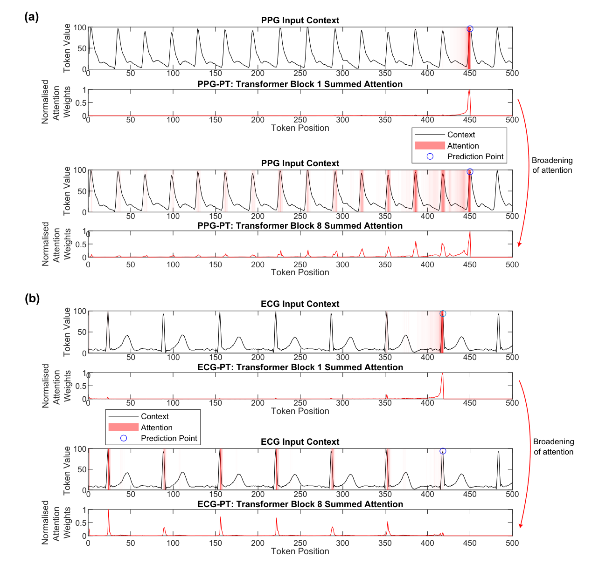

图源：HeartGPT 论文 Fig. 2（arXiv:2407.20775）

**方法**：受大语言模型（GPT）通过简单的“预测下一个词（Next-Token Prediction）”涌现出深层语义理解的启发，HeartGPT 探索了极简自回归架构在单通道生理波形上的表征与可解释性潜力。作者将原始连续信号经基线去趋势与幅值归一化后，**均匀量化为 101 个离散整数分箱（Vocabulary Size $V = 101$）**，直接送入包含 8 层因果自注意力（8 头，嵌入维 64，上下文窗口 500 个时间步）、**总参数量仅 0.44M（44 万参数）** 的纯解码器 Transformer，并训练了两个同构姐妹模型：
1. **ECG-PT（心电预训练模型）**：输入为重采样至 **100 Hz** 的 5 秒单导联心电信号（500 词元），在 [Icentia11k](../datasets/wearable_datasets.md#icentia11k) 动态胸贴心电库（11,000 名受试者，累计 **4,200 万个心电词元**）上进行下一幅值词元自回归预训练；
2. **PPG-PT（脉搏波预训练模型）**：输入为重采样至 **50 Hz** 的 10 秒单通道指尖 PPG 信号（500 词元），在 CapnoBase 与 [MIMIC-III Waveform](../datasets/wearable_datasets.md#mimic-iii-waveform) 子集（累计 **1.28 亿个脉搏词元**）上进行自回归预训练。

**结果**：
- **下游少样本微调**：在心房颤动（AFib）筛查中，ECG-PT 与 PPG-PT 分别取得 **0.99** 与 **0.93 的 AUROC**；在 PPG 逐拍搏动峰值检测（Beat Detection）任务中，PPG-PT 取得 **F1 = 0.98**。
- **涌现的电生理可解释性**：无需任何生理先验监督，HeartGPT 内部的自注意力矩阵自然涌现出清晰的心血管物理结构——（1）聚合注意力权重随心动周期呈周期性峰值，自动追踪前序心拍的对应相位以适应心率变异性（HRV）；（2）潜空间表征在三维主成分空间中按“等电位基线 → P 波/切迹 → 主波峰（R 波/收缩峰） → 复极化波（T 波）”严格聚合成连续相位轨迹；（3）不同的独立注意力头自动分工，分别锁定心电信号的 **P 波**（房颤判别关键）或脉搏波的**重搏切迹（Dicrotic Notch）**（外周血管阻力关键）。

**评注**：HeartGPT 以仅 0.44M 参数证明了因果自回归预测能够赋予轻量级生理模型优良的电生理可解释性与生成外推能力，非常适合教学演示、异常搏动归因与端侧微控制器（MCU）部署。

---

### HeartBERT

多伦多大学 · arXiv 2024 · [论文](https://arxiv.org/abs/2411.11896) · [代码](https://github.com/ecgResearch/HeartBert) · [权重](https://github.com/ecgResearch/HeartBert)

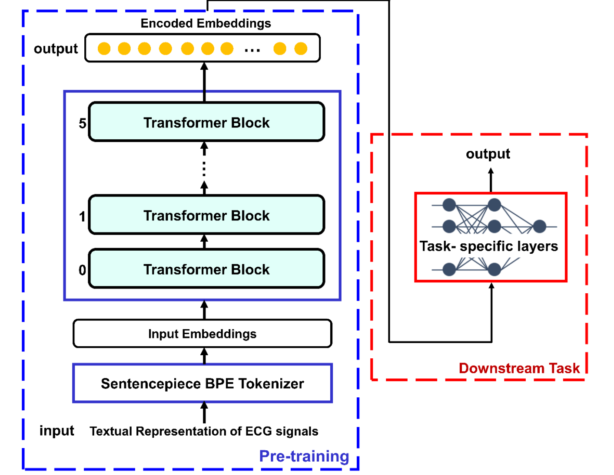

图源：HeartBERT 论文 Fig. 1（arXiv:2411.11896）

**方法**：针对逐点量化导致序列过长的问题，HeartBERT 引入自然语言处理中的**子词分词（Subword Tokenization）** 压缩生理波形：首先将归一化后的心电信号均匀量化为 26 个离散幅值级别并映射为英文字母 `a`–`z` 的长字符串，随后在该字符流上训练 **SentencePiece 字节对编码（BPE）分词器**，将高频重复出现的局部波形走势（如平缓基线段或陡峭 QRS 上升支）自动合并为单个复合子词 Token。模型采用 6 层 **RoBERTa 双向 Transformer（参数量约 83.5M）**，在整合自 [MIMIC-III](../datasets/wearable_datasets.md#mimic-iii-waveform)、[PTB-XL](../datasets/wearable_datasets.md#ptb-xl) 与 [Icentia11k](../datasets/wearable_datasets.md#icentia11k) 的 **7,400 万个 BPE 词元**上执行掩码语言建模（MLM）预训练。

**结果**：在基于单导联心电的睡眠三阶段分期（Wake / NREM / REM）任务上取得 **Macro-F1 = 0.75**，在 MIT-BIH 心拍分类与 PTB-XL 异常检测中准确率达 **0.88**，优于直接训练的双向 LSTM 与 ResNet 基线。

**评注**：通过“幅值字母化 + BPE 子词合并”实现了对平缓等电位基线的自适应无损压缩与对剧烈波形变化区段的细粒度保留，为生理信号自适应变步长词元化提供了有益思路；但硬量化操作会损失微伏级幅度绝对量纲。

---

## 5. 消费级脉搏（PPG）与临床心电（ECG）的跨模态桥梁

### 5.1 为什么要打通 PPG 与 ECG？

| 对⁠比⁠维⁠度 | 光⁠电⁠容⁠积⁠脉⁠搏⁠波 (PPG) | 心⁠电⁠图 (ECG) |
| :--- | :--- | :--- |
| **物⁠理⁠测⁠量⁠本⁠质** | 外周微血管搏动性充血引起的**组织光吸收反射变化** | 心脏起搏传导系统去极化/复极化产生的**微伏级体表生物电** |
| **穿⁠戴⁠设⁠备⁠形⁠态** | 智能手表、手环、智能戒指（支持 24/7 全天候无感佩戴） | 临床 12 导联湿电极、胸贴或手表双指主动触摸（偶发、受限） |
| **临⁠床⁠信⁠息⁠密⁠度** | 反映机械搏动、心率节律与外周血管顺应性，缺乏心室除极细节 | 心血管诊断核心依据：可精确定位心肌缺血部位、传导阻滞与心律失常 |
| **跨⁠模⁠态⁠协⁠同⁠愿⁠景** | **借助跨模态基础模型，利用 24 小时低成本腕戴 PPG，逆向合成或蒸馏临床级 ECG 诊断表征。** |

### 5.2 跨模态生成与蒸馏代表性工作

1. **[PPGFlowECG](smartwatch_models.md#ppgflowecg)**（北京大学，2025/2026）：采用 CardioAlign 双层生理对齐编码器结合**潜空间整流流（Latent Rectified Flow）**，以直线常微分方程（ODE）轨迹在 1～4 步内由单通道 PPG 合成 12 导联心电波形，并在斯坦福 MC-MED 11.8 万急诊就诊队列上通过了心血管内科医生的双盲诊断评测。
2. **[UniCardio](smartwatch_models.md#unicardio)**（清华大学 / 北京安贞医院，*Nature Machine Intelligence* 2025）：构建统一多模态扩散 Transformer（DiT）框架，将 PPG、ECG 与连续动脉血压（ABP）的去噪、缺失插补与跨模态双向翻译统一建模，仅需 0.3M/模态增量参数即可支持多传感器热插拔与持续学习。
3. **[AnyPPG](smartwatch_models.md#anyppg)**（北京大学，KDD 2026）：提出“心电引导式脉搏波预训练（ECG-Guided Pretraining）”，在 10.7 万小时配对 PPG-ECG 数据上利用冻结的高容量心电编码器作为语义教师，指导纯 PPG 编码器提取深层心血管与全身微循环特征，成功将腕戴脉搏波筛查拓展至慢性肾脏病（CKD）与帕金森病等跨系统疾病。

---

## 6. 下游心血管临床任务迁移全景

根据 *npj Digital Medicine* 综述总结，心电与脉搏基础模型的下游临床迁移任务可分为三个难度层级：

| 任⁠务⁠层⁠级 | 临⁠床⁠任⁠务⁠范⁠畴 | 代⁠表⁠性⁠适⁠应⁠症⁠与⁠数⁠字⁠生⁠物⁠标⁠志⁠物 |
| :--- | :--- | :--- |
| **Level 3：隐⁠匿⁠性⁠与⁠结⁠构⁠性⁠心⁠脏⁠病⁠早⁠期⁠筛⁠查** | 常规肉眼阅图难以直接识别的微弱电机械重塑表型 | 无症状左室射血分数降低（LVEF ≤ 40%）、中重度心脏瓣膜狭窄/反流（[EchoNext](../datasets/wearable_datasets.md#echonext)）、肥厚型心肌病（HCM）、心脏淀粉样变性、高钾血症、慢性肾病、查加斯病及中长期死亡风险预测 |
| **Level 2：常⁠见⁠临⁠床⁠节⁠律⁠与⁠形⁠态⁠学⁠诊⁠断** | 标准心电图科室常规结构化报告自动判读与跨模态检索 | 心房颤动 / 心房扑动（AF/AFL）、室性早搏（PVC）、房性早搏（PAC）、房室传导阻滞（AVB）、左右束支传导阻滞、ST 段抬高型心梗（STEMI）及自由文本心电报告生成 |
| **Level 1：连⁠续⁠血⁠流⁠动⁠力⁠学⁠与⁠生⁠理⁠参⁠数⁠估⁠计** | 日常健康管理与重症监护连续生命体征追踪 | 连续无袖带血压（CBP）、心率与心率变异性（HRV）、呼吸率（RR）、QRS/QT 传导间期回归、血管生物学年龄（Vascular Age Gap）、睡眠分期与运动心肺耐力评估 |

---

## 7. 行业结构性瓶颈与未来演进路线

依据 *npj Digital Medicine* 综述剖析，当前心电与脉搏基础模型走向临床级应用仍需突破以下四大瓶颈：

1. **破解预训练人群同质性与光学肤色偏倚（Data Diversity & Algorithmic Fairness）**：
   - 现有开源心电基模高度依赖北美与欧洲急诊/住院群体（如 `MIMIC-IV-ECG` 与 `HEEDB`），儿科人群（如 `ZZU pECG` 评测所暴露的跨年龄退化）、非洲及低收入地区人群代表性不足；
   - 腕戴光学 PPG 在深肤色人群（Fitzpatrick 肤色分级 V–VI 型）中面临黑色素对绿光波段的强吸收衰减，预训练阶段亟需引入跨肤色光学增益不变性约束与公平性分层汇报（如 [DeepECG-SSL](#deepecg-ssl) 的年龄/性别假阳性率审计）。
2. **建立严格的“受试者级”无泄漏评测规范（Subject-Level Evaluation Split & Contamination Control）**：
   - **严禁记录级或切片级随机混洗**：同一患者的心电与脉搏形态具有高度个体特异性，训练、验证与测试集的划分必须严格以**独立患者 ID（Patient-level Split）** 为隔离边界；
   - **杜绝预训练与评测集重叠**：综述图 3 揭示多个公开模型在预训练时已纳入 `PTB-XL`、`CODE-15%` 或 `Chapman-Shaoxing`，下游评测应优先采用零交集的独立外部队列（如 `EchoNext`、`SPH`、`ZZU pECG`）并在罕见病种上同时报告 AUPRC 与概率校准误差（ECE）。
3. **端侧微控制器轻量化部署（Edge AI on Wearables）**：
   - 消费级智能手表电池容量受限（通常仅 200～400 mAh），百兆参数的 Transformer（如 91M 的 `ECG-FM`、`DeepECG-SSL`）难以长时常驻端侧内存；
   - 未来演进一方面可采用紧凑状态空间架构（如 3.3M 的 [ECG-CPC](#ecg-cpc)）或轻量因果模型（如 0.44M 的 [HeartGPT](#heartgpt)），另一方面可结合结构化通道剪枝与跨层知识蒸馏（如 [PPG-Distill](smartwatch_models.md#ppg-distill)），将推理功耗压降至毫瓦级微控制器（MCU / NPU）水平。
4. **电生理波形级归因与临床可解释性（Waveform Grounding & Trust）**：
   - 临床医生的诊断决策建立在 P 波极性、PR 间期、QRS 时限、QTc 间期与重搏切迹等明确物理量纲之上。通过多粒度心拍-句子对齐（如 [MELP](#melp)）、注意力相位可解释映射（如 [HeartGPT](#heartgpt)）以及波形物理测量值锚定（如 [GEM](health_reasoning_llms.md#gem)），是将自监督表征转化为临床可信决策辅助的关键路径。

---

> **欢迎交流与共建**  
> 本文由开源知识库项目 [Wearable-Physiological-Foundation-Models](https://github.com/tujy859/Wearable-Physiological-Foundation-Models) 整理策划。该项目持续追踪全球在智能手表、连续血糖监测（CGM）以及多模态生理健康基础模型领域的最新突破。如果您对可穿戴生理计算、时序健康基模与数字生物标志物有任何想法，欢迎在仓库提 Issue 交流！
