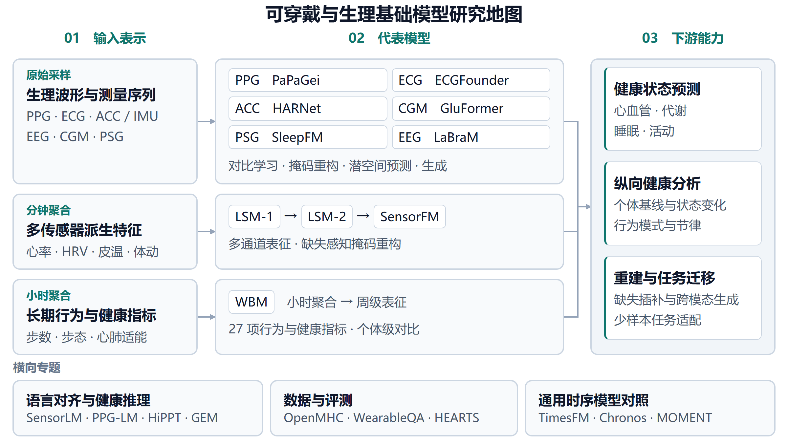
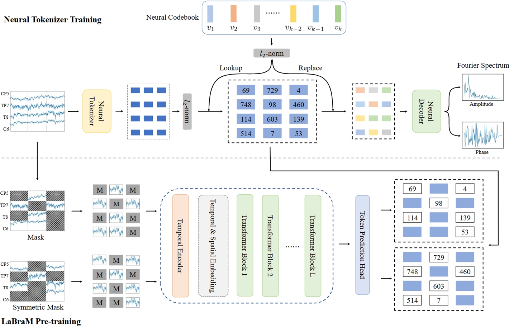
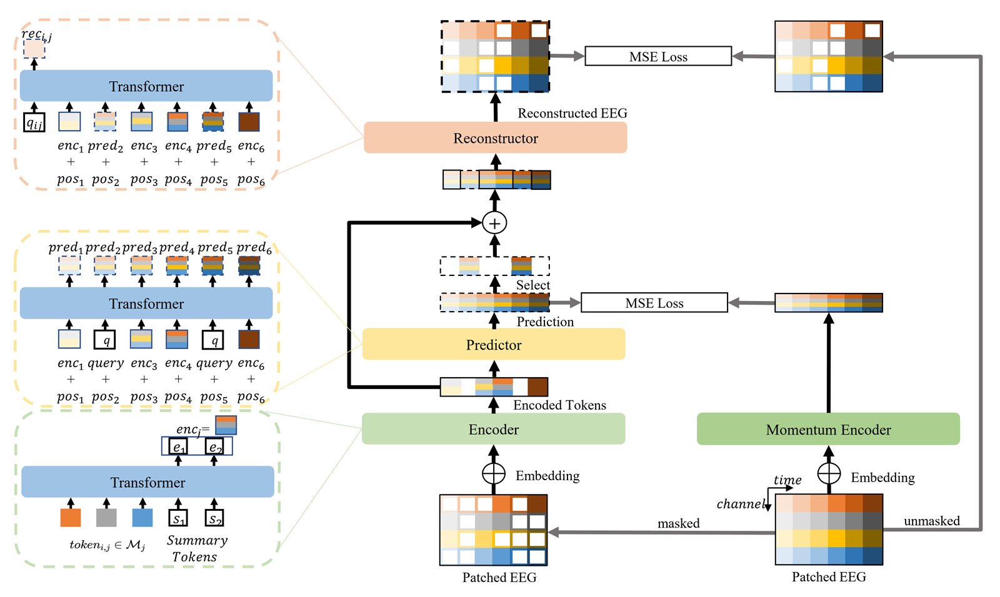
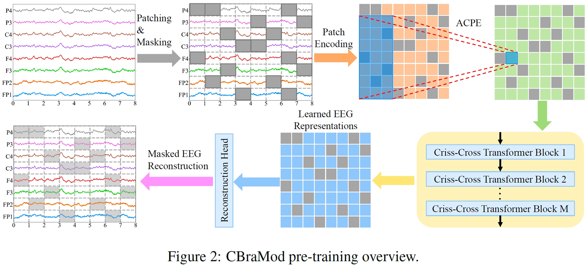

# 脑电基础模型与跨导联迁移

脑电（EEG）为头带、耳内传感和多导睡眠记录提供直接的神经活动测量。本专题收录具有多任务预训练、公开实现和可复用权重的代表工作，作为腕戴与临床生理模型的扩展路线。检索截至 2026-11-04。

图源：本仓库领域总览。EEG 模型属于信号与测量序列路线，原论文框架见下文。

## 阅读与选型

LaBraM 用离散神经词元学习跨数据集表征，EEGPT 联合优化潜空间预测与信号重构，CBraMod 在网络结构中分开处理空间和时间依赖。它们覆盖的电极布局、预处理、预训练语料及微调协议不同，选型应先匹配实际输入通道和目标任务。

| 模型 | 架构与参数口径 | 预训练数据 | 学习机制 | 原论文代表结果 | 开源资源 |
| :--- | :--- | :--- | :--- | :--- | :--- |
| [LaBraM](#labram) | 通道分块 Transformer，Base 5.8M，另评测 46M / 369M | 2,534.78 小时，多来源 EEG | 频谱预测词元器与离散词元掩码预测 | TUAB AUROC 0.9022 ± 0.0009，Base 全量微调 | [代码](https://github.com/935963004/LaBraM) · [Base 与词元器检查点](https://github.com/935963004/LaBraM/tree/main/checkpoints) |
| [EEGPT](#eegpt) | 分层编码器、预测器和重构器，Large 完整预训练网络 101M，TUAB 下游表列 25M | PhysioMI、HGD、TSU、SEED、M3CV 五个数据集 | 动量表征对齐与掩码重构 | TUAB AUROC 0.8718 ± 0.0050，冻结编码器加可训练适配层 | [代码](https://github.com/BINE022/EEGPT) · [权重](https://figshare.com/s/e37df4f8a907a866df4b) |
| [CBraMod](#cbramod) | 时空交叉注意力 Transformer，4.0M | TUEG 清洗后超过 9,000 小时，约 111 万个片段 | 时域与频域分块编码、非对称位置编码、掩码重构 | CHB-MIT AUROC 0.8892 ± 0.0154，全量微调 | [代码](https://github.com/wjq-learning/CBraMod) · [权重](https://huggingface.co/weighting666/CBraMod) |

表中结果保留各自数据集和适配协议，供查找原实验使用。跨论文比较还需统一数据切分、通道配置和训练预算。EEGPT 摘要的参数描述、完整预训练网络和下游评测表采用不同口径，因此索引保留版本与组件说明。[LaBraM 论文](https://arxiv.org/abs/2405.18765) · [EEGPT 论文](https://proceedings.neurips.cc/paper_files/paper/2024/hash/4540d267eeec4e5dbd9dae9448f0b739-Abstract-Conference.html) · [CBraMod 论文](https://arxiv.org/abs/2412.07236)

## 模型分析

### LaBraM

上海交通大学 / Emotionhelper · ICLR 2024 · [论文](https://arxiv.org/abs/2405.18765) · [官方代码](https://github.com/935963004/LaBraM) · [Base 检查点与词元器](https://github.com/935963004/LaBraM/tree/main/checkpoints)

图源为 [LaBraM 作者仓库中的框架图](https://github.com/935963004/LaBraM/blob/main/labram.png)，保留原图内容并缩放。

模型先将每个通道按 1 秒切片，训练向量量化的频谱预测词元器，再让 Transformer 预测被遮蔽片段对应的离散编码。200 Hz 重采样、通道位置嵌入及统一分块，使不同来源记录能够进入同一预训练过程。作者报告 Base 模型在 TUAB 异常识别上得到上述 AUROC，并评估了更大模型的扩展效果。[论文第 2-3 节与附录 D](https://arxiv.org/abs/2405.18765)

评注。该工作适合研究离散词元预训练和跨语料迁移。使用新队列时需要核对预训练数据重叠及电极名称映射。下游任务仍需训练分类器，数据来源扩展本身不能保证便携少导联设备上的泛化。

官方仓库的 `checkpoints/` 目录提供 Base 编码器与 VQ-NSP 词元器文件。论文中的 Large、Huge 实验规模不等于该目录提供的模型规模，复现时应注明实际使用的检查点。[官方检查点目录](https://github.com/935963004/LaBraM/tree/main/checkpoints)

### EEGPT

哈尔滨工业大学 · NeurIPS 2024 · [论文](https://proceedings.neurips.cc/paper_files/paper/2024/hash/4540d267eeec4e5dbd9dae9448f0b739-Abstract-Conference.html) · [官方代码](https://github.com/BINE022/EEGPT) · [作者提供的检查点](https://figshare.com/s/e37df4f8a907a866df4b)

图源为 [EEGPT 作者仓库中的框架图](https://github.com/BINE022/EEGPT/blob/main/figures/EEGPT.jpg)，保留原图内容并缩放。

EEGPT 用动量编码器提供表征目标，将时空表示对齐与掩码信号重构联合训练。官方 Large 检查点采用 58 通道、256 Hz、4 秒输入和 64 点分块。实验覆盖运动想象、睡眠分期、事件分类等任务，并重点考察冻结编码器后的迁移。[官方实现与检查点说明](https://github.com/BINE022/EEGPT)

论文 Table 6 的 Large 预训练网络为 101M 参数，TUAB / TUEV 下游比较表为 25M 参数。预训练网络还包含预测器、重构器与动量分支，部署选型应报告实际保留的编码器和任务头，而不是直接将预训练总量当作推理成本。[论文 Table 2、3、6](https://proceedings.neurips.cc/paper_files/paper/2024/hash/4540d267eeec4e5dbd9dae9448f0b739-Abstract-Conference.html)

评注。该方法值得作为潜空间学习的对照。论文称为线性探测的部分实验包含可训练时空适配卷积，睡眠实验还使用序列 Transformer 头，复现时应把这些组件计入训练预算。只比较一个“冻结”标签会掩盖协议差异。[论文第 3 节与附录 C.2](https://proceedings.neurips.cc/paper_files/paper/2024/hash/4540d267eeec4e5dbd9dae9448f0b739-Abstract-Conference.html)

### CBraMod

浙江大学 / 阿里巴巴 · ICLR 2025 · [论文](https://arxiv.org/abs/2412.07236) · [官方代码](https://github.com/wjq-learning/CBraMod) · [官方权重](https://huggingface.co/weighting666/CBraMod)

图源为 [CBraMod 作者仓库提供的论文 Fig. 2](https://github.com/wjq-learning/CBraMod/blob/main/figure/model.png)，保留原图内容并缩放。

CBraMod 将时域编码与频域特征组合，再以并行空间注意力和时间注意力建模通道关系与时间变化。非对称条件位置编码用于适应不同长度和通道配置。论文主体覆盖 10 类任务、12 个公开数据集，附录另补充一个运动想象数据集。[论文第 2-3 节](https://arxiv.org/abs/2412.07236)

预训练采用 19 通道、200 Hz、30 秒片段，清洗后保留 1,109,545 段记录；输入按 1 秒划分为词元。公开实现采用 MIT 许可，作者提供的 Hugging Face 权重页标注 Apache-2.0，复用时应分别保留代码与模型文件的许可信息。[论文预训练设置](https://arxiv.org/html/2412.07236v3#S3.SS1) · [代码许可](https://github.com/wjq-learning/CBraMod/blob/main/LICENSE) · [权重模型卡](https://huggingface.co/weighting666/CBraMod)

评注。4M 参数与广泛任务覆盖使其适合作为时空结构建模的基线。其主要结果来自全量微调，应用到少量头带或耳内 EEG 通道时，仍需重新验证通道布局和参考电极变化的影响。

TUEG 与 TUAB、TUEV 存在来源关系。论文分别报告包含这些子集的主结果和排除对应子集后重新预训练的结果，使用它们做独立测试时应选择相符设置。例如 TUAB AUROC 从主表的 0.9227 降为排除 TUAB 后的 0.9156，不能把二者当作同一训练协议。[论文附录 E.7-E.8](https://arxiv.org/html/2412.07236v2)

## 与睡眠及可穿戴研究的关系

脑电基础模型适合为便携 EEG 提供表征，也能作为 [睡眠 PSG 模型](sleep_models.md) 的方法对照。PSG 研究同时使用脑电、心电、呼吸等通道，评价中应明确单模态 EEG 与完整 PSG 的输入差异。

后续选型可以围绕三项实验展开。同一受试者划分下比较冻结表征与全量微调，逐步删减至目标硬件的实际导联，再检验跨中心和跨设备迁移。记录小时数、通道数和受试者数应分开统计，多通道累计小时与整段记录时长也应分别注明。

## 检索与收录边界

本轮以 ICLR、NeurIPS 论文集、arXiv 和作者代码仓为入口，检索 EEG foundation model、cross-channel pretraining、LaBraM、EEGPT 与 CBraMod，并回查论文附录和检查点来源。三项正式条目分别代表离散词元、潜空间预测和时空结构建模，选取依据为跨任务预训练及可复用实现。这是围绕可穿戴迁移的增量整理，不声称穷尽脑电基础模型。

| 工作 | 本轮处理 | 依据与待补证据 |
| :--- | :--- | :--- |
| LaBraM、EEGPT、CBraMod | 纳入主索引 | 有同行评审论文、跨任务实验与作者提供的检查点入口；保留各自适配协议 |
| REVE / LUNA | 候选追踪 | 后续核对预训练与评测数据重叠、导联迁移、检查点及适配预算，再决定是否新增独立条目。[REVE 项目](https://brain-bzh.github.io/reve/) · [LUNA 代码](https://github.com/pulp-bio/biofoundation) |
| LaBraM at Scale | 候选追踪 | 2026-11-02 发布预印本，扩展至 5.8M-1.97B 编码器和 25,067-79,910 小时数据；值得跟进，正式条目仍需逐项核对数据重叠、检查点与适配设置。[论文](https://arxiv.org/abs/2611.03165) |

这里的 EEGPT 指 NeurIPS 2024 的 *Pretrained Transformer for Universal and Reliable Representation of EEG Signals*。另有早期使用 EEGPT 名称、2025 年修订版题名改为 BrainGPT 的自回归预训练论文，检索时应以完整标题和论文编号区分，不能混用其数据规模与参数量。[BrainGPT 论文与版本记录](https://arxiv.org/abs/2410.19779)

---

> **欢迎交流与共建** 
> 本文由开源知识库项目 [Wearable-Physiological-Foundation-Models](https://github.com/tujy859/Wearable-Physiological-Foundation-Models) 整理策划。该项目持续追踪全球在智能手表、连续血糖监测（CGM）以及多模态生理健康基础模型领域的最新突破。如果您对可穿戴生理计算、时序健康基模与数字生物标志物有任何想法，欢迎在仓库提 Issue 交流！
