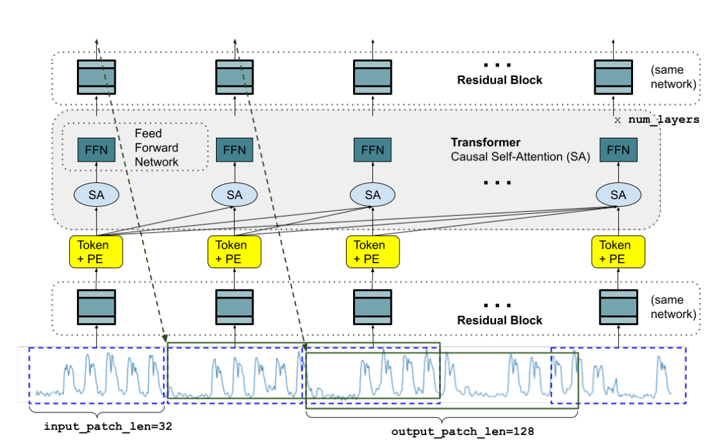
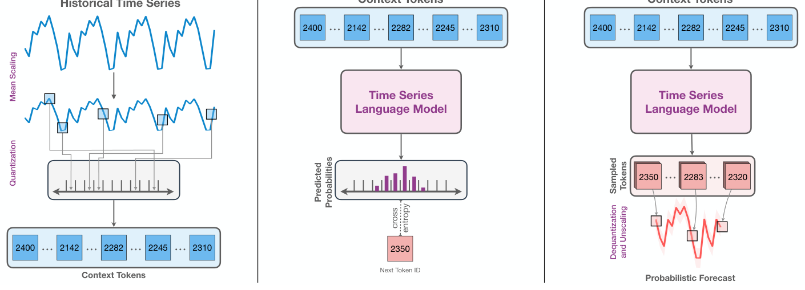
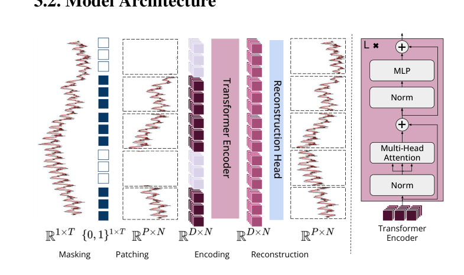
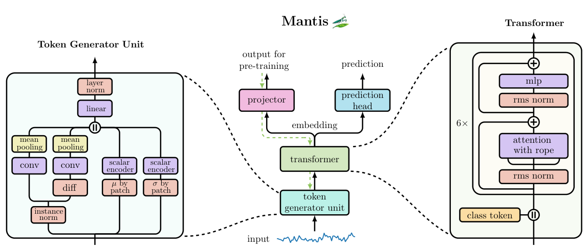
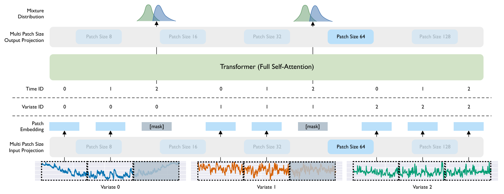
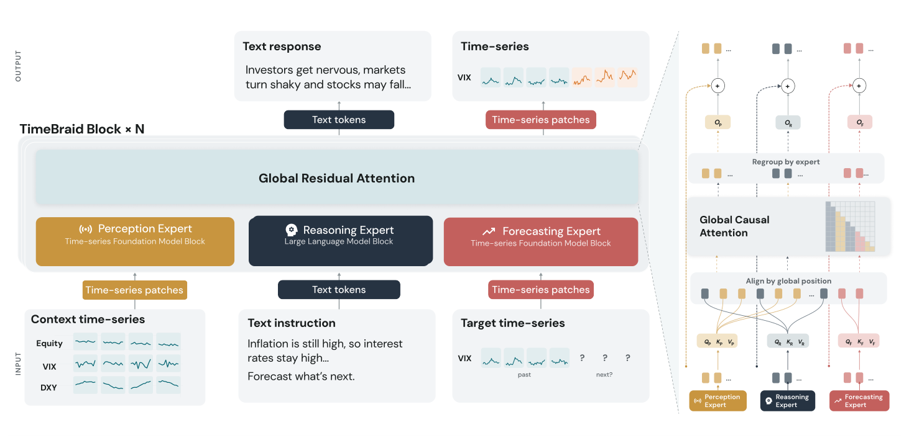
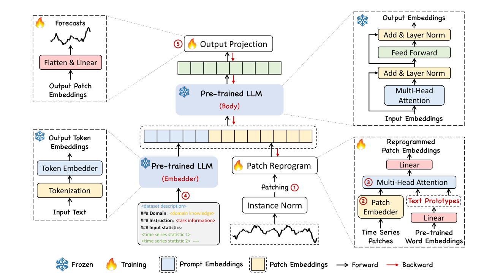

# 通用时间序列基础模型 (General TSFM) 选型与跨界对比

基于自监督预训练的通用时间序列基础模型（General Time-Series Foundation Models, TSFM）在预测、插补与异常检测等通用时序任务上展现出良好的零样本（Zero-Shot）迁移能力。本专题系统梳理学术界与工业界代表性通用 TSFM 的底层架构与训练机制，并深入探讨将其跨界应用于**可穿戴生理信号**时的核心优势、领域差异（Domain Gap）及工程适配建议。

---

## 目录

- [1. 通用时序模型发展概况与技术路线分野](#1-通用时序模型发展概况与技术路线分野)
- [2. 代表性模型深度拆解](#2-代表性模型深度拆解)
  - [TimesFM](#timesfm)
  - [Chronos](#chronos)
  - [MOMENT](#moment)
  - [Mantis](#mantis)
  - [MOIRAI](#moirai)
  - [Timestral](#timestral)
  - [Kumo-Forecast](#kumo-forecast)
  - [TimeBraid](#timebraid)
  - [Time-LLM](#time-llm)
- [3. 通用时序基础模型横向对比矩阵](#3-通用时序基础模型横向对比矩阵)
- [4. 通用 TSFM 应用于穿戴生理信号的领域差异与适配建议](#4-通用-tsfm-应用于穿戴生理信号的领域差异与适配建议)

---

## 1. 通用时序模型发展概况与技术路线分野

时间序列不同于自然语言（离散词表且具严格句法结构）和自然图像（二维空间局部平稳性）。围绕如何处理连续实数值、跨通道耦合与多采样率，通用时序基础模型主要演化出七条技术路线：

| 技⁠术⁠路⁠线⁠流⁠派 | 核⁠心⁠设⁠计⁠机⁠制⁠与⁠优⁠势 | 代⁠表⁠性⁠模⁠型 |
| :--- | :--- | :--- |
| **1. 连⁠续⁠值⁠分⁠块⁠与⁠解⁠耦⁠跨⁠度⁠预⁠测** | 保持原始数值连续性，无分箱量化精度损失；引入解耦预测跨度（DHF）与全协变量支持，兼顾精度与纯 CPU 低延迟推理 | Google TimesFM、Mistral Timestral |
| **2. 离⁠散⁠分⁠箱⁠与⁠语⁠言⁠模⁠型⁠迁⁠移** | 将连续序列均值方差归一化后均匀量化为数千个离散分箱（Bins），复用成熟 T5/GPT 架构与交叉熵损失拟合复杂非高斯分布 | Amazon Chronos、Chronos-Bolt |
| **3. 掩⁠码⁠时⁠序⁠自⁠编⁠码⁠与⁠多⁠任⁠务⁠表⁠征** | 采用 Patch-MAE 或任意变量掩码注意力，原生支持任意位置缺失插补（Imputation）、去噪、异常检测与下游微调 | CMU MOMENT、Salesforce MOIRAI |
| **4. 检⁠索⁠增⁠强⁠与⁠原⁠生⁠可⁠解⁠释⁠预⁠测** | 引入时序检索增强（DARR），融合神经网络局部预测与历史库 $k$-NN 相似模式检索，内置特征与滞后步归因可解释层 | NVIDIA Kumo-Forecast (Kumo-TS) |
| **5. 几⁠何⁠自⁠适⁠应⁠分⁠块⁠与⁠时⁠序⁠判⁠别⁠学⁠习** | 采用多尺度差分卷积分块保留局部极值与陡峭边缘，基于对比学习专攻时序分类、动作识别与事件筛查，体积小巧 | Huawei Mantis |
| **6. 跨⁠模⁠态⁠时⁠序⁠重⁠编⁠程** | 100% 冻结通用大语言模型主干，通过交叉注意力将连续时序补丁映射为词表原生“文本原型”的凸组合向量 | Monash / Ant Time-LLM |
| **7. 多⁠模⁠态⁠时⁠序-语⁠言⁠深⁠度⁠交⁠错⁠基⁠座** | 在网络深度方向将连续时序编码器与大语言模型双向跨注意力编织，兼具高精度数值预测与受控反事实情景推演（What-If） | UCSD / USC TimeBraid |

---

## 2. 代表性模型深度拆解

### TimesFM

> **发表信息**：ICML 2024 · [论文](https://arxiv.org/abs/2310.10688) · [代码](https://github.com/google-research/timesfm) · [权重](https://huggingface.co/google/timesfm-2.0-500m-pytorch)  
> **机构**：Google Research  
> **预训练数据**：超 1,000 亿个时间点（涵盖 Google Trends、Wikipedia 流量、气象、电力、交通与合成时序）  
> **开源状态**：开源推理/微调代码与 200M / 500M 官方权重

图源：TimesFM 论文 Fig. 1（ICML 2024 / arXiv:2310.10688）

TimesFM（*A Decoder-Only Foundation Model for Time-series Forecasting*）是 Google 研发的纯解码器因果自回归时序预测基座。

#### 核心架构与设计机制

1. **分块输入与残差 MLP（Patch-Level Tokenization）**：
   - 将一维连续时序切分为长度为 $P$（如 $P=32$）的非重叠分块（Patches）；
   - 通过输入残差多层感知机（Residual MLP）映射为隐空间 Token 嵌入，将 Transformer 有效序列长度缩短 $P$ 倍，从而支持数千至数万步的历史上下文窗口。
2. **非对称输入-输出分块与纯解码器因果自回归**：
   - 采用因果自注意力掩码（Causal Attention Mask），仅依据历史 Patch 预测未来 Patch；
   - **输出块长大于输入块长**（如输入 Patch 长度 32，单步输出 Patch 长度 128），显著减少了长视界自回归滚动步数与误差累积，同时附加分位数预测头（Quantile Head）提供不确定性区间估计。

---

### Chronos

> **发表信息**：TMLR / ICML 2024 · [论文](https://arxiv.org/abs/2403.07815) · [代码](https://github.com/amazon-science/chronos-forecasting) · [权重](https://huggingface.co/amazon/chronos-bolt-base)  
> **机构**：Amazon Web Services (AWS) AI Labs  
> **预训练数据**：28 个公开时序数据集 + KernelSynth 高斯过程合成语料（数百亿词元）  
> **开源状态**：开源完整训练/推理库与全尺寸权重（Tiny 20M 至 Large 710M 及 Chronos-Bolt 系列）

图源：Chronos 论文 Fig. 1（arXiv:2403.07815）

Chronos（*Chronos: Learning the Language of Time Series*）提出了“时序即语言”的极简迁移范式，在不改动 NLP 语言模型架构的前提下实现了通用零样本时序预测。

#### 核心设计思想与演进

1. **均值缩放与均匀分箱量化（Scaling & Quantization）**：
   - 对输入序列按历史绝对均值进行缩放归一化，随后通过均匀量化划分为固定数量的离散分箱（如 $B=4,096$ 个 Bins）；
   - 每个连续实数值被映射为唯一的词表 Token ID（外加 `PAD` 与 `EOS` 标记），从根本上将连续时序回归转化为分类交叉熵（Cross-Entropy）优化问题。
2. **经典 T5 编码器-解码器骨干与多模态概率采样**：
   - 直接复用 T5（20M～710M）架构超参；由于采用分类分布输出而非高斯点估计，模型能够自然拟合多峰、尖峰等复杂非高斯时序分布。
3. **Chronos-Bolt 极速推理演进**：
   - 针对原版逐 Token 自回归采样延迟较高的问题，后续版本 **Chronos-Bolt** 引入 Patch 化双向编码器结合直接多步分位数预测头，单次前向传播即可输出完整未来视界，推理速度提升超过 **250 倍**，显存开销大幅下降。

---

### MOMENT

> **发表信息**：ICML 2024 · [论文](https://arxiv.org/abs/2402.04385) · [代码](https://github.com/moment-timeseries-foundation-model/moment) · [权重](https://huggingface.co/AutonLab/MOMENT-1-large)  
> **机构**：卡内基梅隆大学 (CMU Auton Lab)  
> **预训练数据**：Time-series Pile（汇总 13 个领域的公开时序，含医疗 ECG/PPG/EEG 与 HAR 数据）  
> **开源状态**：开源完整代码、预训练语料管线与 Small / Base / Large (385M) 权重

图源：MOMENT 论文 Fig. 3（ICML 2024 / arXiv:2402.04385）

MOMENT（*MOMENT: A Family of Open Time-series Foundation Models*）是基于分块掩码自编码器（Patch-MAE）构建的多任务全能开源时序底座。

#### 核心架构与多任务全能性

1. **分块掩码自编码（Patch-Based Masked Autoencoder）**：
   - 将固定长度序列（如 512 点）切分为大小为 8 的非重叠 Patch（共 64 个 Patch）；预训练阶段随机将 50%～70% 的 Patch 替换为可学习 `[MASK]` 嵌入；
   - 编码器采用 12～24 层双向 Transformer，解码器采用极轻量线性投影头重建原始数值，防止解码器过强削弱编码器表征质量。
2. **多变量通道独立机制（Channel-Independence）**：
   - 针对多通道传感器序列采用通道独立策略，各通道共享同一套编码权重，规避了不同数据集通道数量与排列顺序不一致带来的维度灾难。
3. **原生涵盖医疗生理语料与四大任务**：
   - 其预训练语料库 **Time-series Pile** 显式纳入了 PhysioNet 心电（ECG）、脉搏波（PPG）、脑电（EEG）与人体活动识别（HAR）数据；
   - 同一预训练主干无需修改结构即可迁移至四类下游任务：**长短程预测（Forecasting）、缺失值插补（Imputation）、异常检测（Anomaly Detection）与时序分类（Classification）**。

---

### Mantis

> **发表信息**：ICML 2026（预印本 arXiv 2025） · [论文](https://arxiv.org/abs/2502.15637) · [代码](https://github.com/vfeofanov/mantis) · [权重](https://huggingface.co/paris-noah/Mantis-8M)  
> **机构**：华为诺亚方舟实验室 (Huawei Noah's Ark Lab) / Inria  
> **预训练数据**：约 200 万条跨领域多样化时间序列  
> **开源状态**：开源 PyPI 工具包（`mantis-tsfm`）与 8M 预训练权重

图源：Mantis 论文 Fig. 2（ICML 2026 / arXiv:2502.15637）

Mantis（*Mantis: Lightweight Foundation Model for Time Series Classification*）针对现有通用时序大模型普遍重预测（Forecasting）而轻判别（Classification）的盲区，提出了专攻时序分类与事件判别的超轻量基座。

#### 核心设计与端侧优势

1. **自适应词元生成单元（Token Generator Unit, TGU）**：
   - 摒弃抹平局部形态的固定线性切块，结合多尺度一维卷积与一阶差分特征提取分支，显式保留生理波形与运动传感器的局部极值、斜率突变与高频包络。
2. **8M 超轻量 ViT-1D 骨干与对比预训练**：
   - 整个编码器仅 **800 万参数（8M）**，采用自监督对比学习拉近同一序列不同随机变换视图的距离；
   - 在常规 CPU 上单次推理仅需十余毫秒，冻结编码器配合逻辑回归线性探针（Linear Probing）即可在 UCR / UEA 多变量时序分类基准上超越数十倍参数量的重建型基模，非常适合智能手表端侧姿态识别（HAR）与异常节律筛查。

---

### MOIRAI

> **发表信息**：ICML 2024 · [论文](https://arxiv.org/abs/2402.02592) · [代码](https://github.com/SalesforceAIResearch/uni2ts) · [权重](https://huggingface.co/Salesforce/moirai-1.0-R-large)  
> **机构**：Salesforce AI Research  
> **预训练数据**：LOTSA 跨领域多变量时序语料库（约 270 亿个观测值）  
> **开源状态**：开源 `uni2ts` 框架与 Small (14M) / Base (91M) / Large (311M) 权重

图源：MOIRAI 论文 Fig. 2（ICML 2024 / arXiv:2402.02592）

MOIRAI（*Unified Training of Universal Time Series Forecasting Transformers*）提出了任意变量（Any-Variate）掩码概率预测架构，以单一网络原生处理任意通道数与任意采样频率的多变量时序。

1. **多尺寸分块投影（Multi-Patch Size Projection）**：内置多组不同宽度的输入/输出线性投影层（Patch Size $\in \{8, 16, 32, 64, 128\}$），根据序列采样频率自适应匹配感受野。
2. **任意变量展平与二进制注意力偏置（Any-Variate Attention）**：将 $C$ 个通道、$T$ 个时间步的二维矩阵展平为一维长序列，结合旋转位置编码（RoPE）处理时间维相对距离，并通过二值变量标识符区分“同一通道内交互”与“跨通道交互”，无需固定输入通道数。
3. **混合参数分布输出**：输出头同时预测学生 $t$ 分布、负二项分布、对数正态分布与高斯分布的混合参数，灵活适配实数、非负计数与偏态长尾分布。

---

### Timestral

> **发表信息**：Mistral AI Technical Report 2026（2026 年 10 月） · [代码与报告](https://github.com/mistralai/timestral) · [权重](https://huggingface.co/mistralai/Timestral-209M)  
> **机构**：Mistral AI  
> **预训练数据**：大规模跨领域单变量与多变量真实及合成时序语料  
> **开源状态**：开源完整推理代码与 5M / 28M / 123M / 209M 四个尺寸权重（Modified MIT License）

Timestral 是 Mistral AI 推出的原生零样本概率时间序列预测模型家族。主力版 `Timestral-209M` 采用 24 层 Transformer（隐藏层维度 768），同时提供极轻量的 **5M 与 28M** 边缘版本，无需 GPU 即可在常规 CPU 上实现 **10 ms～140 ms** 的毫秒级推理，并在发布时登顶 **GIFT-Eval、TIME、fev-bench** 三大公开零样本时序预测榜单。

#### 核心架构与设计机制

1. **解耦预测跨度机制（Decoupled Horizon Forecasting, DHF）**：
   - 传统因果解码器通常采用连续块掩码（Contiguous Patch Masking）将未来窗口遮蔽为缺失值，造成历史上下文有效利用率下降；
   - **DHF 机制将“历史上下文读取”与“未来视界预测”解耦**：引入独立的**可学习预测词元（Learned Forecast Tokens）** 去关注完整、不中断的历史序列，使历史观测值在同一前向过程中既充当完整上下文又提供多起点监督信号。
2. **超长上下文与时间-变量双重注意力（Time & Variate Attention）**：
   - 采用固定 **32 个时间步** 的 Patch 切分，最大支持 **32,768 步历史上下文**，单次前向传播可直接预测 **1,024 步**（更长周期支持以中位数分块滚动回填扩展）；
   - 交替堆叠时间注意力与跨变量注意力，原生支持单变量与多变量联合建模。
3. **全协变量原生注入与缺失值鲁棒性**：
   - 原生支持**仅历史协变量（Past-only Covariates）** 与**已知未来协变量（Known-future Covariates，包含数值型与目标编码的类别型特征，如作息排班、给药或计划进食碳水）**，并通过因果掩码严格阻断未来目标泄漏；
   - 内置 `NaN` 缺失值指示器，无需前置插值即可直接处理存在传感器断流的穿戴序列。
4. **21 分位数概率输出**：
   - 基于 Pinball Loss 训练，每个未来时间步直接输出 **21 个分位数（从 0.01 到 0.99）**，精细刻画预测区间的不确定性。

#### 公开基准零样本表现 (GIFT-Eval)

在无微调、无集成的零样本设定下，`Timestral-209M` 在 GIFT-Eval 综合榜单上的表现对比如下：

| 模⁠型⁠名⁠称 | 参⁠数⁠量 | GIFT-Eval MASE (↓) | GIFT-Eval CRPS (↓) |
| :--- | :--- | :--- | :--- |
| **Mistral Timestral-209M** | **209M** | **0.658 (Rank #1)** | **0.446 (Rank #1)** |
| **t0-gamma** | — | 0.661 | 0.452 |
| **Google TimesFM-3** | 330M | 0.667 | 0.456 |
| **Datadog Toto-2.0** | 2.5B | 0.696 | 0.476 |
| **Amazon Chronos-2** | 120M | 0.698 | 0.485 |

---

### Kumo-Forecast

> **发表信息**：NVIDIA GTC Berlin 2026（2026 年 10 月，早期代号 *NV-Tesseract*） · [代码与报告](https://github.com/NVIDIA/Kumo-TS) · [权重](https://huggingface.co/nvidia/Kumo-Forecast)  
> **机构**：NVIDIA  
> **预训练数据**：企业级多变量时间序列与关系型结构化数据库  
> **开源状态**：开源 `Kumo-TS` 完整代码库与预训练权重（Apache 2.0 License）

Kumo-Forecast 是英伟达面向结构化数据推出的开源基础模型家族 **Kumo** 中的时间序列核心套件（`Kumo-TS`），包含多变量预测模型 **`Kumo-Forecast`** 与基于扩散模型的异常检测模块 **`Kumo-Anomaly`**。

#### 核心架构与技术创新

1. **冻结预训练编码器 + 可训练轻量预测头**：
   - 基于预训练的 **MOMENT-1-large** 骨干构建（约 **340M 参数**）；
   - 在下游适配时保持底层 Embedder 与 Transformer Encoder 权重完全冻结，仅更新轻量级任务特定预测头（Trainable Forecasting Head），兼顾直接多步预测与自回归扩展。
2. **领域感知表征与检索增强（DARR: Domain-Aware Representation and Retrieval）**：
   - 这是 `Kumo-Forecast` 的核心架构创新（即**时间序列领域的 RAG**）。模型打破了仅靠当前短窗口直接前向推理的局限，将两条预测分支动态加权融合：
     - **直接模型预测（Direct Model Predictions）**：利用预训练 Transformer 提取当前窗口的局部动态表征；
     - **历史模式检索（Historical Pattern Retrieval）**：通过 $k$-近邻搜索（$k$-NN）在更广阔的历史数据库切面中检索相似的经验演化轨迹，将其注入预测流以锚定长周期非线性趋势，支持灵活调节两分支融合权重。
3. **内置模型无关可解释性诊断层（Built-in Interpretability Layer）**：
   - 针对严肃医疗与工业监控对“黑盒模型”的顾虑，原生内置无需修改主干即可输出视界级（Horizon-specific）解释的诊断层，提供三类归因指标：
     - **特征与滞后步归因（Feature & Lag Attributions）**；
     - **语义流与轨迹稳定性诊断（Semantic-flow & Trajectory-stability Diagnostics）**；
     - **可选的嵌入层积分梯度（Embedding Integrated Gradients）**。
4. **关系图数据库协同与扩散异常检测**：
   - 配合家族中的 `Kumo-Relational`（基于 Graph Transformers 将多表外键关联建模为图节点与边），可将跨表静态与动态上下文信号传播至时序管线；同仓开源的 `Kumo-Anomaly` 则采用扩散模型配合自适应阈值策略（SCS / MACS）执行多变量流式异常检测。

---

### TimeBraid

> **发表信息**：arXiv 2026（2026 年 9 月） · [论文](https://arxiv.org/abs/2609.29792) · [代码](https://github.com/Aether-AI/TimeBraid)  
> **机构**：加州大学圣迭戈分校 (UCSD) / 南加州大学 (USC) / Aether AI  
> **预训练数据**：220 万条跨模态对齐样本 + 多领域时序理解与预测指令微调集  
> **开源状态**：论文公开，代码与 1.2B / 2.5B / 6.7B 检查点陆续开放

图源：TimeBraid 论文 Fig. 3（arXiv:2609.29792）

TimeBraid（*TimeBraid: Unifying Time Series and Language for Understanding and Forecasting*）针对以往“时序转文本丢失精度”或“浅层线性投影特征被稀释”的局限，提出了**预训练时序基础模型与预训练大语言模型原生深度交错架构（Omni-learner）**。

#### 核心架构与训练机制

1. **双塔混合专家与深层交错残差注意力（Interleaved Global Residual Attention）**：
   - **语言塔（Language Tower）**：采用开源大语言模型（Qwen 1.2B～6.7B）；
   - **时序塔（Time-Series Tower）**：采用连续值时序基础模型（TimesFM 2.5）；
   - **深层双向编织**：在网络深度方向（如在 28 层语言网络中交织 20 个跨模态融合块），文本 Token 与连续时序 Patch Token 通过层间双向交叉注意力（Cross-Attention）实时交互：
     $$
     H_{\text{text}}^{(l+1)} = H_{\text{text}}^{(l)} + \text{CrossAttn}\big(H_{\text{text}}^{(l)}, H_{\text{ts}}^{(l)}\big), \quad H_{\text{ts}}^{(l+1)} = H_{\text{ts}}^{(l)} + \text{CrossAttn}\big(H_{\text{ts}}^{(l)}, H_{\text{text}}^{(l)}\big)
     $$
2. **统一提示词协议与多块自回归预测（MPP）**：
   - 基于 ChatML 模板引入专用边界标记 `<ts>` 与 `</ts>`，输入历史序列附带统计元信息块（`stats="len=..., mean=..., std=..."`），待预测区段放置空占位符 `<ts></ts>`；
   - 语言分支采用因果交叉熵损失 $\mathcal{L}_{\text{CE}}$，时序分支采用多块预测（Multi-Patch Prediction, MPP）回归头，同时优化点预测误差与分位数损失。

#### 核心消融结论与多模态训练工程经验 (RQ1–RQ6)

论文通过系统消融回答了多模态时序大模型训练的 6 个关键工程问题：

| 研⁠究⁠问⁠题 | 探⁠究⁠主⁠题 | 核⁠心⁠实⁠证⁠结⁠论⁠与⁠工⁠程⁠指⁠引 |
| :--- | :--- | :--- |
| **RQ1** | 跨模态交互应发生在什么层级？ | **深层交错残差注意力显著最优**，全面优于仅在输入端拼接的前置融合（Early Fusion）或输出端拼接的晚期融合（Late Fusion）。 |
| **RQ2** | 理解与预测任务是否需要拆分为独立三塔？ | **不需要**。时序理解与时序预测共享同一时序塔的“双塔架构”性能匹敌甚至优于分立三塔，且显著节省显存。 |
| **RQ3** | 语言交叉熵与时序回归损失能否稳定共存？ | **时序回归损失对梯度扰动高度敏感**。必须采用有界截断目标（Bounded Targets）与精细梯度缩放，防止语言损失主导导致数值预测退化。 |
| **RQ4** | 模态损失权重与数据配比如何设定？ | 统一学习率下，**时序损失权重系数设为 $\alpha=0.5$** 最稳健；**时序理解数据与时序预测数据建议采用 3:7 配比**。 |
| **RQ5** | 预训练对齐阶段（Alignment）能否省略？ | **不可省略**。若跳过 220 万样本的跨模态对齐直接进行指令微调（SFT），模型在所有下游检查点上的表现均显著落后。 |
| **RQ6** | 推理时数值预测应多大程度依赖文本（$\lambda$）？ | **取决于外部事件驱动强度**。受突发事件或干预驱动的场景（如公共健康、用药/饮食干预）显著受益于高文本权重；纯周期物理信号主要依赖数值主干。 |

#### 评测表现与受控反事实推演 (Ctrl-F)

- **时序问答与感知（TSAQA）**：`TimeBraid-6.7B` 在异常定位、形态分类与因果推理综合评测中取得 **80.65%** 准确率；
- **纯时序零样本预测（GIFT-Eval）**：克服了以往多模态模型“引入语言后纯数值预测性能崩塌”的问题，保持了与原生 TimesFM 2.5 持平的预测精度；
- **受控反事实预测（Ctrl-F）**：能够严格遵循自然语言给出的未来情景假设（如外部环境突变或医疗干预指令），生成符合因果逻辑的未来时序曲线。

---

### Time-LLM

> **发表信息**：ICLR 2024 · [论文](https://arxiv.org/abs/2310.01728) · [代码](https://github.com/KimMeen/Time-LLM)  
> **机构**：莫纳什大学 (Monash University) / 蚂蚁集团 / IBM Research / 香港科技大学  
> **预训练骨干**：冻结 LLaMA-7B 或 GPT-2 主干  
> **开源状态**：开源完整训练与重编程代码

图源：Time-LLM 论文 Fig. 2（ICLR 2024 / arXiv:2310.01728）

Time-LLM（*Time-LLM: Time Series Forecasting by Reprogramming Large Language Models*）提出了经典的**跨模态时序重编程（Cross-Modality Reprogramming）** 范式：在不修改、不微调开源大语言模型（如 LLaMA-7B）主干参数的前提下，将连续时间序列重编程为语言模型能够直接处理的词表空间向量。

#### 四步重编程流水线设计

1. **可逆实例归一化与分块（RevIN & Patching）**：
   - 对每个输入通道执行可逆实例归一化（RevIN）消除均值方差偏移，随后按窗口长度 $P$ 切分为局部连续 Patch 并线性映射为查询特征 $Q$。
2. **基于文本原型的跨注意力重编程（Patch Reprogramming via Text Prototypes）**：
   - 从 LLM 原生词表嵌入矩阵 $E \in \mathbb{R}^{V \times D}$ 中线性投影学习一小组紧凑的“文本原型（Text Prototypes）” $E' \in \mathbb{R}^{V' \times D}$（其中 $V' \ll V$，如 $V'=1000$，代表“上升”、“平稳”、“尖峰”等基础语义基元）；
   - 将时序特征 $Q$ 作为 Query，文本原型 $E'$ 作为 Key 与 Value，通过多头交叉注意力计算软组合：
     $$
     \widetilde{P} = \text{Softmax}\left(\frac{Q {E'}^\top}{\sqrt{d_k}}\right) E'
     $$
   - **数学本质**：每个连续时序 Patch 被表示为大模型原生词向量的**凸组合（Convex Combination）**，强制时序特征落在冻结 LLM 熟悉的高维文本语义流形内。
3. **统计提示词前缀增强（Prompt-as-Prefix）**：
   - 在重编程后的时序词元前拼接结构化自然语言前缀（包含数据集领域背景、预测任务说明，以及当前输入序列的最小/最大值、中位数、整体趋势与自相关滞后周期等统计先验）。
4. **冻结主干前向推理与线性展平投影**：
   - 经完全冻结的 LLM 主干变换后，丢弃文本前缀部分，将时序隐状态展平并通过轻量线性投影头（Linear Projection）与逆归一化（RevIN Denorm）输出未来预测序列，可训练参数量不足总参数的 **1%**，在 5%～10% 极少样本（Few-shot）场景下表现突出。

---

## 3. 通用时序基础模型横向对比矩阵

| 模⁠型⁠名⁠称 | 主⁠导⁠机⁠构 | 核⁠心⁠范⁠式 | 词⁠元⁠化⁠机⁠制 | 参⁠数⁠规⁠模 | 优⁠势⁠任⁠务 | 在⁠穿⁠戴/生⁠理⁠领⁠域⁠的⁠适⁠配⁠性 |
| :--- | :--- | :--- | :--- | :--- | :--- | :--- |
| **TimesFM** | Google | 自回归因果生成 (Decoder) | 连续值 Patch (32 点) | 200M～500M | 点预测、分位数预测 | 适中（适合步数、静息心率等宏观趋势外推） |
| **Chronos** | Amazon | 离散分箱语言模型 (T5) | 4,096 Bins 离散量化 | 20M～710M | 复杂非高斯分布预测 | 较弱（高频波形量化分箱易抹平重搏切迹等微形态） |
| **Chronos-Bolt** | Amazon | Patch 编码 + 直接多步预测 | Patch 离散化 | 40M～200M | 高吞吐低延迟概率预测 | 适中（推理速度提升 250 倍，适合小时级生命体征预警） |
| **MOMENT** | CMU | 掩码重建 (Patch-MAE) | 连续值 Patch (8 点) | 40M～385M | **信号插补、去噪、异常检测** | **优良（Pile 含 ECG/PPG/EEG 语料，适合波形缺失补全）** |
| **Mantis** | 华为诺亚 | 几何对比学习 (ViT-1D) | 多尺度差分卷积分块 (TGU) | **8M (端侧极简)** | **事件分类、动作识别、节律筛查** | **优良（CPU 毫秒级推理，适合手环端侧 HAR 与心律筛查）** |
| **MOIRAI** | Salesforce | 任意变量掩码注意力 | 多尺寸动态 Patch | 14M～311M | 跨传感器多变量概率预测 | 适中（全通道展平注意力在高频多导联下计算开销大） |
| **Timestral** | Mistral AI | **解耦预测跨度 (DHF) + 概率预测** | **连续 Patch (32 点) + 预测词元** | **5M～209M (纯 CPU 极速)** | **零样本概率预测、未来协变量注入** | **优良（适合 CGM 餐食/胰岛素协变量血糖预测与边缘部署）** |
| **Kumo-Forecast** | NVIDIA | **冻结 MOMENT + DARR 检索增强** | **连续 Patch + $k$-NN 历史检索** | **约 340M (配可解释层)** | **检索增强预测、滞后归因、扩散异常检测** | **良好（适合结合个体历史生理档案的个性化基线锚定与归因）** |
| **Time-LLM** | Monash / 蚂蚁 | **跨模态重编程 (Reprogramming)** | **Patch + 文本原型 Cross-Attn** | **冻结 7B (微调 <1%)** | **少样本/零样本预测、长短程外推** | 适中（适合低频宏观健康指标少样本冷启动迁移） |
| **TimeBraid** | UCSD / USC | **多模态深度交错 (MoT)** | **连续 Patch + 文本 Token** | **1.2B～6.7B** | **时序问答、反事实推演 (Ctrl-F)、纯预测** | **良好（可作为穿戴健康大模型时序与语言双向交织的架构参考）** |

---

## 4. 通用 TSFM 应用于穿戴生理信号的领域差异与适配建议

### 4.1 四大核心领域差异 (Domain Gap)

尽管通用时序基础模型在能源、气象、金融等宏观基准上表现优异，但将其**零样本直接迁移至智能手表高频传感器或 CGM** 时，必须正视以下四个物理与生理层面的领域鸿沟：

1. **频域运动伪影碰撞的物理不可知性**：
   - 通用预测模型缺乏人体骨骼运动动力学先验。当手腕 PPG 中混杂着能量高出数十倍的跑步步频谐波（1.5～3 Hz）时，通用自回归模型会将强步频伪影当作主导周期进行外推，导致预测脉率严重偏离真实心率。
2. **微形态切迹与病理瞬态特征丢失**：
   - 脉搏波的重搏切迹（Dicrotic Notch）、心电图的 ST 段微小抬高或 Q 波顿挫往往仅跨越数个采样点（20～40 ms）。通用模型的粗粒度分块（如 32 或 64 点）或离散分箱（Binning）会直接平滑抹除这些承载关键血管顺应性与心肌缺血信息的微观几何特征。
3. **异构多采样率与跨传感器因果降噪缺失**：
   - 可穿戴场景中 PPG（25～100 Hz）、三轴加速度计 ACC（25～50 Hz）、皮电 EDA（4 Hz）与肤温（0.1 Hz）多速率并存。通用模型大多采用通道独立（Channel-Independent）策略，无法利用同步 ACC 作为“运动伪影参考流”在潜空间对 PPG 执行自适应抵消。
4. **日常非规则佩戴与长程物理断流**：
   - 通用时序基模普遍假设输入序列位于连续等间隔的时间网格上。但在真实自由生活佩戴中，洗手、充电、佩戴松动会导致频繁的物理断流，需要结合专用的连续物理时间旋转位置编码（如 [PPG-LM](smartwatch_models.md#ppg-lm) 的连续时间 RoPE）或显式观测掩码（如 [GlucoFM](cgm_models.md#glucofm)）。

### 4.2 穿戴生理场景选型与落地适配建议

- **波形缺失插补与去噪预处理**：优先选用 **MOMENT**，利用其预训练语料包含 ECG/PPG 的先验与 Patch-MAE 双向重建能力修补短时信号丢包；
- **腕端动作识别（HAR）、睡眠体动分期与异常事件筛查**：优先选用 **Huawei Mantis（8M）**，利用其 TGU 多尺度差分卷积保留波形局部极值，并在边缘 CPU 上以毫秒级延迟运行线性分类探针；
- **CGM 连续血糖概率预测与饮食/用药干预注入**：推荐选用 **Mistral Timestral（5M / 28M 轻量规格）**，直接利用其**已知未来协变量（Known-future Covariates）** 接口注入计划进食碳水化合物克数、外源胰岛素剂量与运动计划，配合内置 `NaN` 指示器与 **21 分位数输出**，在移动端 CPU 上实时生成未来血糖风险扇区；
- **个体长程历史档案锚定与临床可解释归因**：推荐借鉴 **NVIDIA Kumo-Forecast** 的 **DARR（时序检索增强）** 机制，利用 $k$-NN 从佩戴者过往数月的个人生理档案库中检索相似生理状态切面（如相似运动负荷后的心率恢复轨迹）辅助当前推演，并借助内置**特征与滞后归因层（Lag Attributions）** 向医生与用户提供可解释依据；
- **前瞻性健康情景推演（What-If）与多模态健康问答**：推荐吸收 **TimeBraid** 的深层交错残差注意力与统一 `<ts>` 提示词范式（遵循 RQ4 的 $\alpha=0.5$ 损失配比与 RQ5 的预训练对齐策略），构建“输入连续生理体征 + 自然语言干预假设 → 输出未来恢复曲线与健康分析报告”的端到端系统；
- **高频心血管波形表征提取**：对于脉搏波形态学分析、无袖带血压与多器官慢病筛查，仍应以经过配对生理信号自监督预训练的专用基模（如 **[PaPaGei](smartwatch_models.md#papagei)、[Pulse-PPG](smartwatch_models.md#pulse-ppg)、[AnyPPG](smartwatch_models.md#anyppg)、[SleepFM-2](sleep_models.md#sleepfm)**）作为底层特征提取主干。
