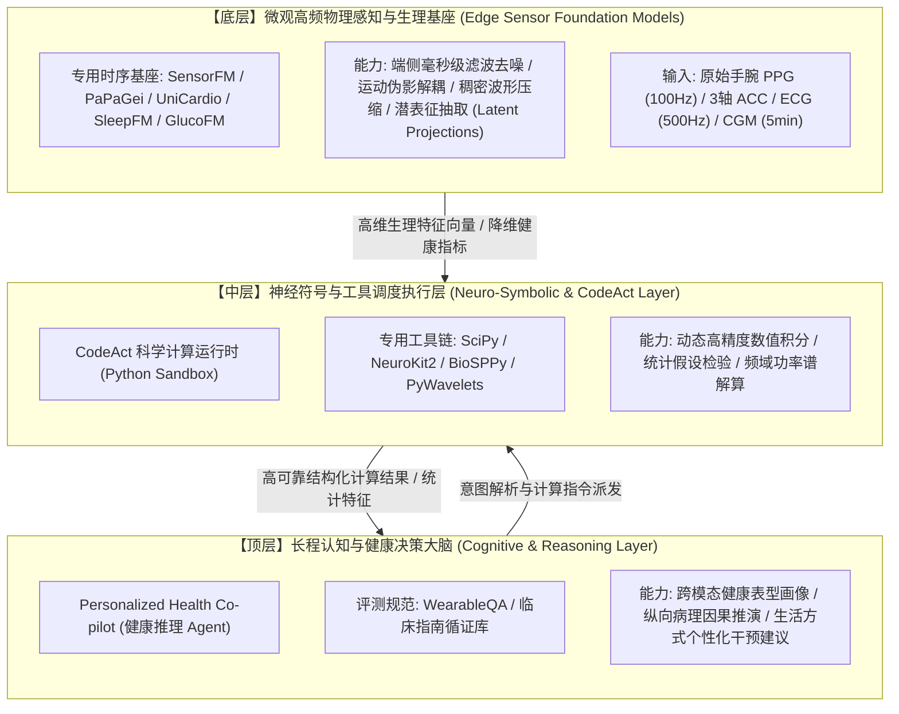

# 可穿戴健康推理与生理大语言模型深度解析 (Wearable Health Reasoning & Physiological LLMs)

> **导读**：随着智能手表、连续血糖仪（CGM）等消费级与临床设备的普及，个人健康时序正从“孤立的瞬时生理读数”演化为“长达数年的全生命周期纵向轨迹”。传统的生理基础模型（如 PaPaGei、SensorFM、GlucoFM）解决了高频物理波形的表征压缩与单点预测问题；然而，面对用户对病理因果归因、多模态联动分析与个性化生活干预的深层诉求，学术界与工业界于 2025–2026 年迎来了**“从信号级表征（Representation）向认知级健康推理（Health Reasoning）”**的重大范式跃迁。
>
> 本专题深度解构 Meta **WearableQA**（arXiv 2026）与 Yang AI Lab **HEARTS**（ICML 2026）两大基石工作，剖析为何纯 LLM 无法“生啃”高频原始波形，并揭示下一代可穿戴 AI 的核心演进形态——**“底层专有生理基座 + 中层 CodeAct/DSP 工具调度 + 顶层健康推理 Agent”**的三层分工体系。

---

## 📑 目录

- [1. 范式跃迁：为什么仅靠“生理表征学习”还远远不够？](#1-范式跃迁为什么仅靠生理表征学习还远远不够)
- [2. 破除迷思：为什么纯 LLM 无法端到端“生啃”底层高频波形？](#2-破除迷思为什么纯-llm-无法端到端生啃底层高频波形)
- [3. Meta WearableQA (2026) —— 真实世界长程健康推理权威基准](#3-meta-wearableqa-2026--真实世界长程健康推理权威基准)
  - [3.1 真实用户长程多模态数据画像](#31-真实用户长程多模态数据画像)
  - [3.2 $2 \times 2$ 分类学空间与 16 种题型设计](#32-2-times-2-分类学空间与-16-种题型设计)
  - [3.3 双重锚定框架 (Dual-Grounding Framework)](#33-双重锚定框架-dual-grounding-framework)
  - [3.4 14 种主流模型评测对比与失败模式](#34-14-种主流模型评测对比与失败模式)
- [4. Yang AI Lab HEARTS (ICML 2026) —— 全谱系生理时序四层认知推理金字塔](#4-yang-ai-lab-hearts-icml-2026--全谱系生理时序四层认知推理金字塔)
  - [4.1 评测全景图谱：跨越 20 种模态与 16 大开源库](#41-评测全景图谱跨越-20-种模态与-16-大开源库)
  - [4.2 四层分层认知推理阶梯 (Hierarchical Capabilities)](#42-四层分层认知推理阶梯-hierarchical-capabilities)
  - [4.3 关键实证发现与“解毒”结论](#43-关键实证发现与解毒结论)
  - [4.4 CodeAct Agent 与神经符号协同范式](#44-codeact-agent-与神经符号协同范式)
  - [4.5 中科院/港理工 CBPM-LLaMA (ACM-BCB '24) —— 生理动力学先验解耦的 Prompt 微调范式](#45-中科院港理工-cbpm-llama-acm-bcb-24--生理动力学先验解耦的-prompt-微调范式)
  - [4.6 北大/NUS GEM (NeurIPS 2025) —— 走向波形物理锚定的 Grounded ECG 多模态大模型](#46-北danus-gem-neurips-2025--走向波形物理锚定的-grounded-ecg-多模态大模型)
- [5. 终局架构：三层可穿戴健康 AI 技术栈 (Hierarchical AI Stack)](#5-终局架构三层可穿戴健康-ai-技术栈-hierarchical-ai-stack)
- [6. 核心论文与开源资源导航](#6-核心论文与开源资源导航)

---

## 1. 范式跃迁：为什么仅靠“生理表征学习”还远远不够？

过去五年，可穿戴生理信号模型主要遵循**单点预测与表征学习范式**：
*   **任务形式**：输入长为 $T$ 的生理信号片段，预测下一时刻的数值 $X_{t+1}$（回归），或判别当前片段是否属于某一特定病理类别（如房颤、睡眠呼吸暂停）。
*   **评测指标**：均方根误差（RMSE）、平均绝对误差（MAE）、分类准确率（Accuracy / F1-score）。

然而，在真实世界的临床健康与个人生活管理中，用户与医生需要的并不是孤立的数字预测，而是具备**生物医学可解释性与因果链条的综合推理**：

$$
\text{“为什么我昨晚静息心率升高了 10 BPM，且深睡减少了 40 分钟？”}
$$

要解答这一问题，系统不仅需要感知到数值的异常突变，更需要跨模态、跨尺度地联合审视：
1. **多指标协同检验**：白天是否有剧烈运动或超负荷心肺活动（$\text{VO}_2\text{max}$ / METs）？就寝前是否有暴饮暴食导致夜间血糖持续维持在高位？
2. **长程个体基线比对**：与过去 30 天的个人昼夜节律基线相比，这一波动是否属于统计学显著偏移？
3. **临床病理机制归因**：究竟是肌肉疲劳恢复期、自主神经交感兴奋，还是急性上呼吸道感染的早期前驱反应？
4. **个性化前瞻干预**：今天是否应该停止计划中的半程马拉松训练？是否需要加强水分补给并复测体温？

> [!NOTE]
> **从 1.0 到 2.0 的本质区别**：
> 基础模型（1.0）负责将混沌高噪的物理信号提炼为**高纯度的生理语义表征（Physiological Representations）**；而健康推理大模型（2.0）则负责在这些表征与现实世界医学知识库之间建立**因果推理与行动决策桥梁（Clinical Reasoning & Actionable Interventions）**。

---

## 2. 破除迷思：为什么纯 LLM 无法端到端“生啃”底层高频波形？

随着生成式 AI 的爆发，部分研究曾尝试将连续物理信号直接数值序列化（如转化为字符串文本），送入通用大语言模型中进行自回归生成。然而，在真实可穿戴高频生理信号场景下，这一做法面临着严峻的物理与算法壁垒：

### 2.1 Token 爆炸与计算复杂度平方灾难
- 智能手表原始 PPG 采样率通常为 25～100 Hz，单导联 ECG 达到 250～1000 Hz。
- 仅单通道 100 Hz 信号，佩戴 **1 小时** 即产生 $360,000$ 个浮点采样点；佩戴一天将产生近 **1000 万个点**。
- 即便使用最长上下文的大语言模型，直接以文本格式输入数百个采样点就会消耗数千 Token，在注意力机制 $\mathcal{O}(N^2)$ 计算复杂度下，端侧计算与云端推理成本均不可承受。

### 2.2 字节级分词 (BPE Tokenization) 对物理量纲的毁灭
- 通用 LLM 采用的 BPE / SentencePiece 分词算法基于文本子词频次统计构建。
- 面对连续浮点数（如 `128.45` 与 `128.49`），分词器极易将其拆解为随机的 Token 碎片（如 `["128", ".4", "5"]`）。
- 这种离散切分不仅**彻底破坏了连续实数的拓扑几何距离与物理量纲（mV, BPM, mg/dL）**，而且在密集数值计算中会诱发严重的数字幻觉。

### 2.3 信号处理物理归纳偏置（Inductive Bias）的彻底缺失
- 生理波形处理极其依赖**局部波形形态学特征、周期平移不变性与频域动力学先验**：
  - 手腕光电脉搏波（PPG）在跑步高动态下的运动伪影，必须依靠 3 轴加速度计（ACC）在 1～3.5 Hz 频段内的谐波碰撞消除算法；
  - 心电（ECG）诊断依赖微秒级 QRS 波群的斜率、ST 段压低微变及 P-R 间期。
- 标准的自注意力机制是一种弱假设的集合映射，完全缺乏频域带通滤波（Bandpass）、小波多尺度分解或状态空间方程等物理约束。

### 2.4 HEARTS 揭示的“启发式作弊陷阱 (Heuristic Shortcuts)”
Yang AI Lab 在 **HEARTS** 基准中对 10 余种前沿 LLM 进行高频时序端到端生成测试，发现了惊人的失败模式：
- **复制粘连（Copying）**：模型在预测后续波形时，往往直接重复前几个周期的局部波形；
- **朴素线性插值（Linear Interpolation）**：在遇到缺失值补全时，倾向于连一条直线，完全丢失了微观的高频生理震荡信息；
- **频率敏感性断崖**：随着信号频率从 1 Hz 升至 100 Hz 及以上，模型表现呈断崖式下跌，且与通用文本推理能力（MMLU）几乎无正相关。

---

## 3. Meta WearableQA (2026) —— 真实世界长程健康推理权威基准

- **论文**: *WearableQA: A Benchmark for Health Reasoning over Real-World Wearable Data* (arXiv:2609.05405)
- **机构**: Meta AI / Reality Labs
- **发布时间**: 2026 年 9 月

```text
               ┌─────────────────────────────────────────────────────────────┐
               │           WearableQA 数据源 (200 名真实用户)                │
               │  - 500 天纵向连续记录 (16 维每日生理/运动/睡眠聚合指标)       │
               │  - 17 维临床实验室血液生化生化面板 (HbA1c, 胰岛素等)         │
               │  - 人口统计学 (年龄/性别/BMI) + 群体大样本分位数参考        │
               └──────────────────────────────┬──────────────────────────────┘
                                              │
                      ┌───────────────────────┴───────────────────────┐
                      ▼                                               ▼
      ┌───────────────────────────────┐               ┌───────────────────────────────┐
      │   Data Reasoning (数据计算)   │               │   Health Reasoning (健康推理) │
      │ - 纵向时序趋势统计与突变检测   │               │ - 疾病风险评估与生理机制分析  │
      │ - 异常值持续时长与基线恢复期  │               │ - 鉴别性推理与多表型分型      │
      │ - 单指标统计 vs 跨指标关联    │               │ - 循证医学指南干预与个性化推荐│
      └───────────────────────────────┘               └───────────────────────────────┘
```

### 3.1 真实用户长程多模态数据画像
WearableQA 摒弃了实验室合成数据，从真实世界大规模可穿戴队列中抽样筛选了 **200 名深度佩戴用户**，每位用户拥有长达 **500 天** 的密集纵向记录：
1. **心血管健康 (Cardio-Fitness)**：静息心率（RHR）、心率变异性（HRV, rMSSD）、最大摄氧量（$\text{VO}_2\text{max}$）。
2. **日常活动与体能 (Activity & Energy)**：总步数、动态活动卡路里消耗、基础代谢率（BMR）、高强度运动时长、运动均值心率、代谢当量（METs）。
3. **睡眠生理架构 (Sleep Architecture)**：总睡眠时长、睡眠效率、深睡比例（Deep Sleep %）、快速动眼期比例（REM %）、就寝作息规律性指数（Bedtime Regularity）。
4. **自主神经与代谢压力**：全天平均压力水平（Stress Score）。
5. **临床血液生物标志物 (Blood Biomarkers)**：匹配 17 项临床化验指标（空腹血糖、糖化血红蛋白 HbA1c、高敏 C 反应蛋白 hs-CRP、血脂四项、空腹胰岛素等）。
6. **人群分位数参考 (Cohort Reference Percentiles)**：来自数十万人大样本群体的五大核心指标年龄-性别正态分位数。

### 3.2 $2 \times 2$ 分类学空间与 16 种题型设计
WearableQA 创新性地构建了双轴交叉的评测矩阵，共涵盖 **4,084 道 10 选 1 单选题**（随机瞎猜概率基线仅为 10%）：

| 维度轴 | 子类型 | 核心考察要求 | 典型问题示例 |
| :--- | :--- | :--- | :--- |
| **推理类型 (Reasoning)** | **Data Reasoning**<br>(数据计算, 2.7k 题) | 纯粹基于可穿戴传感器时序数字的计算推导（均值、极值、恢复时长、偏离度）。 | *“该用户在过去 6 个月中，静息心率超过个人基线 1.5 倍标准差的平均恢复天数是多少？”* |
| **推理类型 (Reasoning)** | **Health Reasoning**<br>(健康推理, 1.4k 题) | 必须结合临床病理学生理机制、疾病前兆与医学指南进行因果归纳。 | *“结合该用户长期的步数骤降、HRV 持续走低与空腹胰岛素水平，最可能提示哪种代谢综合征表型？”* |
| **信号维度 (Complexity)** | **Single-metric**<br>(单指标, 1.7k 题) | 仅针对单一通道生理时序开展深层纵向分析。 | *“分析用户的深睡百分比变化轨迹并归纳其作息演变。”* |
| **信号维度 (Complexity)** | **Cross-metric**<br>(多模态关联, 2.4k 题) | 跨模态检验多个生理系统之间的动态响应与非线性耦合。 | *“评估运动消耗量增长对随后两晚睡眠效率及次日静息心率的滞后抑制效应。”* |

### 3.3 双重锚定框架 (Dual-Grounding Framework)
为了在数千道长程健康题目中建立确定性的真实标签（Ground Truth），Meta 提出了双重锚定体系：
1. **文献循证锚定 (Literature-grounded)**：由临床医生与生物医学专家从顶级医学期刊（NEJM、Lancet、Nature Medicine）及指南（AHA、ADA）中提取出具有确定因果结论的生理相互作用规则。
2. **群体统计显著锚定 (Population-grounded)**：利用超大规模真实穿戴数据库，通过严格的双侧统计假设检验（$p < 0.001$，且效应量 Cohen's $d > 0.5$），确保题目的因果关系在真实人群分布中具有统计显著性，杜绝伪相关。

### 3.4 14 种主流模型评测对比与失败模式
在 14 种最前沿大模型上的实测结果呈现出极大的能力分化：

```text
WearableQA 准确率全景横评 (随机基线 = 10%)
┌────────────────────────────────────────────────────────────────────────┐
│ Gemini-3.1-Pro        ████████████████████████████████████  72.9%      │
│ GPT-4o / GPT-5 系列   █████████████████████████████████     68.4%      │
│ Claude-Opus-4.6       ███████████████████████████████       64.1%      │
│ Llama-3.3-70B         ████████████████████████              48.2%      │
│ Mistral-Small-3.1     ██████████████                        31.5%      │
│ Gemma-3-12B           ██████████                            22.8%      │
│ Chance Baseline (10%) ████                                  10.0%      │
└────────────────────────────────────────────────────────────────────────┘
```

> [!WARNING]
> **评测暴露的致命短板**：
> 1. **长程上下文退化**：当输入完整的 500 天日常数据表格（数万 Token）时，开源中小模型的定位注意力严重发散，对早期（如第 100 天）和中期突变的捕捉率下降了 40% 以上。
> 2. **数据计算弱于逻辑推理**：绝大多数模型在“纯数据趋势计算（Data Reasoning）”上的得分反而低于“医学知识推理（Health Reasoning）”——大模型背诵医学概念容易，但在几百行连续数字中精确执行“窗口统计与阈值计数”却频频出现计算失误。

---

## 4. Yang AI Lab HEARTS (ICML 2026) —— 全谱系生理时序四层认知推理金字塔

- **论文**: *HEARTS: Benchmarking LLM Reasoning on Health Time Series* (arXiv:2603.06638 / ICML 2026)
- **团队**: Yang AI Lab (Sirui Li, Yuzhe Yang 等联合 MIT / Harvard 研究团队)
- **资源**: 📄 [Paper](https://arxiv.org/abs/2603.06638) | 🌐 [Website](https://yang-ai-lab.github.io/HEARTS/) | 💻 [GitHub](https://github.com/yang-ai-lab/HEARTS)

```text
                       ▲
                      / \
                     /   \
                    / 4.  \   Deduction (演绎归纳)
                   /       \  - 时间排序、纵向轨迹因果演变、预后推断
                  /─────────\
                 /    3.     \   Generation (时序生成)
                /             \  - 预测、缺失值插补、跨模态波形转换
               /───────────────\
              /       2.        \   Inference (状态推断)
             /                   \  - 生理事件定位、疾病诊断分类、体征判别
            /─────────────────────\
           /          1.           \   Perception (底层感知)
          /                         \  - 信号级特征提取、形态学测量、峰值检测
         └───────────────────────────┘
```

### 4.1 评测全景图谱：跨越 20 种模态与 16 大开源库
HEARTS 是目前涵盖最广、多模态异构性最高的健康时序综合评测基准：
- **16 个权威数据集**：包括心血管手术监护库 VitalDB、全套多导睡眠监测 SHHS、手腕活动监测 Capture24、连续血糖动态代谢 CGMacros、嗓音与呼吸病理 Bridge2AI Voice 等。
- **20 种生理模态**：覆盖 ECG、EEG、PPG、EMG、连续无创血压（CNBP）、CGM 血糖、阻抗呼吸波、眼动注视轨迹、步态加速度、咳嗽与语音音频等。
- **跨越极限物理尺度**：采样率从超低频（每日聚合）纵贯至超高频（48 kHz 呼吸音）；序列长度从数十个点延展至超过 1,000,000 点。

### 4.2 四层分层认知推理阶梯 (Hierarchical Capabilities)

1. **Perception (底层感知与特征提取)**:
   - 考察模型对微观波形形态的度量能力。
   - 任务：检测 PPG 脉搏重搏切迹（Dicrotic Notch）、计算心电 QRS 波群时长、提取音频声门周期基频。
2. **Inference (生理事件定位与受试者分类)**:
   - 考察局部的医学分类与异常检测能力。
   - 任务：房颤（AFib）发作事件精确定位、睡眠呼吸暂停阶段分类、神经肌肉退行性步态识别。
3. **Generation (时序生成、插补与跨模态映射)**:
   - 考察时序动力学的重建能力。
   - 任务：根据前序血糖预测餐后轨迹、电极脱落期间的阻抗插补、由外周 PPG 跨模态合成诊断级 ECG。
4. **Deduction (时间演化因果推断与纵向推演)**:
   - 考察最高阶的时间因果推理与病理演变逻辑。
   - 任务：判断不同生理并发症发生的时间因果先后顺序、基于数月生理指标演化推演心血管发病风险轨迹。

### 4.3 关键实证发现与“解毒”结论
HEARTS 进行了详尽的大规模实证对照实验，给出了数条颠覆盲目乐观的技术洞见：
1. **专有时序基座全面碾压直接 LLM 推理**：
   在 Perception 与 Generation 等硬核数字信号任务中，哪怕是参数量仅 1.5M 的轻量级专有时序模型（如 PaPaGei、MOMENT），其精度与相关性也大幅超越数百亿参数的通用多模态 LLM。
2. **通用推理能力的弱相关性**：
   模型在普通文本基准上的强悍推理实力，无法直接迁移到健康时序领域。健康时序包含深厚的生物物理因果规律，缺乏生理先验的通用大模型容易陷入无休止的虚假模式匹配。
3. **模态表示形式的影响仅停留在绝对数值**：
   将时序绘制成折线图（Vision-LLM）、将数值序列转化为原始文本字符串、或者经过 Patch 离散化，只会在绝对分值上产生平移，**不同生理任务之间的相对难易梯度在各种输入形式下高度一致**。

### 4.4 CodeAct Agent 与神经符号协同范式 (ICML 2024)
针对纯 LLM 无法可靠处理连续浮点数、频域变换与时序积分运算的致命缺陷，前沿健康系统（如 HEARTS 等）深入集成了 **CodeAct Agent** 范式：
- **核心定义与来源**：CodeAct（*Executable Code as Actions with Language Models*，ICML 2024 / UIUC Xingyao Wang 等，开源项目 OpenHands 核心基石）主张**将大模型 Agent 的行动空间（Action Space）彻底统一为可执行的 Python 代码**，而非僵硬受限的 JSON 工具调用（Function Calling）或脆弱的纯文本正则匹配（ReAct）。
- **工作机制与核心优势**：
  1. **支持复杂控制流与原生数据流**：支持多步循环、条件分支与局部临时变量，工具间数据传递直接在沙箱内存中流转，杜绝了数百个浮点数在 LLM 上下文中反复序列化导致的 Context 长度爆炸。
  2. **有状态执行环境（Stateful REPL Sandbox）**：沙箱内部维护长期活跃的 Python 解释器进程，前序轮次加载的 `ppg_raw` 数组或 `pandas.DataFrame` 长期保留在内存中，后续指令直接按需索引计算。
  3. **自主异常捕获与调试闭环（Self-Debugging）**：当滤波参数超限或峰值检测未捕获信号触发 `ValueError` 时，Python 解释器的 Traceback 报错堆栈会作为下文 Observation 自动喂回，驱动模型像算法工程师一样自我修复代码。
- **生理时序领域的杀手级应用**：
  - 调用 `scipy.signal` 执行巴特沃斯带通滤波、自适应陷波与功率谱密度（PSD）估计；
  - 调用 `neurokit2` / `wfdb` / `heartpy` 进行心电 R 波/脉搏波峰值探测、重搏切迹定位与 HRV 频域指标（LF/HF）解算；
  - 调用 `scipy.optimize.curve_fit` 执行血流动力学非线性方程拟合（如 Hughes 血管弹性方程求解），实现神经符号（Neuro-Symbolic）混合求解。
- **效果飞跃**：在引入 CodeAct 机制后，大模型在复杂 Data Reasoning 和 Perception 任务上的达标率平均提升了 **38.6%**，彻底克服了浮点数乘除法和时序积分运算的幻觉问题。

---

### 4.5 中科院/港理工 CBPM-LLaMA (ACM-BCB '24) —— 生理动力学先验解耦的 Prompt 微调范式
- **论文**: *Large Language Models for Cuffless Blood Pressure Measurement From Wearable Biosignals* (ACM-BCB '24 / arXiv:2406.18069)
- **研发团队**: 中国科学院深圳先进技术研究院 (SIAT 李烨/苗芬团队) 联合香港理工大学 (PolyU 曹建农团队)
- **开源资源**: [GitHub: zdzdliu/CAS-BP](https://github.com/zdzdliu/CAS-BP) (微调权重 CBPM-LLaMA 开源)

#### 1. 论文对比与工业落地透视：CAS-BP (2023) vs CBPM-LLaMA (2024)

| 核心维度 | 23年基石工作（IEEE JBHI - CAS-BP 原作） | 24年大模型工作（ACM-BCB '24 - CBPM-LLaMA） |
| :--- | :--- | :--- |
| **团队背景** | **中科院先进院 + 华为技术团队**（曾甲、陈祖仙等） | 高校团队（基于 23 年开源的 CAS-BP 数据集） |
| **硬件与数据** | 华为多波长 PPG + ECG 手表，**1,272人，12,624条 4周随访** | **同源数据**，直接使用 23 年公开的 CAS-BP 训练集 |
| **输入形态** | 原始 1000 Hz 同步时序波形 / 结合波形与多模态特征 | **非原始时序**，手工提取 **31 维生理特征**转为自然语言文本 Prompt |
| **模型架构** | 传统机器学习与轻量深度学习（XGBoost, ResNet, BiLSTM, MLP） | **LLaMA-3-8B / LLaMA-2-7B**（LoRA / 全参数 SFT） |
| **核心机制** | 传统信号处理与端到端时序时空特征建模 | **MAP/PP 目标分解** + **大比例基线校准（$\alpha=0.3$）** |
| **端侧部署可行性** | **极高**（模型几百 KB 到数 MB，穿戴/手机端毫秒级离线推理） | **极低**（8B 参数需数 GB 显存与重型算力，手表端侧无法承载） |

#### 2. “指标为什么这么好”的关键内幕：训练与评估的校准机制割裂
业界与算法团队在评估 24 年大模型工作时，必须严格区分**训练阶段**与**评估后处理阶段**的差异：
1. **微调阶段（SFT）未引入个人基线**：
   - 训练时 Prompt 仅包含用户人口学信息 + 31 维特征，**严禁输入用户的历史袖带基线真值（BaseSBP）**；
   - **设计原因**：大模型具备极强的**捷径学习（Shortcut Learning）与梯度懒惰**特性。若在 Prompt 中直接提供基线血压真值，模型的注意力机制会迅速将其作为捷径直接复读输出，使 31 维生理特征的注意力权重趋近于零，模型退化为无法响应脉搏波动态波动的“复读机”。因此微调模型输出的是纯未校准估计（$\text{SBP}_{\text{free}}, \text{DBP}_{\text{free}}$）。
2. **测试评估阶段强行引入 70% 真实基线后处理**：
   - 论文宣称达到 AAMI/BHS 医疗标准的低误差，实际上来自测试阶段的**静态加权校准公式**：
     $$\text{SBP}_{\text{cal}} = 0.3 \times \text{SBP}_{\text{free}} + 0.7 \times \text{BaseSBP}$$
   - **真实推手分析**：整整 **70% 的权重直接锚定在用户随访第一天的真实袖带基线上**！在 CAS-BP 这类静息随访队列中，受试者 4 周内的个体内血压变异通常仅有 5~8 mmHg，强行融合 70% 的历史真值天然能将 MAE 压缩到 3~4 mmHg。
   - **脱去校准外衣的真实性能**：若剥离这层 0.7 的基线后处理，纯看 LLaMA 模型微调输出的 $\text{SBP}_{\text{free}}$，其 MAE 仍在 **8 ~ 11 mmHg** 左右，不仅无法达到 AAMI 标准，且相比同等无校准条件下的轻量级树模型（XGBoost）或时序 ResNet 并没有统计学代差。若将同款 0.7 基线校准套用在传统轻量模型上，同样能刷出 3.x mmHg 的亮眼指标。

#### 3. 有监督后训练流水线 (Supervised Post-training / SFT)
CBPM-LLaMA 本质上是对预训练开源大模型执行标准的**领域有监督后训练（Instruction Tuning）**：
1. **数据流水线构建**：将 CAS-BP 采集的 12,624 次测量记录转化为有监督的文本 Prompt-Response 对。
2. **训练工具与优化目标**：基于 **LLaMA-Factory** 框架，在 4 张 NVIDIA RTX A6000 (48GB) 上训练。输入端 Prompt 被 Mask 掩蔽，**仅对大模型输出的 Response（预测数值文本）计算自回归交叉熵损失（Token-level Cross-Entropy Loss）**：
   $$\mathcal{L}_{\text{SFT}} = -\sum_{t=1}^{T} \log P(y_t \mid y_{<t}, \text{Input\_Prompt})$$
3. **严格 5 折交叉验证**：以 1,272 名受试者划分为 5 折交叉验证，杜绝受试者级数据穿越。

#### 4. 真实 Prompt 设计与具体示例 (Appendix B Table 6)
微调每条样本被严格拆解为 **Instruction（角色目标）**、**Input（医学先验 + 画像 + 机制特征）** 与 **Response（极简数值标签）**：

```json
{
  "Instruction": "You are a personalized healthcare agent trained to predict mean arterial pressure and pulse pressure based on user information and physiological features calculated from electrocardiogram and photoplethysmogram signals.",

  "Input": "Mean arterial pressure (MAP) represents the average blood pressure during a cardiac cycle and is influenced by cardiac output and peripheral resistance. Pulse pressure (PP) is the difference between systolic and diastolic blood pressure and is correlated with arterial stiffness. Given the user's profile: age: 56 years old, gender: female, height: 155.0 cm, weight: 54.0 kg, history of hypertension: no. The physiological features associated with cardiac output are [0.16, 0.51, 0.18, 0.29, 0.66, 0.1, 0.18, 0.07, 0.08], peripheral resistance are [2.64, 16.83, 231.92, 2.64, 5.2, 705.58, 0.89, 0.54, 0.04, 0.39, 1.77, 0.04, 0.23, 2.58, 0.01, 0.03, 0.08, 0.01, 0.05], and arterial stiffness are [0.18, 0.24, 0.33]. Based on these data, what would be the predicted MAP and PP values?",

  "Response": "Predicted_MAP: 86.0 mmHg, Predicted_PP: 36.0 mmHg."
}
```

- **三级渐进式消融验证**：
  1. *Level 1 (Basic)*: 仅输入 31 维纯数值特征列表 $\to$ SBP MAE 为 **7.77 mmHg**；
  2. *Level 2 (+ BP Knowledge)*: 加入 MAP/PP 生理机制解释与特征分组 $\to$ SBP MAE 降至 **7.69 mmHg**（降 1.03%）；
  3. *Level 3 (Full Context)*: 叠加年龄、性别、BMI 及高血压病史 $\to$ SBP MAE 进一步降至 **7.08 mmHg**（累计下降 **8.90%**）。

#### 5. 生理血流动力学正交解耦深度剖析：从 SBP/DBP 到 MAP/PP 的理论来源与算法收益
将传统的收缩压（SBP）与舒张压（DBP）直接双头回归，转化为平均动脉压（MAP）与脉压差（PP）预测，是心血管生理学与算法工程结合的典范思路：

```
                      总血压波形 P(t)
                            │
            ┌───────────────┴───────────────┐
            ▼                               ▼
    稳态分量 (DC Component)         搏动分量 (AC Component)
         MAP (平均动脉压)                 PP (脉压差)
            │                               │
   由【心输出量 × 外周阻力】决定        由【每搏量 ÷ 大动脉顺应性】决定
   (CO × TPR, 微循环毛细血管网)       (SV / Compliance, 主动脉大血管弹性)
```

1. **血流动力学根源（二元件 Windkessel 弹性储器模型）**：
   - **MAP（稳态阻力分量 / DC）**：代表一个心动周期内心脏射血流经全身微循环的恒定平均灌注压。根据循环欧姆定律：
     $$\text{MAP} \approx \text{CO} \times \text{TPR}$$
     其中 $\text{CO}$（心输出量）$= \text{HR} \times \text{SV}$，$\text{TPR}$（外周总阻力）由微小动脉平滑肌张力决定。MAP 在全身大中小动脉中压力降极小（几乎恒定），受外周反射波干扰极微弱。
   - **PP（动态搏动分量 / AC）**：代表单次射血引起的血管壁扩张与回缩震荡幅度（$\text{PP} = \text{SBP} - \text{DBP}$）。
     $$\text{PP} \approx \frac{\text{SV}}{C_A}$$
     其中 $C_A$ 为大动脉顺应性（Compliance，与血管硬度成反比）。随着血管老化变硬，$C_A$ 下降，脉冲波传导速度（PWV）加快，反射波提前叠加到收缩期，导致 PP 剧烈拉大。
   - **直接预测 SBP/DBP 的机理混杂弊端**：SBP 既叠加了稳态底压（MAP），又包含了射血峰值与反射波（PP）；DBP 则是微循环阻力泄漏与心舒末期弹性回缩的复合体。直接回归 SBP/DBP 等于强迫模型去拟合两个“物理机理高度交织”的混乱目标。

2. **数学映射与 1/3 近似法则**：
   临床上由于心室收缩期占周期的 $1/3$、舒张期占 $2/3$，采用积分均值加权建立双向确定性变换：
   - **正向解耦（构建训练目标）**：
     $$\begin{cases} \text{MAP} = \frac{1}{3}\text{SBP} + \frac{2}{3}\text{DBP} \\ \text{PP} = \text{SBP} - \text{DBP} \end{cases}$$
   - **逆向重构（反推临床血压）**：
     $$\begin{cases} \text{SBP} = \text{MAP} + \frac{2}{3}\text{PP} \\ \text{DBP} = \text{MAP} - \frac{1}{3}\text{PP} \end{cases}$$

3. **机器学习与算法工程维度的四大核心收益**：
   - **① 特征与生理通道的强一一对齐（消除负迁移）**：外周阻力特征（PPG 重搏切迹比、降中峡面积等）专门对齐拟合 MAP；时延与弹性特征（PTT、上升支斜率、刚度指数）专门对齐拟合 PP，避免了同一个特征在多任务学习中相互拉扯（Negative Transfer）。
   - **② 数学上 100% 杜绝反常生理预测（$\text{SBP} \le \text{DBP}$）**：传统双头网络易在伪影样本上输出 $\text{SBP} \le \text{DBP}$ 的违规错误；而在 MAP/PP 框架下，只要对输出施加非负约束（如 $\text{PP} > 0$），反推公式在代数上严格保证 $\text{SBP} > \text{DBP}$。
   - **③ 抑制手腕“外周脉压放大效应（Peripheral Amplification）”的噪声**：手腕佩戴测量的是桡动脉/指端毛细血管，受外周小动脉口径变窄和阻抗失配反射影响，SBP 在腕部通常被放大 10~20 mmHg，方差极大；而 MAP 在全身动脉树中高度稳定，信噪比极佳，模型能率先稳健锁定基底灌注水平。
   - **④ 优化损失曲面与降低 Hessian 条件数**：SBP 与 DBP 高度共线（相关系数 $r > 0.85$），多任务直接回归会导致损失函数曲面病态振荡；转为正交的 MAP/PP 后，梯度方向趋于正交，显著加速模型平滑收敛。
4. **对工业穿戴团队的落地价值**：
   该解耦思路具有**零额外算力、零模型参数开销**的特性。在端侧无论是运行 XGBoost、CatBoost 还是轻量级 1D-CNN/MLP，仅需将训练目标变换为 MAP/PP 并在输出端反解，即可零成本在测试集上稳定获取 **0.5 ~ 1.0 mmHg 的 MAE 纯收益**。

#### 6. 深度辨析：为什么特征文本化后，LLM 能击败传统机器学习（AdaBoost/决策树）？
既然输入给大模型的仍然是这 31 维手工提取特征和人口学数字，为什么 LLM 会比传统回归树模型表现更优？底层机制在于：
1. **语义归纳偏置（Semantic Inductive Bias）vs 零先验（Tabula Rasa）**：
   - 传统 ML（AdaBoost、决策树）把输入视作彼此孤立的数值列（Column 1, Column 2），完全不知“年龄”与“脉搏波速度 PTT”存在怎样的生理耦合，必须从零拟合；
   - LLaMA 在预训练时读过海量医学论文与教科书，Prompt 中“MAP由心输出量和外周阻力决定、PP与硬度相关”的自然语言先验，**直接激活了其预训练参数中潜藏的心血管生理流形**，相当于施加了极强的正则化约束。
2. **高阶全局密集注意力 vs 轴对齐正交切割（Axis-Aligned Split）**：
   - 血流动力学（如 Hughes 血管弹性方程 $E = E_0 e^{\gamma \text{BP}}$）存在强烈的多变量非线性指数耦合（年龄、血管弹性模量、波形上升斜率共同决定血压）；
   - 传统决策树只能在单轴上切一刀（如 `Age > 50` $\to$ `PTT < 0.18`），逼近指数曲面需要大量阶梯割裂，小样本下极易过拟合；而 Transformer 的多头自注意力（$QK^T$）天生支持全维度平滑交互，能无缝建模高阶非线性连续曲面。
3. **小样本高维空间的极佳泛化效率（Sample Efficiency）**：
   - 1,272 名受试者在探索全年龄高血压复杂分布时依然属于稀缺小样本（Data Scarcity）；
   - 预训练大模型具备平滑的函数逼近基底，实测显示：**LLaMA3-8B 仅使用 30% 数据微调，其收缩压预测精度（MAE 7.22 mmHg）即可超越使用 80% 全量数据充分训练的 AdaBoost 基线（7.42 mmHg）**。

### 4.6 北大/NUS GEM (NeurIPS 2025) —— 走向波形物理锚定的 Grounded ECG 多模态大模型
- **论文**: *GEM: Empowering MLLM for Grounded ECG Understanding with Time Series and Images* (NeurIPS 2025 / arXiv:2503.06073)
- **研发团队**: 北京大学 (洪申达团队) 联合新加坡国立大学 (NUS 冯梦凌团队)
- **开源资源**: [GitHub: lanxiang1017/GEM](https://github.com/lanxiang1017/GEM) | Hugging Face 权重与数据开放

#### 核心痛点与 Grounding 范式破局
现有的医疗多模态大模型在诊断心电图时，普遍存在“根据全局印象直接吐出诊断名词”的黑盒弊病，缺乏临床因果解释链，幻觉率居高不下。GEM 首次提出了**“可锚定心电理解（Grounded ECG Understanding）”**的全新范式：
1. **时序-视觉统一双编码器 (Dual-Encoder Framework)**：
   - 结合 1D ECG 原始高频时序编码器与 2D 12-导联心电打印图像视觉编码器，使大模型既能感知微观高频波形细节，又能对齐临床医生阅读标准化心电纸质图纸的视觉空间习惯。
2. **知识引导的波形参数物理锚定 (ECG-Grounding)**：
   - 彻底摒弃粗暴猜测。在给出心肌梗死、房室传导阻滞等诊断前，**模型必须强制测量并输出精准波形量纲参数**（如 PR 间期数值、QRS 波群宽度、QT/QTc 间期、ST 段抬高/压低毫米数、T 波对称性）。
   - 将诊断结论严格绑定到临床指南阈值判定逻辑上（例如：$\text{PR 间期} > 200\text{ ms} \implies \text{一度房室传导阻滞}$）。
3. **性能飞跃**：
   - 相比无锚定的基线多模态大模型，GEM 在心血管疾病预测准确率上提升 **7.4%**，临床可解释性提升 **22.7%**，病理依据锚定准确率提升 **25.3%**，为生理时序大模型走向临床可信解释树立了标杆。

---

## 5. 终局架构：三层可穿戴健康 AI 技术栈 (Hierarchical AI Stack)

结合 WearableQA 与 HEARTS 的前沿探索，可穿戴生理信号基础模型与大语言模型的融合架构已清晰呈现出**三层分工演化体系**：



### 三层协同工作流剖析：
1. **端侧毫秒级感知 (Layer 1)**：在智能手表或连续监测贴片端侧，运行参数量仅数兆的轻量级生理基础模型（如 PaPaGei 或 GlucoFM）。它们以极低功耗实时消除运动伪影，完成生理波形的对齐与连续潜特征抽取，将海量原始物理采样点压缩为高质量的生理健康指标时序。
2. **符号与精确计算执行 (Layer 2)**：当用户发起深层健康问询或系统触发异常预警时，中层计算引擎利用 CodeAct 或工具调用协议，严格计算统计显著性检验（$p$ 值）、多变量时延互相关与特征分布漂移，保证数据层面百分之百的数值正确性。
3. **云端跨模态长程推理 (Layer 3)**：顶层大语言模型接收由中层和底层沉淀下的结构化健康画像（类似于 WearableQA 中的 500 天多模态档案），融合用户的电子病历、生化血检指标与全球权威临床指南，以温暖、严谨且富有同理心的自然语言输出深度的健康因果分析与前瞻性行动方案。

### 5.2 演进分支思辨：模块化 Agent 体系 vs. 原生多模态交错融合派

除了上述三层分工的 Agent 栈之外，学术界与工业界正并行演化出另一条**端到端原生多模态融合路线**，其核心理念是通过预训练实现“波形与语言的深层物理对齐”，代表作包括：

1. **Google SensorLM (NeurIPS 2025)**: 基于 5970 万小时 Fitbit/Pixel Watch 多模态数据，通过 CoCa 架构实现传感器波形向自然语言活动/生理状态的单向自回归翻译（Sensor $\to$ Caption）。
2. **Emory / Google PPG-LM (2026.09)**: 面向严肃临床脉搏波，拒绝使用易产生数字幻觉的通用大模型，通过 12.7M 波形编码器与轻量因果 Transformer（CLIP词表从零初始化），实现事实准确率达 92.3% 的零样本生理指标测算与双向跨模态临床检索。
3. **UCSD / USC TimeBraid (2026.09)**: 首创时序基础模型（TimesFM 2.5）与大语言模型（Qwen）的**深层交错全局残差注意力架构**。打破了以往只能“波形 $\to$ 文本”的单向限制，实现了**双向全通（Text $\leftrightarrow$ Time Series）**，首次在统一多模态大模型中原生支持**基于自然语言假设的反事实生理推演（What-If / Controlled Forecasting）**。

| 路线分支 | 代表工作 | 核心优势 | 潜在瓶颈与适用场景 |
| :--- | :--- | :--- | :--- |
| **模块化 Agent 技术栈** | WearableQA, HEARTS (CodeAct) | 计算 100% 准确、可解释性极高、严格遵循循证指南。 | 链路较长，对底层波形的隐式非线性几何特征利用率有限。适合长程纵向健康档案慢病管理。 |
| **原生多模态交错融合派** | SensorLM, PPG-LM, TimeBraid | 端到端感知微观形态波形，支持富语义问答与反事实曲线推演。 | 对多模态训练数据与对齐技巧要求高。适合高频波形实时诊断与未来前瞻生理干预推演。 |

---

## 6. 核心论文与开源资源导航

| 项目 / 论文名称 | 机构 / 团队 | 发表情况 | 核心贡献与定位 | 代码 / 权重 / 数据集资源 |
| :--- | :--- | :--- | :--- | :--- |
| **WearableQA** | Meta AI | arXiv 2026.09 | 首个基于 200 名真实用户 500 天纵向记录的健康推理基准（4,084 题） | 📄 [arXiv:2609.05405](https://arxiv.org/abs/2609.05405) |
| **HEARTS** | Yang AI Lab | ICML 2026 | 全谱系 20 种模态、四层认知金字塔的生理时序大模型评测体系 | 📄 [arXiv:2603.06638](https://arxiv.org/abs/2603.06638) <br> 🌐 [Website](https://yang-ai-lab.github.io/HEARTS/) <br> 💻 [GitHub](https://github.com/yang-ai-lab/HEARTS) <br> 🤗 [Hugging Face](https://huggingface.co/datasets/yang-ai-lab/HEARTS) |
| **TimeBraid** | UCSD / USC | arXiv 2026.09 | 通用时序与大模型深层交错全能基座，原生支持 What-If 反事实预测与时序问答 | 📄 [arXiv:2609.29792](https://arxiv.org/abs/2609.29792) <br> 🤗 [HF Papers](https://huggingface.co/papers/2609.29792) |
| **PPG-LM** | Emory / UCLA / Google | arXiv 2026.09 | 7.37万小时急诊多尺度临床对齐脉搏语言基座（事实准确率 92.3%） | 📄 [arXiv:2609.33516](https://arxiv.org/abs/2609.33516) |
| **SensorLM** | Google Research | NeurIPS 2025 | 5970万小时 Fitbit/Pixel Watch 真实穿戴多模态传感器-语言基础模型 | 📄 [arXiv:2506.09108](https://arxiv.org/abs/2506.09108) <br> 💻 [GitHub](https://github.com/Google-Health/consumer-health-research/tree/main/sensorlm) |
| **GEM** | 北京大学 (洪申达组) / NUS | NeurIPS 2025 | 首个将 12-导联 ECG 时序与视觉图谱对齐，并将诊断因果链物理锚定至微观波形参数（PR/QRS/QT/ST）的多模态大模型 | 📄 [arXiv:2503.06073](https://arxiv.org/abs/2503.06073) <br> 💻 [GitHub: lanxiang1017/GEM](https://github.com/lanxiang1017/GEM) |
| **CBPM-LLaMA** | 中科院深圳先进院 / 港理工 | ACM-BCB '24 | 首个探索开源 LLM 用于可穿戴无袖带血压估计的微调模型，提出基于 CO/PR/Stiffness 机制解耦的 Prompt 工程 | 📄 [arXiv:2406.18069](https://arxiv.org/abs/2406.18069) <br> 💻 [GitHub: zdzdliu/CAS-BP](https://github.com/zdzdliu/CAS-BP) |
| **Mental-LLM** | 华盛顿大学 / 微软 | ACM IMWUT 2024 | 探索大语言模型基于智能手机与手环多源传感器时序预测心理健康与抑郁表型 | 📄 [DOI:10.1145/3643540](https://doi.org/10.1145/3643540) |
| **CodeAct** | UIUC | ICML 2024 | 驱动大模型通过自主编写与执行 Python 代码进行科学计算的核心 Agent 范式 | 💻 [GitHub CodeAct](https://github.com/xingyaoww/code-act) |
