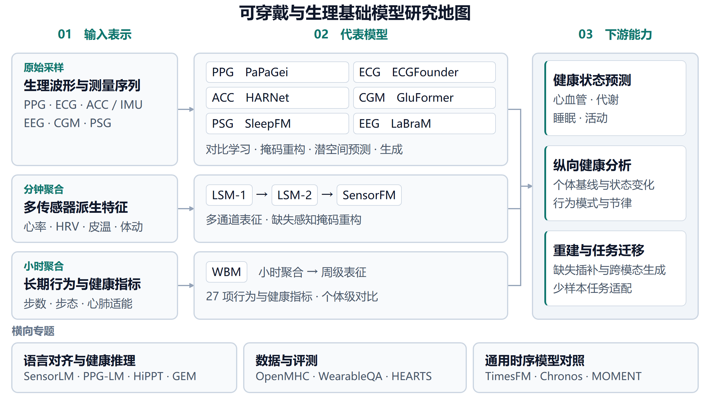
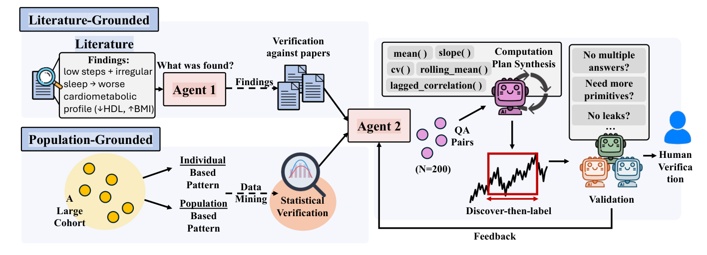
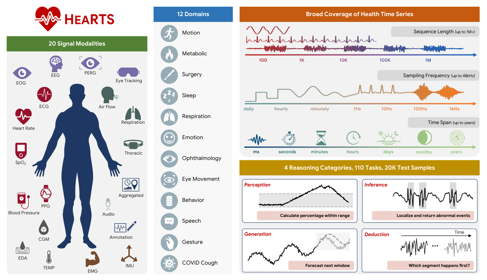
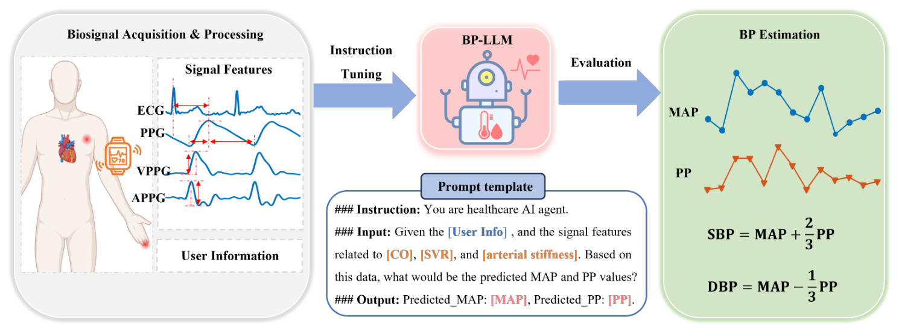
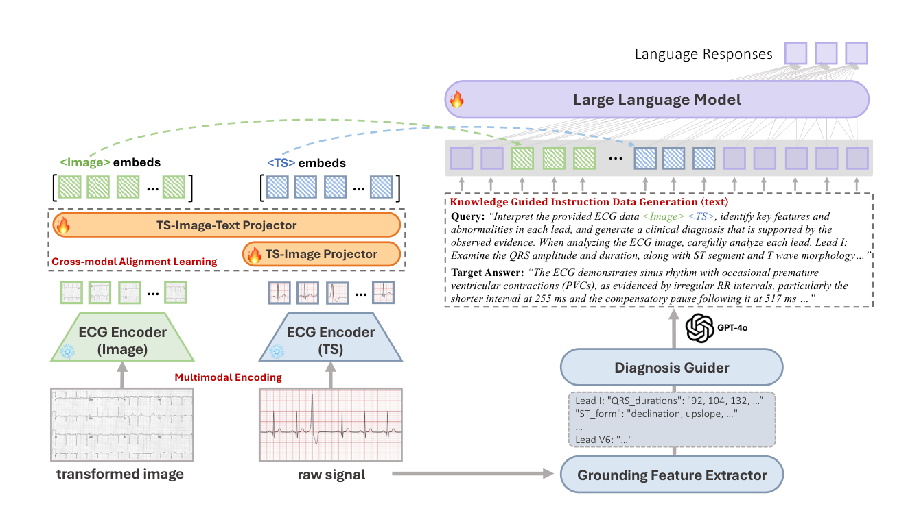
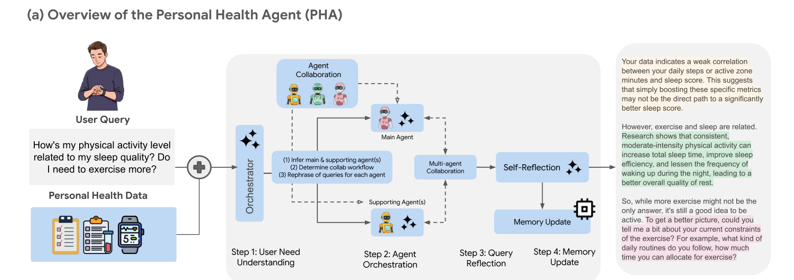

# 可穿戴健康推理与生理大语言模型

生理模型处理的输入层次不同：PaPaGei 学习 PPG 波形，GlucoFM 处理低频血糖序列，SensorFM 学习分钟级多传感器派生特征。健康推理研究进一步考察如何利用这些记录进行数据计算、跨指标解释和问答。本文区分评测基准、任务适配、多模态模型与应用系统，资料更新截至 2026-11-09。

## 阅读与比较

| 工作 | 架构或协议 | 数据规模 | 主要机制 | 代表评测与限制 | 资源 |
| :--- | :--- | :--- | :--- | :--- | :--- |
| [WearableQA](#wearableqa) | 十选一健康问答 | 200 人、每人最长约 500 天；4,084 题 | 数据/健康推理与单/跨信号两轴 | 14 个模型准确率 19.6%-72.9%，随机基线 10%；论文版本内比较 | [代码与数据](https://github.com/facebookresearch/WearableQA) |
| [HEARTS](#hearts) | 感知、推断、生成、演绎四类任务 | 16 数据集、20 模态、110 任务、20,226 样本 | 固定测试样例与工具型 Agent 框架 | 按任务使用专门指标；不压缩成单一临床能力分数 | [代码](https://github.com/yang-ai-lab/HEARTS) · [数据](https://huggingface.co/datasets/yang-ai-lab/HEARTS) |
| [CBPM-LLaMA](#cbpm-llama) | 31 维生理特征文本化与 LLM 指令微调 | CAS-BP 1,272 人、12,624 条有效记录 | 领域知识、人口信息与 MAP/PP 目标 | LLaMA-3-8B 的 SBP MAE 7.08 mmHg，属于含个体基线校准的论文设置 | [论文](https://doi.org/10.1145/3698587.3701447) · [数据申请](https://github.com/zdzdliu/CAS-BP) |
| [GEM](#gem) | ECG 时序/图像双编码器与 7B 语言骨干 | ECG-Instruct 1,156,110 对话；新增 ECG-Grounding 30,000 对话 | 跨模态对齐与特征锚定指令 | CSN 准确率 92.6%，同表 PULSE 85.2%；为特定模型变体与数据集结果 | [代码](https://github.com/lanxiang1017/GEM) · [权重](https://huggingface.co/LANSG/GEM) |
| [PHA](#pha) | 三个专长代理与动态协调器 | 11 项评测、7,000 余份人工标注 | 个人数据计算、健康解释与多轮辅导 | 评测对话质量与短期任务表现；属于应用系统 | [正式论文](https://doi.org/10.1038/s41586-026-11161-8) · [代码](https://github.com/Google-Health/consumer-health-research/tree/main/personal_health_agent) |

这些工作比较的是不同能力：数值计算、标签预测、生成报告与长程解释。选择基准时应先确定输入是否为原始波形、派生指标或人工特征，再记录受试者划分、上下文长度、工具预算及评分方法。

## 评测基准

### WearableQA

Meta AI / Reality Labs · arXiv 2026 · [论文](https://arxiv.org/abs/2609.05405) · [代码](https://github.com/facebookresearch/WearableQA) · [数据](https://huggingface.co/datasets/facebook/WearableQA)

图源：WearableQA 论文 Fig. 1，arXiv 2609.05405。

题目来自真实用户的穿戴历史、血检和人口信息，保留缺失日期与个体差异。每人最多提供 16 项日级穿戴指标，血检信息按题目提供；“最多 500 天”是个人历史长度上限，不是所有人都有 500 天完整观测。官方结构化数据的观察窗口为 28 天，题目可附带更长历史作为上下文。[官方数据说明](https://github.com/facebookresearch/WearableQA)

题集含 2,724 道数据推理与 1,360 道健康推理题，另按单信号与跨信号划分。作者结合文献关系与人群统计构造参考答案，在 14 个模型上得到 19.6%-72.9% 的准确率范围。[论文](https://arxiv.org/abs/2609.05405)

评注。它适合检验个人纵向记录上的计算和解释。人群相关关系和文献支持的题目答案不能等同于对个人病因的确认。复现需要保留指标隐藏规则、序列化方式和缺失处理；使用公开题集调参后再报告同一题集分数，也不能作为独立泛化结果。数据采用 CC BY-NC 4.0，并有研究与基准用途的附加条款。[数据与许可](https://github.com/facebookresearch/WearableQA)

### HEARTS

UCLA / Google Research · ICML 2026 · [论文](https://arxiv.org/abs/2603.06638) · [代码](https://github.com/yang-ai-lab/HEARTS) · [数据](https://huggingface.co/datasets/yang-ai-lab/HEARTS)

图源：HEARTS 论文 Fig. 1，arXiv 2603.06638。

HEARTS 整合 16 个数据集、12 个健康领域、20 种模态，覆盖 110 项任务和 20,226 个评测样本。四类能力分别是信号测量与特征提取、事件与状态推断、预测/插补/跨模态生成、时间顺序及纵向轨迹分析。论文评测 14 个 LLM，观察到长序列和高频输入下的性能下降，以及部分任务中的复制、插值等简单策略。[论文](https://arxiv.org/html/2603.06638v1)

官方实现提供 CodeAct 等 Agent 接口和固定测试样例。使用工具可以改变系统能力，也会增加执行预算，因此应一起报告输入格式、工具可用性、调用轮数、失败处理和任务指标。[实现与运行协议](https://github.com/yang-ai-lab/HEARTS)

评注。四类任务是能力分类，不能直接解释成临床因果推断层级。工具收益应按具体实验配置与任务读取，不能用一个平均提升数字代表所有健康推理能力。

## 生理模型与语言适配

### CBPM-LLaMA

中科院深圳先进院 / 香港理工大学等 · ACM-BCB 2024 · [正式论文](https://doi.org/10.1145/3698587.3701447) · [预印本](https://arxiv.org/abs/2406.18069) · [CAS-BP 数据](https://github.com/zdzdliu/CAS-BP)

图源：*Large Language Models for Cuffless Blood Pressure Measurement From Wearable Biosignals* 原论文插图。

该工作把 ECG/PPG 的 31 维派生特征按心输出量、外周阻力和动脉硬度相关分组组织为提示，并加入人口信息，微调语言模型估计 MAP 与 PP，再转换为 SBP 与 DBP。它是已有 LLM 的血压任务适配案例，输入为预提取特征。[论文第 3 节](https://arxiv.org/abs/2406.18069)

论文第 4.2 节的校准公式为“最终预测 = 0.3 × 模型预测 + 0.7 × 个体基线”。Table 3 报告 LLaMA-3-8B 的 SBP MAE 为 7.08 mmHg、DBP MAE 为 5.31 mmHg，应按该校准协议读取。无校准表现需要单独实验，不能从上述结果直接推导。[论文第 4.2 节与 Table 3](https://arxiv.org/abs/2406.18069)

评注。比较时需要同时保留只输出个人基线的基准，并考察跨日期变化能否被模型捕捉。MAP/PP 是可逆目标变换，不能仅凭这个设计就称其为统计独立或正交解耦。CAS-BP 仓库提供样例、读取说明与完整数据申请入口，本次未在该仓库找到 CBPM-LLaMA 微调代码或权重，不能把数据仓库标为模型代码。[CAS-BP 官方说明](https://github.com/zdzdliu/CAS-BP)

### GEM

新加坡国立大学 / 北京大学等 · NeurIPS 2025 · [论文](https://arxiv.org/abs/2503.06073) · [代码](https://github.com/lanxiang1017/GEM) · [权重](https://huggingface.co/LANSG/GEM) · [数据](https://huggingface.co/datasets/LANSG/ECG-Grounding)

图源：GEM 论文 Fig. 2，arXiv 2503.06073v2。

GEM 结合 ECG 时序编码器、心电图像编码器和语言骨干，通过跨模态对齐与指令微调学习带波形证据的解释。训练同时使用 ECG-Instruct 的 1,156,110 段对话和新构建的 30,000 段 ECG-Grounding 对话；后者结合心搏级特征与 GPT-4o 生成，不应全部写作人工临床标注。[论文第 3-4 节](https://arxiv.org/abs/2503.06073)

Table 2 中 GEM 的 SFT LLaVA 变体在 CSN 上准确率为 92.6%，PULSE 为 85.2%，相差 7.4 个百分点。不同 GEM 变体在其他数据集上的收益不同，论文摘要的 7.4% 不能作为所有诊断任务的统一提升。部分解释评测采用模型评分，需结合评分协议解读。[论文 Table 1-2](https://arxiv.org/abs/2503.06073)

评注。特征锚定能够让报告更便于检查，但生成文字中的数值与导联依据仍应独立复核。面向腕戴单导联 ECG 时，要另行验证导联减少、设备噪声与图纸布局变化，不能直接沿用 12 导联的实验结论。

## 应用系统

### PHA

Google Research / Google DeepMind / Columbia University 等 · Nature 2026 · [正式论文](https://doi.org/10.1038/s41586-026-11161-8) · [预印本](https://arxiv.org/abs/2508.20148) · [代码](https://github.com/Google-Health/consumer-health-research/tree/main/personal_health_agent)

图源：PHA 预印本 Fig. 6a（arXiv:2508.20148），裁取系统流程部分。

个人健康代理（Personal Health Agent，PHA）以可穿戴记录、血检与个人背景为输入，由数据科学代理计算趋势，领域专家代理解释健康证据，健康教练代理组织建议；协调器分派任务、整合结果并更新对话记忆。它提供生理数据分析的应用系统，未新增生理时序预训练模型。正式论文涵盖 11 项评测，主要衡量数据解读和多轮交互质量。[正式论文](https://doi.org/10.1038/s41586-026-11161-8)

官方实现包含代理、提示词、Python 执行工具与合成样例，采用 Apache 2.0 许可；样例不等于原研究队列。它适合研究已有记录和模型输出如何进入可检查的健康解释。[实现与数据说明](https://github.com/Google-Health/consumer-health-research/tree/main/personal_health_agent)

与基础模型的连接见 [SensorFM](longitudinal_wearable_models.md#sensorfm)：该研究将预测头输出加入健康摘要上下文，在 31 人的静态、单轮摘要上收集 1,860 次医生评分。这项实验与 PHA 原论文的多轮系统评测应分别阅读；它检验预测信息对摘要的帮助，未验证长期健康改善。[SensorFM 方法 M.6](https://arxiv.org/abs/2605.22759v3)

另一类系统直接面向未来数值预测。[GlucoAgent](cgm_models.md#glucoagent) 通过代码分析个人多模态历史并提交血糖预测，其方法、餐后结果与评测边界统一在 CGM 专题维护。

## 工程路线与候选处理

| 路线 | 可用组件 | 需要控制的实验条件 |
| :--- | :--- | :--- |
| 数值工具与语言模型组合 | 信号处理、统计代码、可穿戴编码器与 CodeAct 接口 | 工具预算、信号质量、失败处理、计算结果是否忠实进入答案 |
| 时序/图像与语言联合模型 | GEM、[SensorLM](smartwatch_models.md#sensorlm) 等 | 预训练数据重叠、输入模态、冻结或微调协议、缺失模态 |
| 纵向指标表征与问答 | [LSM / SensorFM / WBM](longitudinal_wearable_models.md)、WearableQA | 时间窗口、个人与人群基线、缺失数据、未来信息泄漏 |

这是可供比较的实现路线，不表示所有研究都运行在端侧，也不表示统一由一个 LLM 调度。传感器模型的推理成本应由其具体输入、模型规模和部署实验确定。

本轮按健康时序推理、信号问答、多模态基准及准确模型名检索论文和作者仓库。WearableQA、HEARTS 与 GEM 沿用并修正现有条目；CBPM-LLaMA 保留为任务适配案例。[PhysioBench](https://arxiv.org/abs/2609.20836) 列为高价值候选：摘要报告 22 数据集、30 任务与约 6,140 万问答，官方 README 说明公开 QA 包仅覆盖 18 数据集，原始波形需分别获取。本轮未取得完整论文，暂不登记模型排名和细粒度实验结论。其数据发布范围与后续核查项见 [评测专题](physiological_benchmarks.md)。

[ECG-R1](https://arxiv.org/abs/2602.04279) 也保留为推理方向候选，后续核查任务构造、推理预算、数据访问与完整实现后再决定是否单列。候选状态截至 2026-11-04。

---

> **欢迎交流与共建** 
> 本文由开源知识库项目 [Wearable-Physiological-Foundation-Models](https://github.com/tujy859/Wearable-Physiological-Foundation-Models) 整理策划。该项目持续追踪全球在智能手表、连续血糖监测（CGM）以及多模态生理健康基础模型领域的最新突破。如果您对可穿戴生理计算、时序健康基模与数字生物标志物有任何想法，欢迎在仓库提 Issue 交流！
