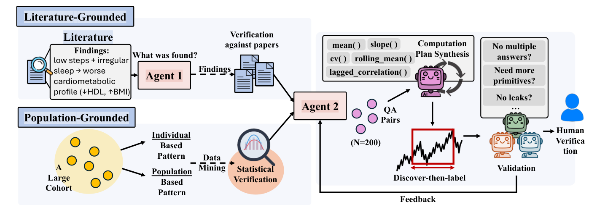
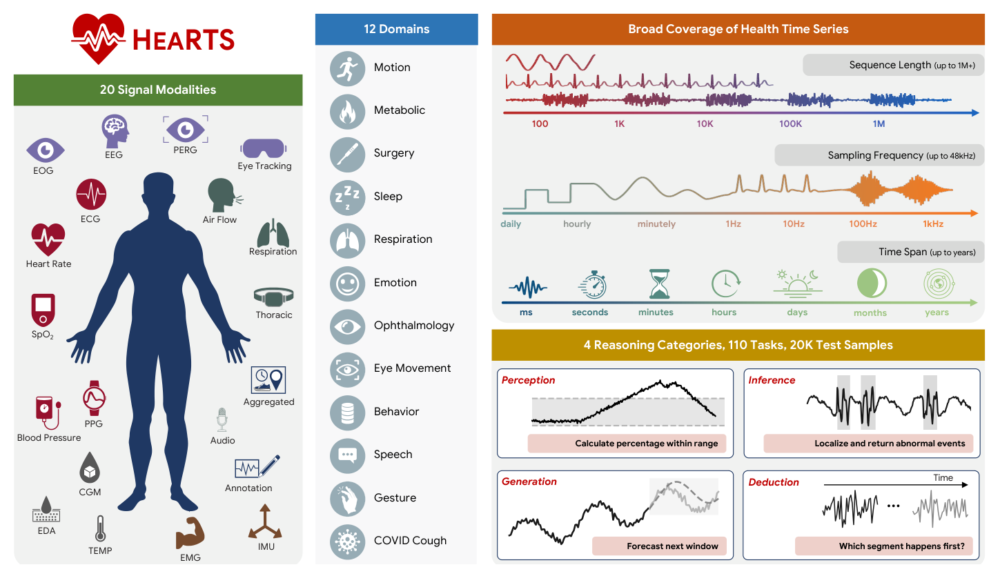
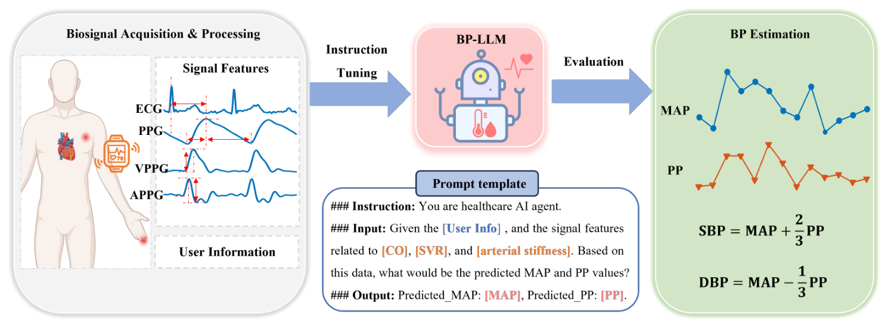
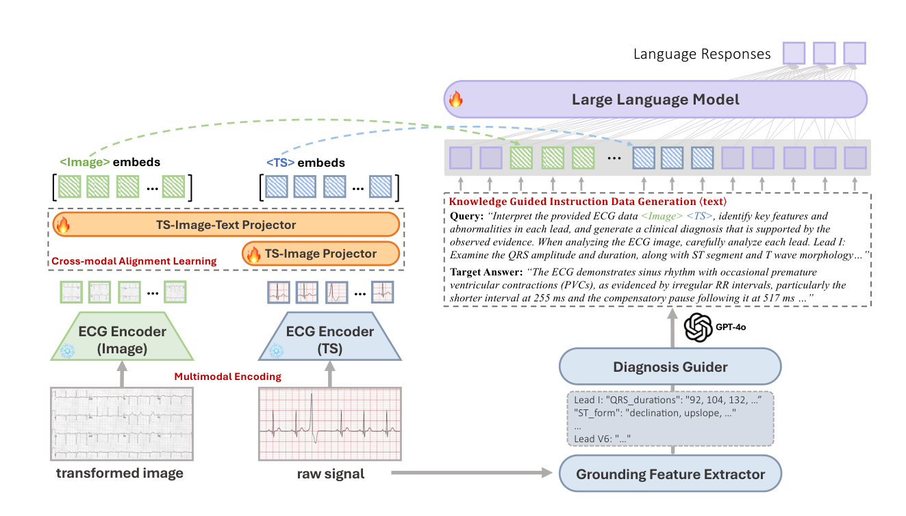
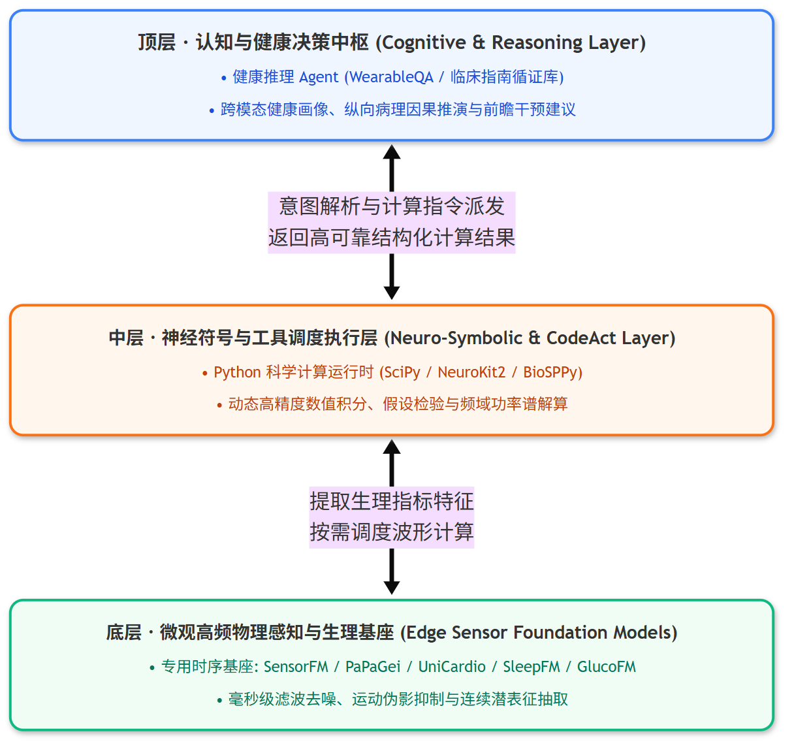

# 可穿戴健康推理与生理大语言模型 (Wearable Health Reasoning & Physiological LLMs)

随着智能手表、连续血糖仪（CGM）等消费级与临床穿戴设备的普及，个人健康时序正从“孤立的瞬时生理读数”演变为“跨越数月乃至数年的纵向健康轨迹”。传统的生理信号基础模型（如 PaPaGei、SensorFM、GlucoFM）主要解决高频物理波形的去噪、表征压缩与单点回归/分类问题；而面对临床与日常健康管理中对**病理因果归因、多模态联动分析与循证生活方式干预**的深层需求，2025～2026 年领域研究迎来了从“底层信号表征（Representation）”向“高层健康认知推理（Health Reasoning）”的范式拓展。

本专题深度拆解 Meta **WearableQA** 与 Yang AI Lab **HEARTS** 两大健康推理评测基准，剖析 **CBPM-LLaMA**（血流动力学正交解耦微调）与 **GEM**（心电波形物理测量锚定）两项代表性跨模态模型，并总结“底层专用生理基座 + 中层 CodeAct 神经符号工具链 + 顶层健康推理 Agent”的三层技术栈。

---

## 目录

- [1. 范式演进：为什么仅靠生理表征学习还不够？](#1-范式演进为什么仅靠生理表征学习还不够)
- [2. 底层瓶颈：为什么纯大语言模型无法端到端直接处理高频原始波形？](#2-底层瓶颈为什么纯大语言模型无法端到端直接处理高频原始波形)
- [3. 代表性评测基准与跨模态模型深度拆解](#3-代表性评测基准与跨模态模型深度拆解)
  - [WearableQA](#wearableqa)
  - [HEARTS](#hearts)
  - [CBPM-LLaMA](#cbpm-llama)
  - [GEM](#gem)
- [4. 三层协同架构：端侧生理基座、神经符号计算与健康推理 Agent](#4-三层协同架构端侧生理基座神经符号计算与健康推理-agent)
- [5. 技术路线辨析：模块化 Agent 体系 vs. 原生多模态交错融合派](#5-技术路线辨析模块化-agent-体系-vs-原生多模态交错融合派)
- [6. 核心文献与开源资源汇总](#6-核心文献与开源资源汇总)

---

## 1. 范式演进：为什么仅靠生理表征学习还不够？

过去五年，可穿戴生理信号建模主要遵循单点预测与表征分类范式：
- **输入与输出形式**：输入长度为 $T$ 的传感器波形片段，回归预测下一时刻的生理数值 $X_{t+1}$，或判别当前片段是否属于某一特定病理标签（如心房颤动、睡眠呼吸暂停）。
- **评价指标**：均方根误差（RMSE）、平均绝对误差（MAE）、受试者工作特征曲线下面积（AUROC）与宏平均 F1 分数。

然而，在真实世界的临床辅助决策与个人健康管理中，用户与临床医生需要的往往不是孤立的异常报警数字，而是具备生物医学可解释性与因果链条的综合推理：

$$
\text{“为什么我昨晚静息心率比平时升高了 10 bpm，且深睡时长减少了 40 分钟？”}
$$

要科学回答这一问题，系统必须跨越单次测量窗口，执行多模态、跨时间尺度的协同分析：
1. **多通道日间行为联动排查**：前一日傍晚是否进行了高强度无氧或长距离耐力训练（结合最大摄氧量 $\text{VO}_2\text{max}$ 与运动代谢当量 METs）？就寝前是否有高碳水进食或饮酒导致夜间交感神经持续兴奋与血糖高位运行？
2. **长程个体基线统计比对**：与该用户过去 30～90 天的个人昼夜节律分布相比，昨晚的偏移是否超过了 $1.5\sigma$ 或 $2\sigma$ 的统计学显著阈值，抑或属于周期性正常波动？
3. **病理生理机制鉴别归因**：当前表现究竟符合运动后过量氧耗（EPOC）恢复期、自主神经交感张力亢进，还是急性上呼吸道病毒感染潜伏期的前驱体温/心率反应？
4. **可执行的前瞻性干预建议**：今日是否应当暂停原定的高强度间歇训练（HIIT）？需要如何调整补液与作息，并在出现何种伴随症状时建议就医？

> [!NOTE]
> **生理表征基模与健康推理大模型的分工边界**：底层生理基础模型负责将高噪、高频的原始物理采样流提炼为**准确的生理语义表征与结构化体征指标**；顶层健康推理模型则负责在多维纵向生理轨迹、个体临床背景与循证医学知识库之间建立**因果推导与个性化决策支持闭环**。

---

## 2. 底层瓶颈：为什么纯大语言模型无法端到端直接处理高频原始波形？

随着通用大语言模型（LLM）的发展，早期部分工作尝试将连续生理波形直接格式化为数字文本字符串输入 LLM 进行自回归推理。然而，在真实可穿戴高频信号场景下，这种“纯文本端到端生啃原始波形”的做法面临四道物理与算法壁垒：

### 2.1 上下文词元（Token）爆炸与二次方计算复杂度

- 智能手表原始 PPG 采样率通常为 25～100 Hz，临床或胸贴单导联 ECG 达 250～1,000 Hz。
- 仅单通道 100 Hz 信号连续采集 **1 小时** 即产生 $360,000$ 个浮点采样点，全天 24 小时高达 **864 万个点**。若将每个浮点数序列化为 4～6 个文本 Token，仅数分钟的原始波形就会耗尽十万级上下文窗口，在自注意力机制 $\mathcal{O}(N^2)$ 复杂度下，计算延迟与显存开销均无法承受。

### 2.2 子词分词器（BPE Tokenization）对连续物理量纲的破坏

- 通用 LLM 采用的字节对编码（BPE）或 SentencePiece 分词器基于自然语言子词频次构建。
- 面对连续实数（如 `128.45` 与 `128.49`），分词器往往将其切割为无固定对齐规律的数字碎片（如 `["128", ".", "45"]`）。这种离散切分从根本上破坏了欧氏空间中连续实数的数值拓扑距离与物理量纲（mV、bpm、mg/dL），极易在多步数值比较、移动平均与斜率计算中诱发算术幻觉。

### 2.3 信号处理物理归纳偏置（Inductive Bias）缺失

- 高频生理波形解析高度依赖**局部形态几何特征、相位平移不变性与频域动力学先验**：
  - 手腕光电脉搏波（PPG）在跑步动态下的强运动伪影，需结合三轴加速度计（ACC）在 1～3.5 Hz 频段内的步频谐波相关性进行滤除；
  - 心电图（ECG）传导阻滞与缺血诊断依赖毫秒级 PR 间期、QRS 波群宽度与 ST 段毫伏级微变。
- 标准文本 Transformer 的全局注意力缺乏带通滤波（Bandpass Filtering）、小波多尺度分解或连续状态空间方程等物理归纳偏置。

### 2.4 HEARTS 基准揭示的“启发式捷径（Heuristic Shortcuts）”失败模式

Yang AI Lab 在 **HEARTS** 基准中对十余种主流商用与开源大模型进行了高频生理波形直接生成与补全测试，观察到三类典型的失效现象：
- **周期机械复制（Copying）**：在预测后续心电或脉搏波形时，模型倾向于直接复制粘贴前几个周期的局部数值，忽略心率变异性与呼吸调制趋势；
- **朴素线性连接（Linear Interpolation）**：面对传感器缺失区段插补任务时，倾向于在首尾两端点间生成单调近似直线，完全丢失高频生理重搏切迹与振荡细节；
- **高频性能断崖**：随着采样率从日粒度聚合（$10^{-5}\text{ Hz}$）提升至原始波形（$\ge 100\text{ Hz}$），纯 LLM 的预测与分类表现呈断崖式下跌，且模型在文本推理榜单（如 MMLU）上的得分与高频生理信号表现几乎无正相关性。

---

## 3. 代表性评测基准与跨模态模型深度拆解

### WearableQA

> **发表信息**：arXiv 2026（2026 年 9 月） · [论文](https://arxiv.org/abs/2609.05405)  
> **机构**：Meta AI / Reality Labs  
> **数据规模**：200 名真实佩戴者 × 500 天纵向连续记录（16 维日常穿戴指标 + 17 项临床血液化验） · 4,084 道 10 选 1 推理题  
> **开源状态**：评测协议、分类学体系与论文公开



图源：WearableQA 论文 Fig. 1（arXiv:2609.05405）

WearableQA（*WearableQA: A Benchmark for Health Reasoning over Real-World Wearable Data*）是首个基于真实用户超一年期纵向多模态穿戴记录与临床血检构建的长程健康推理评测基准。

#### 3.1 真实用户 500 天多模态健康数据画像

WearableQA 从大规模真实世界穿戴队列中抽样了 **200 名高依从性深度佩戴用户**，每位用户均包含长达 **500 天** 的连续日粒度聚合时序与临床体检档案，涵盖六大维度：
1. **心血管与有氧体能（Cardio-Fitness）**：静息心率（RHR）、夜间心率变异性（HRV rMSSD）、最大摄氧量估计值（$\text{VO}_2\text{max}$）；
2. **日常活动与能量代谢（Activity & Energy）**：每日总步数、动态活动卡路里消耗、基础代谢率（BMR）、中高强度运动时长（MVPA）、运动平均心率、代谢当量（METs）；
3. **睡眠生理结构（Sleep Architecture）**：总睡眠时长（TST）、睡眠效率（SE）、深睡比例（Deep Sleep %）、快速眼动期比例（REM %）、就寝作息规律性指数（Bedtime Regularity）；
4. **自主神经压力负荷**：全天生理压力评分（Stress Score）；
5. **临床实验室血液生物标志物（17 项 Blood Biomarkers）**：配对采集空腹血糖、糖化血红蛋白（HbA1c）、空腹胰岛素、高敏 C-反应蛋白（hs-CRP）、血脂四项（TC/TG/HDL-C/LDL-C）、肝肾功能指标等；
6. **大样本人群参考分位数（Cohort Reference Percentiles）**：提供来自数十万人群队列按年龄、生理性别分层的核心指标分位数基准表。

#### 3.2 $2 \times 2$ 分类学矩阵与 16 类题型设计

为精准定位大语言模型在长程健康分析中的能力短板，WearableQA 构建了“推理类型 × 信号复杂度”正交交叉的评测体系，共包含 **4,084 道 10 选 1 单选题**（随机猜测基线为 10.0%）：

| 评⁠测⁠维⁠度⁠轴 | 子⁠类⁠别（题⁠目⁠数⁠量） | 核⁠心⁠考⁠察⁠能⁠力⁠要⁠求 | 典⁠型⁠问⁠题⁠示⁠例 |
| :--- | :--- | :--- | :--- |
| **推理类型轴**<br/>*(Reasoning Type)* | **Data Reasoning**<br/>（纯数据计算，约 2.7k 题） | 考察在数百天多变量表格中执行精确窗口统计、极值定位、异常持续天数计数与基线恢复周期测算 | *“该用户在过去 6 个月中，静息心率连续超过个人基线 1.5 倍标准差后，恢复至基线以内的平均天数是多少？”* |
| **推理类型轴**<br/>*(Reasoning Type)* | **Health Reasoning**<br/>（医学健康推理，约 1.4k 题） | 考察结合病理生理学机制、血液生化指标与临床循证指南进行疾病风险分级、鉴别归因与干预推荐 | *“结合该用户近半年步数下降、夜间 HRV 持续走低以及入组空腹胰岛素与甘油三酯水平，最符合哪种代谢表型？”* |
| **信号维度轴**<br/>*(Signal Complexity)* | **Single-metric**<br/>（单通道纵向，约 1.7k 题） | 针对单一生理指标开展跨月度的趋势分解、季节性波动与突变点分析 | *“分析该用户 500 天内深睡比例的季度变化斜率并判断其睡眠结构演变趋势。”* |
| **信号维度轴**<br/>*(Signal Complexity)* | **Cross-metric**<br/>（多模态耦合，约 2.4k 题） | 跨模态检验运动负荷、睡眠结构、自主神经 HRV 与血液生化指标之间的滞后响应与非线性耦合 | *“评估该用户高强度运动消耗量激增对随后两晚睡眠效率及次晨静息心率的滞后影响。”* |

#### 3.3 双重真实标签锚定框架 (Dual-Grounding Framework)

为杜绝开放式健康问答中主观标注不一的问题，所有题目的标准答案均经过双重客观锚定：
1. **临床文献与指南循证锚定（Literature-grounded）**：由临床医师从顶级医学期刊（*NEJM*、*The Lancet*、*Nature Medicine*）及专业学会指南（AHA、ADA、AASM）中提取具有明确共识的生理因果规则；
2. **大样本群体统计显著性锚定（Population-grounded）**：在万人级真实穿戴数据库中执行严格的双侧假设检验（要求 $p < 0.001$ 且效应量 Cohen's $d > 0.5$），确保题目所考察的跨指标关联在真实人群分布中具备统计学显著性。

#### 3.4 14 种主流大模型评测表现与核心失败模式

在无外部代码解释器辅助的直接长上下文评测中，14 种主流大语言模型的准确率呈现明显分化：

| 模⁠型⁠名⁠称 | 模⁠型⁠类⁠型⁠与⁠规⁠模 | WearableQA 总⁠体⁠准⁠确⁠率 (↑) | 核⁠心⁠表⁠现⁠特⁠征 |
| :--- | :--- | :--- | :--- |
| **Gemini-3.1-Pro** | 商用主力多模态模型 | **72.9%** | 长上下文跨月度表格检索与多指标联合归因表现最优 |
| **GPT-4o / GPT-5 系⁠列** | 商用主力大模型 | **68.4%** | 临床医学指南推理稳健，长序列滑动窗口计数偶有偏差 |
| **Claude-Opus-4.6** | 商用主力大模型 | **64.1%** | 病理鉴别推理严谨，对极端长表中间区段敏感度略降 |
| **Llama-3.3-70B** | 开源大参数权重模型 | **48.2%** | 具备基础医学常识，但在 500 天跨指标统计计算中失误率较高 |
| **Mistral-Small-3.1** | 开源中等规模模型 | **31.5%** | 长上下文注意力明显发散，难以同时追踪多列生理时序 |
| **Gemma-3-12B** | 开源轻量级模型 | **22.8%** | 仅略高于随机基线，长表数值定位与多步算术能力严重受限 |
| **Random Baseline** | 10 选 1 随机猜测基线 | **10.0%** | — |

> [!IMPORTANT]
> **WearableQA 揭示的两大关键洞察**：
> 1. **“数据计算（Data Reasoning）难于医学背诵（Health Reasoning）”**：多数大模型能够熟练阐述医学概念与指南条文，但在长达 500 行、16 列的连续数字表格中执行精确的“条件过滤、跨列相关性比对与持续时长计数”时频繁发生算术幻觉，导致 Data Reasoning 得分普遍低于 Health Reasoning。
> 2. **长程上下文注意力中间坍缩（Lost-in-the-Middle）**：当一次性输入完整 500 天记录（数万 Token）时，开源中小模型对序列早期（第 50～150 天）和中期一过性生理异常事件的召回率下降超过 40%，印证了引入中层代码计算工具（如 Pandas / CodeAct）的必要性。

---

### HEARTS

> **发表信息**：ICML 2026（预印本 arXiv 2026） · [论文](https://arxiv.org/abs/2603.06638) · [代码](https://github.com/yang-ai-lab/HEARTS) · [项目主页](https://yang-ai-lab.github.io/HEARTS/) · [数据集](https://huggingface.co/datasets/yang-ai-lab/HEARTS)  
> **机构**：Yang AI Lab (MIT / Harvard 联合研究团队)  
> **数据规模**：整合 16 个公开数据集 · 12 个健康领域 · 20 种生理模态 · 110 项任务 · 20,226 个评测样本  
> **开源状态**：开源完整评测框架、基准数据集与基线代码



图源：HEARTS 论文 Fig. 1（ICML 2026 / arXiv:2603.06638）

HEARTS（*HEARTS: Benchmarking LLM Reasoning on Health Time Series*）构建了横跨微观高频原始波形与宏观纵向健康指标的四层认知推理金字塔评测体系。

#### 3.1 评测全景图谱与四层认知能力阶梯

HEARTS 汇聚了 VitalDB（手术室血流动力学）、SHHS（多导睡眠）、Capture-24（手腕体动）、CGMacros（动态血糖与饮食）、Bridge2AI-Voice（呼吸与嗓音病理）等 16 个公开库，采样率从每日聚合横跨至 48 kHz 音频，序列长度从数十点延伸至超百万点，按认知深度划分为四个层级：
1. **Layer 1 · Perception（底层信号感知与形态测量）**：考察微观波形物理特征提取，如检测 PPG 重搏切迹（Dicrotic Notch）、测量 ECG 的 QRS 波群宽度、提取呼吸音基频与信噪比评估；
2. **Layer 2 · Inference（生理状态推断与疾病分类）**：考察局部窗口的临床判别能力，如心房颤动（AFib）发作定位、睡眠分期判读、帕金森步态冻结识别；
3. **Layer 3 · Generation（时序预测、插补与跨模态转换）**：考察生理动力学重建能力，如餐后血糖轨迹外推、电极脱落区段波形插补、由腕部 PPG 跨模态合成 ECG；
4. **Layer 4 · Deduction（时间演化因果推断与反事实推演）**：考察高阶纵向临床逻辑，如判定多器官并发症出现的先后因果顺序、结合数月体征演变推演心血管事件风险轨迹。

#### 3.2 核心实证结论与 CodeAct 神经符号协同范式

1. **专用轻量生理基模在底层任务上大幅领先通用 LLM**：在 Perception 与 Generation 层级中，参数量仅数兆的专用时序基模（如 PaPaGei、MOMENT、Chronos）在数值精度与形态保真度上显著优于数百亿参数的通用文本/多模态大模型。
2. **输入模态表示形式不改变任务相对难易梯度**：无论是将生理时序转为数字文本串、渲染为二维波形折线图输入视觉大模型（VLM），还是经 Patch 投影输入，不同生理任务之间的相对难易排序高度一致，单纯将波形画成图片并不能解决高频定量计算的瓶颈。
3. **CodeAct Agent（可执行代码作为动作空间）带来显著性能跃升**：
   - 借鉴 **CodeAct**（*Executable Code as Actions with Language Models*，ICML 2024）范式，让大模型不再直接口算浮点数，而是编写并在于有状态 Python 沙箱（Stateful REPL Sandbox）中执行科学计算代码：
     - 调用 `scipy.signal` 执行巴特沃斯带通滤波、工频陷波与 Welch 功率谱密度（PSD）积分；
     - 调用 `neurokit2` / `wfdb` / `heartpy` 精确定位 ECG R 波峰值、PPG 收缩期峰值与重搏切迹，解算精确 HRV 时频域指标（SDNN、rMSSD、LF/HF）；
     - 当滤波参数或峰值检测触发异常时，根据 Python Traceback 报错信息自主修正代码（Self-Debugging）。
   - 实验表明，引入 CodeAct 神经符号协同后，大模型在复杂感知测量（Perception）与数据计算推理任务上的综合达标率平均提升 **+38.6%**。

---

### CBPM-LLaMA

> **发表信息**：ACM-BCB 2024 · [论文](https://arxiv.org/abs/2406.18069) · [代码与数据](https://github.com/zdzdliu/CAS-BP)  
> **机构**：中国科学院深圳先进技术研究院 (SIAT 李烨 / 苗芬团队) / 香港理工大学 (PolyU 曹建农团队)  
> **训练与评测数据**：CAS-BP 可穿戴无袖带血压队列（1,272 名受试者，4 周纵向随访共 12,624 条配对记录）  
> **开源状态**：开源 CAS-BP 数据集与微调代码



图源：CBPM-LLaMA 论文 Fig. 1（ACM-BCB 2024 / arXiv:2406.18069）

CBPM-LLaMA（*Large Language Models for Cuffless Blood Pressure Measurement From Wearable Biosignals*）探索了将心血管血流动力学物理先验注入大语言模型指令微调（SFT），用于可穿戴无袖带连续血压估计。以下从数据渊源、评估校准机制、血流动力学正交解耦原理及算法收益四个维度进行深度拆解：

#### 3.1 论文演进对比与工业落地透视：CAS-BP (2023) vs. CBPM-LLaMA (2024)

| 对⁠比⁠维⁠度 | 2023 年⁠数⁠据⁠集⁠基⁠石⁠工⁠作（IEEE JBHI — CAS-BP 原⁠作） | 2024 年⁠大⁠模⁠型⁠微⁠调⁠工⁠作（ACM-BCB '24 — CBPM-LLaMA） |
| :--- | :--- | :--- |
| **研⁠发⁠团⁠队⁠背⁠景** | **中科院深圳先进院 + 华为技术团队**（曾甲、陈祖仙等） | 中科院深圳先进院 + 香港理工大学高校联合团队 |
| **硬⁠件⁠与⁠数⁠据⁠源** | 华为多波长 PPG + 单导联 ECG 智能手表，**1,272 人、12,624 条 4 周随访** | **完全同源数据**，直接基于 2023 年开源的 CAS-BP 数据集开展实验 |
| **模⁠型⁠输⁠入⁠形⁠态** | 原始 1,000 Hz 同步波形 / 波形与特征混合输入 | **非原始波形输入**，将预提取的 **31 维生理特征**嵌入自然语言文本 Prompt |
| **骨⁠干⁠网⁠络⁠架⁠构** | 传统机器学习与轻量神经网络（XGBoost、AdaBoost、ResNet、BiLSTM） | **LLaMA-3-8B / LLaMA-2-7B / BioMedLM**（LoRA 与全量指令微调 SFT） |
| **核⁠心⁠方⁠法⁠创⁠新** | 建立大规模多天随访无袖带血压基准与信号质量控制管线 | **MAP/PP 血流动力学正交目标分解** + **医学机制分组 Prompt 工程** |
| **穿⁠戴⁠端⁠侧⁠部⁠署⁠性** | **高**（模型仅数百 KB 至数 MB，手表或手机端可毫秒级离线运行） | **极低**（8B 参数需十余 GB 显存，仅能部署于云端服务器或作为教师模型） |

#### 3.2 关键评估机制辨析：训练阶段无基线 SFT 与测试阶段 0.7 基线校准的剥离分析

在审视无袖带血压论文报告的低误差指标时，必须严格区分**模型微调阶段（无校准估计）** 与**测试后处理阶段（含基线校准）** 的差异：
1. **微调训练阶段（SFT）严禁输入个人袖带基线**：
   - 训练时输入给 LLaMA 的 Prompt 仅包含受试者人口统计学特征（年龄、性别、身高、体重、高血压史）与当前测量的 31 维 ECG+PPG 波形特征，**不包含受试者首日的袖带血压基线真值（$\text{BaseSBP}$）**；
   - **避免捷径学习（Shortcut Learning）的设计考量**：在静息随访队列中，同一受试者跨天的血压往往围绕个人基线小幅波动。若在训练 Prompt 中直接提供 $\text{BaseSBP}$，大语言模型的自注意力机制会迅速走捷径直接复制该基线值，导致 31 维动态脉搏波特征的梯度权重趋近于零，模型退化为无法响应血压动态变化的“基线复读机”。因此，LLaMA 微调直接输出的是**无校准纯模型预测值（$\text{SBP}_{\text{free}}, \text{DBP}_{\text{free}}$）**。
2. **测试评估阶段的 70% 静态基线加权校准**：
   - 论文在计算最终达到 AAMI / BHS 临床标准的校准指标时，对测试集输出施加了静态线性加权公式（设校准系数 $\alpha = 0.3$）：
     $$
     \text{SBP}_{\text{cal}} = 0.3 \times \text{SBP}_{\text{free}} + 0.7 \times \text{BaseSBP}, \quad \text{DBP}_{\text{cal}} = 0.3 \times \text{DBP}_{\text{free}} + 0.7 \times \text{BaseDBP}
     $$
   - **客观归因**：校准后误差之所以能降至约 $3\text{～}4\text{ mmHg}$，其中 **70% 的权重直接来自受试者首日袖带测量真值 $\text{BaseSBP}$**。若剥离这层 $0.7$ 的基线锚定后处理，直接评估纯模型输出 $\text{SBP}_{\text{free}}$（或采用简单的加法偏移校准 $\text{SBP}_{\text{free}} - \text{SBP}_{\text{free},0} + \text{BaseSBP}$），收缩压 MAE 实际处于 **7.08～11.0 mmHg** 区间（这正是当前腕戴无袖带血压领域的真实物理水平）。

#### 3.3 有监督指令微调流水线与真实 Prompt 结构 (Appendix B Table 6)

CBPM-LLaMA 基于 **LLaMA-Factory** 框架在 4 张 NVIDIA RTX A6000（48 GB）上执行指令微调，严格按 1,272 名受试者 ID 进行 5 折交叉验证（Subject-level 5-Fold CV）。训练时对输入 Prompt 部分施加掩码，**仅对模型输出的数值预测文本计算自回归交叉熵损失**：

$$
\mathcal{L}_{\text{SFT}} = -\sum_{t=1}^{T} \log P\big(y_t \;\big|\; y_{<t},\; \text{Input\_Prompt}\big)
$$

每条训练样本由 **Instruction（角色设定）**、**Input（血流动力学先验定义 + 用户画像 + 按机制归类的 31 维特征）** 与 **Response（MAP 与 PP 预测值）** 构成：

```json
{
  "Instruction": "You are a personalized healthcare agent trained to predict mean arterial pressure and pulse pressure based on user information and physiological features calculated from electrocardiogram and photoplethysmogram signals.",
  "Input": "Mean arterial pressure (MAP) represents the average blood pressure during a cardiac cycle and is influenced by cardiac output and peripheral resistance. Pulse pressure (PP) is the difference between systolic and diastolic blood pressure and is correlated with arterial stiffness. Given the user's profile: age: 56 years old, gender: female, height: 155.0 cm, weight: 54.0 kg, history of hypertension: no. The physiological features associated with cardiac output are [0.16, 0.51, 0.18, 0.29, 0.66, 0.1, 0.18, 0.07, 0.08], peripheral resistance are [2.64, 16.83, 231.92, 2.64, 5.2, 705.58, 0.89, 0.54, 0.04, 0.39, 1.77, 0.04, 0.23, 2.58, 0.01, 0.03, 0.08, 0.01, 0.05], and arterial stiffness are [0.18, 0.24, 0.33]. Based on these data, what would be the predicted MAP and PP values?",
  "Response": "Predicted_MAP: 86.0 mmHg, Predicted_PP: 36.0 mmHg."
}
```

- **三级渐进式 Prompt 消融实证（未加权基线的纯模型误差对比）**：
  1. **Level 1（Basic，仅输入 31 维原始特征列表）**：SBP MAE 为 **7.77 mmHg**；
  2. **Level 2（+ BP Knowledge，注入 MAP/PP 血流动力学机制解释与三类特征分组）**：SBP MAE 降至 **7.69 mmHg**；
  3. **Level 3（Full Context，叠加年龄、性别、身高体重与高血压病史上下文）**：SBP MAE 进一步降至 **7.08 mmHg**（累计相对降低 **8.90%**）。

#### 3.4 生理血流动力学正交解耦深度剖析：从 SBP/DBP 到 MAP/PP 的理论来源与算法收益

该工作最具普适工程价值的贡献，是将传统“直接双头回归收缩压（SBP）与舒张压（DBP）”转化为“**先预测平均动脉压（MAP）与脉压差（PP），再代数反解 SBP/DBP**”：

1. **血流动力学物理根源（二元件 Windkessel 弹性腔模型）**：
   动脉血压波形 $P(t)$ 在物理上由正交的稳态直流分量（DC）与搏动交流分量（AC）叠加而成：
   - **平均动脉压（MAP，稳态阻力分量 / DC）**：代表一个心动周期内维持外周组织灌注的平均压力，由**心输出量（CO）与外周总阻力（TPR，微小动脉平滑肌张力）** 决定：
     $$
     \text{MAP} \approx \text{CO} \times \text{TPR} = (\text{HR} \times \text{SV}) \times \text{TPR}
     $$
     MAP 在从主动脉到桡动脉的传导过程中压力衰减极小，几乎不受外周阻抗失配反射波的干扰。
   - **脉压差（PP，动态搏动分量 / AC）**：代表心室单次射血引起的大动脉壁周期性扩张与回缩振幅（$\text{PP} = \text{SBP} - \text{DBP}$），主要由**每搏输出量（SV）与大动脉顺应性（$C_A$，与动脉僵硬度成反比）** 决定：
     $$
     \text{PP} \approx \frac{\text{SV}}{C_A}
     $$
     随着年龄增长或动脉硬化，$C_A$ 下降、脉搏波传导速度（PWV）加快，导致 PP 显著增大。
   - **直接回归 SBP/DBP 的混杂弊端**：$\text{SBP}$ 与 $\text{DBP}$ 同时混杂了微循环阻力（TPR）与大血管弹性（$C_A$）两套截然不同的物理机制，直接拟合容易引发多任务梯度冲突。
2. **双向确定性代数变换（1/3 积分近似法则）**：
   - **正向解耦（构建正交训练目标）**：
     $$
     \text{MAP} = \frac{1}{3}\text{SBP} + \frac{2}{3}\text{DBP}, \qquad \text{PP} = \text{SBP} - \text{DBP}
     $$
   - **逆向重构（推理端无损反解临床血压）**：
     $$
     \text{SBP} = \text{MAP} + \frac{2}{3}\text{PP}, \qquad \text{DBP} = \text{MAP} - \frac{1}{3}\text{PP}
     $$
3. **算法工程维度的四大核心收益**：
   - **特征与目标通道物理对齐（消除负迁移）**：反映外周阻力的特征（重搏切迹相对高度、舒张期面积比）专门对齐拟合 MAP；反映血管刚度的特征（脉搏波传导时间 PTT、收缩期上升支斜率）专门对齐拟合 PP；
   - **代数上 100% 杜绝反常预测（$\text{SBP} \le \text{DBP}$）**：只要约束 $\text{PP} > 0$，逆向公式严格保证 $\text{SBP} - \text{DBP} = \text{PP} > 0$；
   - **抑制手腕“外周脉压放大效应（Peripheral Pulse Amplification）”噪声**：手腕桡动脉受远端反射波叠加影响，SBP 波动方差远大于中心主动脉，而 MAP 全身恒定、信噪比更高，优先锁定 MAP 能显著稳定回归基线；
   - **改善多任务损失曲面条件数**：SBP 与 DBP 强共线（相关系数 $r > 0.85$），解耦为近似正交的 MAP 与 PP 后，梯度更新方向更独立。**该策略零参数开销、零算力增量，在端侧轻量模型（XGBoost、CatBoost、1D-CNN）上同样可稳定带来 0.5～1.0 mmHg 的 MAE 下降**。

#### 3.5 深度辨析：为什么同样输入 31 维特征，LLM 微调能优于传统树模型（AdaBoost / 决策树）？

1. **医学语义归纳偏置（Semantic Inductive Bias）**：传统树模型将输入视为无物理意义的匿名数值列（Column $1 \dots 31$）；而预训练大模型通过自然语言 Prompt 中的生理机制描述与高血压病史上下文，激活了预训练语料中习得的“高龄 + 高血压史 + PTT 缩短 $\implies$ 动脉顺应性下降、脉压差增大”的先验约束。
2. **全维度平滑自注意力 vs. 轴对齐阶梯切割（Axis-Aligned Splits）**：根据 Hughes 动脉弹性指数方程 $E = E_0 e^{\gamma \text{BP}}$，血压与脉搏波速、年龄之间呈连续高阶非线性指数耦合。决策树仅能沿单一特征轴做正交矩形切割，在千人级样本下逼近连续指数曲面易产生阶梯过拟合；而 Transformer 的多头交叉注意力天然擅长拟合光滑的多变量交互流形。
3. **小样本数据效率（Sample Efficiency）**：实验证实，**LLaMA-3-8B 仅使用 30% 训练集受试者微调，其收缩压预测精度（MAE 7.22 mmHg）即超越使用 80% 全量训练集训练的 AdaBoost 基线（MAE 7.42 mmHg）**。

---

### GEM

> **发表信息**：NeurIPS 2025 · [论文](https://arxiv.org/abs/2503.06073) · [代码](https://github.com/lanxiang1017/GEM) · [权重与数据](https://huggingface.co/lanxiang1017)  
> **机构**：北京大学 (洪申达团队) / 新加坡国立大学 (NUS 冯梦凌团队)  
> **预训练与指令数据**：基于 MIMIC-IV-ECG 等构建的百万级时序-图像-报告三模态物理锚定指令集（ECG-Grounding）  
> **开源状态**：开源完整训练/评估代码、预训练权重与评测基准



图源：GEM 论文 Fig. 2（NeurIPS 2025 / arXiv:2503.06073）

GEM（*GEM: Empowering MLLM for Grounded ECG Understanding with Time Series and Images*）针对现有医疗多模态大模型在判读心电图时“凭全局模糊印象直接输出疾病名称、缺乏客观测量依据与导联定位、幻觉率高”的痛点，提出了**波形物理锚定心电理解（Grounded ECG Understanding）** 范式。

#### 核心架构设计与临床证据链绑定

1. **时序-视觉协同双编码器（Dual-Encoder Framework）**：
   - 并行融合 **1D 原始心电时间序列编码器**（精确感知 500 Hz 采样下的毫伏级电压波动与间期微变）与 **2D 标准 12 导联心电图纸视觉编码器**（对齐心内科医生审阅走纸网格图纸的空间布局习惯），经跨模态投影器共同注入大语言模型。
2. **细粒度波形参数物理锚定（Fine-Grained Feature Grounding）**：
   - 在输出任何心律失常或心肌缺血诊断结论之前，模型被强制要求先定位具体导联（如 Lead II、V1～V6）并输出**客观可测量的电生理物理量纲参数**（心率 HR、PR 间期毫秒数、QRS 波群宽度、QT/QTc 间期、ST 段抬高/压低毫伏数及 T 波形态）。
3. **循证指南因果推导链**：
   - 将中间物理测量值与临床心电学诊断指南严格绑定（例如：先测出 `Lead V1-V3 ST 段弓背向上抬高 > 0.2 mV` 且伴对应导联改变 $\implies$ 再推导 `急性前壁 ST 段抬高型心肌梗死`）。
   - 实验表明，相比无物理锚定的多模态基线，GEM 在心血管疾病诊断准确率上提升 **+7.4%**，临床报告可解释性评分提升 **+22.7%**，病理波形依据锚定准确率提升 **+25.3%**。

---

## 4. 三层协同架构：端侧生理基座、神经符号计算与健康推理 Agent

综合 WearableQA、HEARTS、GEM 与前沿穿戴基础模型的演进脉络，可穿戴生理信号基础模型与大语言模型的工程融合呈现出清晰的**三层协同技术栈（Hierarchical AI Stack）**：



图源：可穿戴生理感知基座、神经符号计算与顶层健康推理 Agent 的三层协同架构

1. **底层 · 微观高频物理感知与端侧生理基座（Edge Sensor Foundation Models）**：
   - **代表模型**：[SensorFM](smartwatch_models.md#sensorfm)、[PaPaGei](smartwatch_models.md#papagei)、[HiMAE](smartwatch_models.md#himae)、[PPGFlowECG](smartwatch_models.md#ppgflowecg)、[SleepFM-2](sleep_models.md#sleepfm)、[GlucoFM](cgm_models.md#glucofm)。
   - **核心职责**：运行于智能手表、指环或贴片端侧（参数量通常在 0.5M～20M 之间），负责高频原始波形（25～500 Hz）的实时运动伪影抑制、跨模态虚拟传感、毫秒级波形形态特征提取与潜空间表征压缩，将每天数百万个原始采样点提炼为高信噪比的生理特征序列。
2. **中层 · 神经符号与可执行工具调度层（Neuro-Symbolic & CodeAct Runtime）**：
   - **代表机制**：HEARTS CodeAct Python 沙箱、`SciPy` / `NeuroKit2` / `BioSPPy` 工具链、GEM 电生理物理参数测量器、CBPM-LLaMA 血流动力学正交变换层。
   - **核心职责**：当触发健康异常分析或用户发起复杂查询时，由代理生成可执行 Python 代码调用专业信号处理与统计检验库，精确计算长程分位数偏离度、双侧假设检验 $p$ 值、功率谱积分与血流动力学方程解算，确保数值计算层面 **100% 零算术幻觉**。
3. **顶层 · 长程认知与个性化健康决策中枢（Cognitive Health Reasoning Agent）**：
   - **代表体系**：WearableQA 长程推理引擎、临床指南循证 RAG 知识库。
   - **核心职责**：接收底层生理基模表征与中层精确统计计算结果，融合用户长达数月的睡眠/运动/血糖纵向档案、医院生化检验单与权威医学指南，输出具备完整证据链锚定（Grounded）的病理归因解释与个性化生活方式干预建议。

---

## 5. 技术路线辨析：模块化 Agent 体系 vs. 原生多模态交错融合派

当前将生理时序与自然语言模型结合的研究正沿着两条互补的技术路线演进：

| 对⁠比⁠维⁠度 | 模⁠块⁠化⁠分⁠层 Agent 体⁠系 | 原⁠生⁠多⁠模⁠态⁠交⁠错⁠融⁠合⁠派 (Native Interleaved MLLM) |
| :--- | :--- | :--- |
| **代⁠表⁠性⁠工⁠作** | WearableQA、HEARTS (CodeAct)、CBPM-LLaMA | [SensorLM](smartwatch_models.md#sensorlm) (NeurIPS 2025)、[PPG-LM](smartwatch_models.md#ppg-lm) (2026)、[TimeBraid](general_tsfm.md#timebraid) (2026)、GEM |
| **核⁠心⁠交⁠互⁠机⁠制** | 端侧专用基模提取结构化指标 → 中层 Python 沙箱精确统计计算 → 顶层 LLM 结合指南进行符号与逻辑推理 | 在同一 Transformer 内部将连续波形 Patch 编码器与语言 Token 通过跨注意力或 CoCa 架构深度交织，端到端联合对齐 |
| **核⁠心⁠优⁠势** | • 数值统计与阈值判定 **100% 精确可控**<br/>• 模块解耦，端侧无需部署大参数语言模型<br/>• 证据链清晰，易于对齐医疗器械监管规范 | • 能直接感知难以用手工公式 exhaustively 描述的隐式非线性波形微形态<br/>• 支持双向跨模态波形检索与自然语言受控反事实曲线生成（What-If） |
| **潜⁠在⁠局⁠限** | 链路较长，若底层特征提取遗漏了某种未知的亚临床波形模式，顶层 LLM 无法回溯感知原始波形 | 需要百万级高质量“生理波形—临床分层描述文本”配对预训练语料，且纯数值计算仍需防范回归损失与语言损失冲突 |
| **最⁠佳⁠适⁠用⁠场⁠景** | **跨月/跨年长程个人慢病管理、多指标体检报告综合解读、端云协同穿戴健康助手** | **10～60 秒床旁/急诊波形即时判读（如 GEM / PPG-LM）、多模态生理信号语义检索、干预响应模拟** |

---

## 6. 核心文献与开源资源汇总

| 项⁠目 / 论⁠文⁠名⁠称 | 主⁠导⁠机⁠构 | 发⁠表⁠情⁠况 | 核⁠心⁠贡⁠献⁠与⁠定⁠位 | 论⁠文⁠与⁠代⁠码⁠资⁠源 |
| :--- | :--- | :--- | :--- | :--- |
| **WearableQA** | Meta AI | arXiv 2026 | 基于 200 人 500 天真实穿戴与血检记录的长程健康推理基准（4,084 题） | [论文](https://arxiv.org/abs/2609.05405) |
| **HEARTS** | Yang AI Lab (MIT / Harvard) | ICML 2026 | 覆盖 20 种生理模态、四层认知金字塔的健康时序大模型评测基准 | [论文](https://arxiv.org/abs/2603.06638) · [代码](https://github.com/yang-ai-lab/HEARTS) · [主页](https://yang-ai-lab.github.io/HEARTS/) |
| **GEM** | 北京大学 / 新加坡国立大学 | NeurIPS 2025 | 融合 1D 时序与 2D 图纸并将诊断因果链物理锚定至微观波形参数的心电多模态大模型 | [论文](https://arxiv.org/abs/2503.06073) · [代码](https://github.com/lanxiang1017/GEM) |
| **CBPM-LLaMA** | 中科院深圳先进院 / 香港理工大学 | ACM-BCB 2024 | 引入 MAP/PP 血流动力学正交解耦与机制分组 Prompt 的无袖带血压微调大模型 | [论文](https://arxiv.org/abs/2406.18069) · [代码](https://github.com/zdzdliu/CAS-BP) |
| **PPG-LM** | Emory / UCLA / Google | arXiv 2026 | 7.37 万小时急诊多时间尺度临床对齐脉搏-语言基座（零样本事实准确率 92.3%） | [论文](https://arxiv.org/abs/2609.33516) |
| **SensorLM** | Google Research | NeurIPS 2025 | 5,970 万小时 Fitbit / Pixel Watch 多传感器分层字幕对齐语言基座 | [论文](https://arxiv.org/abs/2506.09108) · [代码](https://github.com/Google-Health/consumer-health-research/tree/main/sensorlm) |
| **TimeBraid** | UCSD / USC | arXiv 2026 | 连续时序基模与大语言模型深层交错基座，支持受控反事实情景推演（Ctrl-F） | [论文](https://arxiv.org/abs/2609.29792) · [代码](https://github.com/Aether-AI/TimeBraid) |
| **CodeAct** | UIUC | ICML 2024 | 将可执行 Python 代码作为大模型动作空间以消除复杂科学计算幻觉的 Agent 框架 | [论文](https://arxiv.org/abs/2402.01030) · [代码](https://github.com/xingyaoww/code-act) |
