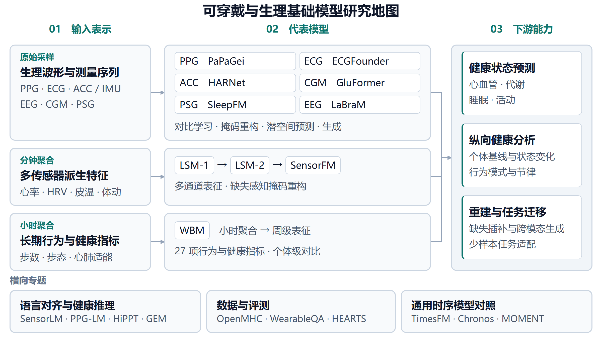
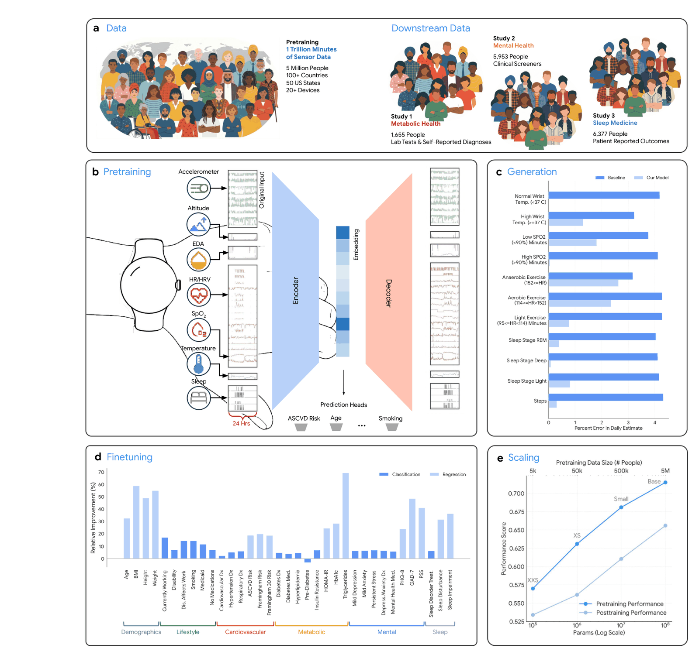
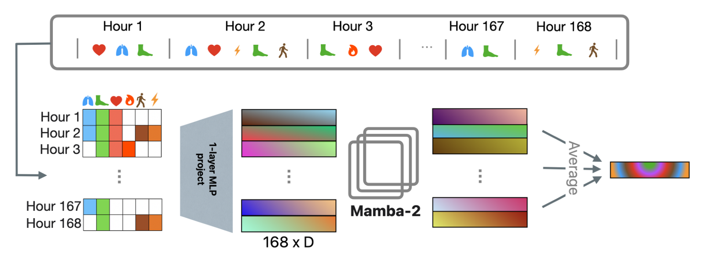
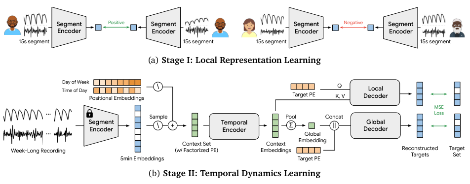

# 纵向可穿戴与行为基础模型

本专题按模型实际接收的数据粒度梳理 Google LSM-1、LSM-2、SensorFM、SensorLM、WavesFM 与 Apple WBM。分钟级派生特征、小时级行为指标和原始生理波形具有不同的信息量、缺失机制与适用任务。选型时应同时比较输入定义、观察窗口、受试者划分和下游适配协议。

资源状态截至 2026-11-04。LSM 在后续 Google 工作中称为 LSM-1；独立团队的复现与原作者模型具有不同的训练数据和资源来源。

## 系列关系

Google LSM-1 建立分钟级多传感器特征的规模化预训练基线，LSM-2 将真实缺失纳入训练与推理，SensorFM 延续 AIM 并扩大人群规模和健康任务范围。Apple WBM 则研究小时聚合的行为与健康指标，在周级窗口上学习表征。[WavesFM](#wavesfm) 以分阶段预训练连接短时 PPG / ACC 波形形态与周内时间关系，补充从原始信号出发的纵向建模路线。这五项工作分别说明规模、缺失处理、健康任务迁移、长期行为指标和波形层级建模的不同选择。

[SensorLM](smartwatch_models.md#sensorlm) 是传感器与语言对齐路线，可与上述数值表征模型对照。[OpenMHC](smartwatch_models.md#openmhc) 提供独立数据上的 WBM、LSM 系列复现和评测入口。

## 横向对比

| 工作与发表 | 输入与窗口 | 架构与核心机制 | 训练规模 | 论文结果与评测设置 | 官方资源 |
| :--- | :--- | :--- | :--- | :--- | :--- |
| LSM-1 ICLR 2025 | 26 个分钟级派生特征 5 小时窗口 | ViT MAE 二维分块与随机掩码重构 | 165,090 人 主要结果用 660 万小时，扩展实验最高 4,000 万小时 | 8 类活动识别，全量微调准确率 68.5%，监督训练基线 53.2% | [论文](https://arxiv.org/abs/2410.13638) 原作者代码与权重未见公开链接 |
| LSM-2 arXiv 2025 | 26 个分钟级派生特征 24 小时窗口 | ViT-1D，约 25M 参数 AIM 继承真实缺失并加入人工掩码 | 60,440 人 原文报告 4,000 万小时 | 高血压线性探测 AUROC 0.754，同设置重训 LSM-1 为 0.739 | [论文](https://arxiv.org/abs/2506.05321) 原作者代码与权重未见公开链接 |
| SensorFM arXiv 2026 | 五类传感器派生的 34 个分钟级特征 24 小时窗口 | ViT-1D MAE + AIM 约 0.139M-110.763M 参数 | 500 万人 论文分别报告超 20 亿多模态数据小时、超 1 万亿传感器分钟 | 35 项判别任务中 34 项优于工程特征监督基线 | [论文](https://arxiv.org/abs/2605.22759) 原作者代码与权重未见公开链接 |
| SensorLM NeurIPS 2025 | 26 个分钟级派生特征与分层描述 24 小时窗口 | ViT + 文本编码器与解码器 对比对齐与描述生成 | 103,643 人 约 5,970 万小时 | 20 类活动零样本 AUROC 0.84、Macro-F1 0.29 | [论文](https://arxiv.org/abs/2506.09108) [参考代码](https://github.com/Google-Health/consumer-health-research/tree/main/sensorlm)，未列原始权重 |
| WBM ICML 2025 | 27 个 HealthKit 指标及缺失标记 小时聚合、7 天窗口 | TST 词元化 + Mamba-2 个体级对比学习 | 全部数据集为 161,855 人、1,514 万人周 按人划分 80% / 10% / 10% | 57 项任务，睡眠时长回归 R² 为 0.590，统计特征基线 0.104 | [论文](https://arxiv.org/abs/2507.00191) 作者声明代码与权重无法发布 |
| [WavesFM](#wavesfm) arXiv 2026 | 15 秒 PPG / ACC 波形 5 分钟表示、7 天窗口 | EfficientNet-B7 + 6 层 Transformer 参与者对比预训练、双分支掩码重构；总参数量未报告 | 第一阶段约 32.4 万人、680 万小时 第二阶段约 1 万人、530 万小时 | 58 个个体级二分类任务，平均 AUROC 0.766；多周表示汇聚后线性探测 | [论文](https://arxiv.org/abs/2605.09173) 该可穿戴模型的代码与权重获取方式尚不明确 |

表中结果来自各自论文的独立队列与协议，跨行指标仅用于说明研究覆盖面。LSM-2 表中的 LSM-1 对照是同设置重训版本，不能直接替代 LSM-1 原论文结果。WBM 的约 25 亿小时描述全部数据集，实际训练集按参与者划分，不能直接写成全部用于预训练。

数据规模保留原文统计边界。SensorFM 同时报告“超 20 亿多模态数据小时”和“超 1 万亿传感器分钟”；LSM-2 第 3 节同时出现 3,581,748 人天和 4,000 万小时，另以约 160 万日窗口讨论缺失分布。原文没有充分解释这些统计量的对应关系，因此作者报告的时长不能直接相互换算，也不适合据此排列厂商数据规模。[SensorFM 数据定义](https://arxiv.org/html/2605.22759v3) · [LSM-2 第 3 节](https://arxiv.org/html/2506.05321v1)

## LSM-1

Google Research / Google DeepMind / 华盛顿大学 · ICLR 2025 · [论文](https://arxiv.org/abs/2410.13638) · [会议记录](https://proceedings.iclr.cc/paper_files/paper/2025/hash/94b25992757a549470c8f8dfe73d8df6-Abstract-Conference.html)

图源：LSM-1 论文 Fig. 1（arXiv:2410.13638v1）。

LSM-1 将心率、HRV、活动等分钟级特征组成时间与通道矩阵，通过掩码自编码学习可迁移表征。常规实验先补齐缺失值，使用 5 小时窗口，研究数据量、模型容量和计算量的变化。

主要结果采用约 660 万训练小时，4,000 万小时属于扩展实验。原论文 Table 3 的 8 类活动识别准确率由监督基线的 53.2% 提高到全量微调的 68.5%，线性探测为 49.4%。适配方式会明显改变结论，表征比较应同时保留冻结探测和微调协议。[论文第 3-5 节及附录 B](https://arxiv.org/html/2410.13638v1)

**评注**

该工作适合作为分钟级特征预训练的历史基线。复现时需要保留插补策略和受试者均衡采样信息，避免将数据扩展带来的收益与预处理变化混在一起。

## LSM-2

Google Research 及合作团队 · arXiv 2025 · [论文](https://arxiv.org/abs/2506.05321) · [官方介绍](https://research.google/blog/lsm-2-learning-from-incomplete-wearable-sensor-data/)

图源：LSM-2 论文 Fig. 4（arXiv:2506.05321v1）。

AIM 将数据原有缺失与人工遮挡合并，通过固定数量词元移除和注意力掩码处理不同样本的缺失比例。重构损失仅作用于原本有观测值的人工遮挡区域，推理时继续使用真实缺失掩码。

输入为 26 × 1,440 的日级特征矩阵，以 10 分钟为单通道分块长度。作者在同设置比较中报告高血压 AUROC 由 0.739 提高至 0.754，焦虑 AUROC 由 0.743 提高至 0.758。20 类活动识别 AUROC 为 0.899，略低于 LSM-1 对照的 0.900，结果应按任务阅读。[论文第 4-6 节](https://arxiv.org/html/2506.05321v1)

**评注**

该方法适合研究真实缺失的处理。自有数据应进一步区分脱表、硬件间歇采集与质量过滤，并评估这些缺失模式是否与设备或人群标签相关。

## SensorFM

Google Research 及合作团队 · arXiv 2026 · [论文](https://arxiv.org/abs/2605.22759) · [官方介绍](https://research.google/blog/sensorfm-towards-a-general-intelligence-and-interface-for-wearable-health-data/)

图源为 SensorFM 论文 Fig. 1，arXiv 2605.22759。

SensorFM 延续 LSM-2 的 AIM，在五类传感器派生的 34 个分钟级特征上学习日级表征。公开模型配置覆盖约 13.9 万至 1.108 亿参数，包含编码器与解码器。训练目标为可观测区域上的掩码重构。

论文评估 35 项健康、生活方式与人口统计任务。34/35 的比较对象是工程特征监督基线，33/35 则指最大的 SensorFM-B 在不同容量版本之间胜出的任务数。冻结表征还可供下游预测头和健康 Agent 使用，Agent 评估包含 1,860 次临床人员评分；该静态摘要实验与原 PHA 系统的关系见 [PHA 应用案例](health_reasoning_llms.md#pha)。[论文第 2 节及方法 M.3](https://arxiv.org/html/2605.22759v3)

判别评测的 35 项任务均为个体级标签。作者对同一个人全部可用天数中的有效词元表示计算均值与标准差，再降至 50 个主成分并训练任务头。因此，24 小时指编码器窗口，不代表最终预测只使用一天。预训练使用日长滑窗；时间编码还包含星期和年内日期。[方法 M.3.1、M.3.2、M.3.4](https://arxiv.org/html/2605.22759v3)

**评注**

该工作的价值在群体级扩展和广泛任务迁移。研究输入依赖设备端已经计算的特征，迁移到其他硬件时应核对特征定义、校准与缺失规则。Agent 摘要评分与患者结局属于不同证据层次。

## WBM

Apple / 南加州大学 · ICML 2025 · [论文](https://arxiv.org/abs/2507.00191) · [会议记录](https://proceedings.mlr.press/v267/erturk25a.html) · [官方介绍](https://machinelearning.apple.com/research/beyond-sensor)

图源为 WBM 论文 Fig. 2，arXiv 2507.00191。

WBM 使用 27 个行为与健康指标，将每周小时聚合值和缺失标记组成 168 × 54 矩阵。TST 词元化后输入 Mamba-2，并以同一人的不同周作为对比学习正样本。最终骨干为 24 层，论文未给出明确的总参数量。

作者在 57 项任务上评估表征。睡眠时长回归 R² 为 0.590，拼接 PPG 表征后为 0.601。原始模型未使用睡眠指标预训练，睡眠任务标签来自 Apple Watch 的估计结果。训练与评测均按受试者划分。[论文第 4-5 节及附录 A](https://arxiv.org/html/2507.00191v1)

**评注**

WBM 展示了小时级行为指标的周长表征学习，数据覆盖约 16.2 万人。OpenMHC 的公开 WBM 实现使用独立数据与训练过程，应与 Apple 原始权重区分。

## SensorLM 与系列资源边界

SensorLM 为数值表征引入语言接口，与 LSM-2 和 SensorFM 的重构目标形成互补。其传感器编码器从 3M 扩展至 1.27B 参数，文本编码器与多模态解码器另计 12M 至 1.45B；这些数字不能混写成单一编码器规模。完整输入、零样本结果和原论文图见 [SensorLM 专节](smartwatch_models.md#sensorlm)。

官方仓库公开分层描述生成和 SigLIP 变体的参考训练代码，README 未列出原论文预训练检查点下载。因此“有参考代码”与“能够直接加载原作者预训练模型”应分别记录。[官方代码说明](https://github.com/Google-Health/consumer-health-research/blob/main/sensorlm/README.md) · [NeurIPS 2025 记录](https://proceedings.neurips.cc/paper_files/paper/2025/hash/42cd98f0e7520d4a63c34891ac1c972f-Abstract-Conference.html)

| 资源 | 来源与获取条件 | 复用时的区别 |
| :--- | :--- | :--- |
| LSM-1、LSM-2、SensorFM | 原作者论文与官方介绍；原始预训练权重的公开获取方式尚不明确 | 原论文方法与独立团队复现的权重需分别比较 |
| WBM | 作者明确因研究参与者知情同意限制而无法发布代码与权重 | Apple 原始模型与独立复现具有不同的训练数据和参数 |
| WavesFM | 两阶段波形与纵向表征研究；对应论文的官方代码、权重或数据获取方式尚不明确 | 与同名无线通信项目不同；原文人数及时间块长存在报告差异 |
| SensorLM | 原作者参考代码，包含描述生成与 SigLIP 训练变体 | 参考实现的训练目标需与论文具体变体对应 |
| OpenMHC 的 WBM / LSM 复现 | 由独立团队在独立数据上训练 | 可作开放评测对照，其检查点不属于 Google 或 Apple 原始模型 |

## WavesFM

Google Research / MIT / 华盛顿大学 · arXiv 2026 · [论文](https://arxiv.org/abs/2605.09173)

WavesFM 将短时波形表征与周内时间结构连接，使原始信号预训练和纵向健康表征可以在同一框架中比较。其全名为 *WavesFM: Hierarchical Representation Learning for Longitudinal Wearable Sensor Waveforms*，不同于同名无线通信模型。

图源：WavesFM 论文 Fig. 2（arXiv:2605.09173v1），直接裁剪原论文。

| 层级 | 输入与架构 | 训练目标与输出 |
| :--- | :--- | :--- |
| 第一阶段 | 15 秒 PPG 与 ACC 模长，重采样至 100 Hz；EfficientNet-B7 | 同一人不同片段的对比学习，输出 256 维片段表示 |
| 中间汇聚 | 每 20 个相邻片段表示取均值 | 每 5 分钟一个向量，一周 2016 个位置；缺测以可学习词元表示 |
| 第二阶段 | 冻结第一级编码器；6 层、4 头、256 维 Transformer，加入日内时刻与星期位置编码 | 局部与全局双分支重建被遮挡的表示，学习周级表征 |

第一阶段用约 32.4 万人的 680 万小时片段，第二阶段用其中约 1 万人的 530 万小时纵向记录，共 6.12 万条周长记录。模型总参数量未报告。第二阶段学习的是嵌入序列，不是再次输入整天原始波形；五分钟内的顺序被均值汇聚，不能描述为无损保留长时原始信号。[方法与附录 B/C](https://arxiv.org/html/2605.09173v1)

作者在 58 个个体级二分类任务上报告平均 AUROC 0.766，形态表示直接平均为 0.748，19 个手工特征加同配置时间编码器为 0.728。两类基线由作者在同源数据上构造，不是原版 LSM、SensorFM 或 Apple WBM。下游以自报健康、生活方式等标签为目标，冻结编码器并训练逻辑回归。评测把每人的全部可用周级向量平均，因此主结果不能直接解释为只观察一周的表现。[第 4 节及 Table 8](https://arxiv.org/html/2605.09173v1)

**评注**

这一两级预训练设计连接了局部形态与长期节律，但尚未验证跨设备、缺失整路传感器或急性事件任务。原文将 LSM、LSM-2、WBM 均归入广义 Behavior-Centric；更精确的共同名称是派生指标驱动的纵向生理与行为建模，不能仅凭分钟级或小时级粒度区分生理与行为。

原文存在两项报告差异：正文下游总人数为 11,736，附录 B 划分人数却合计 15,700；§3.2 的块长 1、2、4 与其文字标注的 5、20、60 分钟不符。二者都会影响实验复现。截至 2026-11-04，数据未公开，对应这篇可穿戴论文的官方代码与权重获取方式尚不明确。

## 时间尺度与历史汇聚

输入窗口、最终预测使用的历史总量和结果更新周期需要分别记录。日级编码器可以利用多天历史，周级编码器也可以在滑动窗口中每天更新；后者属于部署设计选项，并非本文确认的线上实现。

| 工作 | 窗口内部怎样建模 | 窗口之间怎样汇聚 |
| :--- | :--- | :--- |
| SensorFM | 一天的分钟级派生特征，学习日内时序与跨通道关系 | 全部可用天数中的有效表示取均值和标准差 |
| WavesFM | 短段波形先编码，再对一周的五分钟表示学习有序关系 | 全部可用周级向量取平均 |

这个差别支持比较“日内编码加跨日统计汇聚”和“周内有序编码加跨周汇聚”，不能归纳为两者只用了不同天数的数据。SensorFM 的日期编码提供日历背景，但不等同于在一次注意力计算中联合观察多天的实际轨迹。[SensorFM 方法 M.3](https://arxiv.org/html/2605.22759v3) · [WavesFM 第 3-4 节](https://arxiv.org/html/2605.09173v1)

WavesFM 将工作日与周末差异作为一周窗口的动机，但未报告控制输入、数据和架构后的 1 天与 7 天窗口消融。附录 E 比较的 252、504、1008 个上下文位置，是同一周内的可见比例，不是不同历史跨度。周期性只能说明值得考虑跨日信息，不能证明 7 天是通用最优窗口。[WavesFM 第 2.2 节及附录 E](https://arxiv.org/html/2605.09173v1)

季节变化也不必通过每次输入一年原始信号来处理。训练数据覆盖不同季节、日期与环境条件、个人长期基线、单次输入窗口分别解决不同问题。SensorFM 已包含年内日期编码，LSM-2 则将季节与年尺度列为后续研究。日期背景不能替代个体的真实长期变化。[SensorFM 方法 M.3.1](https://arxiv.org/html/2605.22759v3) · [LSM-2 附录 A.6](https://arxiv.org/html/2506.05321v1)

**工程评注**

可保留近期细粒度表示、跨日时序表示和缓慢更新的个人基线，由目标任务选择所需历史。在同一批用户、同一预测时点上比较 1、3、7、14、28 天，并用相同长历史的统计汇聚作对照，才能区分历史变多与时序结构带来的收益。除预测指标外，应比较状态变化响应、缺失鲁棒性、跨季节泛化和计算成本；这些是评测建议，不是上述论文已经完成的结论。

## 产品关联与证据边界

Google 在 2026 年 8 月的产品介绍中明确将血压趋势功能关联到 WavesFM，并将胰岛素抵抗趋势功能的基础模型链接指向 SensorFM 官方介绍。两条路线因而具有不同的产品落点，不能把整个 Google Health 归结为一个模型。[Health Guardian 产品介绍](https://blog.google/products-and-platforms/products/google-health/pixel-watch-health-guardian/) · [SensorFM 官方介绍](https://research.google/blog/sensorfm-towards-a-general-intelligence-and-interface-for-wearable-health-data/)

该证据说明功能采用的模型路线，没有公开生产检查点、推理窗口、聚合实现或手表、手机与云端的计算分工。论文中的窗口与评测协议不能直接视为产品实现，也不能把健康趋势功能等同于论文之外的实时临床测量能力。

## 选型与评测建议

| 研究条件 | 优先对照 | 需要保留的实验信息 |
| :--- | :--- | :--- |
| 分钟级多传感器指标齐全 | LSM-1、LSM-2、SensorFM 路线 | 特征定义、缺失率、窗口长度、受试者划分 |
| 观测严重碎片化 | LSM-2 的 AIM | 真实与人工缺失来源、整模态缺失、连续脱表时段 |
| 小时级长期行为指标 | WBM 路线 | 聚合方式、周级覆盖率、个体级正样本、标签时间窗 |
| 同时保留局部波形与跨日关系 | WavesFM 路线 | 波形质量、两阶段划分、五分钟压缩、跨周汇聚与原文报告差异 |
| 希望获得可运行的开放对照 | OpenMHC 复现、SensorLM、NormWear | 原作者或复现身份、训练队列、许可和实际权重入口 |

以上选择是基于论文输入与方法作出的工程判断。模型规模之外，还应报告工程特征加线性模型或树模型的对照、冻结与微调结果，以及跨设备和跨人群表现。训练时长应同时提供人数、窗口数、采样粒度和有效观测占比，便于识别同一统计量的不同计数方式。
