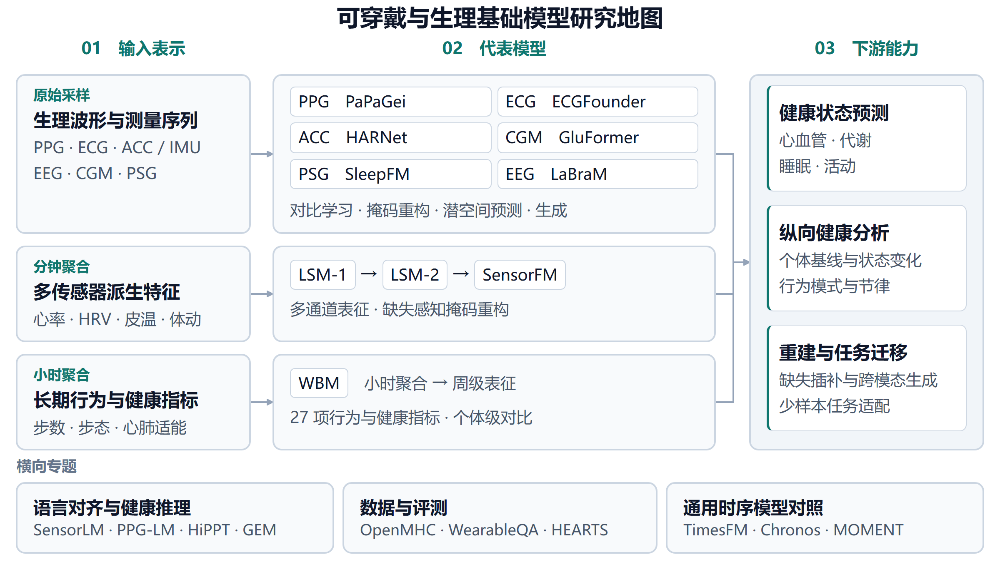
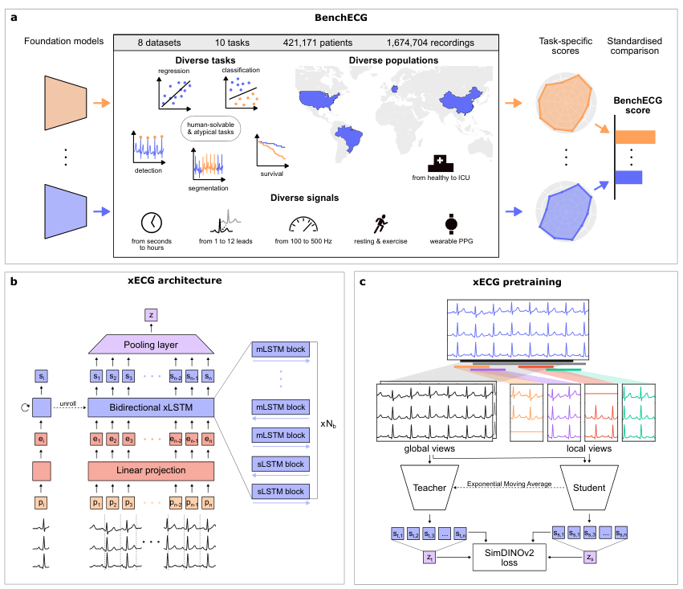
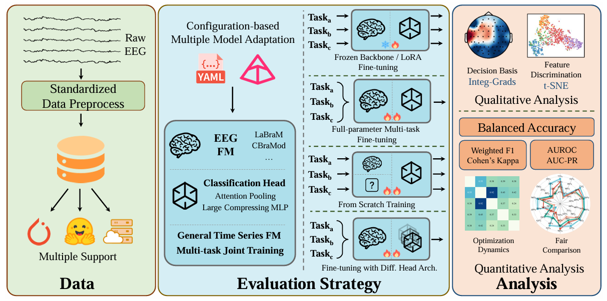

# 生理信号基础模型评测基准

本专题介绍 ECG 与 EEG 的统一评测协议，并对照 PPG、纵向穿戴和健康推理基准，重点比较可复用的任务定义、数据划分与评测实现。

## 评测对象与协议对照

| 基准 | 评测架构或输入 | 数据规模 | 主要协议 | 结果应如何读取 | 开源入口 |
| :--- | :--- | :--- | :--- | :--- | :--- |
| BenchECG / xECG | ECG，含 PPG 跨模态迁移；xECG 为双向 xLSTM + SimDINOv2 | 8 个数据集、421,171 人、1,674,704 份记录 | 10 项分类、检测、分割、回归及生存任务；线性探测与微调 | 期刊版报告 xECG 综合分 0.838；该分数是基准内聚合指标 | [评测代码](https://github.com/dlaskalab/bench-xecg) · [xECG 权重](https://huggingface.co/riccardolunelli/xECG_base_model_v1) |
| EEG-FM-Bench | 7 个 EEG 基模与 Mantis、MOMENT；可更换分类头 | 14 个数据集、10 类 EEG 范式 | 冻结、全参数、LoRA；单任务与多任务；梯度及表征分析 | 按数据集和适配策略读取 Balanced Accuracy、F1 等；排名依赖协议 | [评测代码](https://github.com/xw1216/EEG-FM-Bench) |
| [PPG-Bench](smartwatch_models.md#ppg-bench) | PPG 基模与简单 PRV、通用时序对照 | 论文 9 个数据集、26 项任务；公开代码列 17 项主要任务 | 四级下游适配协议 | 固定代码版本，同时报告简单基线与跨受试者划分 | [代码](https://github.com/mannas-ai/ppg-bench) |
| [OpenMHC](smartwatch_models.md#openmhc) | 纵向穿戴指标 | 多年人群记录 | 预测、插补、外推与公开基线复现 | 区分原始工业模型与开放复现 | [代码](https://github.com/AshleyLab/OpenMHC) |
| [HEARTS](health_reasoning_llms.md#hearts) | 高频波形至长期指标 | 16 个数据集、110 项任务、20,226 个样本 | 感知、推断、生成、演绎；含工具型 Agent | 分层、分任务比较，保留工具及输入格式 | [代码与数据入口](https://github.com/yang-ai-lab/HEARTS) |
| [WearableQA](health_reasoning_llms.md#wearableqa) | 个人穿戴历史、血检与人口信息 | 200 人、最长约 500 天、4,084 道十选一题 | 数据/健康推理与单/跨信号两轴 | 随机基线为 10%；记录缺失、上下文长度与序列化方式 | [代码与数据](https://github.com/facebookresearch/WearableQA) |

本表用于选择评测入口，不将不同基准的分数直接横向排序。模型表征质量、下游头容量、上下文长度、语言提示和工具能力分别影响结果。

## BenchECG

因斯布鲁克医科大学 · npj Digital Medicine 2026 · [正式论文](https://doi.org/10.1038/s41746-026-03196-y) · [预印本](https://arxiv.org/abs/2509.10151) · [代码](https://github.com/dlaskalab/bench-xecg)

图源：BenchECG 论文 Fig. 1（arXiv:2509.10151v1），保留作者原图。

BenchECG 将短程多导联心电、长程单/双导联记录、运动心电和腕戴 PPG 纳入统一任务集合，并设置跨人群年龄估计与生存分析。配套 xECG 通过双向 xLSTM 和师生自监督学习构建表征；官方仓库分别提供线性探测和微调配置。

作者在 2026-09-14 期刊在线版报告 xECG 的 BenchECG 综合分为 **0.838**，五个模型中的平均排名为 1.5。预印本中的约五倍速度优势指同一 L40S GPU 上相对 ST-MEM 的基准微调耗时，不能泛化为所有训练阶段或硬件的固定倍率。[期刊摘要](https://www.nature.com/articles/s41746-026-03196-y) · [实验设置](https://arxiv.org/html/2509.10151v1)

**评注**

该基准覆盖检测、分割和生存等任务，并提供显式的分布外评测。复用时需核对预训练与评测数据重叠；较长输入窗口本身也会改变适配难度。基准评测代码与配套 xECG 模型权重分别提供。

## EEG-FM-Bench

同济大学 / 上海市养志康复医院 · ICML 2026 · [正式论文](https://proceedings.mlr.press/v306/xiong26f.html) · [代码](https://github.com/xw1216/EEG-FM-Bench)

图源：EEG-FM-Bench 论文 Fig. 2（arXiv:2508.17742v3）；图片取自作者 [官方仓库](https://github.com/xw1216/EEG-FM-Bench/blob/main/assets/img/pipeline.png)。

该基准在统一框架中组合不同适配策略、任务组织方式和分类头，并分析梯度冲突与表征变化。作者报告，多任务训练可缓解部分小数据任务的过拟合，也可能产生负迁移；模型与语料规模不能单独解释迁移表现。[正式论文](https://proceedings.mlr.press/v306/xiong26f.html)

其评测以分类任务为主。部分预训练数据与评测数据重叠，论文表格有专门标记；附录 B.3 的情绪数据划分也不能统一解释为受试者完全隔离。读者应核对具体数据集的划分和适配设置，再引用结果。[论文附录 B、C](https://arxiv.org/html/2508.17742v3)

**评注**

该工作适合配合 [EEG 模型专题](eeg_models.md) 使用：先匹配输入通道与采样率，再比较冻结和可训练编码器的差异。协议内的结果可以指导实验配置，但不能单凭平均排名推断新设备上的表现。

## 相关评测

以下工作提供其他任务组织方式和评测范围，作为延伸阅读。

| 工作 | 研究方向 | 数据与适用范围 |
| :--- | :--- | :--- |
| [PhysioBench](https://arxiv.org/abs/2609.20836) | 生理信号问答，覆盖 ECG、EEG、PPG 与 PSG | 论文摘要报告 22 数据集、30 任务和约 6,140 万问答；[官方实现与资源说明](https://github.com/Leanna97/PhysioBench)中的公开 QA 包覆盖 18 数据集，原始波形须分别按许可获取，完整基准与公开包的覆盖范围不同 |
| [WEQA](https://arxiv.org/abs/2606.18147) | 查询自适应 Agent 与可穿戴问答 | 比较结果时需同时考虑任务划分和代理调用预算 |
| [HealthLoopQA](https://openreview.net/pdf?id=7mHfFopx4t) | 糖尿病穿戴解释与模拟故障评测 | 所引材料为投稿版本，正式发表状态与数据获取方式尚不明确 |
| [CLIMB](https://proceedings.mlr.press/v267/dai25b.html) | 多模态临床评测 | 覆盖影像、语言、时序和图等临床数据，适合作为范围更广的评测参考 |
