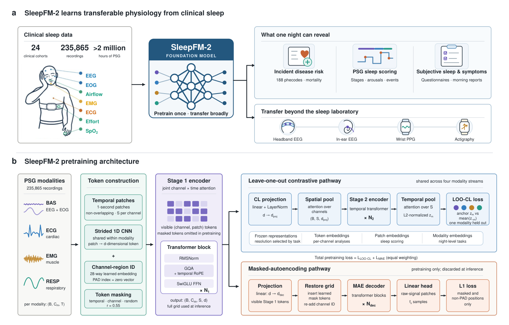
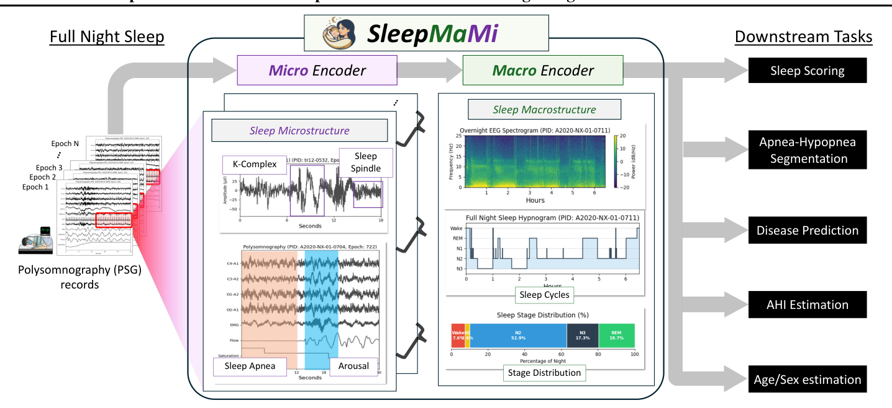
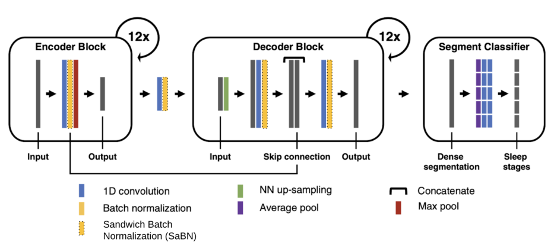

# 睡眠与心肺多模态基础模型

睡眠是人体神经系统、心血管网络与呼吸力学进行生理稳态重置的核心时段。本专题深入解构以多导睡眠监测（PSG：EEG、ECG、PPG、Resp、EMG）及家庭穿戴为核心表征对象的代表性基础模型，剖析跨器官生物物理耦合、留一对比学习范式以及从单夜睡眠表征预测 130 余种慢性疾病风险的底层机制。

## 目录

- [1. 睡眠生理时序的独特性与表征挑战](#1-睡眠生理时序的独特性与表征挑战)
- [2. 经典模型剖析](#2-经典模型剖析)
  - [SleepFM](#sleepfm)
  - [SleepMaMi](#sleepmami)
  - [U-Sleep](#u-sleep)
- [3. 经典公开睡眠数据集与评测基准](#3-经典公开睡眠数据集与评测基准)
- [4. 核心睡眠基础模型横向对比全景矩阵](#4-核心睡眠基础模型横向对比全景矩阵)
- [5. 对消费级穿戴睡眠监测的技术启示](#5-对消费级穿戴睡眠监测的技术启示)
  - [5.1 消费级穿戴的技术演进突破](#51-消费级穿戴的技术演进突破)
  - [5.2 核心前沿问答：穿戴式 ACC 基模能否用来识别微觉醒？](#52-核心前沿问答穿戴式-acc-基模能否用来识别微觉醒)
- [6. 核心文献与资源汇总](#6-核心文献与资源汇总)

---

## 1. 睡眠生理时序的独特性与表征挑战

临床与科研界普遍将睡眠视为评估全身整体机能退化、心血管事件与神经退行性病变的生理压力测试窗口。相比单一手腕脉搏波或孤立血糖曲线，睡眠时序的处理面临跨系统耦合与尺度跨度双重挑战：

### 1.1 跨系统多器官生物物理耦合 (Brain-Heart-Lung Coupling)

在整夜睡眠过程中，人体经历持续的器官互锁与自主神经调节切换：
- **脑神经（EEG / EOG）**：呈现特征性的 $\delta$ 慢波（深度慢波睡眠）、纺锤波（Sleep Spindles，11～16 Hz）以及快速眼球运动（REM 期）；
- **心血管（ECG / PPG）**：心率变异性（HRV）在非快速眼动期（NREM）呈现强烈的迷走副交感神经张力占优（心率平缓、呼吸性窦性心律不齐 RSA 显著），而在 REM 期交感神经活跃（心率与血压出现突发性波动）；
- **呼吸力学（Resp Effort & Airflow）**：胸腹运动与气流保持节律性气体交换。若发生阻塞性睡眠呼吸暂停（OSA），气道塌陷将导致连续数十秒胸腹反相矛盾运动、血氧骤降，进而诱发皮质微觉醒与交感反应。

传统模型往往针对单一模态（如单导联脑电）进行特征提取，容易丢失心肺耦合（Cardiopulmonary Coupling, CPC）与神经-心血管级联调控的生理先验。

### 1.2 30 秒局部 Epoch 与整夜超长程时序的尺度断层

- **临床金标准规则（AASM 协议）**：医生将整夜 8 小时信号以 30 秒为一个切片（Epoch），划分为 5 种状态：清醒（Wake）、浅睡期（N1、N2）、深睡期（N3 / 慢波睡眠 SWS）及快速眼动期（REM）。
- **尺度矛盾**：单个 30 秒切片仅包含约 30 个心跳或 6～8 次呼吸波形，足以识别微观波形形态（如 K-复合波、单个早搏）；但整夜睡眠质量、微觉醒指数（AHI / ArI）及周期性睡眠阶段转换（约 90～120 分钟 / 周期）属于宏观全夜动力学。孤立建模局部切片容易在时序邻近区域产生频繁的伪跳变。

### 1.3 临床 PSG 与家庭消费级穿戴的模态差异

- **临床多导睡眠监测（PSG）**：通常布置 16～24 个导联，包含金标准脑电（C3 / C4 / F3 / F4 等）、眼电（EOG）、下颌肌电（EMG）、心电（ECG）、口鼻热敏 / 气压气流带、胸腹阻抗运动带、指尖透射式脉搏血氧（SpO2）及体位传感器；
- **家庭消费级设备**：多依赖手表的反射式手腕 PPG 与三轴加速度计 ACC；
- **基础模型的目标**：在海量高质量全模态临床 PSG 上学习多器官联合潜空间，进而跨模态自适应向下蒸馏或零样本迁移至低通道、低成本的穿戴端。

---

## 2. 经典模型剖析

### SleepFM

斯坦福大学医学院 / DTU / BrainCapture · Nature Medicine (1.0) / arXiv:2609.06849 (2.0) · [代码](https://github.com/zou-group/sleepfm-v2-public)

图源：SleepFM-2 论文 Fig. 1（arXiv:2609.06849）

Stanford Medicine（Emmanuel Mignot 睡眠医学团队与 James Zou 人工智能实验室）联合丹麦工大（DTU）、BrainCapture 等机构，开创了基于临床多导睡眠监测（PSG）的生理多模态基础模型家族，经历了从 SleepFM 1.0 到 SleepFM-2 的演进。

#### 1. SleepFM 1.0：留一对比学习范式与 60 万小时奠基

- **数据语料规模**：涵盖 65,000 名受试者、超过 585,000 小时完整夜间多模态生理波形（EEG、ECG、PPG、Resp、EMG），源自斯坦福睡眠诊所长达 20 余年的临床异构队列；
- **留一对比学习机制（Leave-One-Out Contrastive Learning, LOO-CL）**：
  - 将各个模态在 30 秒切片独立编码为 $z_m \in \mathbb{R}^d$；
  - 随机选定一个目标模态 $k$（如呼吸 $z_{\text{Resp}}$），将其余所有模态通过多层感知机或投影器融合为多器官联合嵌入：

    $$
    z_{\setminus k} = \text{Projector}(\{z_j \mid j \ne k\})
    $$

  - 构造 InfoNCE 损失拉近同一切片内 $z_k$ 与 $z_{\setminus k}$ 的距离，引导模型学习跨器官信号间的互补与映射关系；
- **模态热插拔与慢性疾病预测**：天然留一遮蔽赋予模型容忍导联缺失的能力。在电子健康病历（EHR）长期生存分析中，单夜睡眠表征可对阿尔茨海默病（C-index 0.85）、全因死亡率（C-index 0.84）、心肌梗死（C-index 0.81）及心房颤动（C-index 0.78）等提供风险评估参考。

#### 2. SleepFM-2：200 万小时数据、现代 Transformer 架构与细粒度突破

- **语料规模**：汇聚 282,511 份完整夜间多导睡眠监测（PSG）记录，总时长超过 2,000,000 小时。预训练动用 24 个临床及科研队列的 235,865 份记录；外部保留哈佛大学 Human Sleep Project 样本（Harvard HSP，7,078 人）与 Sleep Heart Health Study（SHHS）进行跨中心独立盲测；
- **架构现代化与轻量化**：
  - 采用 RMSNorm 预归一化、SwiGLU 前馈网络、旋转位置编码 RoPE 及无偏置线性投影；
  - 架构设计为两阶段编码：Stage 1（2 层，联合时空网格）+ Stage 2（4 层，纯时间时序）；
  - 编码器参数量从 4.83M 降至 2.56M，结构更为紧凑；
- **双流自监督目标（LOO-CL + MAE）**：
  - 引入掩码自编码器（MAE）分支，以三合一混合掩码（时间块掩码 + 通道块掩码 + 随机掩码）与 L1 损失重构局部微观波形；
  - 在高层使用 LOO-CL 进行多器官宏观对比。消融结果表明，联合优化在兼顾局部睡眠分期（Macro-F1 0.773）的同时，保证了疾病预测的泛化能力（C-index 0.798）；
- **1 秒细粒度切片与临床事件打分闭环**：
  - 将 Token 时间步长由 5 秒提升至 1 秒，具备捕获短程微事件的分辨率；
  - 冻结编码器下接入轻量 LSTMHead，在皮质微觉醒检测（Event-level F1 0.601）、周期性肢体运动检测（Event-level F1 0.604）与呼吸事件检测（Macro-F1 0.462）中均处于资深技师一致性区间；
- **全表型关联分析（PheWAS 215 表型）与通用生理风险轴**：
  - 在 Stanford SSC 与 Harvard HSP 测试中，预测 215 种新发疾病表型（C-index ≥ 0.75）；
  - 对 939 种疾病预测风险矩阵进行主成分分析，第一主成分（PC1）解释了约 58% 的方差。高风险状态与全脑区 Sigma 波空间耦合度下降及催眠密度熵增密切相关；
- **手腕传感器与物理生理代理通道桥（Surrogate Channels Bridge）**：
  - 在手腕三轴加速度计（ACC）缺乏 PSG 对应通道的场景下，SleepFM-2 引入物理滤波桥：
    - **呼吸代理通道**：将加速度在 0.1～0.6 Hz 频段带通滤波，捕获胸腹呼吸微动；
    - **心动冲击代理通道**：将加速度在 3.5～14 Hz 带通滤波提取心冲击微震颤，计算 L2 范数后再在 0.5～3.5 Hz 提取心跳包络；
  - 在 UK Biobank 10 万人 7 天腕戴加速度计随访（390 种疾病终点）中，该代理方法达成了与加速度专用预训练模型相当的平均 C-index（0.687 对比 0.688）。

#### 3. SleepFM 1.0 与 SleepFM-2 架构对比

| 维度 / 参数 | SleepFM 1.0 (Nat Med 2024) | SleepFM-2 (arXiv 2609.06849, 2026) |
| :--- | :--- | :--- |
| **预训练数据规模** | 6.5 万受试者 / 58.5 万小时 | 23.5 万受试者 / 200+ 万小时 (24 个队列) |
| **独立外部验证** | 同医疗体系测试集 | Harvard HSP (7,078 人) + SHHS 独立盲测 |
| **Token 时间步长** | 5 秒 | 1 秒 |
| **编码器骨干网络** | 标准 Transformer (LN, GELU) | 现代轻量 Transformer (RMSNorm, SwiGLU, RoPE) |
| **编码器参数量** | 4.83M | 2.57M (参数精简 47%) |
| **自监督学习目标** | 留一对比学习 (LOO-CL) | LOO-CL (宏观) + MAE (微观局部波形重构) |
| **通道解耦机制** | 早期注意力池化 | 28 维 Channel-Region 解耦嵌入 |
| **微观事件检测** | 不支持（时间分辨率受限） | 支持微觉醒、肢体抽动 PLMS、呼吸暂停事件 |
| **穿戴加速度计支持** | 未做适配 | 物理代理通道桥 (0.1～0.6 Hz 呼吸 / 3.5～14 Hz 心冲击) |

---

### SleepMaMi

首尔大学 · ICML 2026 · [代码](https://github.com/SNU-SPL/SleepMaMi)

图源：SleepMaMi 论文 Fig. 1（ICML 2026）

SleepMaMi（Hierarchical Dual-Encoder Foundation Model for Polysomnography）针对单尺度切片在建模微观瞬变与宏观节律时的脱节问题，提出了分层宏微观双编码器结构。

#### 1. 核心动机：单尺度切片的局限

单一切片建模通常面临两类挑战：
1. 30 秒切片内部包含高频瞬变波形（如 14 Hz 睡眠纺锤波、K-复合波突变、持续数秒的微觉醒肌电变化）；
2. 睡眠过程具备由 4～6 个约 90 分钟周期构成的长程时序节律（N1 → N2 → N3 → REM）。若缺乏全局上下文约束，相邻切片的分类容易出现伪跳变；若缺乏微观细节，则易漏判短程呼吸事件。

#### 2. 双流分层编码体系

- **微观编码器（Micro-Encoder）**：
  - 输入 30 秒多通道 PSG 切片，结合掩码自编码（MAE）与通道内对比学习；
  - 侧重提取高频尖峰、心电复波、脑电微形态与局部呼吸幅度特征；
- **宏观编码器（Macro-Encoder）**：
  - 串联整夜切片表征序列；
  - 引入人口统计学引导对比学习（Demographic-Guided Contrastive Learning），将整夜表征与受试者年龄、性别、BMI 对齐，校准不同群体的基线生理节律。

#### 3. 预训练语料与少样本微调

- 在包含 20,000 余份 PSG 记录、158,000 小时的多中心队列上完成预训练；
- 在少样本微调测试中，使用 1% 标注样本在睡眠分期与呼吸暂停分级（AHI）任务上取得了接近常规全监督基线的表现。

---

### U-Sleep

哥本哈根大学 · Nature npj Digital Medicine 2021 · [论文](https://doi.org/10.1038/s41746-021-00440-5) · [代码](https://github.com/perslev/U-Sleep)

图源：U-Sleep 论文（npj Digital Medicine 2021 / arXiv:2209.11173）

U-Sleep 是睡眠时序领域经典的开源全时程高频基准骨干网络之一。

#### 1. 核心架构特点

- **1D 全卷积 U-Net 结构**：摒弃传统“30 秒手工特征提取 + 循环网络串联”的两阶段方案，直接以连续波形输入；
- **多级时间下采样与跳跃连接**：编码器通过多级步长卷积与池化压缩时间维度，再由解码器配合跳跃连接还原至逐 Epoch 的时间分辨率，直接输出整夜分期标签；
- **通道配置弹性**：对输入导联组合具有较强适应能力，支持单通道脑电或双导联（EEG + EOG）输入，在多中心测试中保持稳定的分期一致性（Macro-F1 约 0.79～0.81）。

---

## 3. 经典公开睡眠数据集与评测基准

大规模多导睡眠监测公开数据库为模型预训练与下游评测提供了核心基础：

| 数据集名称 | 主导机构 | 样本规模 | 模态通道 | 核心特点与临床场景 | 获取途径 |
| :--- | :--- | :--- | :--- | :--- | :--- |
| **SHHS** (Sleep Heart Health Study) | 美国 NIH / NHLBI | 5,804 名中老年受试者 (长程随访) | 完整 PSG (EEG, EOG, EMG, ECG, 胸腹呼吸, SpO2) | 研究睡眠呼吸障碍与心血管疾病因果关联的经典流行病学队列 | NSRR 申请获批 |
| **MESA** (Multi-Ethnic Study of Atherosclerosis) | 美国 NHLBI / 多中心 | 2,237 名多族裔成年人 | 完整 PSG + 腕部 7 天体动仪 Actigraphy | 包含多族裔人群与长期心血管动脉硬化硬终点随访数据 | NSRR 开放申请 |
| **PhysioNet Sleep-EDF (Expanded)** | 荷兰神经研究所 / PhysioNet | 197 份整夜记录 | 2 通道 EEG (Fpz-Cz / Pz-Oz), EOG, EMG, 口鼻呼吸 | 睡眠分析早期经典开源基准，常用于算法原型对比验证 | PhysioNet 公开下载 |
| **ISRUC-Sleep** | 葡萄牙睡眠医学中心 | 100+ 例临床受试者 | 6 通道 EEG, 2 通道 EOG, 3 通道 EMG, ECG, 呼吸 | 提供多位资深技师独立标注的睡眠分期双盲标签 | 学术公开下载 |
| **Stanford Sleep Bench** | 斯坦福大学 Zou Lab | 跨中心万例级标准基准 | 统一多模态 PSG 标准网格 | 涵盖睡眠分期、呼吸暂停分级、微觉醒检测及死亡率预测的多任务套件 | GitHub / 协议获取 |

> [!NOTE]
> 美国国家睡眠研究资源库（[National Sleep Research Resource, sleepdata.org](https://sleepdata.org/)）是获取 SHHS、MESA、MrOS 等临床 PSG 数据的核心平台，签署学术使用协议（DUA）后即可获批下载。

---

## 4. 核心睡眠基础模型横向对比全景矩阵

| 评估维度 / 指标 | Stanford SleepFM 1.0 | Stanford SleepFM-2 | 首尔大学 SleepMaMi | U-Sleep |
| :--- | :--- | :--- | :--- | :--- |
| **主要定位** | 多器官耦合全能基座 | 200 万小时全能生理时序基座 | 宏微观层级时序基座 | 全卷积端到端高频基准 |
| **核心架构** | 1D-ResNet 分支 + 留一对比融合 | 2 阶段轻量 Transformer (RMSNorm / SwiGLU / RoPE) | Macro-Encoder + Micro-Encoder | 1D 全卷积 U-Net (带跳跃连接) |
| **编码器参数量** | 4.83M | 2.57M | 约 15M | 约 3.1M |
| **预训练学习范式** | 留一自监督对比学习 (LOO-CL) | LOO-CL (宏观) + MAE 局部重构 | 人口统计引导对比 + 局部 MAE | 全量监督端到端训练 |
| **预训练数据规模** | 58.5 万小时 (6.5 万人) | 200+ 万小时 (23.5 万人, 24 队列) | 15.8 万小时 (2.0 万人) | 约 1.5 万小时 |
| **时间切片分辨率** | 30 秒 / 5 秒 Token | 1 秒 Token | 30 秒切片 | 原始采样点 (逐秒输出) |
| **多模态涵盖面** | 脑电 + 心电/PPG + 呼吸 + 肌电 | 脑电 + 眼电 + 肌电 + 心电/PPG + 呼吸 | 脑电 + 心电 + 胸腹呼吸 | 任意单 / 多通道脑电与眼电 |
| **导联空间解耦** | 早期通道注意力池化 | 28 维 Channel-Region 动态查找表 | 局部通道掩码 | 卷积通道自适应 |
| **睡眠分期表现** | Macro-F1 约 0.78～0.82 | Macro-F1 约 0.78～0.82 | Macro-F1 约 0.81～0.83 | Macro-F1 约 0.79～0.81 |
| **微观事件检测** | 不支持（时间分辨率受限） | 微觉醒 (F1 0.60)、PLMS (F1 0.60)、呼吸暂停 | 不支持 | 不支持 |
| **远期疾病风险预测**| 支持 (130+ 疾病, C-index > 0.8) | 215 种表型 (C-index ≥ 0.75) + PC1 风险轴 | 未评估 | 不支持 |
| **消费级穿戴迁移** | 概念性探讨 | PPG 零样本 (F1 0.53) + 手腕 ACC 滤波桥 | 概念性探讨 | 需重新对齐输入 |
| **开源代码与权重** | 开源代码 / 评测工具集开放 | 代码已开源 (zou-group/sleepfm-v2) | 论文配套代码开源 | 代码与权重公开 |

---

## 5. 对消费级穿戴睡眠监测的技术启示

### 5.1 消费级穿戴的技术演进突破

当前智能手表等消费级设备主要依靠手腕反射式 PPG 与加速度计 ACC，缺少临床金标准的脑电与直接胸腹气流。前沿睡眠基础模型为端侧穿戴算法提供了以下演进思路：

1. **物理生理代理通道桥（Surrogate Channels Bridge）**：
   - 利用生理物理学先验，通过频段滤波将手腕 ACC 分解为呼吸代理通道（0.1～0.6 Hz）与心动冲击 SCG 代理通道（3.5～14 Hz + 包络检波），直接映射至临床多导模型对应的通道输入，降低端侧重复进行超大规模自监督训练的成本；
2. **手腕光电容积脉搏波（PPG）的零样本迁移**：
   - 临床模型在包含 PPG / ECG 的多模态数据上预训练后，可直接或经少量微调迁移至可穿戴脉搏波信号；亦可采用跨模态交叉注意力蒸馏，以临床 PSG 全模态为 Teacher，端侧 PPG / ACC 为 Student 引导隐空间表征对齐；
3. **宏微观解耦抑制运动伪影**：
   - 借鉴微观切片（滤除翻身伪影并提取短时波形特征）与宏观序列（约束整夜睡眠周期节律）的双层解耦思路，有助于减少手表端深浅睡眠判定的离散跳变；
4. **从单纯分期统计向慢病风险与生理衰老早筛拓展**：
   - 借助通用生理风险轴（如 SleepFM-2 提炼的 PC1 轴）与多表型风险预测机制，将纵向多夜睡眠节律用于心律失常、心功能异常及认知状态退化的长期风险辅助评估。

---

### 5.2 核心前沿问答：穿戴式 ACC 基模能否用来识别微觉醒？

#### 1. 临床医学金标准冲突：微觉醒属于中枢电生理现象而非肢体运动

- **AASM（美国睡眠医学学会）判读标准**：
  - 皮质微觉醒（Cortical Arousal）被定义为：脑电（EEG）信号中突然出现高频波（$\alpha$ 波、$\theta$ 波或 $>16\text{ Hz}$ 快波），持续时间 $\ge 3$ 秒，且此前需有至少 10 秒稳定连续睡眠；
  - 若在 REM 期，还需伴随下颌肌电（Chin EMG）升高至少 1 秒；
- **物理传感器的原理差异**：
  - 脑电反映大脑皮层神经元的电生理突触同步放电；手腕加速度计反映外周肢体的机械位移与体动；
  - 临床上存在大量无体动微觉醒（Sub-movement Arousals）——脑电已出现显著觉醒特征，但肢体未产生位移。纯手腕 ACC 难以捕获此类事件，容易造成漏报；
  - 睡眠中的无意识翻身或偶发肢体轻微抽动在 ACC 上可产生显著位移波峰，若无中枢脑电辅助校验，易导致误报；
  - 在 SleepFM-2 中，微觉醒检测 F1 达到 0.601 是在包含 EEG / EMG 的临床 PSG 导联上评估所得；在手腕 ACC 上评估的主要是宏观睡眠分期与慢病预测。

#### 2. 穿戴端的工程解决路径：PPG + ACC 联合检测自主神经微觉醒

在缺乏脑电的消费级设备上，业界常用的方案是通过手腕光电脉搏波（PPG）检测微觉醒引起的交感神经级联反应，即自主神经微觉醒（Autonomic Arousals）：

- **交感激活波形特征**：
  - **脉搏波振幅衰减（PWA Drop）**：交感神经过度兴奋导致外周毛细血管收缩，PPG 交流峰峰值振幅在短时间内明显下降；
  - **瞬时心率突增（Heart Rate Acceleration / Surge）**：心脏起搏窦房结去抑制，心率在数秒内出现短暂上升；
  - **脉搏波传导时间缩短（PTT Drop）**：外周动脉僵硬度瞬时增高，脉搏波传递加快；
- **ACC 协同判别**：
  - **ACC 剧烈运动 + PPG 突变**：标记为伴随体动的觉醒（Movement-associated Awakening）；
  - **ACC 静止（高信噪比）+ PPG 脉搏波振幅骤降与心率跳增**：判定为无体动型自主神经微觉醒；
  - **ACC 剧烈运动但无自主神经波动**：作为传感器松动或单纯体动伪影过滤。

#### 3. 便携微觉醒检测的硬件演进形态：便携头带与耳内脑电

对于需要定量微觉醒指数（ArI）的临床筛查场景，便携脑电设备提供了另一种路径：
- **额头头带脑电（Headband EEG）**：利用额前双导联结合预训练基座编码器提取微观波形；
- **耳内脑电（In-ear EEG）**：形态贴近无线耳机，在耳道内部采集皮质电位变化，直接监测中枢神经活动。

---

## 6. 核心文献与资源汇总

| 项目 / 论文名称 | 主要机构 | 发表情况 | 核心定位与资源 |
| :--- | :--- | :--- | :--- |
| **SleepFM 1.0** | 斯坦福大学 / DTU | Nat Med 2024 | 58.5 万小时留一自监督对比多器官睡眠基座 · [论文](https://doi.org/10.1038/s41591-024-03020-0) |
| **SleepFM-2** | 斯坦福大学 / DTU / BrainCapture | arXiv 2026 | 200 万小时多模态基座、1 秒切片与代理通道桥 · [论文](https://arxiv.org/abs/2609.06849) · [代码](https://github.com/zou-group/sleepfm-v2-public) |
| **SleepMaMi** | 首尔大学 | ICML 2026 | 宏微观分层双编码器睡眠多导基础模型 · [论文](https://arxiv.org/abs/2605.15852) · [代码](https://github.com/SNU-SPL/SleepMaMi) |
| **U-Sleep** | 哥本哈根大学 | npj Digit Med 2021 | 1D 全卷积高频端到端睡眠分期骨干 · [论文](https://doi.org/10.1038/s41746-021-00440-5) · [代码](https://github.com/perslev/U-Sleep) |
