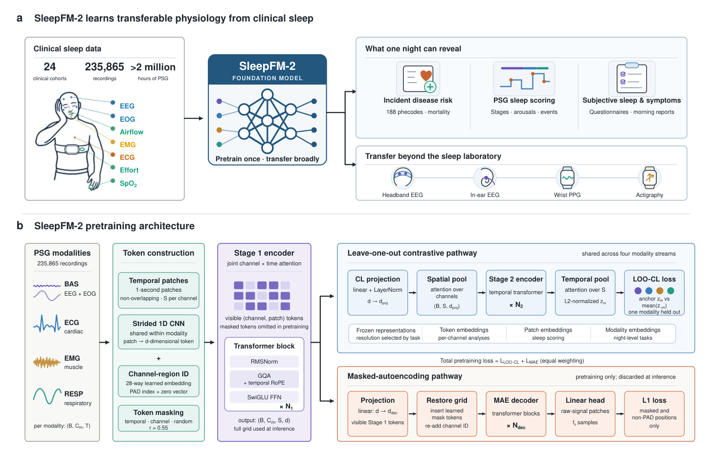
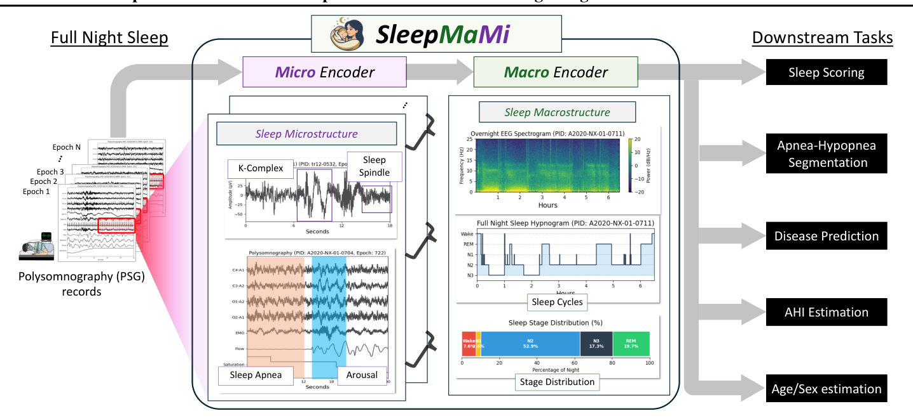
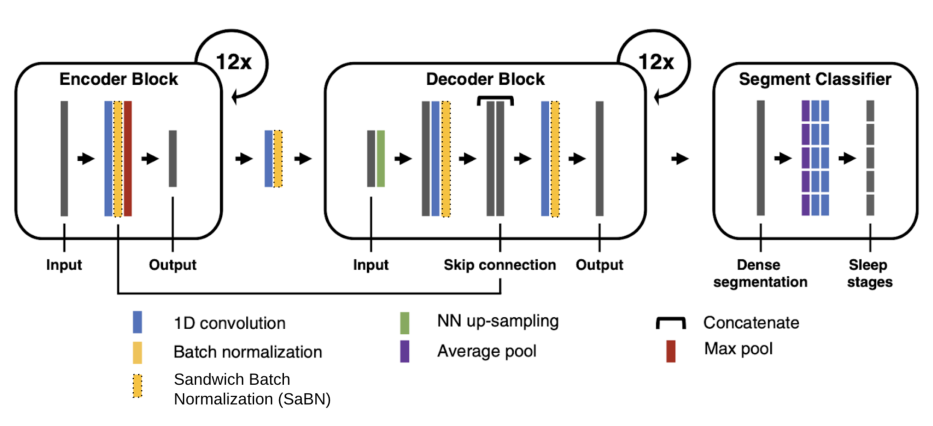

# 睡眠与心肺多模态基础模型 (Sleep & Cardiopulmonary Foundation Models)

睡眠是人体中枢神经系统、心血管网络与呼吸力学进行生理稳态重置的核心时段。本专题深入拆解以多导睡眠监测（PSG：EEG、EOG、EMG、ECG、PPG、Resp）及消费级穿戴设备为核心表征对象的代表性基础模型，剖析跨器官生物物理耦合、留一对比学习与掩码重构双流范式，以及从单夜睡眠表征外推百余种慢性疾病远期风险与穿戴端迁移的底层机制。

---

## 目录

- [1. 睡眠生理时序的独特性与表征挑战](#1-睡眠生理时序的独特性与表征挑战)
- [2. 代表性模型深度拆解](#2-代表性模型深度拆解)
  - [SleepFM](#sleepfm)
  - [SleepFM-2](#sleepfm-2)
  - [SleepMaMi](#sleepmami)
  - [U-Sleep](#u-sleep)
- [3. 经典公开睡眠数据集与评测基准](#3-经典公开睡眠数据集与评测基准)
- [4. 核心睡眠基础模型横向对比全景矩阵](#4-核心睡眠基础模型横向对比全景矩阵)
- [5. 对消费级穿戴（手表 PPG + ACC）睡眠监测的技术演进启示](#5-对消费级穿戴手表-ppg--acc睡眠监测的技术演进启示)
  - [5.1 消费级穿戴的四大技术演进方向](#51-消费级穿戴的四大技术演进方向)
  - [5.2 核心技术辨析：穿戴式 ACC 基模能否直接识别皮质微觉醒？](#52-核心技术辨析穿戴式-acc-基模能否直接识别皮质微觉醒)

---

## 1. 睡眠生理时序的独特性与表征挑战

临床医学与神经科学普遍将整夜睡眠视为评估全身机能退化、心血管事件与神经退行性病变的“自然生理压力测试窗口”。相比单一手腕脉搏波或孤立血糖曲线，睡眠多模态时序建模面临三个独特的生物物理挑战：

### 1.1 跨系统多器官生物物理耦合 (Brain-Heart-Lung Coupling)

在整夜睡眠过程中，人体经历高度动态的器官互锁与自主神经调节切换：
- **中枢脑神经（EEG / EOG）**：产生特征性的 $\delta$ 慢波（0.5～4 Hz，深度慢波睡眠 N3）、睡眠纺锤波（Sleep Spindles，11～16 Hz）、K-复合波（N2 期）以及快速眼球运动（REM 期）；
- **心血管系统（ECG / PPG）**：心率变异性（HRV）在非快速眼动期（NREM）呈现迷走副交感神经张力占优（心率平缓、呼吸性窦性心律不齐 RSA 显著），而在 REM 期交感神经突发活跃（心率与外周血管张力出现显著瞬态波动）；
- **呼吸力学系统（Resp Effort & Airflow）**：胸腹呼吸运动与口鼻气流维持气体交换稳态。若发生阻塞性睡眠呼吸暂停（OSA），上气道塌陷将引发连续数十秒的胸腹反相矛盾运动与动脉血氧饱和度（$\text{SpO}_2$）骤降，进而触发皮质微觉醒与交感神经兴奋风暴。

传统单模态模型仅针对单导联脑电提取特征，容易丢失**心肺耦合（Cardiopulmonary Coupling, CPC）** 与**脑-心-肺级联调控**的关键病理生理信息。

### 1.2 30 秒局部 Epoch 与整夜超长程时序的尺度断层

- **临床判读规则（AASM 标准）**：临床技师将整夜 7～9 小时信号按 **30 秒为一个切片（Epoch）**，划分为 5 个阶段：清醒（Wake）、浅睡期（N1、N2）、深睡期（N3 / 慢波睡眠 SWS）及快速眼动期（REM）。
- **多尺度矛盾**：
  - 微观尺度上，皮质微觉醒（Cortical Arousal）与周期性肢体抽动（PLMS）往往仅持续 **1.5～10 秒**，粗粒度切片极易将其平滑湮没；
  - 宏观尺度上，人类整夜睡眠由 4～6 个次昼夜周期（Ultradian Cycles，每周期约 90～120 分钟）组成。若孤立建模单个 30 秒切片而缺乏整夜上下文约束，模型在阶段转换边界处极易产生高频伪跳变。

### 1.3 临床 PSG 金标准与家庭消费级穿戴的模态鸿沟

- **医院多导睡眠监测（PSG）**：通常布置 16～24 个导联，涵盖多通道脑电（C3/C4/F3/F4/O1/O2）、双侧眼电（EOG）、下颌与胫前肌肌电（EMG）、心电（ECG）、口鼻气流、胸腹阻抗运动带、指尖透射式血氧（$\text{SpO}_2$）及体位传感器；
- **家庭消费级穿戴设备**：智能手表或手环通常仅具备腕部反射式光电脉搏波（PPG）与三轴加速度计（ACC）。
- **睡眠基础模型的核心使命**：在百万小时级全模态临床 PSG 上学习多器官联合表征空间，并通过跨模态对齐、知识蒸馏或物理代理通道映射，向下赋能低成本、无感佩戴的消费级终端。

---

## 2. 代表性模型深度拆解

### SleepFM

斯坦福大学 / DTU / BrainCapture 等 · [2024 前作](https://arxiv.org/abs/2405.17766) · [Nature Medicine 2026](https://doi.org/10.1038/s41591-025-04133-4) · [临床版代码](https://github.com/zou-group/sleepfm-clinical) · [临床版权重](https://github.com/zou-group/sleepfm-clinical/tree/main/sleepfm/checkpoints)

图源为 SleepFM-2 论文 Fig. 1。以下二代结果以 2026-10-02 的 arXiv v2 为准。

SleepFM 系列逐步扩大了多导睡眠记录的表征范围。2024 年工作首先在约 10 万小时记录上研究留一对比学习，2026 年临床版扩展了疾病预测，SleepFM-2 则增加局部重构、细粒度睡眠事件和跨设备迁移。

| 工作 | 数据与计数口径 | 方法与结果 | 证据入口 |
| :--- | :--- | :--- | :--- |
| SleepFM 2024 | 超过 14,000 名参与者，超过 10 万小时 PSG | 留一模态对比学习，睡眠分期 macro AUROC 0.88，睡眠呼吸障碍 AUROC 0.85 | [论文与实现](https://arxiv.org/abs/2405.17766) |
| SleepFM 临床版 | 约 65,000 名参与者，超过 585,000 小时 PSG | 多配置通道表征，130 个疾病结局达到 C-index ≥ 0.75 且通过多重比较校正 | [Nature Medicine 2026](https://doi.org/10.1038/s41591-025-04133-4) |
| SleepFM-2 | 开发与评测共 282,511 份记录、26 个队列，其中预训练 235,865 份记录、24 个队列，总语料超过 200 万小时 | LOO 对比与 MAE 联合训练，PSG 表征结合年龄、性别和 BMI 后，188 个表型在两个测试队列均达到预设标准 | [arXiv v2](https://arxiv.org/abs/2609.06849v2) |

临床版仓库提供基础编码器、疾病预测和睡眠分期检查点，采用 CC BY-NC 4.0 许可。复现需要区分论文完整预训练语料与仓库的 MESA 示例训练流程；官方说明该示例不复现论文主结果。[官方使用与许可说明](https://github.com/zou-group/sleepfm-clinical)

### SleepFM-2

斯坦福大学 / DTU / BrainCapture 等 · arXiv 2026 · [论文 v2](https://arxiv.org/abs/2609.06849v2)

论文的 Code availability 指向 `zou-group/sleepfm-v2-public`，但本轮检索（2026-11-04）该入口返回 404，未找到可访问的二代预训练权重。因此索引将临床版与二代分别登记，二代仅保留论文入口，待资源恢复后更新。[论文代码声明](https://arxiv.org/html/2609.06849v2)

#### 架构与适配

SleepFM-2 使用 1 秒分块、通道区域嵌入和两阶段时空 Transformer。局部 MAE 分支重构波形，较长时间尺度上的留一对比目标学习多模态表征。论文给出的编码器为 2.57M 参数，额外 0.96M 重构解码器仅用于预训练。固定数据和分块长度的架构消融，与最终 1 秒词元模型分开报告，二者的指标应按对应设置引用。[论文 Methods 与补充表 4-5](https://arxiv.org/abs/2609.06849v2)

#### 结果与证据边界

- 临床版在预训练中排除了 SHHS，并在该队列验证迁移。论文报告跨队列睡眠分期平均 F1 为 0.70-0.78，疾病预测包括死亡、痴呆和心肌梗死等结局。[临床版论文](https://doi.org/10.1038/s41591-025-04133-4)
- 二代的 188 个表型同时满足两个测试队列的 Harrell C-index ≥ 0.75 及 Bonferroni 校正 P < 0.01。其中 133 个还通过控制年龄、性别和 BMI 的增量信息检验。该结果使用 PSG 表征与人口统计变量，记录份数也应与独立参与者数分开解释。[二代论文 Results](https://arxiv.org/abs/2609.06849v2)
- 微觉醒、肢体运动和呼吸事件的 F1 分别为 0.601、0.604、0.462。前两项按事件计分，呼吸事件按秒计分，模型表现处于所观察专家的范围内。[二代论文 Fig. 3](https://arxiv.org/abs/2609.06849v2)
- 冻结编码器迁移到 BOAS 头带 EEG、EESM19 耳内 EEG、Wearanize+ 腕部 PPG 后，睡眠分期 macro-F1 分别为 0.721、0.746、0.531。这些迁移实验仍训练下游预测头。腕部 ACC 的 UK Biobank 疾病预测平均 C-index 为 0.687，对照 ACC 预训练模型为 0.688，配对差值置信区间包含零。[二代论文 Fig. 4](https://arxiv.org/abs/2609.06849v2)

评注。此系列值得保留为多器官表征和临床向可穿戴迁移的主要路线。选型时应同时记录编码器是否冻结、预测头是否训练、使用哪些人口统计变量以及目标设备可用通道。研究中的疾病预测相关性仍需在目标人群中验证。

---

### SleepMaMi

首尔大学 · ICML 2026 · [正式论文](https://proceedings.mlr.press/v306/park26n.html) · [arXiv v3](https://arxiv.org/abs/2602.07628v3) · [代码与检查点入口](https://github.com/keondopark/SleepMaMi)

图源：SleepMaMi 论文 Fig. 1（ICML 2026 / arXiv:2602.07628），原图内容不变。

SleepMaMi 的微观编码器以共享与私有 Transformer 处理 30 秒多模态 PSG，通过掩码重构与跨模态对比学习保留局部信号信息。宏观编码器采用双向 Mamba 汇聚整夜序列，以年龄、性别与 BMI 构造人口统计学引导的对比目标。预训练包含 20,964 份记录、158,028 小时；记录份数不能直接视为独立受试者数。[论文第 3 节](https://arxiv.org/html/2602.07628v3)

在 v3 的冻结编码器线性探测中，SHHS1、KISS、CFS、SOF 睡眠分期 macro-F1 分别为 0.741、0.700、0.712、0.652；SHHS1 使用 LSTM 预测头的另一协议得到 0.790，应与线性探测分开比较。论文还评估秒级睡眠呼吸障碍分割与 SHHS1 疾病历史分类，不能把这些结果统一表述为远期疾病预测。[论文 Table 1、Table 17 与第 4.1 节](https://arxiv.org/html/2602.07628v3)

评注。该工作值得作为局部波形与整夜结构联合建模的对照。人口统计学引导目标可能保留人群差异，应用时需增加年龄、性别和 BMI 基线，检查跨队列迁移。官方仓库列出微观、宏微观及睡眠分期三类检查点入口和推理流程，使用时需匹配相应预处理与预测头。[官方实现](https://github.com/keondopark/SleepMaMi)

---

### U-Sleep

> **发表信息**：npj Digital Medicine 2021 · [论文](https://doi.org/10.1038/s41746-021-00440-5) · [代码](https://github.com/perslev/U-Sleep)  
> **机构**：哥本哈根大学 (University of Copenhagen)  
> **研究数据**：训练与评测合计覆盖 15,660 名参与者、16 项临床研究；该模型作为有监督分期对照收录。 
> **开源状态**：开源完整代码与预训练模型权重

图源：U-Sleep 论文架构图（npj Digital Medicine 2021）

U-Sleep（*U-Sleep: resilient high-frequency sleep staging*）是公开的端到端全卷积睡眠分期系统。它使用有标签数据训练，与自监督睡眠基础模型的训练范式不同。[正式论文](https://doi.org/10.1038/s41746-021-00440-5)

- **1D 全卷积深层 U-Net 结构**：摒弃了传统“先按 30 秒提取特征、再用 Bi-LSTM/CRF 串联”的两阶段流水线，直接接收整夜数百万采样点的连续原始波形（统一重采样至 128 Hz），通过 12 层编码器下采样压缩时间尺度，再经跳跃连接（Skip Connections）与解码器上采样输出任意时间粒度（最高支持逐秒级）的睡眠分期概率流。
- **任意导联组合容错性**：训练时随机采样任意单通道脑电与单通道眼电组合，使其在推理时面对不同医院导联配置甚至单导联穿戴脑电时，仍能保持稳定的分期精度（Macro-F1 约 0.79～0.81）。

---

### 待核查候选

[PFTSleep](https://github.com/benmfox/PFTSleep) 保留为全夜睡眠表征方向的候选。后续需核对完整训练协议、权重访问条件，并区分直接外部测试与加入外部队列训练预测头后的结果，再决定是否新增索引条目。候选状态截至 2026-11-04。

## 3. 经典公开睡眠数据集与评测基准

大规模高质量多导睡眠监测（PSG）公开数据库是训练与评测睡眠基础模型的基石：

| 数⁠据⁠集⁠名⁠称 | 主⁠导⁠机⁠构 | 样⁠本⁠规⁠模 | 涵⁠盖⁠模⁠态⁠通⁠道 | 核⁠心⁠特⁠色⁠与⁠临⁠床⁠价⁠值 | 获⁠取⁠途⁠径 |
| :--- | :--- | :--- | :--- | :--- | :--- |
| **[SHHS](../datasets/wearable_datasets.md#shhs)** (Sleep Heart Health Study) | 美国 NIH / NHLBI | 5,804 名中老年人（>15 年随访） | 完整 PSG（EEG, EOG, EMG, ECG, 胸腹呼吸, $\text{SpO}_2$） | 研究睡眠呼吸障碍与心衰、卒中、全因死亡率关联的金标准流行病学队列 | NSRR 签约免费申请 |
| **[MESA](../datasets/wearable_datasets.md#mesa)** (Multi-Ethnic Study of Atherosclerosis) | 美国 NHLBI 多中心 | 2,237 名四族裔成年人 | 完整 PSG + **连续 7 天腕部体动仪 Actigraphy** | 兼具多族裔代表性、心血管钙化硬终点与“临床 PSG + 腕戴体动”配对记录 | NSRR 签约免费申请 |
| **[Sleep-EDF Expanded](../datasets/wearable_datasets.md#sleep-edf)** | 荷兰神经研究所 / PhysioNet | 197 份整夜记录 | 2 通道 EEG (Fpz-Cz / Pz-Oz), EOG, EMG, 口鼻呼吸 | 睡眠分期领域引用最广的免审批基准，适合算法快速原型验证 | PhysioNet 直接下载 |
| **ISRUC-Sleep** | 葡萄牙科英布拉大学 | 118 例受试者（含睡眠呼吸暂停与健康对照） | 6 通道 EEG, 2 通道 EOG, 3 通道 EMG, ECG, 呼吸 | 提供多位资深技师独立给出的双盲睡眠分期与微觉醒标注，常用于评测观察者间一致性 | 官方网站公开下载 |
| **[Stanford Sleep Bench](https://arxiv.org/abs/2512.09591)** | 斯坦福大学 / DTU | 17,467 份记录，超过 163,000 小时 | 多模态 PSG | 比较睡眠分期、呼吸暂停、年龄及 13 个疾病/死亡结局 | 按论文与数据平台的访问条件获取 |

> [!NOTE]
> **美国国家睡眠研究资源库（[National Sleep Research Resource, sleepdata.org](https://sleepdata.org/)）** 是获取 SHHS、MESA、MrOS、WSC、CFS 等数十万小时临床 PSG 数据的核心枢纽，学术研究者在线签署标准数据使用协议（DUA）后通常数日内即可获批高速下载。

---

## 4. 核心睡眠基础模型横向对比全景矩阵

| 评⁠估⁠维⁠度 | SleepFM 临床版 | Stanford SleepFM-2 | 首⁠尔⁠大⁠学 SleepMaMi | 哥⁠本⁠哈⁠根⁠大⁠学 U-Sleep |
| :--- | :--- | :--- | :--- | :--- |
| **核⁠心⁠定⁠位** | 多器官耦合对比学习基座 | 多模态睡眠与跨设备表征 | 宏微观分层双编码器基座 | 全卷积端到端高频分期基准 |
| **骨⁠干⁠架⁠构** | 1D-CNN + 标准 Transformer | 两阶段 Transformer（RMSNorm / SwiGLU / RoPE） | 共享/私有 Transformer + 双向 Mamba | 1D 全卷积深层 U-Net |
| **编⁠码⁠器⁠参⁠数⁠量** | 4.83M | **2.57M（精简 47%）** | 未统一报告 | 约 3.1M |
| **预⁠训⁠练⁠范⁠式** | 留一对比学习（LOO-CL） | **LOO-CL（宏观）+ 混合掩码 MAE（微观）** | 人口统计引导对比 + 局部 MAE | 有监督端到端交叉熵训练 |
| **数据规模与口径** | 58.5 万小时（6.5 万人） | 总语料 200+ 万小时；预训练 235,865 份记录、24 队列 | 158,028 小时（20,964 份记录） | 训练与评测合计 15,660 人、16 项研究 |
| **时⁠间⁠切⁠片⁠粒⁠度** | 30 秒窗口 / 5 秒 Token | **30 秒窗口 / 1 秒 Token** | 30 秒切片 + 整夜序列 | 128 Hz 采样流（支持逐秒输出） |
| **空⁠间⁠导⁠联⁠处⁠理** | 早期通道注意力池化 | 28 类通道区域嵌入 | 局部通道掩码 | 随机单通道 EEG + EOG 组合 |
| **睡⁠眠⁠分⁠期⁠表⁠现** | 平均 F1 0.70-0.78（跨队列） | Macro-F1 0.716-0.818（七个队列） | 线性探测 Macro-F1 0.652-0.741（四队列） | Macro-F1 0.79～0.81 |
| **秒⁠级⁠临⁠床⁠微⁠事⁠件** | 未评测秒级事件 | **微觉醒 (F1 0.601)、PLMS (0.604)、呼吸事件** | 评估秒级睡眠呼吸障碍分割 | 不支持微觉醒与肢体抽动 |
| **远⁠期⁠慢⁠病⁠预⁠测** | 130 个结局（C-index ≥ 0.75） | **188 个表型（两队列 C-index ≥ 0.75）** | SHHS1 疾病历史分类，非远期随访 | 不支持 |
| **消⁠费⁠级⁠穿⁠戴⁠迁⁠移** | 概念探讨 | **冻结编码器迁移 + 训练预测头，腕部 PPG F1 0.531** | 概念探讨 | 仅支持便携单通道脑电 |
| **开⁠源⁠状⁠态** | 代码与权重可得，CC BY-NC 4.0 | 论文提供的代码入口当前不可访问，权重未找到 | 官方仓库列出代码与检查点入口 | 代码与预训练权重可得 |

---

## 5. 对消费级穿戴（手表 PPG + ACC）睡眠监测的技术演进启示

### 5.1 消费级穿戴的四大技术演进方向

SleepFM-2 的实验支持跨设备表征迁移，也提示需要把输入信号、预测目标与适配过程分别记录。以下前两项来自论文实验，后两项为可进一步验证的工程设想。[SleepFM-2 v2 第 2.4 节及补充方法](https://arxiv.org/abs/2609.06849v2)

| 方向 | 已有证据与可执行实验 | 边界 |
| :--- | :--- | :--- |
| 从 PSG 向腕部 ACC 迁移 | 作者用滤波得到呼吸与心脏代理通道，验证睡眠分期与 UK Biobank 疾病风险预测 | 代理通道是输入适配，不能据此认为 ACC 测到了与临床导联完全相同的信号 |
| 从 PSG 向便携 EEG 和腕部 PPG 迁移 | 冻结编码器、训练预测头，比较头带、耳内 EEG 和 PPG 的睡眠分期结果 | 冻结编码器仍需要下游标注与适配训练 |
| 配对 PSG 与腕戴数据蒸馏 | 可用同步记录比较教师监督、直接迁移与腕戴自监督三种方法 | 属于后续研究设计，本论文未证明所需样本量或端侧部署效果 |
| 短时事件与整夜表征结合 | 可在同一数据切分下考察分块长度、序列头与人口统计变量的增量 | 应分别报告事件定位、分期和风险预测，避免把一个任务的改进外推到另一任务 |

在 UK Biobank 的配对比较中，SleepFM-2 与专用加速度模型的平均 C-index 分别为 0.687 和 0.688，二者均加入年龄、性别和 BMI。平均统计覆盖测试集中存在事件的 388 个结局，配对差值为 −0.0015，95% CI 为 −0.0067 至 0.0033。该结果支持特定任务和队列上的相近点估计，尚不能推出临床睡眠数据能普遍替代腕戴预训练语料。[论文 Fig. 4 与补充表 13](https://arxiv.org/abs/2609.06849v2)

### 5.2 核心技术辨析：穿戴式 ACC 基模能否直接识别皮质微觉醒？

SleepFM-2 的跨设备迁移实验没有建立这一结论。论文的微觉醒检测 F1 为 0.601，来自临床 PSG 与专家标注的事件评估。腕部 ACC 的睡眠分期和疾病风险预测属于不同任务，不能用这些结果替代微觉醒事件级评测。[论文 Fig. 3-4](https://arxiv.org/abs/2609.06849v2)

同样，BOAS 头带 EEG 的 0.721、EESM19 耳内 EEG 的 0.746 和 Wearanize+ 腕部 PPG 的 0.531 都是睡眠分期 macro-F1。它们体现了冻结编码器加预测头的迁移能力，没有直接证明这些设备上的微觉醒检测精度。[论文补充表 11](https://arxiv.org/abs/2609.06849v2)

评注。若目标是用 PPG/ACC 估计微觉醒，应另建同步 PSG 的事件标注评测，区分体动、心血管变化与脑电标注事件，并报告按事件计算的敏感度、误报率和跨设备泛化。外周变化的判定阈值需要数据支持，其与临床微觉醒的对应关系也需要单独验证。便携 EEG 的方法对照可参见 [脑电基础模型专题](eeg_models.md)。

---

> **欢迎交流与共建** 
> 本文由开源知识库项目 [Wearable-Physiological-Foundation-Models](https://github.com/tujy859/Wearable-Physiological-Foundation-Models) 整理策划。该项目持续追踪全球在智能手表、连续血糖监测（CGM）以及多模态生理健康基础模型领域的最新突破。如果您对可穿戴生理计算、时序健康基模与数字生物标志物有任何想法，欢迎在仓库提 Issue 交流！
