# 智能手表与腕戴生理基础模型深度解析

腕戴设备（智能手表、智能手环）已成为普及度最高的消费级生理监测终端。本专题深入解构针对光电容积脉搏波（PPG）、三轴加速度计（ACC/IMU）及微弱体表心电（ECG）研发的专用时序基础模型，梳理其对抗运动伪影、多速率对齐、跨模态生成以及端侧轻量化部署的底层技术演进。

## 目录

- [1. 腕戴生理时序的独特性与核心技术挑战](#1-腕戴生理时序的独特性与核心技术挑战)
- [2. 经典多模态与波形形态基础模型](#2-经典多模态与波形形态基础模型)
  - [SensorFM](#sensorfm)
  - [PaPaGei](#papagei)
  - [Pulse-PPG](#pulse-ppg)
  - [xMAE](#xmae)
  - [HiMAE](#himae)
  - [UniCardio](#unicardio)
  - [PPGFlowECG](#ppgflowecg)
  - [AnyPPG](#anyppg)
  - [SigmaPPG](#sigmappg)
- [3. 端侧轻量化、生物年龄与大一统评测基准](#3-端侧轻量化生物年龄与大一统评测基准)
  - [PPG-Distill](#ppg-distill)
  - [PpgAge](#ppgage)
  - [开源脉搏基础模型生物年龄横评](#开源脉搏基础模型生物年龄横评)
  - [PPG-Bench](#ppg-bench)
- [4. 空间运动与跨专题基模索引](#4-空间运动与跨专题基模索引)
  - [LIMU-BERT](#limu-bert)
  - [Mantis](#mantis)
  - [SleepFM](#sleepfm)
- [5. 大规模开源生态与时序语言多模态基座](#5-大规模开源生态与时序语言多模态基座)
  - [OpenMHC](#openmhc)
  - [PPG-LM](#ppg-lm)
  - [SensorLM](#sensorlm)
- [6. 核心基础模型横向对比矩阵](#6-核心基础模型横向对比矩阵)
- [7. 对自建手表大模型 (Watch-LSM) 的工程架构启示](#7-对自建手表大模型-watch-lsm-的工程架构启示)
- [8. 核心文献与资源汇总](#8-核心文献与资源汇总)

---

## 1. 腕戴生理时序的独特性与核心技术挑战

与抽象的通用单变量时序（如金融气象）不同，智能手表采集的生理流具备强物理与生物先验：

1. **异构采样率与多模态物理对齐 (Multi-Rate Heterogeneity)**：
   - **PPG (光电脉搏)**：常见采样率 25 Hz、50 Hz、64 Hz 或 100 Hz，波形由微血管收缩期充血与舒张期弹性回缩构成，包含收缩峰（Systolic Peak）、重搏切迹（Dicrotic Notch）及舒张峰（Diastolic Peak）；
   - **ACC (三轴加速度计)**：常见采样率 25 Hz 或 50 Hz，记录人体在空间三维的正交加速度矢量 $(a_x, a_y, a_z)$；
   - **ECG (偶发心电)**：250～1000 Hz，用户主动按压表冠或电极时触发；
   - **低频慢速指标**：皮肤温度（Skin Temp, 0.1 Hz）、皮电反应（EDA, 4 Hz）、气压高度计（1 Hz）。
2. **严重的运动伪影与频域碰撞 (Spectral Collision)**：
   - 手臂摆动、跑步落足引起的微小形变与静脉血液惯性流动，使光学传感器接收到的漫反射光被剧烈调制；
   - **致命碰撞**：日常跑步步频谐波（1.0～3.5 Hz，即 60～210 SPM）与人体运动心率主频（1.2～3.2 Hz，即 70～190 BPM）完全重叠。传统经验带通滤波或峰值拾取（Peak-Picking）极易把步频误当心率，导致误差超过 50 BPM。
3. **极度受限的端侧计算资源**：
   - 智能手表电池通常仅 200～500 mAh，运行在 ARM Cortex-M 或低功耗 Cortex-A 核心上，要求模型参数小（<5M）、推理延迟低（<5 ms）且满足整型定点量化。

---

## 2. 经典多模态与波形形态基础模型

### SensorFM

Google Research / Fitbit Health AI · 2026 · [论文](https://arxiv.org/abs/2605.22759)

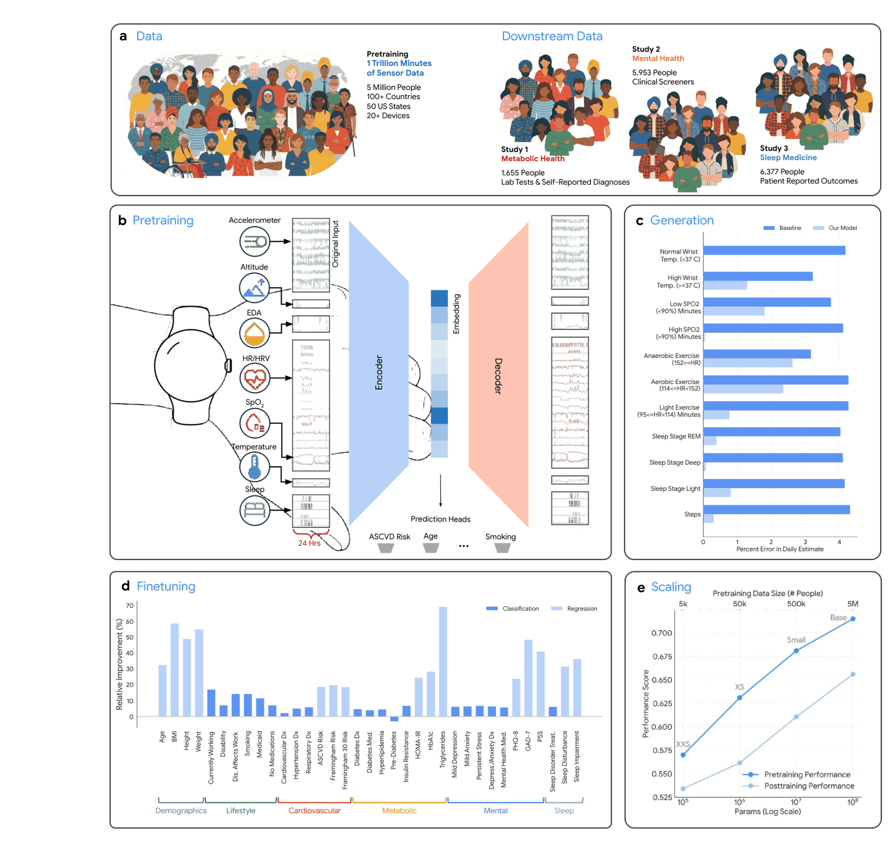

图源：SensorFM 论文 Fig. 1（*Towards a General Intelligence and Interface for Wearable Health Data*, arXiv:2605.22759）

SensorFM 是面向穿戴传感器时序构建的超大规模多模态基础模型，系统验证了万亿分钟级穿戴数据下的 Scaling Law。

#### 1. 核心规模与数据构成

- **数据总量**：超过 **1 万亿分钟（>1,000,000,000,000 分钟）** 的真实可穿戴多模态时序；
- **用户基数**：超过 **500 万**名经过知情同意的 Fitbit 与 Google Pixel Watch 全球真实用户；
- **传感器模态**：绿光 / 红外 PPG、三轴 ACC、皮电反应（EDA）、皮肤温度、气压高度计；
- **开源状态**：论文已发布；模型权重与代码闭源（商业生态核心资产）。

#### 2. 核心架构与自监督算法

- **统一时间分块 (Multi-Rate Patch Tokenization)**：
  - 摒弃了简单粗暴的插值重采样，采用固定物理时间窗口（Physical Time Slice）作为统一的 Patch 跨度；
  - 为不同速率的传感器配备独立的线性投影嵌入层（Sensor-Specific Embedding），附加时间位置编码后输入统一的双向 Transformer 编码器。
- **复合预训练目标**：
  - **Masked Multimodal Modeling**：在时域和模态域进行随机多维掩码，训练 Transformer 联合重建被遮蔽的生理片段；
  - **Cross-Modal Infilling**：模拟硬件传感器掉线或低功耗节能策略（例如夜间关闭高耗电 PPG 仅开启低功耗 ACC），由存活模态在隐空间推断缺失模态表征。

#### 3. 下游任务与 Scaling 验证

- 在 **35 个下游健康与行为预测基准**上进行了迁移评估，横跨四大领域：
  1. **心血管健康**：静息心率、运动恢复心率、HRV、血压趋势、最大摄氧量（VO2 Max）；
  2. **代谢与活动**：步频能量消耗、高强度运动类型识别、代谢综合征风险评估；
  3. **睡眠与神经**：睡眠深浅分期、REM 快速眼动期、阻塞性睡眠呼吸暂停；
  4. **情绪与压力**：EDA 突变检测与全天候生理压力指数。
- **关键结论**：在 35 项任务中的 **34 项**击败了此前针对单一任务精调的专用模型，在生理信号领域完整验证了 Scaling Law 的泛化飞轮。

---

### PaPaGei

Nokia Bell Labs / 剑桥大学 / 达特茅斯学院 · ICLR 2025 · [论文](https://arxiv.org/abs/2410.20542) · [代码](https://github.com/Nokia-Bell-Labs/papagei-foundation-model) · [权重](https://zenodo.org/records/13983110)

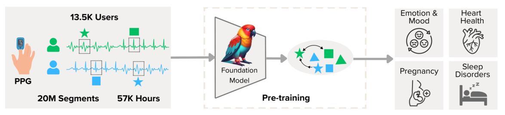

图源：PaPaGei 论文 Fig. 1（*PaPaGei: Open Foundation Models for Optical Physiological Signals*, ICLR 2025）

PaPaGei 是面向光学脉搏波（PPG）微观形态研发的经典开源生理基础模型。

#### 1. 核心架构：ResNet1D-MoE

- **输入设定**：10 秒长度的单通道 PPG 信号，统一重采样至 125 Hz（单样本 1,250 点），并经过自适应 Z-score 标准化；
- **网络结构**：
  - 18 个 1D 残差卷积块（ResNet Blocks），基础特征通道 32；
  - 引入 3 个混合专家（Mixture of Experts, MoE）分支，基于瞬态脉搏形态动态路由特征；
  - 全局平均池化输出 **512 维**潜空间表征，参数量仅约 **1.5M**。

#### 2. 形态感知对比学习 (Morphology-Aware Pretraining)

- **破除经典对比学习在生理信号上的缺陷**：
  - 传统 SimCLR / BYOL 若将“同一用户不同时刻”视作正样本，会强制拉近该用户的平静心率波形与剧烈运动波形，从而抹杀血管阻抗、瞬时搏动的微形态特征；
- **形态引导配对采样 (Morphology-Guided Pair Sampling)**：
  - 提取波形收缩期上升斜率、舒张期凹槽深浅等生理先验，构建连续动态对比正负样本对，迫使模型保留心血管动力学特异性。

#### 3. 下游评测

- 整合 10 个公开数据集（VitalDB、MIMIC、CAPNO、WESAD、PPG-DaLiA 等），覆盖 20 项下游任务：
  - 心率回归（HR Regression，MAE 约 1.2～3.5 BPM）；
  - 血压估计（收缩压 / 舒张压 MAE 约 5～8 mmHg）；
  - 血管弹性生理年龄（Vascular Age）；
  - 睡眠呼吸暂停检测（Sleep Apnea，F1 > 0.82）。

---

### Pulse-PPG

孟菲斯大学 / UIUC · UbiComp 2025 · [代码](https://github.com/maxxu05/pulseppg)

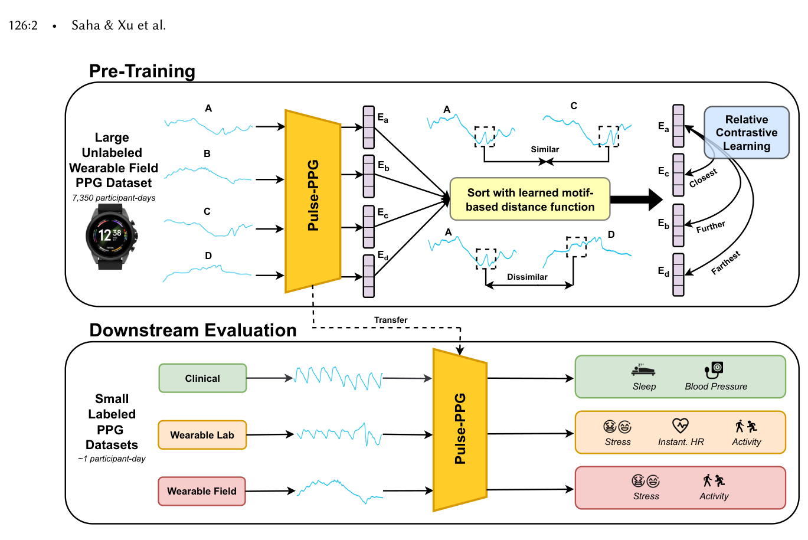

图源：Pulse-PPG 论文 Fig. 1（*Pulse-PPG: An Open-Source Field-Trained PPG Foundation Model for Wearable Applications Across Lab and Field Settings*, UbiComp 2025）

Pulse-PPG 聚焦于真实野外非受限生活场景下的手腕脉搏波建模，攻克了临床平躺数据向真实手腕迁移时的领域漂移问题。

#### 1. 解决临床数据到手表的域漂移 (Clinical-to-Field Domain Shift)

- **临床数据的虚假干净**：MIMIC、VitalDB 中患者多处于麻醉或静卧状态，探头紧贴指尖，波形几乎无运动伪影；而在真实手腕上，受试者跑步、洗手、打字时信号信噪比急剧恶化；
- **大规模真实野外语料**：采集 120 名受试者连续 100 天自由生活（Free-living）的真实腕戴数据，有效野外 PPG 数据量达 **2 亿秒（约 5.5 万小时）**。

#### 2. 相对对比学习 (Relative Contrastive Learning, RelCon)

- 放弃离散的 Positive / Negative 二元分类损失；
- 引入连续相似度衰减机制：将**时序物理间隔**与**三轴加速度计测算的受试者瞬时运动量**联合编码为连续权重，构建具备自适应温度调节的连续对比损失：
  $$
  \mathcal{L}_{\text{RelCon}} = - \sum_{i} \log \frac{\sum_{j} w(i, j) \cdot \exp(\text{sim}(z_i, z_j)/\tau)}{\sum_{k} \exp(\text{sim}(z_i, z_k)/\tau)}
  $$
- **架构**：12 层 1D ResNet，采用大卷积核（Kernel Size = 11）以充分覆盖跨心动周期的长程时间依赖。在野外跨域生物年龄与高噪心率追踪中显著胜过仅在临床数据上训练的对比基线。

---

### xMAE

Samsung Research America / UCLA · ICML 2024

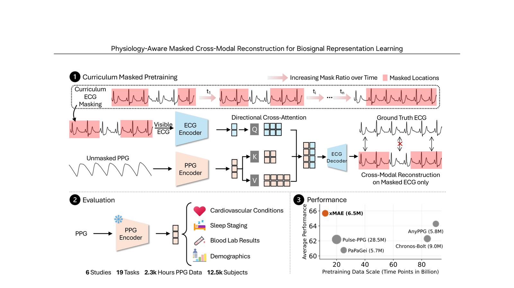

图源：xMAE 论文 Fig. 2（ICML 2024）

xMAE 探索了将全天候手腕 PPG 映射为高临床价值心电图（ECG）表征的跨模态虚拟传感（PPG → 虚拟 ECG）方案。

- **临床矛盾**：心电图（ECG）具备极高的心脏电生理诊断价值，但智能手表要求用户另一手长按表圈电极形成回路，无法做到全天候被动连续监测；而背部光学 PPG 可 24 小时被动采集，但信息维度较低、噪声剧烈；
- **训练方案**：
  - 基于 9,400 小时配对同步采集的 ECG-PPG 数据集；
  - 将高精度 ECG 信号大比例掩码（如 75%），以配对的腕部 PPG 为上下文条件，训练 Cross-Modal Transformer 重建被掩码的 ECG 潜表征；
- **落地效果**：推理期无需用户触碰表圈，仅凭日常 PPG 即可连续提取富含心脏电生理（如 QRS 复合波间期、心肌缺血特征）的高阶潜表征。

---

### HiMAE

Samsung Research America / UCLA · ICLR 2026 · [论文](https://arxiv.org/abs/2510.25785) · [代码](https://github.com/Simonlee711/HiMAE)

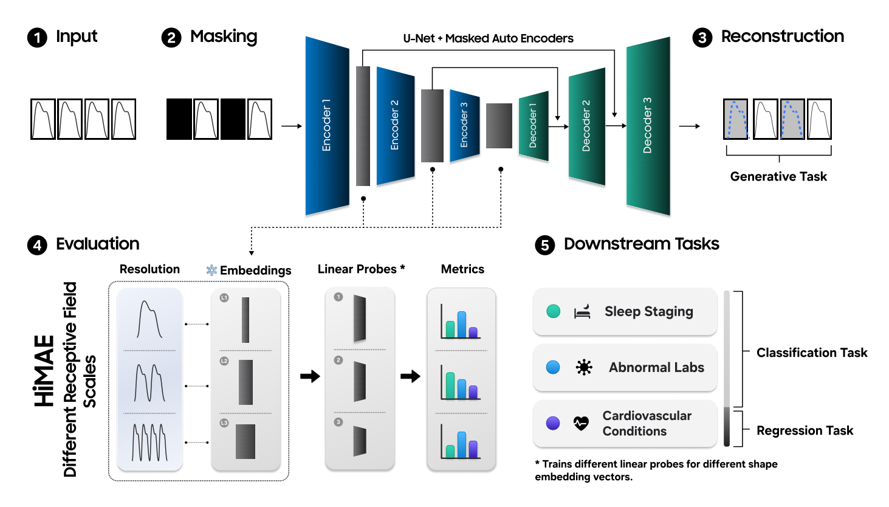

图源：HiMAE 论文 Fig. 1（*HiMAE: Hierarchical Masked Autoencoders Discover Resolution-Specific Structure in Wearable Time Series*, ICLR 2026）

HiMAE 是专为智能手表 CPU 研发、实现**亚毫秒级（<1 ms）纯腕上端侧实时推理**的分层 1D 卷积掩码自编码器基础模型，提出并严密验证了生理表征学习的“时间分辨率假说”。

#### 1. 核心立论：归纳偏置反思与“时间分辨率假说 (The Resolution Hypothesis)”

1. **反思通用 ViT 在生理时序上的盲目应用**：
   - 计算机视觉与通用时序领域常默认采用 Transformer 骨干，假定“全局自注意力和巨量参数能够解决一切”。然而，腕戴生理信号（PPG、ECG）本质上是由心脏搏动、自主神经系统调节与外周血管舒缩等少数生物物理潜在过程驱动的**低维、强局部性、高节律性**物理时序；
   - 扁平的 ViT / Transformer 强制全局 token 交互，不仅需要动辄上百兆（110M+）参数容易过拟合，更会破坏生理时序固有的局部形态结构与时间层次性，且无法常驻手表端芯片（超出手表内存与功耗门槛）；
2. **分辨率假说（The Resolution Hypothesis）**：
   - **时间分辨率（Receptive Field / Effective Temporal Context）不是一个单纯的模型超参数，而是生理表征学习的基本轴（Fundamental Axis）**；
   - 不同的临床与行为健康指标依赖于完全不同尺度的时序结构：从毫秒级单心拍几何形态，到数秒级多心跳心率变异性（HRV），再到跨周期节律。基础模型应显式解耦并保留多尺度层级表征，而非粗暴折叠为单一全局向量。

#### 2. 核心架构：1D 卷积 U-Net 与物理时间尺度严格映射

- **输入设定**：固定长度 $T = 10\text{ s}$ 的单通道绿光 PPG 信号，采样率 $f_s = 100\text{ Hz}$（单样本序列长度 $L = 1000$ 采样点，每个点严格对应 $10\text{ ms}$）。10 秒窗口是临床心电 / 脉搏诊断的金标准跨度；
- **5 级残差卷积 U-Net 骨干**：
  - 编码器采用 5 级残差块，每级通过 Stride-2 卷积进行时间维度 2 倍下采样，通道维度逐步扩增：$[16, 32, 64, 128, 256]$；
  - 随着层级加深，特征图点数从 $1000 \to 500 \to 250 \to 125 \to 62 \to 31$，有效感受野按指数级扩张；
  - 解码器采用对称的转置卷积逐步上采样，并通过 **Skip Connections** 直接拼接编码器对应的浅层高分辨率特征，最终通过 `tanh` 输出归一化重构信号。
- **层级深度与物理时间尺度的数学映射表**：

| 网⁠络⁠层⁠级 (Stage) | 特⁠征⁠点⁠数 ($L_\ell$) | 感⁠受⁠野⁠点⁠数 ($R_\ell$) | 物⁠理⁠时⁠间⁠跨⁠度 ($R_\ell \times 10\text{ ms}$) | 对⁠应⁠时⁠间⁠尺⁠度 | 生⁠理⁠学⁠物⁠理⁠意⁠义⁠与⁠对⁠应⁠事⁠件 |
| :--- | :---: | :---: | :---: | :---: | :--- |
| **Enc 1 (浅⁠层)** | 500 点 | $5 \sim 13$ 点 | **$50 \sim 130\text{ ms}$** | **毫秒级 (ms)** | **心拍微观瞬态形态**：收缩期上升支斜率、收缩峰顶点、重搏波切迹 (Dicrotic Notch) |
| **Enc 2 (中⁠浅⁠层)** | 250 点 | $21 \sim 37$ 点 | **$210 \sim 370\text{ ms}$** | **亚秒级 (数百 ms)** | **单次心室射血与充盈期**：局部脉搏波传导与血管顺应性响应 |
| **Enc 3 (中⁠层)** | 125 点 | $53 \sim 85$ 点 | **$530 \sim 850\text{ ms}$** | **约 1 秒级** | **完整单心动周期 (Cardiac Cycle)**：对应正常人单个完整心跳（60～100 BPM） |
| **Enc 4 (中⁠深⁠层)** | 62 点 | $117 \sim 181$ 点 | **$1.17 \sim 1.81\text{ s}$** | **秒级 (多心拍)** | **跨心搏间期交互**：2～3 跳相邻搏动差异、偶发早搏后的代偿间歇 |
| **Enc 5 (深⁠层/瓶⁠颈)** | 31 点 | $245 \sim 373+$ 点 | **$2.45 \sim 3.73\text{ s+}$** | **多秒级宏观** | **宏观血流动力学包络**：呼吸性窦性心律不齐 (RSA)、自主神经低频节律、基线包络漂移 |

#### 3. 自监督预训练目标：高掩码率与混合掩码机制

- **Patch 划分**：划分为无重叠的 Patch，长度 $P = 5$（总计 200 个 Patches）；
- **极高掩码率**：掩码比例 $r = 0.8$（高达 80% 的信号被遮盖）；
- **随机掩码与连续跨度掩码交替 (Hybrid Masking)**：
  - **均匀随机掩码 (Random Masking)**：迫使模型基于周围局部相关性推理丢失点；
  - **连续块掩码 (Contiguous Masking)**：连续遮蔽大块相邻区域，专门逼真模拟智能手表在日常晃动、传感器滑动及汗液干扰下的瞬态丢信号与伪影遮挡；
- **损失函数**：仅在被遮盖区域计算均方误差损失 $\mathcal{L}_{\text{MSE}}$，迫使模型利用多尺度分层先验进行高阶时序推断。

#### 4. 8 万小时工业级数据与三道严苛 SQI 质控防线

- **数据语料**：涵盖 7 款三星智能手表（Galaxy Watch Active 2、Watch 3、Gear S3 等），收集自 **47,644 名**真实用户，总计约 **80,000 小时**的手腕绿光 PPG 时序，覆盖美、韩、巴西、孟加拉国 4 个国家；
- **三道严苛信号质量控制 (SQI) 过滤网**：
  1. **振幅偏度修剪 (Amplitude Skewness Trimming)**：计算 Z-score 幅度绝对值的偏度 $\gamma$。若 $\gamma > 2$（代表存在重尾的剧烈手腕甩动伪影冲击），执行迭代削峰截断，若仍无法正态化则从根本上丢弃；
  2. **自相关周期散度检验 (Autocorrelation Dispersion)**：计算样本自相关函数 $r[k]$ 零交叉点的离散度 $\sigma_{\text{zc}}$。真实的生理搏动具有强准周期性，该机制能精准识别并剔除因表带松脱或脱手引起的无周期杂波；
  3. **形态模板契合度 (Canonical Template Matching)**：经过 0.1～2 Hz 带通滤波后，与标准脉搏波模板比对，计算有效覆盖率 $p$ 与契合度 $a$ 的调和平均数 $H(a, p) = \frac{2ap}{a+p}$，仅保留高一致性生理片段。

#### 5. 核心评测发现：多尺度探针证实“尺度-疾病严格对齐”

HiMAE 在预训练后冻结骨干，通过对 5 个不同层级的隐空间特征分别训练线性分类器（Linear Probes），在 12 项分类任务上系统证实了“分辨率假说”：

1. **心血管急症与血管阻抗偏好“浅层毫秒级 (Enc 1～2)”**：
   - **室性早搏 (PVC Detection)** 与**高血压分类 (Hypertension)** 在第 1～2 层（50～370 ms）达到最高 AUROC；
   - **机理**：早搏由心室异位起搏点触发，表现为心拍内部的单点几何畸形；高血压表现为外周小动脉阻力增高导致反射波提前叠加切迹变形。两类任务本质由**局部波形微形态**主导；
2. **睡眠分期与生化异常偏好“深层多秒级 (Enc 4～5)”**：
   - **4 分类睡眠分期 (DREAMT 黄金 PSG 标注)** 以及 **7 种临床化验血液指标异常 (Tulane 大学数据集)** 均在第 4～5 层（2～4 秒以上）达到最高 AUROC；
   - **机理**：血液检验指标（HbA1c 糖化血红蛋白、血小板、白细胞 WBC、血红蛋白等）以及深浅睡眠并非单拍即时形态，而是通过全身微循环床顺应性改变、交感 / 副交感神经张力调制，体现在**多心拍间的瞬态统计变异与包络波动**上。

#### 6. 智能手表 CPU 真机基准对比 (Samsung Galaxy Watch 8 实测)

研究直接在 **Samsung Galaxy Watch 8（搭载 Exynos W1000 手表 CPU，FP32 未量化）** 上进行了实机全量评测，对比主流穿戴基础模型基准：

| 评⁠测⁠维⁠度 | LSM-Base (1D-ViT) | 1D Swin-Transformer | EfficientNet-B1 | **Samsung HiMAE (本⁠文)** | 优⁠势⁠收⁠益 |
| :--- | :---: | :---: | :---: | :---: | :--- |
| **参⁠数⁠量 (Parameters)** | 110.0 M | 110.0 M | 7.8 M | **0.31 M (编码器) / 1.2M (全网)** | **参数量缩减约 355×** |
| **计⁠算⁠复⁠杂⁠度 (FLOPs/10s)** | 15.94 G | 11.90 G | 0.85 G | **0.065 G** | **计算量降低约 246×** |
| **常⁠驻⁠内⁠存 (RAM 占⁠用)** | 441.3 MB | 423.0 MB | 31.2 MB | **3.6 MB** | **内存缩小约 123× (<10 MB 门槛)** |
| **手⁠表 CPU 推⁠理⁠延⁠迟** | 3.93 ms | - | 1.42 ms | **0.99 ms (亚毫秒级)** | **速度提升约 4×** |
| **手⁠表⁠端⁠吞⁠吐⁠量** | 255 samples/s | - | 704 samples/s | **1,200 samples/s** | **每分钟可处理约 2.8 小时信号** |

- **综合性能**：在参数缩小超 300 倍的前提下，HiMAE 在下游 12 项分类任务和多项生成式插补任务上**全面逼平或超越 110M 的 LSM-Base**。

#### 7. 客观去伪存真：连续血压回归的 10 mmHg 物理物理上限

在连续收缩压（SBP）与舒张压（DBP）回归任务中，论文给出了极为清醒的结论：
- 无论是 0.31M 的 HiMAE 还是 110M 的 ViT LSM-Base，手腕单导联 PPG 的 MAE 误差均停留在 **约 10 mmHg** 左右；
- 哪怕经过全量下游微调，Bland-Altman 图上的一致性界限仍普遍超过 $\pm 20\text{ mmHg}$；
- **行业警示**：单导联腕部 PPG 缺乏近心端脉搏传导时间（PWTT）与绝对血流动力学阻抗基准，单靠光学波形堆砌大模型在无袖带血压绝对值预测上存在**物理信息缺失硬瓶颈**，无法达到医疗级替代标准。

---

### UniCardio

清华大学 / 北京安贞医院 / 帝国理工学院 · Nature Machine Intelligence 2025/2026 · [论文](https://doi.org/10.1038/s42256-025-01147-y) · [代码](https://github.com/chen-zehua/UniCardio)

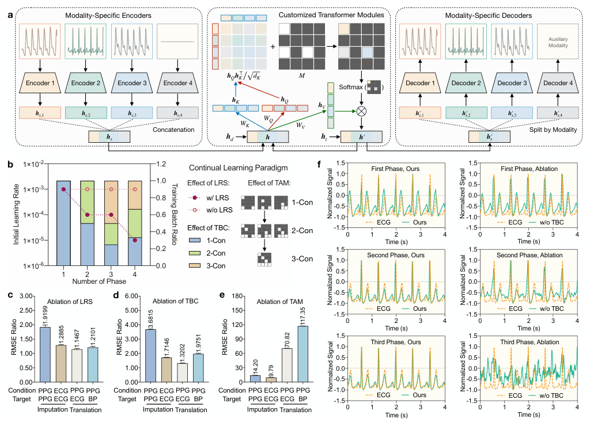

图源：UniCardio 论文 Fig. 2（*Versatile cardiovascular signal generation with a unified diffusion transformer*, Nature Machine Intelligence 2025/2026）

#### 1. 核心突破：统一生成范式 (Many-to-Any Generative Modeling)

传统穿戴模型将信号处理任务机械割裂：去噪（Denoising）、插补（Imputation）与模态翻译（Translation，如 PPG → ECG）往往需要针对性训练完全独立的特定模型。**UniCardio 提出了首个多模态心血管扩散 Transformer (Diffusion Transformer, DiT) 统一生成基座**：
- 联合建模光电脉搏（PPG）、心电（ECG）与连续动脉血压波（BP）的多模态联合条件分布；
- **全任务统一处理**：在统一的无条件前向加噪与条件反向去噪框架下，同时实现低信噪比滤波去噪、间歇性丢点填补、以及任意“条件模态组 → 目标模态组”的连续信号生成（例如腕部 PPG 虚拟生成诊断级 ECG，或 PPG+ECG 无创推断连续血压波）。

#### 2. 核心架构设计与轻量化增量

1. **多尺度 1D 卷积分块编码器**：
   - 针对不同生理模态配置专用 1D-CNN 编码器，内置多组不同尺度的卷积核，自适应提取逐拍微形态与长程心血管节律；
2. **任务特异性注意力掩码 (Task-Specific Attention Masks)**：
   - 在统一 DiT 主干中，引入任务导向的注意力掩码，精确约束从“条件 Token”到“目标 Token”的信息流向，防止跨任务跨模态的信息穿透与负迁移；
3. **极低端侧增量开销 (仅 0.3M / 模态)**：
   - 核心 Transformer 骨干完全共享；当穿戴设备新增一种物理传感器（例如从 PPG 拓展到 ECG 或袖带压）时，仅需接入对应的一对轻量 Encoder 和 MLP Decoder（单模态增量参数仅约 **0.3M**），大幅降低了智能手表的端侧存储与部署压力。

#### 3. 持续学习机制 (Continual Learning) 破解组合爆炸

- **穿戴动态组合困境**：现实中传感器频繁断连与切换（例如白天单 PPG、运动时加 ACC、睡眠时偶发 ECG），可能存在成倍的条件组合。直接联合训练会导致训练样本失衡与灾难性遗忘；
- **阶段式持续学习范式**：
  - 由王立元教授等引入持续学习策略，按“单条件 → 双条件 → 多条件”阶段式递进学习；
  - 配合学习率退火（LR Scheduling）、回放缓冲区（Replay Composition）与任务注意力隔离，使模型能够终身动态接入新传感器，不仅无遗忘，而且先修模态能显著正向迁移促进复杂多模态任务的表现（两条件 / 三条件任务 RMSE 分别降低 31.7% 与 36.0%）。

#### 4. 临床病理保真度与实证表现

- **安贞医院临床专家验证**：由腕部 PPG 虚拟翻译出的 ECG 波形，精准再现了**心肌缺血 ST 段位移、双相 P 波、T 波倒置、房性期前收缩 (APC) 及心房颤动 (AF)** 等危急病理微形态；
- **下游跨域零样本迁移**：
  - 在 PTB-XL 数据集上实现高保真度心电去噪与异常分类；
  - 在 MIMIC PERform AF 队列上实现基于腕部 PPG 的高灵敏度房颤筛查；
  - 在 WESAD 数据集上，将手环脉搏心率（HR）估计误差大幅降低；
  - 在 MIMIC 队列上，利用 PPG / ECG 无创推断连续收缩压（SBP）与舒张压（DBP）表现稳健；
- **超快推断延迟**：通过高效一阶 ODE 采样器加速，4 秒时序切片的推断延迟在端侧仅需 **< 0.4 秒**，满足日常实时生命体征监测需求。

---

### PPGFlowECG

北京大学数字健康实验室 · arXiv:2502.14856 / 2025-2026 · [代码](https://github.com/PKUDigitalHealth/PPGFlowECG)

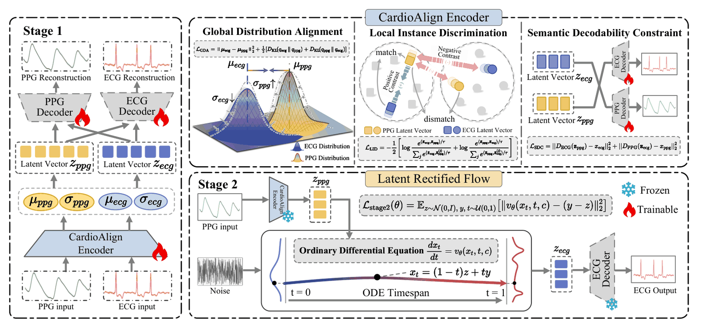

图源：PPGFlowECG 论文 Fig. 2（*PPGFlowECG: Latent Rectified Flow with Cross-Modal Encoding for PPG-Guided ECG Generation and Cardiovascular Disease Detection*, arXiv:2502.14856）

#### 1. 临床背景与核心痛点

- **可穿戴健康监测的“模态鸿沟”**：智能手表等腕戴设备普及了光电容积脉搏波（PPG）的日常全天候采集，但临床心血管疾病（CVD）的确诊金标准依然是体表心电图（ECG）；
- **PPG → ECG 跨模态翻译的两大核心壁垒**：
  1. **跨模态物理与语义未对齐**：PPG 测量末梢血管容积波动阻抗，ECG 记录心肌除极与复极的电生理向量传导，二者物理起源异质，传统时序转换模型易产生严重的语义错位与相位伪影；
  2. **高维时序细粒度保真度难以兼顾**：传统 GAN 模型极易发生模式崩溃（Mode Collapse），而常规像素 / 信号级扩散模型（DDPM）反向去噪采样步数过多（数十至上百步），无法满足端侧与近线实时生成需求。

#### 2. 两阶段生成架构设计 (CardioAlign + Latent Rectified Flow)

1. **Stage 1: CardioAlign 编码器与潜空间生理对齐**：
   - 采用参数绑定（Parameter-Tied）的双分支 Encoder-Decoder 结构，将 PPG 与 ECG 统一映射至低维紧凑的生理潜空间 $\mathcal{Z}$ 中；
   - 编码器输出变分高斯参数 $\mu$ 与 $\sigma$，通过重参数化采样潜向量 $z = \mu + \sigma \odot \epsilon$；
   - **潜空间分布对齐损失 ($\mathcal{L}_{\text{align}}$)**：同时联合最小化均值欧氏距离 $||\mu_{\text{PPG}} - \mu_{\text{ECG}}||_2^2$ 与潜分布对称 KL 散度 $\mathcal{D}_{\text{KL}}$，促使潜空间过滤掉外周光电伪影，仅保留纯净的心肌电动力学生理不变量。
2. **Stage 2: Latent Rectified Flow（潜空间整流流 / 流匹配）**：
   - 摒弃了传统扩散模型曲折反向 SDE 路径，Rectified Flow 学习沿**直线轨迹（Straight-line Trajectory）** 将标准高斯噪声分布 $X_0 \sim \mathcal{N}(0, I)$ 传输至目标 ECG 潜分布 $X_1 \sim q(z_{\text{ECG}})$：
     $$
     \frac{\mathrm{d}X_t}{\mathrm{d}t} = v_\theta(X_t, t, z_{\text{PPG}})
     $$
   - 以 PPG 潜向量 $z_{\text{PPG}}$ 作为强条件引导速度场网络；
   - **常微分方程（ODE）极速采样**：得益于直线矢量场，模型仅需 **1～4 步**数值积分（Euler 或 RK45 求解器）即可完成确定性潜表征生成，推理速度相比多步扩散模型提升一个数量级以上。
3. **高保真 ECG 波形还原**：
   - 生成的潜向量 $z_{\text{ECG}}^*$ 输入专用 1D 卷积心电解码器，还原出连续的诊断级体表心电波形。

#### 3. 评测体系与临床 CVD 筛查实证

- **超大规模急诊级真实评测集**：
  - **MC-MED 数据集**：洪申达教授团队首次在该任务中引入涵盖 **11.8 万名急诊患者、超 1,000 万对真实 PPG-ECG 配对样本**的临床急诊库，具有明确的专家 CVD 确诊标签；
  - **VitalDB / MIMIC-AFib / BIDMC**：跨中心、多硬件域的泛化性能全面领跑。
- **基于心电基座模型 ECGFounder 的高阶特征评估**：
  - 引入心电基座模型 **ECGFounder** 作为特征提取器，计算生成波形的 Fréchet Inception Distance（FID），在特征保真度与形态结构指标（Pearson 峰值相关系数 $r$、SNR、RMSE）上显著超越现有基线。
- **临床医生双盲图灵测试与疾病辅助筛查**：
  - 联合心内科临床医生进行波形盲测，生成的 ECG 在 P 波、QRS 波群宽度及 ST-T 改变上具备高可读性；
  - 在房颤（AFib）、房性 / 室性期前收缩（APC/PVC）、室上性心动过速（SVT）等急性心律失常与心肌缺血检测中，下游分类 AUC 逼近临床真实 ECG 上限。

---

### AnyPPG

北京大学数字健康实验室 · ACM SIGKDD 2026 · [论文](https://arxiv.org/abs/2511.01747) · [代码](https://github.com/Ngk03/AnyPPG)

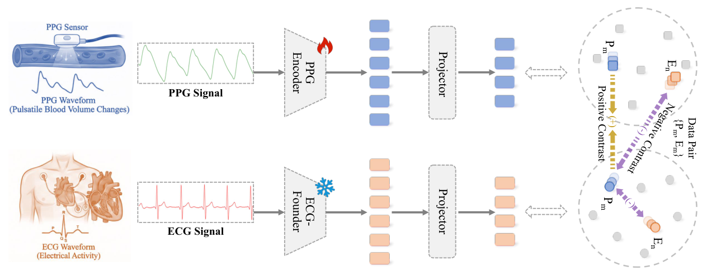

图源：AnyPPG 论文 Fig. 2（*AnyPPG: A PPG Foundation Model*, ACM SIGKDD 2026）

#### 1. 核心定位与范式跃升：从“心率脉搏”迈向“全身画像”

- 过去的穿戴脉搏基座模型（如 PaPaGei、Pulse-PPG）大多局限于单一心血管下游任务（如心率追踪、血压回归、血管弹性年龄）；
- **AnyPPG 系统性论证了：PPG 可以作为多器官整体健康画像（Holistic Multi-Organ Health Profiling）的通用数字生物标志物**。通过深度跨模态预训练，使单模态手腕 PPG 具备了对心血管系统以外的全身系统性慢性疾病进行早期无创筛查的能力。

#### 2. 心电引导的跨模态对比预训练 (ECG-Guided Pretraining)

- **数据资产规模**：聚合了超 **100,000 小时**的高精度同步 PPG-ECG 配对时序数据，涵盖 MC-MED、MIMIC、VitalDB 等多中心临床与生理波形库；
- **为什么必须由 ECG 引导对比学习？**
  - 单模态自监督（如纯粹的 PPG 掩码重建 MAE 或数据增强对比学习）极易走入局部极小值——模型会倾向于拟合受试者的皮肤静态色泽、探头接触压力或手臂运动高频伪影；
  - 同步采集的 ECG 是反映心脏中枢电生理活动的金标准，不存在外周光吸收伪影。AnyPPG 采用**深层对比学习（Contrastive Learning）**，强制拉近时间同步的 PPG 与 ECG 在高维潜表征空间中的距离，迫使 PPG 编码器学会过滤表面运动噪声，自适应提取与心室除极、血管顺应性及自主神经中枢调控相关的深层生理动力学本质。

#### 3. 核心网络架构

- **Net1D 1D-ResNet 双分支编码器**：
  - 为 PPG 与 ECG 模态分别配置专用的 1D-ResNet 骨干网络（单模态分支参数量约 **5.85M**）；
  - 包含 7 个卷积阶段（Convolutional Stages），层层抽取微血管收缩峰、重搏切迹及脉冲波传导时间（PWTT）多尺度特征；
  - 经过全局平均池化（Global Mean Pooling）后输出 **1024 维**的高阶特征向量。
- **轻量投影头与对比表征**：
  - 采用双层 MLP 投影头：$\text{Linear}(1024 \to 512) \to \text{GELU} \to \text{Linear}(512 \to 256)$；
  - 输出 $\ell_2$ 归一化的 256 维潜表征用于跨模态 InfoNCE 对比损失计算。在端侧推理时仅需保留 PPG 单分支（约 5.85M），即插即用。

#### 4. 突破性多器官表型评测 (Beyond Cardiovascular)

AnyPPG 经冻结表征（Frozen Representation）与极简线性探针（Linear Probe）微调，展现出全身多器官疾病跨域泛化能力：
1. **心血管中枢核心任务**：心力衰竭（Heart Failure）、原发性高血压（Hypertension）、心律失常等分类指标全面刷新 SOTA；
2. **突破心血管界限的非心血管系统表型**：
   - **慢性肾脏病 (Chronic Kidney Disease, CKD)**：敏锐捕捉到微血管重塑、硬化与水钠潴留对外周脉搏微形态的微弱时域调制；
   - **帕金森病 (Parkinson's Disease)**：识别由于中枢神经退行导致的自主神经功能紊乱（Autonomic Dysregulation）在末梢血管舒缩节律中的特异性反映；
   - 证明了智能手表光电脉搏波在日常慢病长程管理与神经退行性疾病早筛中的科研与应用价值。

---

### SigmaPPG

米兰理工大学 / 浙江大学 / Emory University · arXiv 2026 · [论文](https://arxiv.org/abs/2601.21031) · [代码](https://github.com/ZonghengGuo/SigmaPPG)

SigmaPPG（*Rethinking the Paradigm of Masked Autoencoders for Photoplethysmography Representation Learning*）针对可穿戴光电脉搏波（PPG）高噪声、强准周期冗余的物理特性，重构了掩码自编码器（MAE）的自监督预训练范式。

#### 1. 核心动机：破解均匀随机掩码的“噪声拟合陷阱”

- **传统 MAE 在 PPG 上的两大结构性缺陷**：
  1. **均匀随机掩码的无效重建**：常规 MAE 对所有时间片无差别执行均匀随机遮蔽。在真实穿戴场景下，高幅值运动伪影与基线漂移片段往往占据大量重建损失权重，迫使编码器消耗模型容量去记忆运动噪声，而非提炼心血管动力学特征；
  2. **跨心动周期的简单插值捷径**：由于静息 PPG 具有较强的相邻周期重复性，均匀小块掩码极易被解码器通过邻近未遮蔽区域的低阶线性插值拟合，难以习得重搏切迹（Dicrotic Notch）与反射波时延等高阶生理语义。

#### 2. 核心架构与自监督机制

1. **强化学习先验引导对抗掩码（Prior-Guided Adversarial Masking）**：
   - 引入基于策略梯度（Policy Gradient）的掩码生成器与形态质量先验（Signal Quality Prior），构建动态对抗训练机制：掩码策略主动定位并优先遮蔽高信噪比、富含血管形态特征的关键心动相位（如收缩期主峰与重搏波切迹区域），同时抑制对纯伪影噪声区段的无效重建；
   - 配合由易到难的课程学习（Curriculum Learning）调度，使编码器逐步从局部波形补全过渡到跨周期血流动力学推断。
2. **向量量化语义一致性（Vector Quantization Semantic Consistency）**：
   - 摒弃单纯依赖时域逐点均方误差（MSE）的低阶重建目标，引入离散生理形态码本（Codebook）将连续 PPG 时间片映射为高阶形态原语（Morphological Primitives）；
   - 在潜空间施加跨视角向量量化语义一致性约束，促使模型对轻微相位抖动和接触压力变化保持表征不变性。

#### 3. 12 万小时预训练与下游泛化评测

- **预训练规模**：在超过 **120,000 小时**的多源公开 PPG 语料上完成自监督预训练；
- **下游评测表现**：在心率估计、无袖带血压回归、呼吸率监测及心律失常筛查等多项基准任务中，以及在 [PPG-Bench](#ppg-bench) 的 9 数据集 26 任务独立评测套件中，SigmaPPG 均展现出良好的跨设备表征鲁棒性与特征迁移效率。

---

## 3. 端侧轻量化、生物年龄与大一统评测基准

### PPG-Distill

Emory University · 2025 · [代码](https://github.com/LingFengGold/PPG-Distill)

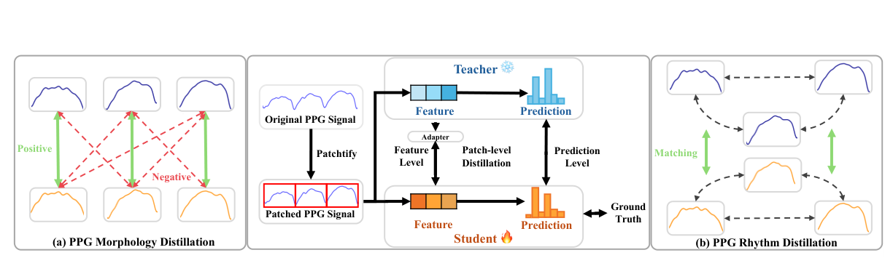

图源：PPG-Distill 论文 Fig. 3（*PPG-DISTILL: Efficient Photoplethysmography Signals Analysis via Foundation Model Distillation*, 2025）

- **研发团队**：Emory University（Juntong Ni, Wei Jin 教授团队）联合医学院；
- **技术突破**：针对大型脉搏基础模型（如 PaPaGei、Pulse-PPG）难以常驻端侧嵌入式 MCU 的瓶颈，提出**三级多尺度知识蒸馏体系**：
  1. **预测级蒸馏 (Prediction-Level)**：迁移下游多任务软标签分布；
  2. **特征级蒸馏 (Feature-Level)**：在潜空间拉近紧凑学生网络与大模型教师网络的表示距离；
  3. **形态与节律蒸馏 (Morphology & Rhythm Distillation)**：专门保留局部脉搏收缩峰微形态与长程心拍周期性结构。
- **实测表现**：在心率估计与心房颤动分类中，学生模型推理加速 **7 倍**，内存开销骤降 **19 倍**，性能较直接训练提升达 **21.8%**。

---

### PpgAge

Apple Health · Nature Communications 2025 · [论文](https://doi.org/10.1038/s41467-025-64275-4)

- **数据规模**：依托 **213,593 名 Apple Health Study** 真实世界佩戴者手腕 PPG；
- **临床核心发现**：
  - 训练深度模型从手表日常 PPG 预测受试者实际年龄（MAE = 2.43 年）；
  - **血管年龄差 (PPG Age Gap)**：若模型预测年龄显著高于受试者生理年龄（提示微血管弹性硬化与内皮衰退），其未来罹患重大心脑血管事件的风险显著激增（**风险比 Hazard Ratio = 1.46**）；
  - 确立了可穿戴光电脉搏大模型作为**全生命周期血管老化数字标志物**的科学地位。

---

### 开源脉搏基础模型生物年龄横评

Nabil Brag · arXiv 2026 · [论文](https://arxiv.org/abs/2603.14030) · [代码](https://github.com/Misterbra/ppg-age-benchmark) · [AI-PPG 权重](https://huggingface.co/Ngks03/PPG-VascularAge)

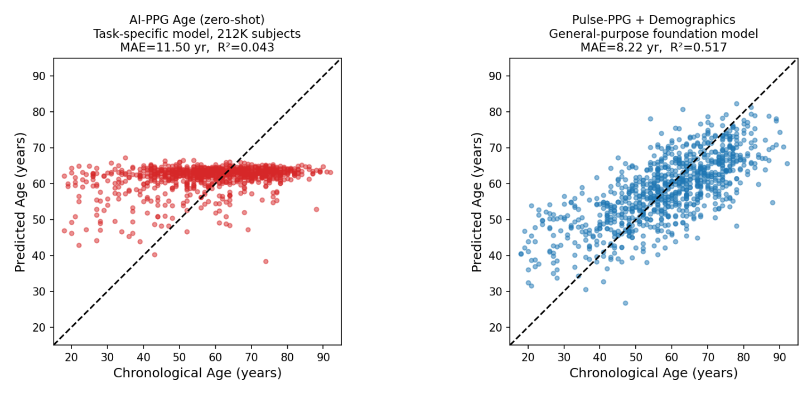

图源：PPG 生物年龄横评论文 Fig. 1（*Benchmarking Open-Source PPG Foundation Models for Biological Age Prediction*, arXiv:2603.14030）

#### 1. 核心破局动机：开源大模型能否打破 Apple 闭源壁垒？

Apple PpgAge（21.3 万人）与 UK Biobank AI-PPG（21.2 万人）确立了光电脉搏波在心血管与全身衰老评估中的重要价值。然而，Apple 模型与数据完全闭源，而单中心大队列监督模型又面临泛化瓶颈。**该工作在独立临床基准 PulseDB（VitalDB 临床指端 PPG，906 位手术患者，41,104 个 10 秒片段，125 Hz，受试者年龄跨度 18～92 岁）上，首次系统性评测主流开源通用生理基础模型（Pulse-PPG、PaPaGei-S）在完全未接触过年龄标签的情况下，能否通过潜空间表征实现对血管生物年龄的高精度零样本与线性探测。**

#### 2. 全景实验结果横评表（906 例 VitalDB 患者，5 折受试者级分层交叉验证）

| 模⁠型 / 特⁠征⁠配⁠置 | 模⁠态⁠与⁠特⁠征⁠维⁠度 | MAE (年) | $R^2$ | 相⁠关⁠系⁠数 $r$ |
| :--- | :--- | :---: | :---: | :---: |
| **Baseline** | 盲猜训练集受试者年龄均值 | 11.91 | - | - |
| **HR only** | 单一平均心率 (1 维) | 11.83 | - | - |
| **HR + HRV** | 传统时域心率变异性 (7 维: SDNN, RMSSD, pNN50 等) | 11.49 | - | - |
| **Demographics** | 全套人口学+血流动力学 (6 维: 性别, 身高, 体重, BMI, SBP, DBP) | 10.04 | - | - |
| **HR/HRV + Demographics** | 传统特征联合建模 (13 维) | 9.59 | - | - |
| **AI-PPG Age (Zero-shot)** | 21.2 万人 UKB 监督训练模型直接推理 | **11.50** | 0.043 | 0.313 |
| **PaPaGei-S (Linear Probe)** | 冻结 512 维潜表征 + 岭回归 | 9.80 ± 0.34 | 0.313 | 0.583 |
| **AI-PPG Age (Linear Probe)** | 提取倒数第二层 192 维卷积激活 + 岭回归 | 9.72 ± 0.37 | 0.310 | 0.563 |
| **Pulse-PPG (Linear Probe)** | 冻结 512 维潜表征 + 岭回归 | **9.28 ± 0.44** | **0.388** | **0.645** |
| **PaPaGei-S + Demographics** | 512 维潜表征 + 6 维人口学特征拼接 | 8.56 ± 0.22 | 0.477 | 0.696 |
| **AI-PPG Age + Demographics** | 192 维潜表征 + 6 维人口学特征拼接 | 8.58 ± 0.25 | 0.440 | 0.664 |
| **Pulse-PPG + Demographics (最⁠优)** | 512 维潜表征 + 6 维人口学特征拼接 | **8.22 ± 0.25** | **0.517** | **0.725** |

#### 3. 关键技术洞察与“两大反转”机理解构

1. **反转一：21 万人专用监督大模型的“跨域预测崩溃（Prediction Collapse）”**：
   - 在 UK Biobank（212,231 人）健康门诊队列上训练的 AI-PPG Age，Zero-shot 迁移至手术室 VitalDB 时出现严重退化（MAE = 11.50 年）；
   - **根因剖析**：手术患者在全身麻醉状态下使用了血管活性药（如去甲肾上腺素）、麻醉剂（丙泊酚）及机械通气，外周阻力与脉搏形态严重异于门诊常态。端到端强监督网络遇到分布外（OOD）生理态产生防御性收缩，**全部预测值被压缩在 38～67 岁这一狭窄区间**（而受试者实际年龄为 18～92 岁），退化为记忆训练集的先验均值。
2. **反转二：无监督自监督大模型（Pulse-PPG）线性探测实现越级超越**：
   - Pulse-PPG 仅通过相对对比学习（RelCon）预训练，完全无年龄标签监督，线性探测取得 **MAE = 9.28 年**；
   - 不仅战胜了重训探测头的 AI-PPG Age（9.72 年），**仅凭 10 秒原始脉搏波提取的 512 维形态表征，直接击败了“HR/HRV + 全套人口学（身高 / 体重 / BMI / 血压）”组合（9.59 年）**；
   - 表明多源高噪预训练赋予了通用基础模型优良的形态不变性（Morphological Invariance），比单一大队列任务过拟合模型更鲁棒。

#### 4. 心血管物理学思辨：单心拍 100 点重采样 vs. 10 秒连续时序

为什么 AI-PPG Age 在特征提取模式下依然逊于 Pulse-PPG？关键在于两派处理哲学的根本分歧：
- **AI-PPG 的人工先验假说（借鉴经典脉搏波分析 PWA）**：为避免受试者走动、情绪激动带来的即时心率（HR）干扰，算法将单心拍机械重采样拉伸到固定的 **100 个采样点（0%～100% 相对心动周期）**，并对 10 秒内的所有拍取相干平均（Average Beat）；
- **付出的沉重代价**：
  1. **破坏了主动脉脉搏波传导速度（PWV）的物理真实性**：动脉硬化程度由脉搏反射波绝对时延（$\Delta T$, ms）决定。相对百分比拉伸使得慢心率下 1 点代表 10 ms、快心率下 1 点代表 6 ms，扭曲了反射波传播的物理量纲；
  2. **丢失了自主神经老化核心指标（HRV）**：衰老伴随窦房结衰退与迷走神经张力减弱，心动周期变异性（SDNN / RMSSD）随衰老显著下跌。单心拍平均模板将多心拍节律波动全部抹杀；
  3. **丢失心肺耦合（Cardiorespiratory Coupling）**：连续 10 秒时序（Pulse-PPG 接收的形式）完整保留了呼吸性脉压起伏（PPV）与呼吸性心律不齐（RSA）。

#### 5. 临床有效性复现与 Apple PpgAge 差距归因

1. **PPG Age Gap 与血管硬化的病理生理映射**：
   - 论文计算了预测年龄减去实际年龄的残差（PPG Age Gap）。在消除日历年龄混杂后，**PPG 年龄差与舒张压（DBP）呈现极显著负相关（$r = -0.188, p = 1.2 \times 10^{-8}$）**；
   - **生理学机理**：大动脉管壁弹性纤维退变与胶原增生（动脉硬化）导致血管顺应性降低，脉压差进行性增大（收缩压 SBP 升高、舒张压 DBP 下降）。PPG 预测表征偏“老”的个体，舒张压明显偏低。这复现了 Apple 关于 PPG 形态蕴含全身血管衰老表型的医学假说。
2. **与 Apple 闭源 PpgAge（MAE = 2.43 年）的差距根因**：
   - **236 倍样本量悬殊**：评测集仅 906 人，而 Apple 达 213,593 人。学习曲线分析显示，在 906 人规模下性能尚未触及平台期（No Plateau），增加临床数据规模仍有提升空间；
   - **生理干扰与探针范式**：Apple 采集自由生活静息手表波形，本研究为术中麻醉监护指端波形；且 Apple 为端到端深度调优，本研究仅为冻结特征线性探测（Frozen Linear Probe）。

---

### PPG-Bench

Mannas AI · arXiv 2026 · [论文](https://arxiv.org/abs/2610.13435) · [代码](https://github.com/mannas-ai/ppg-bench)

针对以往各个 PPG 基础模型采用各自碎片化的私有 / 公有测试集、不同的数据清洗过滤标准与微调协议导致无法公允对比的痛点，该工作构建了首个标准化、严谨防数据泄露的脉搏基础模型大一统评测套件。

- **评测体系与覆盖面**：
  - **参评基模**：AnyPPG、PaPaGei-S、PaPaGei-P、PulsePPG 与 SigmaPPG；
  - **评测规模**：跨越 9 个公开数据集（PPG-DaLiA、DREAMT、WESAD、ECSMP、PPG-BP、BIDMC、BUT-PPG、RealWorldPPG、WildPPG），涵盖 26 项下游任务（心率回归、体动识别、睡眠分期、压力情绪、抑郁筛查、年龄 / 血压估计及身份识别）；
  - **4 级递进适配协议**：线性探测（Linear Probing）、随机森林（Random Forest）、冻结 MLP 探针、端到端全量微调（End-to-End Finetuning）；
  - **严苛对照组**：随机 / 常数基线、无训练参数的脉搏率变异性特征集（PRV）、通用时序大模型（MOMENT）。
- **核心结论（为基模“挤水分”）**：
  - 在全部 68 组“任务-适配策略”配置中，有 **35.3%** 的组合相比最简单的随机 / 常数基线未展现出统计学优势；
  - 在高达 **83.8%（57/68）** 的任务组合中，无任何一个专用 PPG 基础模型能同时战胜“确定性 PRV 特征”与“通用时序大模型 MOMENT”；
  - 下游探测头容量越复杂，在小规模临床稀疏数据集上过拟合风险越显著，呼吁未来脉搏表征学习必须始终引入强物理先验的对照组。

---

## 4. 空间运动与跨专题基模索引

除了以心血管 PPG 为核心的模型外，针对手腕运动加速度（ACC）与多器官睡眠耦合的基础模型同样是智能手表算法体系的重要支柱：

### LIMU-BERT

南洋理工大学 (NTU) · ACM SenSys 2021 · [代码](https://github.com/dapowan/LIMU-BERT-Public)

- **核心定位**：针对三轴加速度计与陀螺仪的空间 IMU 自监督表征模型；
- **机制原理**：借鉴 BERT 的掩码传感器建模（Masked Sensor Modeling, MSM），将三轴运动矢量分片掩码后重构，有效剥离受试者个体身份生物特征（跨用户泛化），提炼通用的高阶步态动力学表征。在走路、跑步、骑行的人体活动识别（HAR）线性探测中达到 **92.1%** 的准确率。

### Mantis

华为诺亚方舟实验室 / Inria · ICML 2026 · [代码](https://github.com/vfeofanov/mantis)

- **核心定位**：时序领域专注于**分类与判别性表征**的轻量级基础模型（参数量约 8M）；
- **核心组件**：
  - **Token Generator Unit (TGU)**：自适应多尺度卷积与差分分块，解决固定 Patch 丢失局部波峰波谷的问题；
  - **多变量通道适配器 (Multichannel Projectors)**：原生支持手环三轴 ACC 或多导联生理信号；
- **手环端侧实测优势**：在 CPU 上单次前向仅需 **19.8 ms**，在日常运动状态识别中线性探测准确率高达 **99.7%**，是手环端侧防误计步与心律失常快速判别的利器。完整架构剖析与实验对比请参阅专题文档：[通用时间序列基础模型 (General TSFM)](general_tsfm.md#mantis)。

### SleepFM

斯坦福大学医学院 / DTU · Nature Medicine 2024 / arXiv 2026 · [代码](https://github.com/zou-group/sleepfm-v2-public)

Stanford Medicine（Emmanuel Mignot、James Zou 教授团队）研发的多模态生理基座家族（涵盖 200 余万小时临床多导睡眠监测 PSG），对消费级智能手表算法研发具有直接指导价值（完整数学原理、双流 LOO+MAE 架构及临床 NSRR 数据集请查阅专题文档：[睡眠与心肺多模态基础模型](sleep_models.md#sleepfm)）：

1. **SleepFM 1.0：留一对比学习与单夜预测 130+ 疾病**：
   - 基于 65,000 名受试者近 60 万小时 PSG 数据，提出留一对比学习（LOO-CL），在 30 秒窗口显式建模大脑（EEG）、心血管（ECG/PPG）、呼吸力学与肌电（EMG）的生理因果耦合；单夜特征预测痴呆症（C-index 0.85）、全因死亡率（0.84）、心肌梗死（0.81）与房颤（0.78）。
2. **SleepFM-2：手腕 PPG 零样本迁移与“物理生理代理通道桥 (Surrogate Channels Bridge)”**：
   - **架构瘦身**：采用现代 LLaMA 骨干（RMSNorm、SwiGLU、RoPE），编码器参数量缩减至 **2.57M**，Token 步长细化至 1 秒，提取解释 58% 方差的 PC1 通用生理风险轴；
   - **手腕 PPG 零样本迁移**：针对消费级手表采集的单通道手腕红外 PPG，冻结编码器零样本微调的 5 分类睡眠分期 Macro-F1 达 **0.531**（对比从头训练的 0.175，提升 3 倍以上）；
   - **手腕 ACC 物理生理代理通道桥**：将手腕三轴加速度在 **0.1～0.6 Hz** 带通滤波提取**呼吸代理通道（Surrogate Respiration）**，在 **3.5～14 Hz** 带通滤波（求 L2 范数后经 0.5～3.5 Hz 滤波）提取**心动冲击代理通道（Surrogate SCG）**，无缝接入 PSG 预训练骨干。在 **UK Biobank 10 万人**腕戴加速度计随访中，针对 390 种疾病发病预测平均 C-index 达 **0.687**，直接打平了专门在 UK Biobank 10 万人加速度计上自监督预训练的专用基础模型（**0.688**）。
3. **工程落地准则：PPG + ACC 联合检测自主神经微觉醒 (Autonomic Arousals)**：
   - 临床皮质微觉醒（Cortical Arousals）以脑电高频突变为金标准，纯 ACC 面对“无动微觉醒”在物理上失明且易受翻身伪影干扰；
   - 工业级腕戴方案应利用 **PPG 捕获交感神经唤醒引发的外周血管急剧收缩（PWA Drop >30%）与瞬时心率突增（HR Surge 10～20 bpm）**，并将 **ACC 作为运动伪影过滤器与伴随体动分型器**。

---

## 5. 大规模开源生态与时序语言多模态基座

### OpenMHC

斯坦福大学医学院 (Euan Ashley 实验室) / 帝国理工学院 / 柏林夏里特医学院 · arXiv 2026 · [论文](https://arxiv.org/abs/2607.16235) · [代码](https://github.com/AshleyLab/OpenMHC) · [数据集](https://huggingface.co/MyHeartCounts)

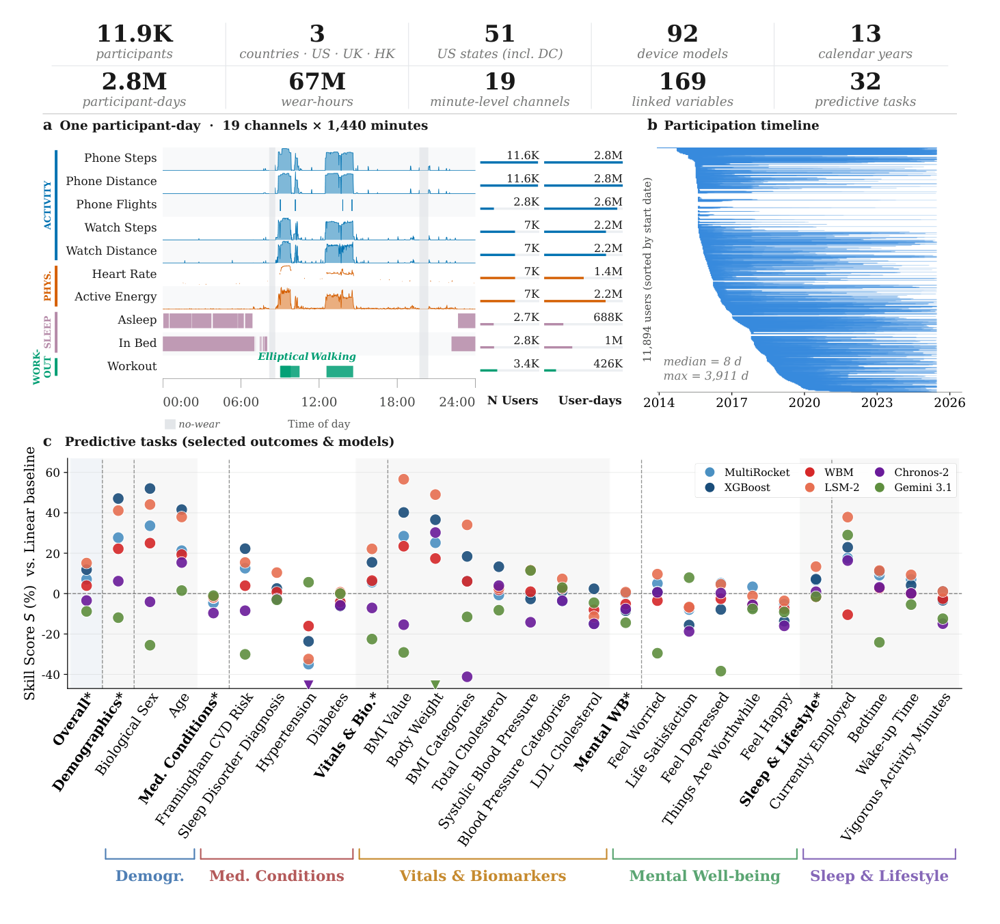

图源：OpenMHC 论文 Fig. 1（*OpenMHC: Accelerating the Science of Wearable Foundation Models*, arXiv:2607.16235）

#### 1. 破局意义：打破科技巨头对穿戴数据的垄断

在可穿戴健康 AI 领域，工业界科技巨头（如 Google SensorFM 的 1 万亿分钟、Apple WBM 的百万级 Apple Watch 数据）长期构筑了商业与隐私壁垒，数据与模型权重双闭源，导致学术界长期面临难以在海量真实生活数据上预训练的困境。**OpenMHC（Open MyHeartCounts）是迄今向合格研究人员开放访问的大规模真实世界可穿戴基础模型基准数据集与开源实现**：
- **数据体量**：包含 **11,894 名**经过知情同意的受试者，横跨美、英、香港等地区，记录了 **>6,700 万小时（282 万人·天）** 的分钟级连续传感器时序（日历时间跨越长达 13 年）；
- **全景传感器通道**：覆盖 **19 个连续生理与运动通道**（步数、心率、心率变异性、睡眠分期、高强度锻炼能耗等），并与 **169 维深度变量**（自述健康问卷、生活方式、情绪心理及 HealthKit 长期档案）建立严密对应。

#### 2. 三大统一评测赛道 (OpenMHC Benchmark)

OpenMHC 规范化了可穿戴基础模型的三大核心评估协议：
1. **Track 1: 预测性任务 (Predictive Tasks)**：包含 32 项涵盖心血管健康、代谢风险与日常行为模式的下游判别任务；
2. **Track 2A: 生成式多变量插补 (Generative Imputation)**：模拟现实佩戴中因洗澡、充电、断连造成的复杂数据空洞，评估模型重建时序动力学的能力；
3. **Track 2B: 时序自回归未来预测 (Generative Forecasting)**：评估模型在零样本或少样本条件下推演未来心率与运动趋势的能力。

#### 3. 工业级基础模型开源复现与对齐

OpenMHC 团队不仅开源了数据基准，更在统一框架下完整复现并开源了前沿可穿戴基础模型：
- **开源版 Apple WBM (Wearable Base Model)** 与 **LSM-2**：让学术界首次能够在统一标准下对标工业级骨干；
- **跨领域时序大模型接入**：集成了 **Chronos-2** 与 **Toto** 等前沿自回归时序基座；
- **经典强基线**：配备了提取 495 个手工生理特征的 **XGBoost**、卷积时序分类器 **MultiRocket** 及非均匀缺失时序模型 **GRU-D**。

> [!NOTE]
> **历史先驱沿革：My Heart Counts (2015) 与 Apple Heart Study (2017) 的交相辉映**  
> - **My Heart Counts (MHC, 2015)**：苹果发布开源医学研究框架 **ResearchKit** 时的首批 5 款先驱 App 之一，由斯坦福医学院 Euan Ashley 教授主导，率先探索智能手机传感器（三轴加速度计 / 协处理器）在大规模人群中被动采集运动与心肺耐力（6MWT）。这项长达十余年的长程队列最终演进成了今天的 **OpenMHC**。  
> - **Apple Heart Study (AHS, 2017)**：苹果官方资助、斯坦福医学院执行的 41.9 万人超大型心房颤动（AFib）临床试验，凭借严格的远程心电贴片（ePatch）核验闭环，直接促成 Apple Watch 房颤脉搏预警算法获得美国 FDA 医疗器械认证（NEJM 2019）。  
> - 两者共同奠定了当今智能手表从“日常计步器”迈向“严肃医学基础模型”的科学基石。

---

### PPG-LM

Emory University / UCLA / Google / Stanford · arXiv 2026 · [论文](https://arxiv.org/abs/2609.33516)

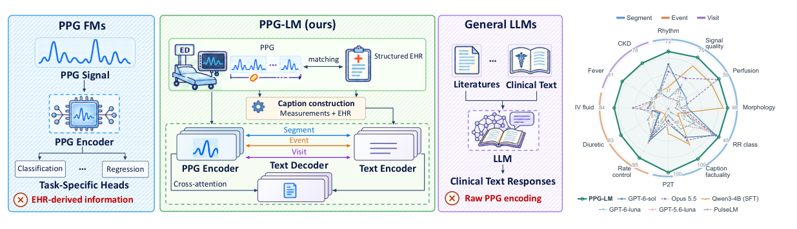

图源：PPG-LM 论文 Fig. 1（*PPG-LM: A Photoplethysmography–Language Model with Multi-Level Clinical Alignment*, arXiv:2609.33516）

PPG-LM 是在 **73,700 小时**连续 PPG 波形（来自 Stanford 成人急诊多模态队列 MC-MED，36,430 名患者、53,473 次就诊）上通过多层级临床自然语言弱监督训练的 PPG–Language 基础模型家族。

#### 1. 核心动机：打破纯波形自监督孤岛，迈向多时间尺度临床语言对齐

在以往的脉搏波基础模型（如 PaPaGei、Pulse-PPG、AnyPPG、SIGMA-PPG）中，研究范式几乎全部局限于“基于波形的自监督学习（对比学习或掩码自编码）+ 下游固定任务 Head”。这种范式面临两大根本瓶颈：
1. **波形表征与临床语义脱节**：模型仅能输出特征向量，无法使用自然语言进行零样本问答、按临床概念检索或直接生成解释性生理报告；
2. **多时间尺度（Multi-level Temporal Scales）无法兼顾**：临床生理监护横跨多种时间跨度——从秒级（30 s 局部脉搏形态与质量）、分钟级（急诊给药事件前后的生理急性波动），到小时至天级（整场就诊的既往病史、分诊危重度与长程心率趋势）。以往模型只看短窗口，丢失了宏观临床上下文。

PPG-LM 既不盲目外挂参数昂贵且易产生医学幻觉的通用大语言模型（LLM），也不局限于单一分类头，而是构建了轻量级双塔对齐与多模态生成架构。

#### 2. 自动化多层级临床文本构建管线 (Clinically Grounded Caption Generation)

由于医院病历中没有现成的“波形-医生注释”微观对齐语料，作者设计了全自动的规则弱监督生成管线，自底向上构建三层语料金字塔：
1. **片段级（Segment-level, 30 s）**：
   - 利用 `pyPPG` 与 `NeuroKit2` 从 30 s 窗口中提取 8 项形态与生理指标（脉率、心率趋势、心律规律性、搏动幅度、信号质量指数 SQI、重搏切迹增强形态、血管反应指数、搏动间变异性）；
   - 提取 300 秒内病历记录的同步生命体征（SpO2、血压、呼吸率）及同步心电节律，填入 10 套语言模板中生成标准生理描述。
2. **事件级（Event-level, 分钟至小时级）**：
   - 从 EHR 中抽取 10 类急危重症用药记录（升压药、血管扩张剂、降心率药、利尿剂、补液、阿片类、镇静剂等）；
   - 以给药时间戳 $a$ 为锚点，抓取前 30 分钟（最多 3 个窗口）与后 60 分钟（最多 5 个窗口）的连续波形；
   - 在同一次就诊的无给药安全时段中均匀采样非用药对照组（Controls），迫使模型学习药物诱发的生理因果变化而非个体底色。
3. **就诊级与时序逻辑陈述（Visit-level, 数小时至数天）**：
   - 整合急诊分诊危重度（ESI）、主诉、年龄、性别、首测体征、ICU 转归、既往病史 ICD-10 及长期处方；
   - 提取整场就诊的**时序逻辑陈述**（如“心动过速占据总时程 30%”、“在后半程心率呈进行性阶梯式上升”）。

#### 3. 核心技术思辨：为什么不用“DSP 规则提取 + 通用 LLM”，以及文本塔为何从零训练？

##### 疑问 1：既然 Stage 1 的文本是用 `pyPPG` 算的，为什么不直接运行 `pyPPG` 得到数值后交给 GPT-4 做临床分析？
- **规则算法在真实生理噪声下的崩溃（Garbage In, Garbage Out）**：`pyPPG` 等经典数字信号处理（DSP）依赖数学一阶 / 二阶求导与硬阈值寻找收缩峰和重搏切迹。在真实世界穿戴与监护中，患者运动伪影、微循环灌注不良（低灌注波形扁平）会导致规则算法频繁波峰找错、甚至直接报错崩溃。把错误的数字交给大模型，会导致严重的幻觉推断；而端到端波形编码器观测整段信号，具备格式塔整体形态感知（Gestalt perception）与强抗噪力；
- **信息瓶颈（丢失 99% 未定义形态）**：把 30 秒 3,750 个连续采样点压缩成 8 个数值，抹杀了尚未被医学公式完全定量的心室-动脉耦合、微血管顺应性变异、自主神经高频涨落等微细几何模式。论文实验显示：仅凭 8 个数值无法有效预测肾衰、糖尿病与心衰，而 PPG-LM 提取的深层波形表征在 32 项临床预测上显著优于基线，证实其学到了超越规则本身的深层物理先验；
- **无法捕捉长程因果动态**：静脉推注升压药或降率药后数十分钟的连续波形演变是高度非线性的生理过程，静态数字表格无法抽象这种时序动力学；
- **经典的“脚手架（Scaffold）效应”**：类似 CLIP 利用弱监督 Alt-text 预训练，`pyPPG` 规则只是**低成本启动波形与语言对齐的“脚手架”**，海量数据（73,700 小时）浸润让神经网络表征能力完成了对规则脚手架的跨越。

##### 疑问 2：文中的“LM”为什么完全从零随机初始化（Random Init），不直接微调现成的 7B+ 大语言模型？
论文附录 C.1 明确指出：**文本塔是一个 8 层因果 Transformer，完全从零随机初始化，仅借用了 CLIP 词表与 Tokenizer**。这一设计的核心权衡包括：
1. **根除医疗“数字与概念幻觉”**：论文在表 3 中实证，通用超大模型在阅读波形数字时存在明显幻觉；而 PPG-LM 将文本空间严格限制在客观生理指标和真实病历中，**事实准确率高达 92.3%**，心率误差低至 3.9 bpm；
2. **紧凑与对称的表征对齐空间**：波形编码器仅 12.7M。若文本端挂载 7B+ 模型，结构严重不对称，在对比学习与双向检索时会导致优化失衡，且大模型的开放语义会引入噪声；
3. **极速推理与端侧监护仪部署**：波形塔 12.7M + 文本塔数千万参数，可在单张 GPU 或床旁监护仪上实现毫秒级低延迟推理，免除部署 7B 大模型的昂贵硬件负担。

#### 4. 两阶段多尺度对齐网络架构 (Two-Stage Alignment Architecture)

##### Stage 1: 片段-语言预训练 (Segment–Language Pretraining)
- **波形编码器**：轻量设计（仅 **12.7M** 参数），1D 卷积将 30 s 信号切分为 150 个 0.2 s Patch，接 6 层 Transformer（宽 384，6 头），输出 512 维波形表征；
- **文本塔**：采用 CLIP 词表（49,408），8 层因果 Transformer（宽 512），完全从零随机初始化；
- **CoCa 联合目标**：
  - **对称 InfoNCE 对比损失**：设计了 **Content Key 机制**，当 batch 内不同样本的量化生理数值相同时将其从负样本集中剔除，避免惩罚生理状态相同的真实波形；
  - **条件自回归 Captioning 损失**：4 层多模态解码器交叉注意力于波形 Memory（32 个可学习 Query），自回归输出生理报告。

##### Stage 2: 宏观时空与长程时序聚合 (Multi-Level Alignment)
Stage 2 冻结 / 微调 Stage 1 骨干，引入长程时序动力学聚合模块：
1. **给药事件聚合（带符号时间偏移）**：引入带符号时间偏移嵌入 $\phi(t_i - a)$（单位为**真实物理分钟**，负数表示给药前，正数表示给药后），通过注意力池化聚合给药前后波形；
2. **整场就诊聚合（Perceiver 锚点探针 + 连续时间 RoPE）**：
   - 面对最多 256 个窗口的长程监护，引入 8 个可学习潜变量 Query（1 个全局探针 + 7 个预设参考时间的局部探针：$0, 15, 30, 60, 120, 240, 480$ 分钟）；
   - **连续时间旋转位置编码（Continuous-time RoPE）**：放弃传统的离散 Token 序号，将 RoPE 旋转角度直接绑定在物理流逝的真实分钟差上（旋转周期跨越 2 分钟至 14 天），从根本上解决了临床不规则采样与数据断流（Gap Token 标记）问题；
3. **时序逻辑陈述匹配（Late-Interaction 与扰动排序）**：
   - 借鉴 ColBERT 的迟交互机制，每个时序句子动态挑选 8 个探针中内积最大的一个匹配，无需人工对齐；
   - 引入**句子找茬（Corrupted Statement Ranking）**，随机篡改句子中的时间或趋势事实（如“上升”篡改为“下降”），迫使模型深度理解时序逻辑因果；
4. **特征缓存与余弦蒸馏保护**：
   - 针对 256 窗口反向传播显存开销问题，采用 **Feature Cache** 机制（每场就诊仅对 8 个实时窗口反向传播梯度，其余读取缓存）；
   - 引入 Stage 1 冻结权重的余弦距离蒸馏损失（$\mathcal{L}_{\text{dst}}$），防止在学习宏观上下文时遗忘微观脉搏形态表征。

#### 5. 穿戴架构范式横评：固定时间网格 (SensorFM/WBM) vs. 连续物理时间 RoPE (PPG-LM)

在构建智能手表长程健康模型（如 `Watch_LSM` 的 Layer 2 特征基模）时，如何向长程骨干输入一连串碎片化生理特征？业界存在两大主流技术阵营：

| 评⁠估⁠维⁠度 | 方⁠案 A：固⁠定⁠规⁠整⁠网⁠格⁠派 (Google SensorFM, Apple WBM, OpenMHC) | 方⁠案 B：连⁠续⁠物⁠理⁠时⁠间⁠派 (PPG-LM, 连⁠续⁠时⁠间 Transformer) |
| :--- | :--- | :--- |
| **数⁠据⁠组⁠织⁠机⁠制** | 每天切出 1,440 个 1 分钟固定网格；用户脱表、洗澡、充电时填入 `[MASK]` 或置零。 | 仅送入实际观测到的有效窗口（如每天 80 个）；每个窗口自带真实物理时间戳 $t_i$（分钟浮点数）。 |
| **算⁠力⁠与⁠显⁠存⁠开⁠销** | **开销较大**：用户若一天仅戴表 6 小时，序列中 75% 是无效 Pad/Mask，自注意力依然承受 $O(1440^2)$ 开销。 | **满负荷有效计算**：只计算真实存在的 80 个窗口，注意力开销仅为 $O(80^2)$，算力节约百倍以上。 |
| **时⁠间⁠分⁠辨⁠率⁠灵⁠活⁠性** | **受限于网格粒度**：分辨率受限于网格大小（如 1 min）；难以原生感知 10 秒瞬时早搏或跨数小时长程空洞。 | **连续分辨率**：时间差是真实物理分钟 / 秒，无需重采样或人工分箱。 |
| **24h 昼⁠夜⁠节⁠律⁠感⁠知** | **天然对齐**：第 480 个网格永远是早晨 08:00，模型凭绝对网格索引即可直接学习交感神经昼夜节律。 | **需显式时间注入**：RoPE 擅长算相对时间差，对绝对钟表相位（白天 vs. 深夜）需通过外挂绝对时间特征辅助。 |
| **缺⁠失⁠值⁠生⁠成⁠插⁠补** | **天然支持 Infilling**：预训练（AIM / 掩码自编码）本质就是在填空，开箱即具备全天波形插补能力。 | **偏向判别与表征**：需以特定时间戳作为 Query 探针查询隐空间，插补不如网格直观。 |

##### PPG-LM 的折中工程智慧：兼得两家之长
PPG-LM 在连续 RoPE 架构上做了精巧的折中设计（值得 `Watch_LSM` 重点吸收）：
1. **主干使用连续物理时间 RoPE**：仅传递有效观测窗口，摒弃全天冗余 Pad，使反向传播与注意力计算高效运行；
2. **外挂加性钟表正弦嵌入（Hour-of-Day Embedding）**：给每个窗口附加“一天中的几点几分”与“距离就诊过去了多久”的正弦时间特征，补齐了对 24 小时昼夜节律相位的感知；
3. **引入中断标记（Gap Token）**：检测到两段波形之间断联超过 10 分钟时，插入一个轻量 Gap Token 显式记录中断时长 $\log(1 + \text{duration})$，既不捏造虚假生理数据，又让模型知晓发生了长时间脱表。

#### 6. 全面评测与下游临床能力越级

1. **零样本生理理解与高保真数值提取**：
   - 在 MC-MED、MIMIC-III、VitalDB 三大独立数据库的 11 项任务中（心律不齐、信号质量、灌注强度、波形增强形态等），PPG-LM 在 **10 项上斩获全场最高 Macro-F1**，显著优于通用超大模型；
   - 从生成的报告中反解生理数值，**心率 MAE 仅 3.90～4.27 bpm**（以独立金标准心电图为准），事实准确率高达 **92.3%**。
2. **高精度双向跨模态检索 (Cross-Modal Retrieval)**：
   - 100 候选池中，MC-MED 上“以波形搜病历描述 (S2T)”达 **97.5% R@1**，“以病历搜波形 (T2S)”达 **96.5% R@1**；在 2,000 候选池中 R@10 仍高达 99.8%。
3. **急危重症事件与慢性病史推断**：
   - 零样本区分 10 类急危重症药物注射波形响应（升压药 AUROC 达 0.860，降率药达 0.803）；
   - 仅凭整场就诊的 8 个 PPG 窗口，即可零样本识别高血压、房颤、心衰、糖尿病及慢性肾病等既往病史（Balanced Acc 达 0.58～0.78）。
4. **32 项冻结表征临床预测全胜**：
   - 在 32 项横跨急诊、ICU 和围手术期的临床分类与回归任务中（心血管疾病、化验生化指标、ICU 转归），PPG-LM 的冻结特征**显著优于了 PaPaGei-S、Pulse-PPG、AnyPPG、SIGMA-PPG 等脉搏基座模型及 MOMENT、Chronos-2 等通用时序大模型**，证明了“多尺度临床语义对齐”学到的生理表征比纯波形自监督更具深层泛化力。

#### 7. 对智能手表可穿戴系统建模的启示

1. **摆脱单一预测 Head，拥抱统一语言接口**：通过轻量级语言对齐，可让模型同时具备分类、测算、检索和自回归报告生成能力；
2. **连续时间 RoPE 是处理真实穿戴非规则采样的利器**：用户摘表、洗澡、充电导致的严重缺失与不规则采样，通过物理时间 RoPE + 锚点潜变量 Query 可实现优雅的长程时序聚合；
3. **弱规则启动与自我提纯**：无需百万级人工医生标注，先用成熟开源 DSP（`pyPPG`）提取形态先验启动第一阶段，再依靠海量真实数据端到端自我提纯，是穿戴生理大模型的高效孵化路径。

---

### SensorLM

Google Research / Google DeepMind / 剑桥大学 · NeurIPS 2025 · [论文](https://arxiv.org/abs/2506.09108) · [代码](https://github.com/Google-Health/consumer-health-research/tree/main/sensorlm)

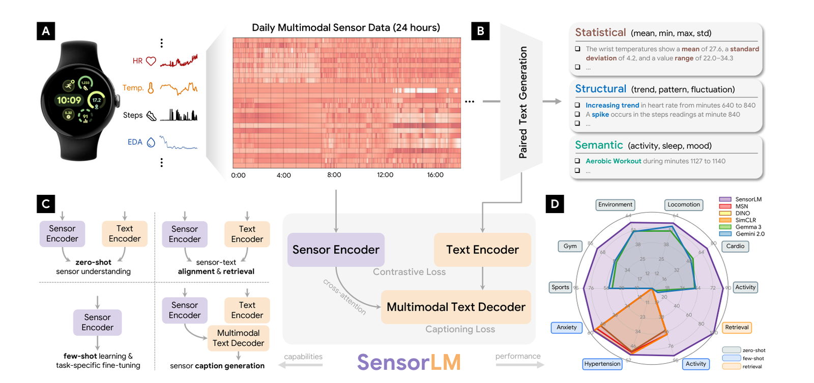

图源：SensorLM 论文 Fig. 1（*SensorLM: Learning the Language of Wearable Sensors*, NeurIPS 2025）

SensorLM 是在 **5,970 万小时（59.7M hours，涵盖 103,000+ 名真实 Fitbit / Pixel Watch 用户）** 真实野外可穿戴多模态数据上训练的传感器-语言多模态基础模型。

#### 1. 双重演进脉络定位：Google 穿戴大模型演化与时序语言三部曲

在整个可穿戴基础模型的技术演进史中，SensorLM 占据了两个关键的“十字路口”地位：

##### 脉络一：Google 自身大穿戴模型 (LSM) 与数字健康体系的完整演化链
1. **纯数值通用时序基座**：**TimesFM**（ICML 2024），解决无先验的单变量纯数值自回归外推；
2. **纯物理多模态自监督基座**：**SensorFM**（arXiv 2026），在 1 万亿分钟 Fitbit 数据上用 Patch-Transformer 做掩码重构，建立无标注物理表征，但代码与权重闭源；
3. **传感器-语言跨模态基础模型**：**SensorLM**（NeurIPS 2025），在 59.7M 小时数据上通过 CoCa 架构**首次打通穿戴硬件波形与人类自然语言的语义映射，且官方开源代码**；
4. **专病连续监测基座**：**GlucoFM**（2026），针对连续血糖（CGM）设计双流 JEPA 预测；
5. **顶层健康对话与临床 Agent**：**Personal Health LLM (PH-LLM) / Gemini Health**，在消费级健康场景中执行高级医学推理。

> [!IMPORTANT]
> **开源生态的关键窗口**：由于 SensorFM 闭源，**SensorLM 是目前学术界与工业界能够直接参考 Google 如何在底层处理 Fitbit / Pixel Watch 多模态物理流、如何构建 Patch Embedding、如何与大模型交互的官方开源代码实现**。

##### 脉络二：可穿戴“时序-语言基础模型”三部曲进化史（SensorLM → PPG-LM → TimeBraid）
- **第一代：Google SensorLM (NeurIPS 2025, 消费级生活穿戴)**：基于 Fitbit 多传感器流，采用 **CoCa 架构**实现**单向翻译（Sensor → Text Caption）**，解决了“如何看传感器波形用自然语言写出佩戴者行为 / 生理状态”的问题；
- **第二代：Emory/Google PPG-LM (2026.09, 严肃临床急诊监护)**：从日常生活迈向急诊与 ICU。继承了 SensorLM 的分层打标思想，但**舍弃通用 7B 大模型（改用 8 层从零初始化的因果 Transformer）杜绝医学幻觉**，并引入连续物理时间 RoPE 攻克穿戴严重断流；
- **第三代：UCSD TimeBraid (2026.09, 通用双向推演全能基座)**：打破了 SensorLM 和 PPG-LM“单向由波形生成文本”的局限。通过**双塔深层交错全局残差注意力（MoT）**，实现 **Text ↔ Time Series 双向全通**，让模型具备**接收自然语言情景假设（如“明天降温 10 度”）、反向生成未来连续生理预测曲线（What-If / Ctrl-F）** 的推演能力。

#### 2. 核心架构：面向异构穿戴传感器的 ViT-CoCa 统一框架

针对穿戴设备传感器采样率不一致（高频 PPG vs. 极低频体温）的物理特性，SensorLM 设计了兼顾对比与生成的模块化架构：
1. **传感器多模态分块编码器 (Sensor Encoder)**：
   - 采用 Vision Transformer（ViT-1D/2D）变体作为骨干网络；
   - 将不同维度的连续时序信号（PPG、三轴 ACC、EDA、皮肤温度、气压计）在时间和通道两个维度上划分为规整的二维 Patch，经过线性投影后拼装为统一长度的 Token 序列，并注入时空位置编码。
2. **文本编码器 (Text Encoder) 与多模态因果解码器 (Multimodal Decoder)**：
   - 包含一个单向文本编码器提取描述向量；
   - 包含一个因果掩码多模态文本解码器，通过 Cross-Attention 层层查询传感器编码器的输出潜变量，自回归解码出长句自然语言。
3. **CoCa (Contrastive Captioner) 双重预训练目标**：
   - **对比损失 ($\mathcal{L}_{\text{Contrastive}}$ / InfoNCE)**：拉近配对的传感器多模态信号与文本描述之间的嵌入距离，构建对齐的多模态几何空间；
   - **生成损失 ($\mathcal{L}_{\text{Captioning}}$)**：最大化给定传感器潜表征条件下生成目标文本的对数似然；
   - **消融实证**：论文证实，相比于仅做 CLIP 对比学习或仅做自回归 Captioning，**CoCa 联合预训练在零样本人体活动识别与特征提取上取得了全场最优性能**。

#### 3. 自动化分层语料生成流水线 (Hierarchical Caption Generation)

智能手表在日常自由生活（Free-living）中缺乏人工文本标签。Google 设计了自底向上的三层自动标注语料管线，将 5,970 万小时原始波形转化为富语义文本：
1. **统计层 (Statistical)**：从原始信号中自动解算均值、方差、极值峰值、能量谱密度与局部振幅差；
2. **结构层 (Structural)**：识别时序的周期性、昼夜节律模式、频域主频、波峰间期（IBI / HRV）波动趋势、步频稳定性以及多传感器间的时延互相关；
3. **语义层 (Semantic)**：结合设备内置算法判别出的高阶健康事件（如跑步、上坡骑行、深睡阶段、压力应激），组装为富有临床与生理常识的自然语言长文本。

#### 4. 预训练数据与下游评测表现

- **数据底座**：涵盖 **103,000+ 名受试者**、近 **6,000 万小时**的连续真实世界传感器记录；
- **核心基准表现**：
  1. **零样本人体活动识别 (Zero-Shot HAR)**：在完全未见过的公开活动数据集（如 Capture-24、PAMAP2）上，直接使用文本 Prompt 进行零样本分类，性能超越传统无监督对比学习模型；
  2. **跨模态传感器-文本双向检索**：仅凭一段自然语言描述（如“*步频稳定且心率逐步抬升的慢跑*”），能高精度从海量传感器库中检索出对应的多维波形片段；
  3. **细粒度传感器状态 Captioning**：能够准确用自然语言区分“处于紧张答辩状态的心率激增（无加速度剧烈运动，伴随 EDA 升高）”与“跑步机运动引起的心率激增（伴随高振幅加速度）”。

#### 5. 对开源生态与自建手表模型 (Watch-LSM) 的实战价值

Google SensorLM 的官方开源代码库（`Google-Health/consumer-health-research/sensorlm`）为自建模型提供了可直接复用的工程资产：
1. **多传感器 Patch 分块实现**：可直接复用其将 5 种不同采样率传感器切分为 Patch 的张量对齐逻辑；
2. **弱监督分层数据工程流水线**：借鉴其统计 → 结构 → 语义的模板代码，用于在自有未标注穿戴数据上快速孵化多模态微调语料；
3. **CoCa 对比 + 生成训练脚本**：提供了经过 Google 工业级大规模验证的损失加权与分布式训练超参配置。

---

## 6. 核心基础模型横向对比矩阵

为保证排版清晰与阅读美观，将代表性腕戴基础模型分为两组进行全景对比：

### 表 1：脉搏波与心血管多模态基础模型

| 维⁠度 / 特⁠征 | PaPaGei | Pulse-PPG | AnyPPG | PPGFlowECG | UniCardio | Samsung xMAE / HiMAE |
| :--- | :--- | :--- | :--- | :--- | :--- | :--- |
| **机⁠构⁠团⁠队** | Nokia Bell Labs | UIUC / 孟菲斯大学 | 北京大学数字健康实验室 | 北京大学数字健康实验室 | 清华大学 / 安贞医院 | Samsung Research / UCLA |
| **核⁠心⁠模⁠态** | 单通道 PPG | 腕部高噪 PPG | PPG (心电引导) | PPG → 诊断级 ECG | PPG + ECG + 动脉血压 (BP) | PPG → 虚拟 ECG / 绿光 PPG |
| **预⁠训⁠练⁠规⁠模** | 5.7 万小时 (10 个公开集) | 5.5 万小时 (野外 100 天) | >100,000 小时同步数据 | 千万级配对 (MC-MED 11.8 万人) | 339 小时三模态全时程 | xMAE 9.4k h / HiMAE 8 万 h (4.7 万人) |
| **网⁠络⁠骨⁠干** | ResNet1D-MoE | 12 层 1D-ResNet | Net1D 1D-ResNet 双分支 | CardioAlign + Rectified Flow | 多模态扩散 DiT | xMAE 跨模态 / HiMAE 1D U-Net (0.31M) |
| **自⁠监⁠督⁠目⁠标** | 形态引导对比学习 | 连续相对对比 (RelCon) | 跨模态深层 InfoNCE 对比 | 潜空间分布对齐 + 整流流生成 | 条件扩散去噪 + 持续学习 | 跨模态重构 / 混合掩码 (80% MAE) |
| **抗⁠伪⁠影⁠机⁠制** | 形态过滤配对 | 结合运动强度的软对比 | 中枢心电无伪影电信号锚定 | 参数绑定潜空间生理不变量 | 多模态互信息互补生成 | 严格三道 SQI (偏度 + 散度 + 模板) |
| **部⁠署⁠延⁠迟** | 端侧轻量 (约 1.5M) | 端侧中等 (约 2M) | 端侧单分支 (约 5.85M) | 1～4 步极速 ODE (<0.1 s) | 极低增量 (约 0.3M / 模态) | 极低 (HiMAE 手表 CPU 0.99 ms) |
| **开⁠源⁠状⁠态** | 代码 + Zenodo 权重 | 代码 + Zenodo 权重 | 代码开源 (GitHub) | 代码开源 (GitHub) | 论文公开 / 代码开源中 | xMAE 闭源 / HiMAE 代码开源 |

### 表 2：全传感器、空间运动与时序语言多模态基础模型

| 维⁠度 / 特⁠征 | SensorFM | SensorLM | OpenMHC (WBM/LSM) | PPG-LM | PPG-Distill | SleepFM-1 / 2 | Huawei Mantis |
| :--- | :--- | :--- | :--- | :--- | :--- | :--- | :--- |
| **机⁠构⁠团⁠队** | Google Research | Google Research / DeepMind | 斯坦福大学 / 帝国理工 | Emory / UCLA / Google | Emory University | 斯坦福大学医学院 | 华为诺亚方舟实验室 |
| **核⁠心⁠模⁠态** | PPG+ACC+EDA+Temp | 5 维传感器 (含气压计) | 19 通道腕部 + 169 维变量 | PPG + 结构化临床语言 | 腕戴 PPG | PSG + 腕部 PPG/ACC 代理桥 | 多变量 (ACC / 生理) |
| **预⁠训⁠练⁠规⁠模** | 1 万亿分钟 (500 万人) | 5,970 万小时 (10.3 万人) | >6,700 万小时 (1.2 万人) | 73,700 小时 (MC-MED 3.6 万人) | 多任务穿戴语料 | 200+ 万小时 (23.5 万人) | 多领域通用分类语料 |
| **网⁠络⁠骨⁠干** | Patch Transformer | ViT-2D Patch + CoCa 解码器 | WBM / LSM-2 / Chronos-2 | Patch-Conv1D + 6 层 Trans (12.7M) | 紧凑 1D 学生网络 | 2.57M LLaMA Transformer | 8M ViT-1D + TGU |
| **自⁠监⁠督⁠目⁠标** | 掩码建模 + 跨模态填补 | CoCa 对比对齐 + 自回归生成 | 多任务表征 + 自回归预测 | CoCa 对称对比 + 物理 RoPE 聚合 | 多尺度三级知识蒸馏 | LOO-CL 对比 + 局部 MAE | 几何自监督对比学习 |
| **抗⁠伪⁠影⁠机⁠制** | 万亿级数据 Scaling | 多传感器交叉互补 (ACC 辅助) | 真实野外全生命周期滤波 | 严格 SQI 分层 + Content-Key 过滤 | 结构化节律形态迁移 | 多器官互信息 + 物理代理桥 | 多尺度差分局部卷积 |
| **部⁠署⁠延⁠迟** | 云端基座 | 端云协同 (编码器端侧) | 端云协同评测基准 | 极轻量 (波形塔 12.7M，单卡极速) | 极低 (内存降 19×) | 冻结编码器 (轻量 2.57M) | 端侧极低 (约 19.8 ms) |
| **开⁠源⁠状⁠态** | 仅论文 (闭源) | 代码开源 (GitHub) | 代码 + 权重 + 基准开源 | 论文公开 (arXiv:2609.33516) | 代码开源 (GitHub) | 代码开源 (GitHub) | 代码与权重开源 (HF) |

---

## 7. 对自建手表大模型 (Watch-LSM) 的工程架构启示

本文提炼的端侧生理表征架构与抗伪影工程实现已落地于开源实验子仓库：[**Watch_LSM**](https://github.com/tujy859/Watch_LSM)。基于上述顶会与工业界成果，构建生产级智能手表生理基础模型应遵循以下八条准则：

1. **物理时序等长分块 (Physical-Time Patch Tokenization)**：
   - 避免使用任意重采样抹平采样率。定义固定物理时长（例如 $\Delta t = 0.25\text{ s}$），PPG 采 16 点、ACC 采 8 点，分别通过模态专用 Conv1d 投影为等长的 Patch Token 序列。
2. **双流交叉消除运动伪影 (Dual-Stream Cross-Attention)**：
   - 将 ACC 流作为强抗噪的“运动参考基准”，通过交叉注意力（Cross-Attention）自适应指引 PPG 流衰减由手臂甩动引起的同频步频谐波。
3. **复合损失约束**：
   - 单纯依赖 MAE 容易重建出平滑模糊波形，必须结合频域保真损失（$\mathcal{L}_{\text{Spectral}}$）以保全脉搏重搏切迹与心跳间期微形态。
4. **两阶段多尺度解耦 (Hierarchical Decoupling)**：
   - 吸收 HiMAE 的强生物物理局部偏置：采用轻量 1D 卷积 U-Net（<1M 参数、<1 ms 延迟）充当秒级底层生理 Tokenizer，将 10 秒原始高频波形提炼为紧凑的生理表征，再在外层级联长程状态空间（Mamba / Transformer）建模分钟至昼夜节律，实现兼顾手表端侧部署与长时程生理表征的平衡。
5. **吸收 PPG-LM 的连续时间 RoPE 与多时间尺度对齐**：
   - 用户佩戴智能手表存在大量洗澡、充电、运动暂停导致的断流与不规则采样。借鉴 PPG-LM 的**连续物理时间 RoPE**（将旋转角度绑定在真实物理分钟差上）与 **Perceiver 时间锚点潜变量探针**，可在不进行插值伪造数据的前提下实现优雅的 24 小时任意长度时序聚合。
6. **吸收 SensorLM 的全传感器异构接入与自底向上分层打标流水线**：
   - 借鉴 Google SensorLM 官方开源代码，将 PPG、3 轴 ACC、EDA、体温统一在 ViT-2D Patch 空间对齐；
   - 复用其统计级 → 结构级 → 语义级三层语料自动化生成流程，在无标注海量手表数据上低成本构建用于多模态对齐的高质量指令语料。
7. **吸收 UniCardio 的动态模态接入与防遗忘思想**：
   - 采用轻量化模态独立编码器结合任务注意力掩码，让用户在增删传感器（如外接胸带、贴片或脱下表带）时免于全模型重训。
8. **判别与生成解耦**：
   - 端侧日常活动分类与心律失常筛查优先采用 Mantis 式判别骨干；而高精度连续生命体征（实时心率、血压波形、虚拟心电）追踪则采用双流生成式重构或扩散骨干。

---

## 8. 核心文献与资源汇总

| 项⁠目 / 论⁠文⁠名⁠称 | 主⁠要⁠机⁠构 | 发⁠表⁠情⁠况 | 核⁠心⁠定⁠位⁠与⁠资⁠源 |
| :--- | :--- | :--- | :--- |
| **SensorFM** | Google / Fitbit Health AI | arXiv 2026 | 1 万亿分钟消费级穿戴多模态基座 · [论文](https://arxiv.org/abs/2605.22759) |
| **PaPaGei** | Nokia Bell Labs | ICLR 2025 | 开源形态感知脉搏波基础模型 · [论文](https://arxiv.org/abs/2410.20542) · [代码](https://github.com/Nokia-Bell-Labs/papagei-foundation-model) |
| **Pulse-PPG** | 孟菲斯大学 / UIUC | UbiComp 2025 | 野外非受限生活场景脉搏基座 · [代码](https://github.com/maxxu05/pulseppg) |
| **HiMAE** | Samsung Research / UCLA | ICLR 2026 | 手表端侧亚毫秒级分层掩码自编码基座 · [论文](https://arxiv.org/abs/2510.25785) · [代码](https://github.com/Simonlee711/HiMAE) |
| **UniCardio** | 清华大学 / 安贞医院 | Nat Mach Intell 2025/2026 | 统一心血管多模态扩散基础模型 · [论文](https://doi.org/10.1038/s42256-025-01147-y) · [代码](https://github.com/chen-zehua/UniCardio) |
| **PPGFlowECG** | 北京大学健康医疗大数据国家研究院 | arXiv 2025-2026 | 潜空间整流流 PPG 转 ECG 跨模态生成 · [论文](https://arxiv.org/abs/2502.14856) · [代码](https://github.com/PKUDigitalHealth/PPGFlowECG) |
| **AnyPPG** | 北京大学健康医疗大数据国家研究院 | ACM SIGKDD 2026 | 心电引导预训练的光电多器官基座大模型 · [论文](https://arxiv.org/abs/2511.01747) · [代码](https://github.com/Ngk03/AnyPPG) |
| **SigmaPPG** | 米兰理工大学 / 浙江大学 / Emory | arXiv 2026 | 强化学习先验引导对抗掩码与向量量化 PPG 基座 · [论文](https://arxiv.org/abs/2601.21031) · [代码](https://github.com/ZonghengGuo/SigmaPPG) |
| **PPG-Distill** | Emory University | 2025 | 脉搏波基础模型多层次端侧知识蒸馏 · [代码](https://github.com/LingFengGold/PPG-Distill) |
| **PpgAge** | Apple Health | Nat Commun 2025 | 21.3 万人腕部脉搏波血管生物年龄研究 · [论文](https://doi.org/10.1038/s41467-025-64275-4) |
| **OpenMHC** | 斯坦福大学医学院 | arXiv 2026 | 6,700 万小时真实世界穿戴基础模型基准与生态 · [论文](https://arxiv.org/abs/2607.16235) · [代码](https://github.com/AshleyLab/OpenMHC) |
| **PPG-LM** | Emory / UCLA / Google | arXiv 2026 | 多时间尺度临床对齐脉搏-语言基础模型 · [论文](https://arxiv.org/abs/2609.33516) |
| **SensorLM** | Google Research / DeepMind | NeurIPS 2025 | 5,970 万小时智能手表传感器-语言多模态基座 · [论文](https://arxiv.org/abs/2506.09108) · [代码](https://github.com/Google-Health/consumer-health-research/tree/main/sensorlm) |
| **LIMU-BERT** | 南洋理工大学 (NTU) | ACM SenSys 2021 | 手腕三轴 IMU 空间运动表征模型 · [代码](https://github.com/dapowan/LIMU-BERT-Public) |
| **PPG-Bench** | Mannas AI | arXiv 2026 | 9 数据集 26 任务脉搏大模型大一统评测套件 · [论文](https://arxiv.org/abs/2610.13435) · [代码](https://github.com/mannas-ai/ppg-bench) |
| **PPG 生⁠物⁠年⁠龄⁠横⁠评** | Nabil Brag | arXiv 2026 | 脉搏基础模型血管生物年龄跨域评测基准 · [论文](https://arxiv.org/abs/2603.14030) · [代码](https://github.com/Misterbra/ppg-age-benchmark) |

---

> **欢迎交流与共建**  
> 本文由开源知识库项目 [Wearable-Physiological-Foundation-Models](https://github.com/tujy859/Wearable-Physiological-Foundation-Models) 整理策划。该项目持续追踪全球在智能手表、连续血糖监测（CGM）以及多模态生理健康基础模型领域的最新突破。如果您对可穿戴生理计算、时序健康基模与数字生物标志物有任何想法，欢迎在仓库提 Issue 交流！
