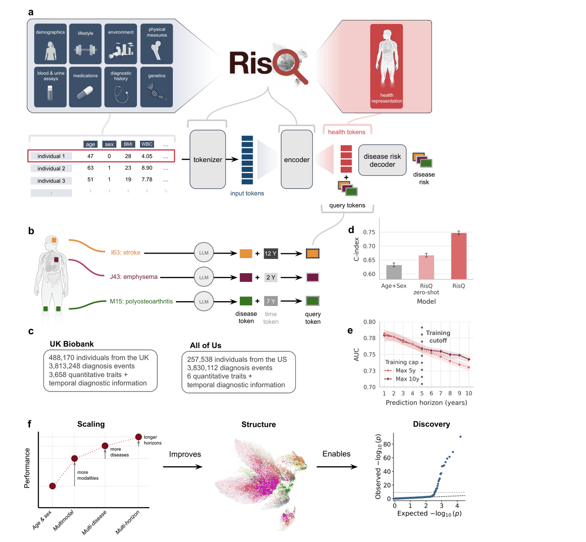

# 系统级多模态健康模型

本专题将临床风险基础模型作为可穿戴研究的扩展参考，重点讨论如何区分记录表征、未来风险与外部验证。RisQ 的主要输入是临床变量、用药、诊断史和遗传信息；其公开论文没有把原始 PPG、ECG 或腕戴加速度波形作为核心输入，与 [纵向可穿戴模型](longitudinal_wearable_models.md) 的输入条件不同。资料截至 2026-11-04。

## RisQ

TUM / Helmholtz Munich 等 · medRxiv 2026 · [论文](https://doi.org/10.64898/2026.07.07.26357373) · [代码](https://github.com/RisQ-Lab/RisQ)

图源：RisQ 论文 Fig. 1，medRxiv 2026.07.07.26357373v1。

| 研究 | 架构与机制 | 数据口径 | 原论文代表结果 | 开放资源 |
| :--- | :--- | :--- | :--- | :--- |
| RisQ | Transformer 编码健康信息，交叉注意力解码器接收疾病和预测时间条件 | UKB 488,170 人用于训练/验证，其中训练 420,760 人；AoU 257,538 人用于外部评测 | UKB 生存评测 C-index 0.760，95% CI 0.754-0.766；留出 ICD 章节的零样本 C-index 0.667 | [MIT 代码](https://github.com/RisQ-Lab/RisQ)，预训练权重的获取方式尚不明确；队列数据另行申请 |

### 输入与查询机制

论文用结构化变量和历史事件形成健康词元，再由疾病描述与时间跨度生成查询。研究同时训练多个疾病和预测时点，检验是否能够共享风险相关信息。临床输入包括人口信息、生活方式、环境暴露、体格测量、生化检查、用药、诊断史和遗传摘要。[论文方法与 Fig. 1](https://www.medrxiv.org/content/10.64898/2026.07.07.26357373v1.full)

“未见疾病”具体指留出 ICD 章节等实验设置；“未见时间”也有明确的训练和测试范围。这样的查询接口支持组合泛化研究，不能据此认为模型对任意疾病、任意时间或任意人群均已得到验证。

### 验证口径

UKB 划分为 420,760 人训练、33,705 人验证与 33,705 人测试。论文主要比较 588 项经临床整理的疾病，并报告 1、2、5、10 年分类与最长 16 年的生存分析。All of Us 的 257,538 人独立用于外部评估，未重训、微调或重新校准；其可用输入更有限，预测时域为 1-5 年。两队列人数相加描述的是研究覆盖人群，不能写成全部预训练人数。[论文第 2 节与 Methods](https://www.medrxiv.org/content/10.64898/2026.07.07.26357373v1.full)

论文报告增加疾病、输入模态和预测时间覆盖能够改善其研究设置中的预测结果。相关分析提供跨任务迁移的实验证据，评估新设备和新队列时仍需要重新检验校准、数据缺失与标签时间对齐。

### 资源与复现

官方仓库公开数据整理、RisQ 与基线训练、All of Us 外部验证、风险评分比较及图表复现代码，采用 MIT 许可。个体级 UKB 数据不在仓库中分发，需要通过对应队列的访问流程获取。代码公开、权重下载和队列访问是三个独立状态。[官方仓库](https://github.com/RisQ-Lab/RisQ)

## 与可穿戴研究的连接

| 对象 | 输入层次 | 主要评测问题 | 比较时的边界 |
| :--- | :--- | :--- | :--- |
| [LSM / SensorFM / WBM](longitudinal_wearable_models.md) | 分钟级多传感器特征或派生行为指标 | 可迁移健康与行为表征 | 原始波形、聚合特征和长期行为指标的输入条件不同 |
| [OpenMHC](smartwatch_models.md#openmhc) | 19 通道派生穿戴时序及关联问卷信息 | 预测、插补与外推 | 自报疾病标签没有诊断日期，不能直接解释成前瞻风险终点 |
| RisQ | 临床变量与诊断史等多源记录 | 跨疾病、跨时间风险预测 | 临床随访与删失处理是其评测条件的一部分 |
| [WearableQA / HEARTS](health_reasoning_llms.md) | 个人指标历史或健康时序 | 数据计算、信号理解与问答 | 问答正确率和疾病风险预测准确度属于不同指标 |

评注。把穿戴表征加入临床风险模型属于进一步研究方向。实验应先固定观察窗口与未来终点，在人口统计、传统穿戴特征和临床协变量基线上分别测量新增表征的收益，并保留独立队列验证。
