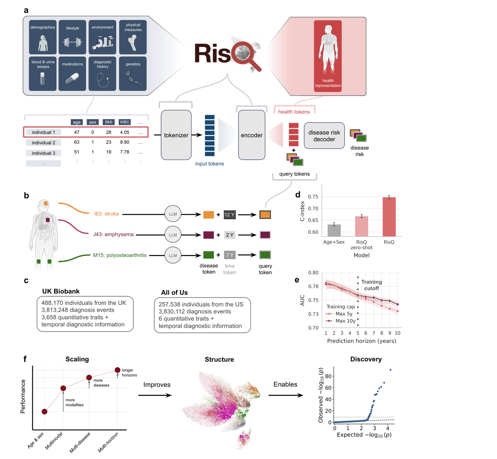
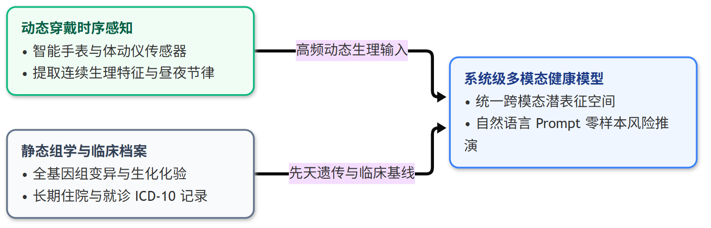

# 系统级多模态健康模型 (Universal Health & Cross-Disease Foundation Models)

本专题梳理系统级多模态健康基础模型（以 RisQ 为代表）的技术架构与跨疾病缩放规律（Scaling Law），并探讨高频连续可穿戴生理时序（如 SensorFM、OpenMHC）如何作为动态遥测探针接入全景健康模型。

长期以来，临床医学和生物医药风险预测多采用针对单一疾病的独立评分体系——预测心血管疾病使用一套评分，预测糖尿病使用另一套模型。然而，人类复杂疾病的发生是遗传易感底色、微观生化代谢稳态、宏观生活方式与时间累积共同作用的非线性动力学过程。2026 年，由慕尼黑工业大学（TUM）、亥姆霍兹慕尼黑中心（Helmholtz Munich）、QuantCo、哈佛大学及斯坦福医学 AIMI 等联合研发的 **RisQ**，在近 75 万真实人类队列（UK Biobank + All of Us）上验证了“人类健康全景跨疾病共享潜在结构（Shared Structure of Human Health）”，并支持通过自然语言提示词（Promptable Query）在全生命周期内对任意疾病进行零样本风险推演。

---

## 目录

- [1. 范式演进：从专病孤岛到系统级健康模型](#1-范式演进从专病孤岛到系统级健康模型)
- [2. 代表性模型深度拆解](#2-代表性模型深度拆解)
  - [RisQ](#risq)
- [3. 静态医学组学与动态可穿戴时序的协同关系](#3-静态医学组学与动态可穿戴时序的协同关系)
- [4. 代表性模型与基准横向对比](#4-代表性模型与基准横向对比)
- [5. 总结与演进方向](#5-总结与演进方向)

---

## 1. 范式演进：从专病孤岛到系统级健康模型

过去半个世纪，流行病学和医学统计学构建风险预测模型的常见范式是“专病专模（Single-Disease Silos）”：
- **心血管专科**：Framingham 评分、SCORE2 风险图表（基于收缩压、胆固醇、吸烟状况预测 10 年心肌梗死与卒中风险）；
- **内分泌专科**：FINDRISC 糖尿病风险评分（评估 10 年 2 型糖尿病发病风险）；
- **神经专科**：多基因风险评分（PRS）结合载脂蛋白 E（*APOE*）基因型预测阿尔茨海默病易感性。

### 传统单病种建模的核心局限

1. **割裂了人体生理的系统性联动**：例如，慢性肾脏病（CKD）、2 型糖尿病（T2D）与动脉粥样硬化心血管疾病（ASCVD）在病理生理学上属于相互促进的“心肾代谢综合征（Cardiorenal Metabolic Syndrome）”。单一疾病模型独立拟合参数，无法捕捉跨器官的共同病理级联反应。
2. **缺乏时间跨度与疾病谱系的开放泛化能力**：若需评估患者未来 3 年而非 10 年的风险，或评估某种未预先建模的并发症，传统方法必须重新清洗队列、重新拟合 Cox 比例风险回归系数；面对训练集未见过的疾病定义，模型无法直接推断。

**系统级健康模型的核心假说**：人类后天复杂疾病的易感性并非彼此独立的随机事件，而是遗传变异、内环境生化稳态、日常生理代谢与多器官共病随时间累积的“共享潜在结构（Shared Structure of Human Health）”。当训练覆盖的数据模态与疾病谱系足够宽广时，模型能够学习到跨疾病、跨时间尺度的统一生命表征。

---

## 2. 代表性模型深度拆解

### RisQ

> **发表信息**：medRxiv / Research Square 2026 · [论文](https://doi.org/10.64898/2026.07.07.26357373)  
> **机构**：慕尼黑工业大学 (TUM) / 亥姆霍兹慕尼黑中心 (Helmholtz Munich) / QuantCo / 哈佛大学 / 帝国理工学院 / 斯坦福医学 AIMI  
> **预训练与验证数据**：745,708 名受试者（UK Biobank 488,170 人 + All of Us 257,538 人）  
> **开源状态**：论文与复现协议公开（闭源权重）

图源：RisQ 论文架构总览图（DOI: 10.64898/2026.07.07.26357373）

RisQ（*Learning the shared structure of human health across diseases, modalities, and time*）通过多尺度跨模态交互注意力机制，将遗传组学、临床生化检验、纵向电子病历轨迹与手腕可穿戴时序统一编码为共享潜在表征向量 $\mathbf{z}$，并配合时间生存风险解码器实现任意时间窗口与零样本疾病的风险推演。

#### 2.1 75 万人跨国双中心队列验证

RisQ 在两个大型生物医学队列上进行了跨人群验证，以检验表征的跨中心泛化能力：
1. **预训练与内部验证队列（UK Biobank，英国生物样本库）**：
   - 包含 **488,170 名受试者**，纵向随访时间达 10～15 年；
   - 融合全外显子测序、全基因组 SNP 芯片、30 余项临床生化常规检验、约 10 万人的 7 天手腕连续三轴加速度计（Axivity AX3，100 Hz）记录，以及覆盖英国 NHS 系统的住院与死亡登记电子病历（ICD-10）。
2. **零样本跨国独立外推队列（All of Us，美国多族裔精准医学队列）**：
   - 包含 **257,538 名受试者**；
   - 在**不进行目标队列微调（Zero-shot without retraining）** 的设定下，直接将预训练的 RisQ 模型迁移至美国多族裔人群进行评估；
   - 实验结果显示，RisQ 在各主要 ICD-10 疾病门类的风险预测一致性指数（C-index）与精确率-召回率曲线下面积（AUC-PR）上，均优于单病种 Cox 比例风险回归模型、多任务多头神经网络及通用表格基础模型。

#### 2.2 四大生命模态与时间跨度联合建模

RisQ 将个体的多源异构健康记录投影至统一的跨模态潜在空间：
- **静态遗传先验模态（Genetics）**：全外显子功能缺失变异（Loss-of-Function, LoF）与常见致病突变，刻画个体先天的疾病易感基线；
- **动态生化内环境（Biomarkers）**：空腹血糖、糖化血红蛋白（HbA1c）、肝肾功能酶学、血脂四项、C-反应蛋白（CRP）等 30 余项临床检验面板；
- **纵向临床事件轨迹（EHR）**：按物理时间戳排列的历史疾病诊断（ICD-10 编码）、手术操作记录与药物处方事件；
- **全天候生活方式时序（Wearable Accelerometry）**：从手腕穿戴设备中提取的日间身体活动强度分布、静坐行为时长及昼夜节律稳定性特征。

#### 2.3 自然语言提示词驱动的零样本风险查询 (Promptable Risk Modeling)

不同于传统模型仅输出固定维度的分类 Logits，RisQ 将语言提示机制与统计生存分析（Survival Analysis）相结合：
- 临床研究者或系统可通过自然语言指令直接发起查询：
  $$
  \text{Query: "Estimate the risk of Type 2 Diabetes within } \Delta t = 5 \text{ years."}
  $$
- 模型内部将自然语言疾病描述映射至医学疾病本体论空间（Disease Ontology / SNOMED CT / ICD-10 嵌入空间），与受试者的多模态潜在表征 $\mathbf{z}$ 及目标预测时间窗 $\Delta t$（如 1 年、3 年、5 年、10 年、15 年）进行交叉注意力对齐，实时解算对应的累积发病风险曲线。
- **未见疾病零样本泛化**：对于训练阶段缺乏充足独立正样本的罕见并发症，RisQ 可利用该疾病与已知疾病在基因通路和生化表征空间上的相关性，输出零样本风险评估。

#### 2.4 医学风险领域的跨疾病缩放定律 (Scaling Law) 实证

RisQ 在生物医学风险预测中系统验证了跨疾病的正向缩放效应：
- **实验规律**：随着模型联合训练覆盖的**疾病种类由数十种扩展至数百种、融合的数据模态增加、以及纵向随访时间跨度拉长**，模型在特定单病种（如急性心肌梗死、阿尔茨海默病、终末期肾病）上的风险预测 C-index 呈现**单调递增趋势**。
- **正向信息迁移（Positive Information Transfer）**：这一现象表明，联合建模多系统疾病并未引发传统多任务学习中常见的“负迁移（Negative Transfer）”，反而借助跨器官共享的底层病理生理机制，提升了单病种表征的判别力。

#### 2.5 微观单基因功能缺失突变 (LoF) 的跨系统病理锚定

为验证模型潜在表征的生物学可解释性，研究团队将 RisQ 学到的潜空间向量与人类全基因组单基因功能缺失突变进行了关联映射，模型自动复现了多个已知致病基因对跨系统疾病风险的级联影响：
- **HBB（血红蛋白亚基 $\beta$ 基因突变）**：在潜空间中显著关联贫血综合征与多系统微循环缺血风险；
- **LDLR（低密度脂蛋白受体突变）**：精确投射至家族性高胆固醇血症及早发冠心病事件轨迹；
- **SLC22A12（尿酸转运蛋白突变）**：关联高尿酸血症、痛风与继发性心肾代谢功能减退；
- **CASR（钙敏感受体突变）**：跨模态连接钙磷代谢异常、甲状旁腺功能亢进与远期骨质疏松风险。

---

## 3. 静态医学组学与动态可穿戴时序的协同关系

在以 RisQ 为代表的系统级健康模型中，可穿戴生理时序与医院临床组学数据构成了时间尺度上的互补关系：

图源：静态组学基线与动态穿戴生理遥测的跨尺度协同架构

| 数据维度 | 组学与医院临床数据 (Genetics & EHR) | 可穿戴生理时序 (Wearables: PPG / ECG / ACC / CGM) |
| :--- | :--- | :--- |
| **采样频次** | 低频、稀疏（全基因组测序通常仅一次，临床体检间隔数月至一年） | 全天候连续采集（秒级、分钟级持续刷新） |
| **状态表征** | 先天遗传底色、器质性病变终点、静态生化快照 | 实时自主神经调节、血流动力学波动、运动负荷与昼夜节律动态 |
| **在架构中的角色** | 提供个体的**先天易感基线与临床确诊参考锚点** | 提供个体的**连续动态生理演变探针与早期亚临床偏离信号** |

> [!TIP]
> **跨尺度协同启示**：缺乏静态多组学与纵向电子病历锚定，单纯的可穿戴波形表征难以直接外推至十万级人群的远期临床硬终点；反之，缺乏可穿戴设备的高频连续监测，系统级医学模型便只能依赖低频体检快照，难以捕捉日常生活中的瞬态病理触发事件与干预响应。

---

## 4. 代表性模型与基准横向对比

| 对比维度 | Google SensorFM (2026) | Stanford OpenMHC (2026) | RisQ (TUM / Helmholtz, 2026) | Meta WearableQA (2026) |
| :--- | :--- | :--- | :--- | :--- |
| **核心定位** | 硬件传感器级微观物理波形基座 | 超大规模开源穿戴基准与模型复现 | 系统级跨疾病全景健康模型 | 真实世界长程健康认知推理基准 |
| **受试者规模** | 超 500 万人（Fitbit 设备） | 11,894 人（MyHeart Counts 队列） | 745,708 人（UKB + All of Us） | 200 人（最长 500 天连续记录） |
| **涵盖核心模态** | PPG + ACC + EDA + 肤温 | 19 维穿戴通道 + 169 维 HealthKit | 全基因组 + 生化化验 + EHR + 穿戴体动 | 16 维穿戴日常指标 + 17 项临床血检 |
| **时间尺度** | 毫秒级、秒级至单日窗口 | 分钟级至跨年连续自由生活 | 1 年、5 年、10 年至全生命周期随访 | 500 天纵向日粒度生理与行为指标 |
| **交互与调用方式** | 提取波形特征向量供下游任务微调 | 运行预测、插补与外推三条统一赛道 | 自然语言 Prompt 查询任意疾病生存风险 | 10 选 1 纵向健康归因与推理问答 |
| **开源状态** | 闭源 | 代码、数据与权重开源（Dataverse / HF） | 论文公开（含复现协议，闭源权重） | 评测协议与论文公开 |

---

## 5. 总结与演进方向

RisQ 展示了生物医学基础模型从“单一疾病专用模型”向“跨模态、跨疾病、跨时间尺度共享表征”演进的可行性。对于可穿戴生理基础模型（如 SensorFM、OpenMHC、PaPaGei、GlucoFM）而言，系统级健康模型指明了底层高频物理表征的重要下游出口——将腕戴光电脉搏、动态血糖与体动编码器提取的连续动态特征注入全景健康风险模型，有望打通从“日常微米/毫秒级生理波动”到“全生命周期慢病风险预警与个性化生活方式干预”的完整链条。
