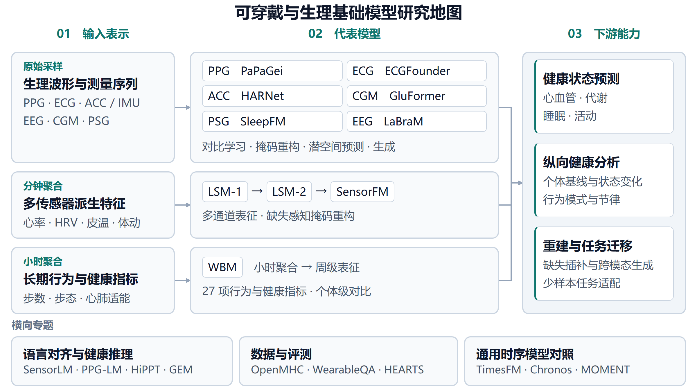
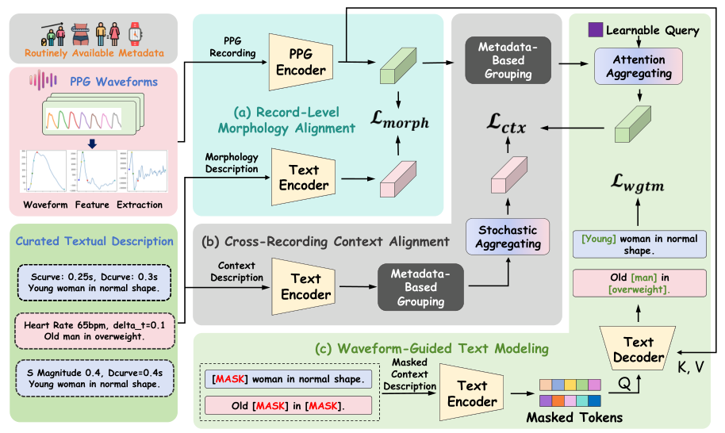
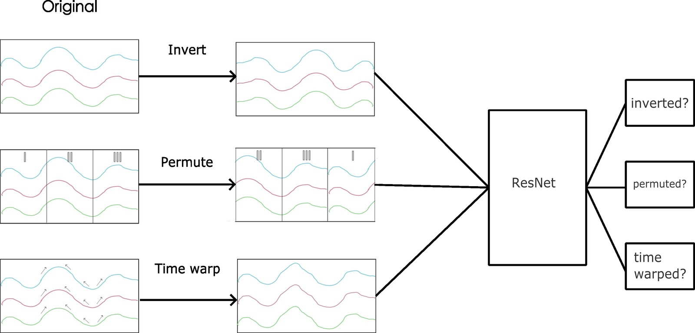
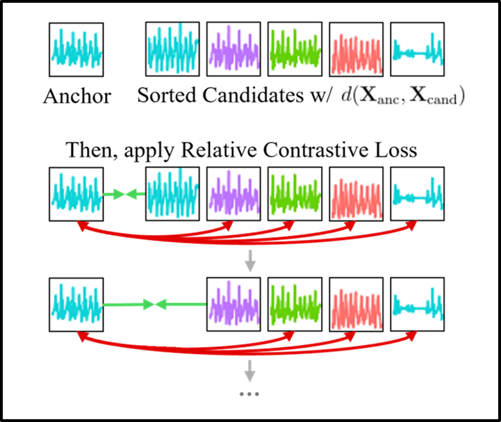

# 腕戴波形预训练与运动表征迁移

检索更新日期为 2026-11-04。本专题补充从原始 PPG、ECG 和加速度信号学习可迁移表征的研究，重点比较训练目标、时间窗口、跨人群评测与可复现资源。分钟级多传感器指标和长期行为指标另见 [纵向可穿戴模型专题](longitudinal_wearable_models.md)。

## 研究路线与收录理由

Apple 的波形模型与跨模态蒸馏展示了如何从消费级设备的短片段中学习健康信息。HiPPT 补充 PPG 与生理描述的多范围对齐，将单段形态和同背景多记录分别作为监督证据。OxWearables 的 HARNet 与 Sensori 分别覆盖短时活动识别和全天运动健康表征。Inertia-1 则提供对采样率、佩戴位置、预训练目标及规模的受控比较。RelCon 补充以相对语义距离学习运动表征的路线。本专题将 Inertia-1 记为评测与方法研究框架，其余独立预训练工作记为模型。

| 工作 | 架构与输入 | 训练数据口径 | 主要机制 | 论文结果及评测条件 | 代码与权重 |
| :--- | :--- | :--- | :--- | :--- | :--- |
| Apple PPG / ECG | 独立 EfficientNet 式 1D 编码器，PPG 3.3M、ECG 2.5M | AHMS 的 PPG 约 1,985 万段、14.1 万人，ECG 约 374 万段、10.7 万人，随后按参与者划分训练集 | 参与者级正样本、正则化 InfoNCE、动量编码器 | 参与者级线性探测，年龄 MAE 分别为 3.19 年和 6.33 年 | 官方研究页未提供代码与权重 |
| Apple ACC 蒸馏 | PPG 教师与 ACC 学生，主实验为 8 层 Transformer，并有模型压缩实验 | 约 2,000 万对一分钟 PPG-ACC 片段、17.2 万人，80% 参与者用于训练 | 先预训练 PPG，再冻结教师进行表征蒸馏 | 全量标签线性探测心率 MAE 为 1.19 bpm，ACC 对比学习基线为 2.33 bpm | 官方研究页未提供代码与权重 |
| [HiPPT](#hippt) | 12 层、512 维 PPG Transformer 与 PubMedBERT 文本分支；250 Hz、12 秒模型输入；总参数量未报告 | HBPM-BG 约 130 万条、1,086 人；VS 约 300 万条、20.05 万人，均为一分钟采集记录 | 单记录形态对齐、按元数据分组的跨记录上下文对齐、波形引导文本恢复 | 线性探测 SBP MAE 11.67 mmHg、cfPWV PR-AUC 0.84；PPG-DaLiA 心率 MAE 7.65 bpm | [预印本](https://arxiv.org/abs/2610.14489) 承诺发布代码与权重，当前未提供下载入口 |
| HARNet / SSL-Wearables | 18 层 1D ResNet-V2，约 10M，公开模型采用 30 Hz ACC | UK Biobank 约 10 万人、70 万人天 | 预测时序变换的多任务自监督预训练 | 期刊版在 8 个活动识别数据集上报告 F1 相对提升中位数 24.4% | [代码与预训练加载入口](https://github.com/OxWearables/ssl-wearables) |
| Sensori | 1D CNN + 8 层 Transformer，40M，24 小时三轴 ACC | 预训练为 UKB/CKB 的 91,037 人、502,823 人天 | 五分钟表征掩码预测与跨日参与者对比学习 | 加入临床协变量后，52/102 项现患疾病分类改善，改善项目的 ΔAUROC 中位数 0.060 | [代码](https://github.com/OxWearables/Sensori) · [学术用途权重](https://huggingface.co/light156/Sensori) |
| RelCon | 1D ResNet 编码器，三轴 ACC | AHMS 87,376 人、10 亿片段 | 学习运动模式距离，再以相对对比目标保留片段相似度排序 | 覆盖 6 个数据集、4 类任务；活动分类与步态回归按各表协议比较 | [代码](https://github.com/maxxu05/relcon)，作者明确不公开预训练权重与数据 |
| Inertia-1 | 多种 CNN、GRU、Transformer 与预训练方法，模型规模实验覆盖约 10M-100M | 研究覆盖 1,822 万小时、115,450 人、15 个数据集 | 控制输入表示、目标、规模和下游协议的比较框架 | 覆盖活动识别、冻结步态及疾病预测，具体指标应按任务表读取 | [MIT 代码](https://github.com/yang-ai-lab/Inertia-1)，官方 README 未提供预训练权重入口 |

表中指标来自各论文内部评测，各研究使用的标签、参与者划分和传感器条件不同。训练规模区分数据集总量与实际预训练划分，跨论文比较应同时读取这些条件。[Apple 波形论文](https://arxiv.org/abs/2312.05409) · [Apple 蒸馏论文](https://arxiv.org/abs/2412.11276) · [HARNet 期刊版](https://doi.org/10.1038/s41746-024-01062-3) · [Sensori 论文](https://arxiv.org/abs/2608.29494) · [Inertia-1 论文](https://arxiv.org/abs/2607.06617)

## Apple 波形与跨模态蒸馏

### Apple PPG / ECG

Apple · ICLR 2024 · *Large-scale Training of Foundation Models for Wearable Biosignals* · [论文](https://arxiv.org/abs/2312.05409) · [官方介绍](https://machinelearning.apple.com/research/large-scale-training)

图源为 Apple 波形论文 Fig. 3，arXiv 2312.05409v2。

论文分别训练 PPG 与 ECG 编码器。PPG 使用四通道、60 秒片段并降采样至 64 Hz，ECG 使用单导联、30 秒片段并降采样至 128 Hz。同一参与者的不同记录构成正样本，随机增强、InfoNCE 与 KoLeo 正则共同约束表征，教师编码器采用动量更新。输出为 256 维表征。[论文第 3-4 节](https://arxiv.org/html/2312.05409v2)

作者先平均同一参与者的多个片段表征，再进行参与者级线性探测。论文 Table 2 报告 PPG 的年龄 MAE 为 3.19 年，ECG 为 6.33 年，性别分类 AUROC 分别为 0.993 和 0.951。这些实验说明预训练表征保留人口与健康相关信息，评价单位是参与者。[论文 Table 2](https://arxiv.org/html/2312.05409v2)

**评注**

这项工作补齐 Apple 波形模型、ACC 蒸馏和 WBM 之间的方法脉络。同人不同片段的正样本设计适合提取稳定个体特征，瞬时状态任务还需评估其对短期变化的保留程度。原始 AHMS 数据、官方训练代码与预训练权重的可获取性限制了独立复现。官方研究入口截至本次检索未列出代码与权重下载。[官方研究页](https://machinelearning.apple.com/research/large-scale-training)

### Apple ACC 蒸馏

Apple · arXiv 2024，2025 年修订 · *Wearable Accelerometer Foundation Models for Health via Knowledge Distillation* · [论文](https://arxiv.org/abs/2412.11276) · [官方介绍](https://machinelearning.apple.com/research/wearable-accelerometer-foundation-models)

图源为 Apple ACC 蒸馏论文 Fig. 1，arXiv 2412.11276v2。

训练数据是低运动时段同步记录的一分钟 PPG 与 ACC。主实验先以掩码自编码预训练 PPG Transformer，再冻结教师，以配对片段将其表征迁移至 ACC 编码器。论文还用 EfficientNet 和对比学习教师验证方法。推理使用 ACC 学生，训练阶段需要配对 PPG。[论文第 3-4 节](https://arxiv.org/html/2412.11276v2)

在约 1.9 万候选片段的检索池中，ACC 表征匹配对应 PPG 表征的 Top-1 准确率为 99.17%。全量标签线性探测的心率 MAE 从 ACC 对比学习基线的 2.33 bpm 降至 1.19 bpm，SDNN MAE 从 9.93 ms 降至 6.54 ms。检索准确率衡量的是跨模态嵌入匹配，心率与 HRV 结果应分别读取回归误差。[论文 Table 1、9、10](https://arxiv.org/html/2412.11276v2)

**评注**

收录价值在于传感器间知识迁移和低功耗感知。研究明确聚焦低运动 ACC 中的细微心血管成分，应用到跑步、强运动或其他佩戴位置时需要新的验证。论文与官方研究页没有提供可下载模型，本仓库保留方法比较入口。[论文讨论](https://arxiv.org/html/2412.11276v2) · [官方研究页](https://machinelearning.apple.com/research/wearable-accelerometer-foundation-models)

## 生理语义与文本对齐

### HiPPT

东南大学 / OPPO / 深圳技术大学 / 北京大学 · arXiv 2026 预印本 · *HiPPT: Physiology-Grounded Wearable PPG Representation Learning via Multi-Scope Text Alignment* · [论文](https://arxiv.org/abs/2610.14489)

图源：HiPPT 论文 Fig. 1（arXiv:2610.14489v2），从论文原稿裁剪并按 2x 渲染。

HiPPT 将不同监督信号与适合的波形证据范围匹配：单条记录支持脉搏形态描述，多个相似背景记录则用于提取更稳定的属性相关规律。训练语料包括 HBPM-BG 的约 130 万条记录、1,086 人，以及 VS 的约 300 万条记录、20.05 万人。VS 在设备判断用户静止时采集，不能视为覆盖全部运动状态的连续波形。OPPO 有三位署名作者，其中一位为共同通讯作者；论文未提供各机构的逐项贡献声明。[论文第 1 页、附录 A](https://arxiv.org/html/2610.14489v2)

**方法**

- 记录级形态对齐：从 PPG 提取八个手工脉搏特征，用模板生成描述，与对应记录做双向对比学习；监督文本来自形态算法，不是人工临床报告。
- 跨记录上下文对齐：按年龄组、性别、BMI 组和采集时段在训练批次内分组，通过可学习查询向量汇聚 PPG 表征，再与上下文文本对齐。分组可以跨人，不要求记录相邻，也不建模先后顺序。
- 波形引导文本建模（Waveform-Guided Text Modeling, WGTM）：遮挡完整属性概念，以剩余文本和 PPG 分块表征恢复内容。遮挡 BMI 时同时遮住身高、体重等相关描述，减少直接从文本计算答案的捷径。

PPG 编码器为 12 层 Transformer，隐藏维 512、8 个注意力头。文本分支将 PubMedBERT 的底部六层作为编码器、顶部六层作为解码器，并插入接收 PPG 分块表征的交叉注意力；预训练文本参数大部分冻结，仅更新指定层与新增模块。原始记录长一分钟、采样率 250 Hz；附录配置为每块 125 点、24 块，因此模型单次输入为 12 秒，不能把采集长度直接写成模型上下文。总参数量、推理延迟与能耗未明确报告，一分钟预训练记录的具体裁片策略也需进一步说明。[论文第 3-4 节、附录 B-D](https://arxiv.org/html/2610.14489v2)

**结果**

以下均为冻结 PPG 编码器后训练线性任务头的结果，对照来自同一论文表格，排除 HiPPT 自身的累计消融；不是跨论文统一排名。

| 任务与数据 | HiPPT | 论文表中最强其他对照 | 协议与解释 |
| :--- | :--- | :--- | :--- |
| 收缩压，HBPM-X | MAE 11.67 ± 0.48 mmHg | SimCLR 11.89 ± 0.69 mmHg | 按记录评测，改善幅度较小，未报告显著性检验 |
| 血管僵硬，cfPWV | PR-AUC 0.84 ± 0.03 | 多任务监督 0.81 ± 0.03 | 以 cfPWV ≥10 m/s 划为异常，属于参与者级分类 |
| 年龄，HBPM-X | MAE 7.05 ± 0.79 年 | MAE 预训练 7.08 ± 0.82 年 | 同一人的多条记录预测先汇聚，名义差异仅 0.03 年 |
| 心率，PPG-DaLiA | MAE 7.65 ± 3.09 bpm | Apple 对照 8.18 ± 3.44 bpm | 15 人留一受试者评估，支持一定跨数据集迁移 |

来源为论文 Table 1-2 与附录 E.1。Table 1 表注将误差汇总写为五个随机种子；附录则分别描述 HBPM-X 的五折、cfPWV 的五次受试者划分和 PPG-DaLiA 的 15 名留一受试者汇总，标准差口径不能统一解释为随机种子波动。

加入上下文对齐后，年龄 MAE 从单独形态对齐的 7.56 降为 7.10 年，cfPWV PR-AUC 从 0.76 升为 0.83；再加入 WGTM 分别为 7.05 和 0.84。在这两项累计消融中，跨记录上下文带来的数值增益大于 WGTM，不能据此断言各组件在所有任务上的贡献顺序。低标注量下并非所有结果领先，例如 10% 标签时 cfPWV PR-AUC 为 0.67，低于 MAE 对照的 0.76。[论文第 5 节、Table 7](https://arxiv.org/html/2610.14489v2)

作者还聚合同一人的十条记录，在候选属性文本中检索，无需训练新任务头即可读取年龄组、性别和 BMI 类别，三者联合准确率为 29.55%。这些属性已参与预训练监督，因此“零样本画像”指新用户的无任务头推断，不能扩展为未见疾病或新概念的零样本识别。失败分析中，低体重与肥胖群体的 BMI 分类表现较弱。[论文 Table 3、Fig. 12](https://arxiv.org/html/2610.14489v2)

**评注**

收录价值在于用已有形态算法与常见元数据组织规模化语义监督，并以多任务线性探测检验表征迁移。它可与短时波形对比学习形成方法对照，但跨记录汇聚不等于长期有序时序建模；与 [WavesFM](longitudinal_wearable_models.md#wavesfm) 的周内有序建模应分开比较。

从消费级设备算法研发的角度，这篇 OPPO 参与的研究把传统形态特征和用户元数据转化成了预训练监督，值得关注的是如何组织已有数据及其可靠证据范围。该判断来自论文设计，不能当作 OPPO 产品部署或整体技术路线的证据。若面向自有研发，宜在相同数据和骨干下比较模板文本、数值元数据、分组对比与直接多任务监督，再检查运动条件、硬件和人群差异。

论文说明预训练队列与 HBPM-X 无用户交集，但未明确 HBPM-X 下游五折是否始终按用户分组；cfPWV 的下游划分按用户隔离，与预训练人群是否重叠则未说明。外部公开验证主要是心率任务，不能据此推出跨硬件血压能力。截至 2026-11-04，论文仍承诺后续发布代码与权重，未给出可核验下载入口；内部训练数据、裁片策略与完整基线配置也限制了独立复现。[论文附录 A、D-E](https://arxiv.org/html/2610.14489v2)

## 从短时活动到全天健康表征

### HARNet

University of Oxford · npj Digital Medicine 2024 · *Self-supervised learning for human activity recognition using 700,000 person-days of wearable data* · [期刊论文](https://doi.org/10.1038/s41746-024-01062-3) · [代码](https://github.com/OxWearables/ssl-wearables)

图源：[HARNet 作者仓库的自监督学习示意图](https://github.com/OxWearables/ssl-wearables/blob/main/plots/imgs/ssl_diagram.jpg)。

HARNet 使用 UK Biobank 腕戴加速度记录预训练 1D ResNet-V2，通过识别时间反转、片段置换和时间扭曲等变换学习活动表征。期刊最终版在八个外部活动识别数据集上报告 F1 相对改善范围 2.5%-130.9%，中位数 24.4%。项目网页和 arXiv 摘要仍保留较早版本的七数据集结果，本专题采用期刊口径。[期刊论文](https://doi.org/10.1038/s41746-024-01062-3) · [早期项目页](https://oxwearables.github.io/ssl-wearables/)

官方仓库提供 `harnet5`、`harnet10` 和 `harnet30` 的 Torch Hub 加载入口，对应 30 Hz 下的 5、10、30 秒三轴输入。加载后的特征提取器经过预训练，分类头需要用下游标签训练。当前仓库采用 Academic Use Licence，许可范围为内部学术、非商业研究，商业用途需另行联系。[官方代码与使用说明](https://github.com/OxWearables/ssl-wearables) · [许可全文](https://github.com/OxWearables/ssl-wearables/blob/main/LICENSE.md)

**评注**

HARNet 的证据重点是跨数据集活动识别。若用于疾病风险研究，应另行定义参与者划分、标签时间点和聚合窗口，加入人口统计学与简单活动特征基线。已有的 [LIMU-BERT](smartwatch_models.md#limu-bert) 可用于较早期 IMU 掩码建模对照，HARNet 则补充大人群预训练与公开权重路线。

### Sensori

University of Oxford 等 · arXiv 2026 · *Learning Human Health and Diseases from 24-hour Wrist Movement* · [论文](https://arxiv.org/abs/2608.29494) · [代码](https://github.com/OxWearables/Sensori) · [权重](https://huggingface.co/light156/Sensori)

图源为 Sensori 论文 Fig. 1，arXiv 2608.29494v1。

Sensori 将 10 Hz 的全天三轴 ACC 经卷积编码、时间池化和 Transformer 汇聚成 768 维日级表征。其五分钟级掩码目标学习日内结构，参与者级跨日对比目标学习稳定行为模式。主模型为 40M 参数。实际预训练使用 UKB 与 CKB 的 91,037 人、502,823 人天，全研究四队列合计 122,640 人、683,617 人天。[论文方法与队列划分](https://arxiv.org/html/2608.29494v1)

作者将表征加入临床协变量后，报告 102 项现患疾病中 52 项分类改善，改善项目的 ΔAUROC 中位数为 0.060。87 项新发疾病中 26 项风险预测改善，改善项目的 ΔUno's C-index 中位数为 0.064。疾病评测来自 UKB，ELSA 和 NHANES 的外部验证覆盖行为及部分健康功能任务。[论文结果](https://arxiv.org/abs/2608.29494) · [完整评测设计](https://arxiv.org/html/2608.29494v1)

**评注**

Sensori 补充全天原始运动信号路线，可与 WBM 的派生行为指标路线并列比较。研究包含地理留出和独立队列，疾病终点的外部泛化仍有待进一步验证。官方代码和权重采用 Academic Use Licence，使用范围为许可规定的内部学术、非商业研究，商业使用需另行联系。模型选型应将许可和输入质控要求一起考虑。[官方许可](https://github.com/OxWearables/Sensori/blob/main/LICENSE.md) · [模型卡](https://huggingface.co/light156/Sensori)

### RelCon

Apple / UIUC / MIT · ICLR 2025 · *RelCon: Relative Contrastive Learning for a Motion Foundation Model for Wearable Data* · [论文](https://arxiv.org/abs/2411.18822) · [官方介绍](https://machinelearning.apple.com/research/relative-contrastive-learning) · [代码](https://github.com/maxxu05/relcon)

图源：[RelCon 作者仓库的相对对比学习示意图](https://github.com/maxxu05/relcon/blob/main/figs/relcon_diagram.png)。

RelCon 先学习比较局部运动模式的距离函数，再固定该函数，给同一参与者及不同参与者的候选片段排序。编码器以相对对比目标保留这套相似度关系，降低将运动相近片段简单视为负样本的影响。作者用 AHMS 的 87,376 名参与者、10 亿个加速度片段预训练，并在 6 个数据集、4 类任务上评测活动识别和步态指标回归。[ICLR 2025 论文](https://proceedings.iclr.cc/paper_files/paper/2025/file/83eb339ed42297658fa24b5cec939285-Paper-Conference.pdf)

**评注**

这项工作补充了 Apple 低运动 ACC 蒸馏之外的运动语义预训练路线，也为 Pulse-PPG 中的相对对比目标提供方法来源。官方仓库公开距离学习、ResNet 预训练和公开基准的评测流程，但明确说明不能发布原始预训练数据及对应权重；示例合成数据用于运行流程，不能复现论文的人群规模结果。[官方资源说明](https://github.com/maxxu05/relcon)

### Inertia-1

UCLA / Duke / Johns Hopkins · 作者公告已获 NeurIPS 2026 接收 · *Inertia-1: An Open Exploration of Wearable Motion Foundation Models* · [论文](https://arxiv.org/abs/2607.06617) · [项目页](https://yang-ai-lab.github.io/Inertia-1/paper/) · [代码](https://github.com/yang-ai-lab/Inertia-1)

图源为 Inertia-1 论文 Fig. 1，arXiv 2607.06617v1。

Inertia-1 比较多种预训练方法及监督基线，控制采样率、窗口长度、三轴与模长表示、传感器位置、模型容量和语料规模。论文覆盖活动识别、冻结步态与疾病预测，汇总语料约 1,822 万小时。该数值描述研究覆盖的数据规模，单次实验训练量随设置变化。[论文第 3 节](https://arxiv.org/html/2607.06617v1)

作者观察到不同任务偏好的目标不同，固定语料下扩大编码器的收益有限，增加训练人群和数据多样性的改善更稳定。论文在正文与项目页对任务总数存在不同表述，本专题按任务家族和具体实验表引用结果，未将其压缩为统一胜率。[论文第 4 节](https://arxiv.org/html/2607.06617v1) · [项目页](https://yang-ai-lab.github.io/Inertia-1/paper/)

**评注**

该框架适合指导腕戴模型的公平比较，因此以基准条目收录。官方 MIT 仓库公开训练和评测代码，疾病预测示例使用占位数据加载器，复现需准备对应队列与标签。此次检查未在官方 README 找到预训练权重下载入口，索引中的权重字段留空。[官方仓库](https://github.com/yang-ai-lab/Inertia-1)

## 检索范围与候选处理

本轮检索覆盖 Apple 官方研究页、OxWearables 与 Yang AI Lab 作者项目页、arXiv、期刊 DOI、官方 GitHub 和模型卡。查询组合包括 wearable biosignal foundation model、PPG accelerometer knowledge distillation、population-scale accelerometer pretraining、wearable motion foundation model 和 sensor-language foundation model，并沿上述论文的相关工作进行回溯。这是可追溯的增量检索，范围侧重腕戴和运动信号。

| 候选或系列 | 本轮处理 | 判断依据 |
| :--- | :--- | :--- |
| Apple PPG / ECG 与 ACC 蒸馏 | 新增 | 补齐 Apple 原始信号与跨传感器迁移路线，方法和评测有完整论文支撑 |
| HiPPT | 新增 | 补充形态与上下文文本监督及多任务迁移；标明预印本、代码权重待发布与评测划分边界 |
| HARNet、Sensori、RelCon | 新增 | 提供短时、全天及运动语义预训练比较；HARNet 与 Sensori 标注学术用途许可，RelCon 标注权重未公开 |
| Inertia-1 | 新增为基准 | 受控分析传感配置和训练目标，公开训练评测框架 |
| SensorLM、NormWear、LIMU-BERT、PaPaGei、Pulse-PPG、HiMAE、xMAE | 沿用现有条目 | 仓库已覆盖相应方法，避免同论文重复登记 |
| PAT | 保留候选 | JBHI 2026 已在线发表，官方仓库介绍了 NHANES 21,538 人的分钟级周长活动序列；本轮未完成全文协议及权重核对。[正式论文](https://doi.org/10.1109/JBHI.2026.3694809) · [作者仓库](https://github.com/njacobsonlab/Pretrained-Actigraphy-Transformer) |
| OxWearables stepcount | 作为应用资源 | 官方工具使用已有 SSL-Wearables 编码器并针对计步微调，可作为模型应用入口。[官方工具](https://github.com/OxWearables/stepcount) |
| Apple 健康表征符号分解 | 延伸方法参考 | ICML 2026 机制可解释性 Workshop 工作，对冻结的 PPG/ACC 表征做后训练分解与跨模态对齐；不重复登记为新基础模型。[官方研究页](https://machinelearning.apple.com/research/health-foundation-models) |

---

> **欢迎交流与共建**  
> 本文由开源知识库项目 [Wearable-Physiological-Foundation-Models](https://github.com/tujy859/Wearable-Physiological-Foundation-Models) 整理策划。该项目持续追踪全球在智能手表、连续血糖监测（CGM）以及多模态生理健康基础模型领域的最新突破。如果您对可穿戴生理计算、时序健康基模与数字生物标志物有任何想法，欢迎在仓库提 Issue 交流！
